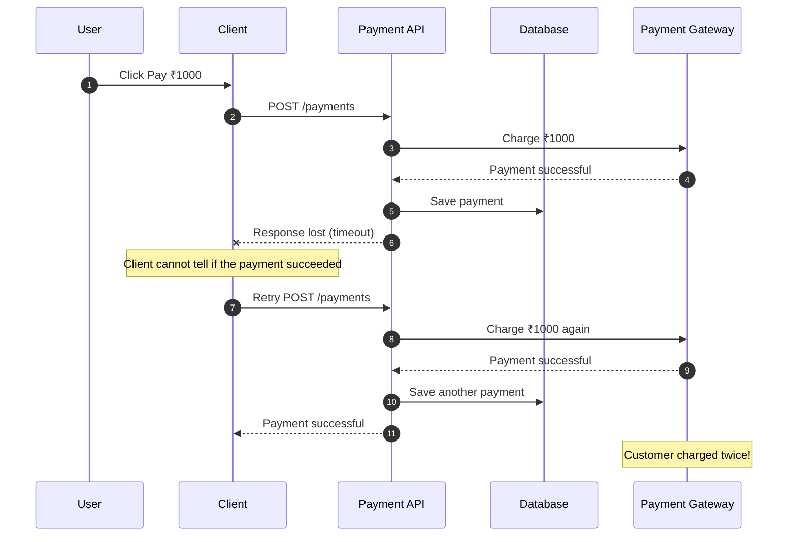
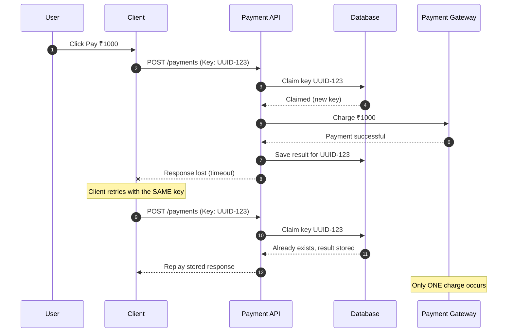
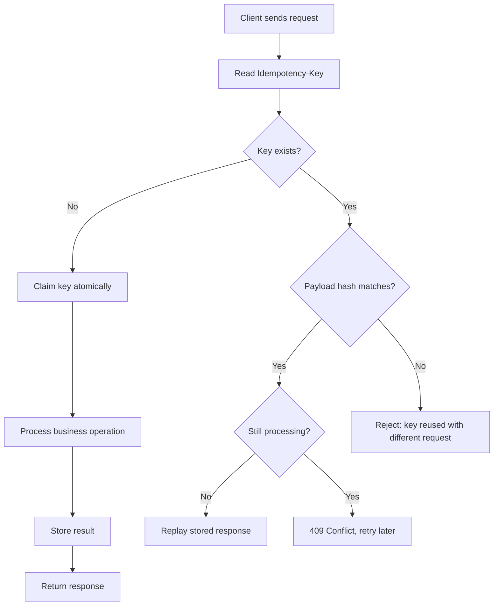
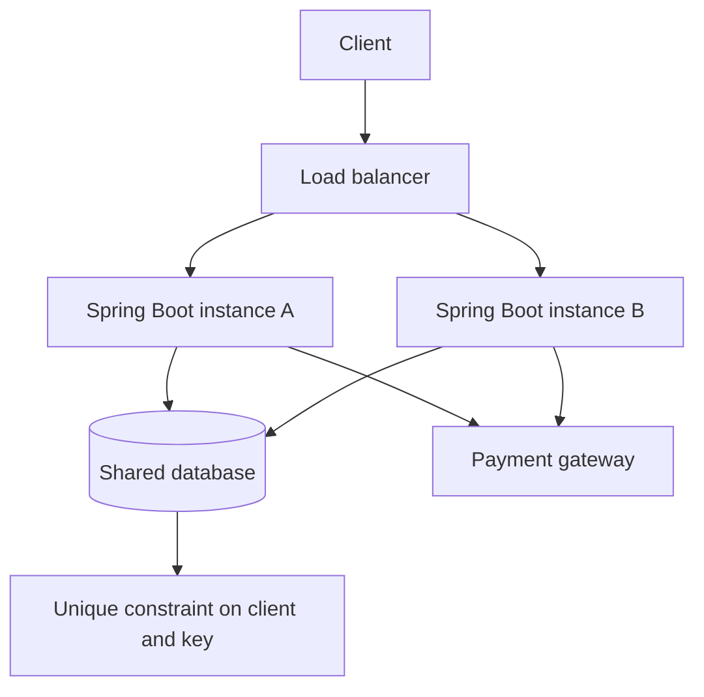
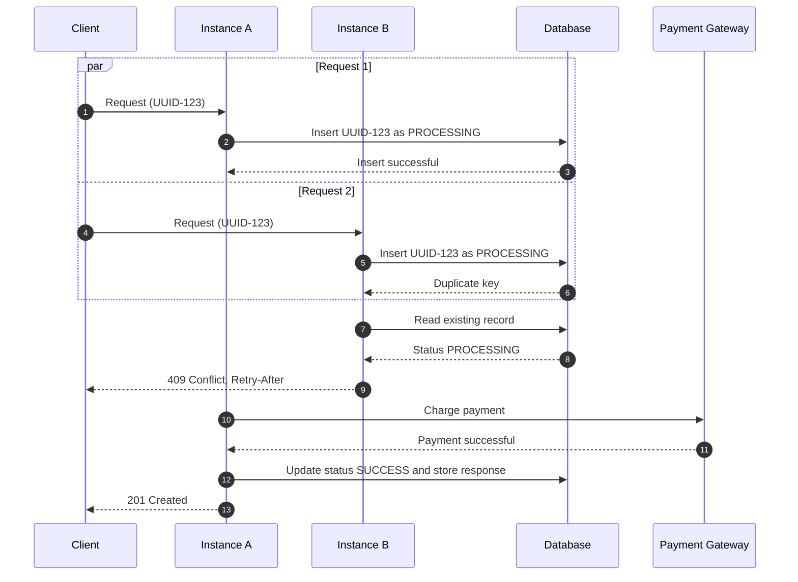
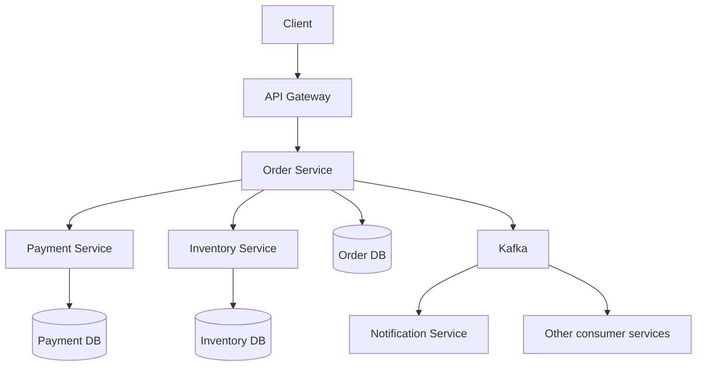

# Idempotency (One Key, One Charge)

> **Reading path:** what it is → why it matters → HTTP methods → Idempotency-Key → database design → concurrency → Spring Boot → client retries → Kafka and microservices → failure recovery → interview Q&A → checklist.

<details open>
<summary><strong>1. What is idempotency?</strong></summary>

**Idempotency** is a property of an operation: running it N > 0 times leaves the system in the same state as running it once ([RFC 9110, Section 9.2.2](https://www.rfc-editor.org/rfc/rfc9110#section-9.2.2)). It makes retries safe, especially when the first request gets no response because of a network error ([Stripe: idempotent requests](https://docs.stripe.com/api/idempotent_requests)).

In simple words: **however many times the same request is submitted, the business operation happens only once.**

Example: a user taps **Pay** three times because the app is slow.

| | Without idempotency | With idempotency |
|---|---|---|
| Request 1 | Deducts ₹1,000 | Deducts ₹1,000 |
| Request 2 | Deducts another ₹1,000 | Returns the stored response |
| Request 3 | Deducts another ₹1,000 | Returns the stored response |
| Total charged | ₹3,000 | ₹1,000 |

**Idempotent does not mean "same response".** The effect on server state is what matters:

```http
DELETE /orders/42   ->  204 No Content   (order deleted)
DELETE /orders/42   ->  404 Not Found    (already gone; server state is unchanged)
```

### Core concepts

1. **Request identity:** identify repeats with a unique key, such as `Idempotency-Key`.
2. **Single execution:** run the business operation once per key.
3. **Stored outcome:** save the response and replay it for duplicates.
4. **Safe retry:** clients can retry after timeouts and network errors.

### Real-world examples

Payment processing, order creation, money transfers, ticket booking, subscription creation and webhook processing.

</details>

<details>
<summary><strong>2. Why do we need idempotency?</strong></summary>

## The real-world problem

A client sends a payment request. The server processes the payment, but the response never reaches the client because of a network timeout. The client cannot tell whether the payment succeeded or failed, so it retries.

<table>
<thead><tr><td><strong>Without idem potency</strong></td><td><strong>With idempotency</strong></td></tr></thead>
<tbody>

<tr><td>



</td><td>



</td></tr>

<tr><td><strong>Problem:</strong> the first request succeeded, but the client never saw the response. The retry created a second payment.</td><td><strong>Solution:</strong> the server recognizes the repeated request by its idempotency key and replays the stored result. The payment is not processed again.</td></tr>

</tbody>
</table>


### Important rule

A retry must use the **same idempotency key**. If the client generates a new UUID for every retry, the server treats each request as a new operation.

</details>

<details>
<summary><strong>3. HTTP methods: safe vs idempotent</strong></summary>

A **safe** method does not change server state. An **idempotent** method can change state, but repeating it has the same effect as calling it once. Every safe method is idempotent, but not the other way round.

| Method | Safe | Idempotent | Explanation |
|---|:-:|:-:|---|
| `GET`, `HEAD` | Yes | Yes | Read-only. `HEAD` is `GET` without the response body. |
| `OPTIONS`, `TRACE` | Yes | Yes | Not expected to have side effects. |
| `PUT` | No | Yes | Replaces the resource with the given representation. |
| `DELETE` | No | Yes | State is the same after the first call. The response may differ. |
| `POST` | No | **No** | Repeated requests may create multiple resources or transactions. |
| `PATCH` | No | **Depends** | Idempotent only if the patch is absolute (`set city`), not relative (`add 1000`). |
| `CONNECT` | No | No | Tunnel setup. |

RFC 2616, Section 9.1.2 ([original text](https://www.rfc-editor.org/rfc/rfc2616#section-9.1.2)) made the same statement for `GET`, `HEAD`, `PUT` and `DELETE`, and added that `OPTIONS` and `TRACE` should have no side effects. It is obsolete and was replaced by [RFC 9110](https://www.rfc-editor.org/rfc/rfc9110#section-9.2.2).

A client may automatically retry a request after a connection failure only if the method is idempotent. For `POST`, it needs an idempotency key.

### GET example

```http
GET /users/101
```

Calling this many times does not change the user's data.

### PUT example

```http
PUT /users/101
Content-Type: application/json

{
  "name": "Yashwanth",
  "city": "Hyderabad"
}
```

Repeating the same request leaves the user in the same final state.

### DELETE example

```http
DELETE /users/101
```

The first request deletes the resource. Repeating it does not delete anything else. The status code may differ (`204`, then `404`), but the server state is the same.

### POST example

```http
POST /payments
Content-Type: application/json

{
  "amount": 1000,
  "currency": "INR"
}
```

Calling this several times may create several payments. That is why `POST` endpoints for critical operations implement idempotency explicitly.

### PATCH examples

**Idempotent `PATCH`:**

```http
PATCH /users/101
Content-Type: application/json

{
  "city": "Hyderabad"
}
```

Setting the city to Hyderabad repeatedly gives the same final state.

**Non-idempotent `PATCH`:**

```http
PATCH /accounts/101
Content-Type: application/json

{
  "operation": "incrementBalance",
  "amount": 1000
}
```

Repeating this increases the balance each time.

### Important interview point

HTTP method idempotency describes the intended effect on server state, not whether every response is identical.

</details>

<details>
<summary><strong>4. What is an Idempotency-Key?</strong></summary>

An idempotency key is a unique identifier, usually a UUID v4, generated by the client to identify one logical business operation. The client sends the same key on every attempt of that operation.

```http
POST /api/payments HTTP/1.1
Host: api.example.com
Content-Type: application/json
Idempotency-Key: 550e8400-e29b-41d4-a716-446655440000

{
  "customerId": 101,
  "amount": 1000,
  "currency": "INR"
}
```

### How it works

1. The client generates a UUID.
2. The client sends it in the `Idempotency-Key` request header.
3. The server atomically claims the key (see sections 5 and 6).
4. If the claim succeeds, the server processes the operation.
5. The server stores the outcome (status code and body) with the key.
6. If the same key arrives again with the same payload, the server replays the stored outcome.
7. The business operation is not executed again.

**Accepting the header does not make an operation idempotent.** The key must be stored together with the operation's outcome.

### Attempt table

| Attempt | Same key? | Same body? | Server behaviour | Response |
|---:|:-:|:-:|---|---|
| 1 | New | n/a | Executes the payment and stores the outcome | `201 Created` |
| 2 (retry after timeout) | Yes | Yes | Does **not** execute again; replays the stored response | `201 Created` (same body) |
| 3 (key reused by mistake) | Yes | **No** | Rejects the request | `422` or `409` (see below) |
| 4 (retry while attempt 1 is still running) | Yes | Yes | Rejects the request | `409 Conflict` |

### Flow diagram



### Same key, same request

The server must also check that the payload matches the original request.

First request:

```json
{ "amount": 1000, "currency": "INR" }
```

Second request with the same key:

```json
{ "amount": 5000, "currency": "INR" }
```

This is **not** a valid retry. The same key is being reused for a different operation, so the server rejects it. The usual approach is to store a request fingerprint, such as a SHA-256 hash of the endpoint and canonical body, and compare it on every repeat.

### Status codes for key misuse

Conventions differ:

- Stripe reports a key reused on a request that doesn't match the original endpoint and parameters as an [`idempotency_error`](https://docs.stripe.com/error-low-level#idempotency). Its status table lists `409 Conflict` for requests that conflict with another request, possibly because of the same key.
- The IETF [Idempotency-Key header draft](https://datatracker.ietf.org/doc/draft-ietf-httpapi-idempotency-key-header/) suggests `422` for a payload mismatch and `409` for a request still in progress. It is a draft, so check its current status.

Pick one convention and document it. Example error body:

```json
{
  "code": "IDEMPOTENCY_KEY_REUSED",
  "message": "Idempotency-Key was already used with different request parameters."
}
```

### Resolving the ID (example)

If your service accepts several identifiers, define the priority order explicitly. Example, adjust to your service:

1. `Idempotency-Key` request header
2. `X-Correlation-ID` request header
3. A business ID in the request body, such as `orderId`
4. A generated ID (only for operations that are naturally idempotent)

</details>

<details>
<summary><strong>5. Database design for idempotency</strong></summary>

Idempotency must work when several application instances are running. A local `HashMap` or in-memory cache is not enough.

Consider two Spring Boot instances:

- Request 1 reaches Instance A and request 2 reaches Instance B.
- Both check their local memory and find no key.
- Both process the payment, which creates a duplicate.

### Distributed architecture



Both instances must coordinate through shared durable storage, or an equivalent atomic mechanism such as a Redis `SET NX`.

### Suggested table (PostgreSQL syntax)

```sql
CREATE TABLE idempotency_records (
    id               BIGINT GENERATED ALWAYS AS IDENTITY PRIMARY KEY,
    client_id        VARCHAR(64)  NOT NULL,
    idempotency_key  VARCHAR(255) NOT NULL,
    request_hash     CHAR(64)     NOT NULL,   -- SHA-256 hex of endpoint + canonical body
    status           VARCHAR(16)  NOT NULL,   -- PROCESSING | SUCCESS | FAILED | UNKNOWN
    response_status  INTEGER,
    response_body    TEXT,
    created_at       TIMESTAMP    NOT NULL DEFAULT CURRENT_TIMESTAMP,
    updated_at       TIMESTAMP,
    expires_at       TIMESTAMP,

    CONSTRAINT uk_idempotency_scope UNIQUE (client_id, idempotency_key)
);
```

| Column | Purpose |
|---|---|
| `client_id` | Scopes the key, so two clients cannot collide |
| `idempotency_key` | Unique request identifier within that scope |
| `request_hash` | Fingerprint of the original request |
| `status` | `PROCESSING`, `SUCCESS`, `FAILED` or `UNKNOWN` |
| `response_status` | Stored HTTP status to replay |
| `response_body` | Stored response to replay |
| `created_at`, `updated_at` | Audit and cleanup |
| `expires_at` | Retention limit (see section 11) |

### Why a unique constraint?

Two requests arrive at the same time and both run:

```sql
SELECT * FROM idempotency_records
WHERE client_id = 'C-1' AND idempotency_key = 'UUID-123';
```

Both find nothing and both try to insert. The unique constraint lets exactly one insert succeed. The other gets a duplicate-key error and must read the existing record.

**Never depend only on `SELECT` followed by `INSERT`.** That pattern has a race condition. Insert first, and treat the duplicate-key error as the signal that the key is taken.

</details>

<details>
<summary><strong>6. Handling concurrent duplicate requests</strong></summary>

A user double-clicks **Pay** and both requests reach the server almost together.



### Recommended approach

Use a database uniqueness constraint together with an explicit state machine:

```text
PROCESSING  ->  SUCCESS
            ->  FAILED
            ->  UNKNOWN   (timeout or uncertain result, see section 12)
```

| Status | Server behaviour |
|---|---|
| No record | Claim the key and start processing. |
| `PROCESSING` | Return an in-progress response, or wait for completion. |
| `SUCCESS` | Replay the stored status and body. |
| `FAILED` | Replay the stored failure, or apply your documented retry policy. |
| `UNKNOWN` | Treat as in progress until reconciliation resolves it. |

### What response for an in-progress request?

```http
HTTP/1.1 409 Conflict
Content-Type: application/json
Retry-After: 2
```

```json
{
  "status": "PROCESSING",
  "message": "A request with this idempotency key is already being processed."
}
```

Another valid design is `202 Accepted` with an operation-status URL.

### What response for a completed operation?

**Replay the original status code and body**, not a generic `200`. If the first call returned `201 Created`, the replay returns `201 Created` with the same body:

```http
HTTP/1.1 201 Created
Content-Type: application/json
```

```json
{
  "paymentId": "PAY-101",
  "status": "SUCCESS",
  "amount": 1000,
  "currency": "INR"
}
```

</details>

<details>
<summary><strong>7. Java Spring Boot implementation</strong></summary>

The flow is: **claim the key, call the gateway outside any DB transaction, then store the outcome.**

### Step 1: Controller

```java
@PostMapping("/payments")
public ResponseEntity<?> createPayment(
        @RequestHeader("Idempotency-Key") String idempotencyKey,
        @RequestBody PaymentRequest request,
        @AuthenticationPrincipal Client client) {

    return paymentService.createPayment(client.id(), idempotencyKey, request);
}
```

### Step 2: Service

This is an illustration, not production code. `store`, `gateway`, `requestHash`, `serialize` and `error` are placeholders for your own classes.

The service method is deliberately **not** `@Transactional`. Each `store` call commits on its own, so the claim is visible to other instances immediately, and the slow gateway call does not hold a DB transaction open.

```java
public ResponseEntity<?> createPayment(String clientId, String key, PaymentRequest request) {

    String hash = requestHash("POST /payments", request);

    // 1. Claim the key. The unique constraint lets only one caller win.
    try {
        store.claim(clientId, key, hash);                 // INSERT ... status = PROCESSING
    } catch (DuplicateKeyException duplicate) {
        return replayOrReject(clientId, key, hash);
    }

    // 2. Call the gateway outside any DB transaction,
    //    passing the same key as the provider-level idempotency key.
    try {
        PaymentResult result = gateway.charge(request, key);
        String body = serialize(result);

        // 3. Store the outcome so duplicates can replay it.
        store.complete(clientId, key, HttpStatus.CREATED.value(), body);
        return ResponseEntity.status(HttpStatus.CREATED).body(result);

    } catch (GatewayDeclinedException declined) {         // definitive failure
        store.fail(clientId, key, HttpStatus.UNPROCESSABLE_ENTITY.value(), declined.body());
        return ResponseEntity.unprocessableEntity().body(declined.body());

    } catch (GatewayTimeoutException timeout) {           // outcome unknown
        store.markUnknown(clientId, key);                 // reconciliation job resolves it
        return ResponseEntity.status(HttpStatus.ACCEPTED)
                .body(error("PAYMENT_OUTCOME_UNKNOWN"));
    }
}

private ResponseEntity<?> replayOrReject(String clientId, String key, String hash) {
    IdempotencyRecord r = store.get(clientId, key);

    if (!r.getRequestHash().equals(hash)) {
        return ResponseEntity.unprocessableEntity()       // or 409, per your convention
                .body(error("IDEMPOTENCY_KEY_REUSED"));
    }

    return switch (r.getStatus()) {
        case PROCESSING, UNKNOWN -> ResponseEntity.status(HttpStatus.CONFLICT)
                .header("Retry-After", "2")
                .body(error("REQUEST_IN_PROGRESS"));
        case SUCCESS, FAILED -> ResponseEntity.status(r.getResponseStatus())
                .body(r.getResponseBody());               // replay the original response
    };
}
```

### Production considerations

1. Use a unique constraint scoped to the client and the key.
2. Handle duplicate-key exceptions as a normal path, not an error.
3. Never call an external payment gateway inside a DB transaction while assuming the database can roll the payment back.
4. Store the payment provider's transaction reference.
5. Handle network timeouts and unknown payment outcomes (status `UNKNOWN`).
6. Pass the same key to the provider whenever it supports idempotency.
7. Make sure concurrent requests cannot execute the same business operation.
8. Add a cleanup or recovery job for records stuck in `PROCESSING`.

### Database transaction vs external payment

A database transaction cannot roll back a payment the gateway has already completed:

```text
Spring Boot
    |
    |-- Call payment gateway
    |       |
    |       |-- Payment successful
    |
    |-- Database update failed
```

The payment succeeded but the database update failed. The application must reconcile this state, not charge again. See the compensating action table in section 12.

</details>

<details>
<summary><strong>8. Client retries: exponential backoff with jitter</strong></summary>

Retry only when the failure is transient, and **reuse the same `Idempotency-Key`** on every attempt.

| Outcome | Retry? |
|---|---|
| Timeout, connection reset | Yes |
| `408`, `429`, `502`, `503`, `504` | Yes (honor `Retry-After` if present) |
| `500` | Only with an idempotency key |
| `409` (request in progress) | Yes, after a delay |
| Other `4xx` (`400`, `401`, `403`, `404`, `422`) | No. Fix the request first. |

Do not retry non-idempotent operations unless they have an idempotency mechanism.

Without jitter, many clients that failed together retry together and overload the recovering server (the thundering herd problem, [illustrated by Stripe](https://stripe.com/blog/idempotency)). Full jitter spreads the retries:

```java
private static final long BASE_MS = 200;
private static final long CAP_MS  = 10_000;

long delayMs = ThreadLocalRandom.current()
        .nextLong(0, Math.min(CAP_MS, BASE_MS * (1L << Math.min(attempt, 20))));
Thread.sleep(delayMs);
```

The `Math.min(attempt, 20)` stops the shift from overflowing on a large attempt count. Also cap the total number of attempts.

</details>

<details>
<summary><strong>9. Idempotency in microservices and Kafka</strong></summary>

In microservices, one business operation can touch several services:

```text
Order Service -> Payment Service -> Inventory Service -> Notification Service
```

If a request or message is delivered more than once, downstream services must not repeat the business operation.



### Idempotent Kafka consumers

A publisher may send the same event more than once after a failure, and Kafka consumers can receive the same event again after a crash. Consumers must deduplicate by `eventId`, or make updates naturally idempotent.

```json
{
  "eventId": "EVT-101",
  "eventType": "PAYMENT_COMPLETED",
  "orderId": "ORD-101",
  "paymentId": "PAY-101"
}
```

```sql
CREATE TABLE processed_events (
    event_id     VARCHAR(100) PRIMARY KEY,
    processed_at TIMESTAMP NOT NULL DEFAULT CURRENT_TIMESTAMP
);
```

Processing order:

```text
1. Receive the Kafka event.
2. Begin a database transaction.
3. INSERT the eventId into processed_events.
   - Duplicate-key error -> already processed: roll back, skip, acknowledge.
4. Apply the business change in the same transaction.
5. Commit the transaction.
6. Acknowledge (commit the offset of) the Kafka message.
```

Inserting first, instead of "check, then insert", avoids a race between two consumer instances. Because the insert and the business update commit together, a crash rolls back both and the redelivered event is processed normally.

```java
@Transactional
public void handle(PaymentEvent event) {
    try {
        processedEventRepo.insert(event.eventId());   // duplicate key = already handled
    } catch (DuplicateKeyException e) {
        return;                                       // skip the duplicate
    }
    orderService.markPaid(event.orderId());           // same transaction as the insert
}
```

### Important interview point

Kafka delivery and database transactions are separate concerns. Kafka's exactly-once features do not automatically give exactly-once effects in an external database or payment gateway. For reliable processing, use:

- Idempotent consumers.
- Unique event IDs.
- Database uniqueness constraints.
- A transactional outbox where appropriate.
- Retry and dead-letter handling.

</details>

<details>
<summary><strong>10. Idempotency vs exactly-once processing</strong></summary>

These concepts are related, but not the same.

| Concept | Meaning |
|---|---|
| Idempotency | Repeating an operation leaves the same final business state as running it once. |
| At-most-once | An operation runs zero or one time. Messages may be lost. |
| At-least-once | An operation is retried until it succeeds, so duplicates are possible. |
| Exactly-once effect | The business effect is applied once, despite retries or duplicate deliveries. |

### Example

A Kafka consumer receives `PAYMENT_COMPLETED`, updates the database, then crashes before acknowledging. Kafka delivers the event again.

Without idempotency:

```text
First delivery  -> update account balance
Second delivery -> update account balance again
```

With idempotency:

```text
First delivery  -> update account balance
Second delivery -> detect processed event and skip
```

The business effect happens once.

**Senior-level understanding:** exactly-once business effects usually come from at-least-once delivery combined with idempotency, durable state, atomic database operations and coordination with external systems. Don't assume them just because a messaging platform offers exactly-once features.

</details>

<details>
<summary><strong>11. Idempotency key scope and expiration</strong></summary>

### How long should keys be stored?

Not necessarily forever. The retention period depends on the business operation.

| Operation | Possible retention strategy |
|---|---|
| Payment | Based on the payment provider and the business retry window. |
| Order creation | Until the order retry and reconciliation window ends. |
| Webhook processing | Retain event IDs according to the provider's retry policy. |
| Inventory reservation | According to the reservation lifecycle. |

Stripe says keys can be removed automatically once they are at least 24 hours old, but check its [docs](https://docs.stripe.com/api/idempotent_requests) for the current window. Choose a retention period longer than your clients' maximum retry window.

### What happens after expiration?

If the key is deleted after 24 hours and the client retries after 48 hours, the server treats it as a new operation. For financial operations this can be dangerous, so:

- Choose retention from business requirements.
- Consider longer retention for financial transactions.
- Keep permanent transaction references where necessary.
- Don't rely on expiration alone to prevent duplicate payments.

### Key scope

Scope the key so unrelated customers or operations cannot share a request identity:

```text
clientId (or customerId) + operationType + idempotencyKey
```

The database unique constraint must match the chosen scope.

</details>

<details>
<summary><strong>12. Failure scenarios and recovery</strong></summary>

| Scenario | Expected behaviour |
|---|---|
| Client timeout | Retry with the same key. |
| Duplicate request | Return the stored result, or the in-progress status. |
| Same key, different payload | Reject the request. |
| Two requests arrive simultaneously | Only one claims the operation. |
| Server crashes during processing | Recover or reconcile the `PROCESSING` state. |
| Payment succeeds, DB update fails | Reconcile using the provider's transaction reference. |
| Kafka event delivered twice | Process the business event once. |
| Database unavailable | Don't process a duplicate-sensitive operation unprotected. |
| Idempotency record expires | Apply the defined retention and recovery policy. |

### What if the server crashes after claiming the key?

```text
1. Request arrives.
2. Idempotency key is stored as PROCESSING.
3. Server calls the payment gateway.
4. Server crashes.
5. Client retries.
```

The system must now find out whether the payment happened. Options:

- Query the payment provider using its transaction reference.
- Retry the provider call with the same provider-level idempotency key.
- Run a reconciliation job.
- Keep a recoverable operation state.
- Don't treat stale `PROCESSING` records as failed without checking.

### State transitions


**Important:** a timeout does not always mean the operation failed. It may mean the result is unknown.

### Compensating action table

Some steps cannot be rolled back by a database transaction. Record a compensating action for each one:

| Step that succeeded | Step that failed | Compensating action |
|---|---|---|
| Payment captured | Order update failed | Retry the order update from the stored provider reference. If it still fails, refund or void the payment. |
| Inventory reserved | Payment failed | Release the reservation. |
| Order created | Payment unknown | Keep the order `PENDING` until reconciliation resolves the payment. |

</details>

<details>
<summary><strong>13. Idempotency vs rate limiting vs debouncing</strong></summary>

| Feature | Purpose | Example |
|---|---|---|
| Idempotency | Prevent duplicate business effects. | Charge a customer only once. |
| Rate limiting | Restrict the number of requests in a time period. | Allow 100 requests per minute. |
| Debouncing | Delay execution until repeated user actions stop (usually in the client). | Search after the user stops typing. |
| Throttling | Restrict how often an action executes. | Allow one operation per second. |

### Can rate limiting replace idempotency?

No. If a payment endpoint allows one request per second, a client can still send another request after one second, and both can create separate payments.

Rate limiting protects system resources. Idempotency protects business operations. For critical operations, use both.

</details>

<details>
<summary><strong>14. Senior Java interview questions and answers</strong></summary>

### Q1. What is idempotency, and why does it matter in REST APIs?

**Answer:**

Idempotency means executing the same operation multiple times has the same effect on system state as executing it once. It matters when clients retry because of network failures or timeouts. In a payment application, if a user clicks Pay several times, we must not deduct money several times. We achieve this with idempotency keys and durable storage.

**Interviewer expects:** a clear definition, a real payment example, understanding of safe retries, and the difference between idempotent and non-idempotent operations.

---

### Q2. How would you prevent duplicate payments in a microservices architecture?

**Answer:**

Generate a unique idempotency key per payment operation. The client sends it in a header. The payment service claims the key in a shared database with a unique constraint, and if the key already exists it returns the stored result instead of charging again. For external gateways, pass the same key if the provider supports it.

**Interviewer expects:** UUID-based identification, database uniqueness, concurrency handling, provider integration, recovery and reconciliation.

---

### Q3. Why is an in-memory `HashMap` not enough?

**Answer:**

Microservices run several instances, each with its own memory. One request can reach Instance A and another Instance B, and both think the request is new. Use a shared database or a distributed atomic mechanism. A database unique constraint reliably blocks concurrent duplicate inserts.

**Interviewer expects:** distributed-systems understanding, race conditions, shared storage.

---

### Q4. What happens if two identical requests arrive simultaneously?

**Answer:**

With `SELECT` followed by `INSERT`, both can proceed. Instead, insert first under a unique constraint. Only one insert succeeds. The other gets a duplicate-key error and returns the existing operation status or response.

**Interviewer expects:** race conditions, database-level uniqueness, atomic operations.

---

### Q5. What if the same key is used with a different payload?

**Answer:**

Store a request fingerprint (a hash of the endpoint and canonical body) with the key. When the key arrives again, compare hashes. If they differ, reject the request, typically with `422` or `409`, because the key is being reused for a different operation.

**Interviewer expects:** request fingerprinting, validation, conflict handling.

---

### Q6. What if the payment succeeds but the database update fails?

**Answer:**

The gateway and our database don't share a transaction. Store the operation state and the provider reference, reconcile using that reference, and use the provider's idempotency support so recovery cannot charge twice.

**Interviewer expects:** distributed transaction limits, reconciliation, provider idempotency, compensating actions.

---

### Q7. Is `POST` always non-idempotent?

**Answer:**

`POST` is not idempotent by default, but an endpoint can be designed to be. A payment API that accepts an `Idempotency-Key` and replays the stored result for duplicates is idempotent in effect. So idempotency depends on the implementation, not only the HTTP method.

**Interviewer expects:** HTTP semantics, API design, practical implementation knowledge.

---

### Q8. Is `PATCH` idempotent?

**Answer:**

It depends on the operation. Setting a field to a value (`city = Hyderabad`) is idempotent. Incrementing a balance is not, because each repeat changes the result.

**Interviewer expects:** understanding of set vs modify semantics.

---

### Q9. How do you handle idempotency in Kafka consumers?

**Answer:**

Give every event a unique ID. In one database transaction, insert the event ID into a processed-events table and apply the business update. A duplicate-key error means the event was already handled, so skip it. Commit the offset after the transaction commits.

**Interviewer expects:** at-least-once delivery, duplicate handling, processed-events table, transactions, outbox awareness.

---

### Q10. What is the difference between idempotency and exactly-once processing?

**Answer:**

Idempotency ensures repeating an operation adds no further business effect. Exactly-once processing means the intended effect is applied once even with retries or duplicate deliveries. In distributed systems the second usually requires the first, plus durable storage, atomic operations and recovery.

**Interviewer expects:** at-least-once delivery, exactly-once semantics, business-level consistency.

---

### Q11. How long should an idempotency key be stored?

**Answer:**

It depends on the business operation and retry window. For payments, follow the provider's policy and business requirements, and don't delete too early, because a delayed retry could create another payment. Keep permanent transaction references for reconciliation.

**Interviewer expects:** retention policy, business requirements, data lifecycle.

---

### Q12. What if the server crashes while the request is `PROCESSING`?

**Answer:**

Don't mark it failed straight away, because the external operation may have succeeded. Use a recovery job to query the provider's transaction status, then move the record to `SUCCESS` or `FAILED`. If the result is still unknown, keep it in a recoverable `UNKNOWN` state and never blindly charge again.

**Interviewer expects:** failure recovery, state management, unknown outcomes, reconciliation.

</details>

<details>
<summary><strong>15. Production implementation checklist</strong></summary>

### API design
- [ ] Generate a UUID for every new business operation.
- [ ] Send the key in an HTTP request header.
- [ ] Reuse the same key for retries.
- [ ] Reject missing or invalid keys where required.
- [ ] Validate that repeated requests have the same payload.
- [ ] Replay the original status code and body for duplicates.

### Database
- [ ] Store keys in durable shared storage.
- [ ] Add a unique constraint that matches the key scope.
- [ ] Store request fingerprints.
- [ ] Store operation status, including `UNKNOWN`.
- [ ] Store the original response.
- [ ] Define a retention policy.

### Concurrency
- [ ] Handle simultaneous duplicate requests.
- [ ] Use an atomic insert or claim.
- [ ] Handle unique constraint violations as a normal path.
- [ ] Avoid relying only on `SELECT` followed by `INSERT`.
- [ ] Don't hold a DB transaction open during the gateway call.

### Retries
- [ ] Retry with exponential backoff and jitter.
- [ ] Reuse the same key on every attempt.
- [ ] Cap the number of attempts and the maximum delay.
- [ ] Honor `Retry-After`.

### Microservices
- [ ] Handle duplicate Kafka events with an idempotent consumer.
- [ ] Maintain unique event IDs.
- [ ] Insert the event ID in the same transaction as the business update.
- [ ] Use a transactional outbox where appropriate.
- [ ] Handle retries and dead-letter queues.

### Failure handling
- [ ] Handle client timeouts.
- [ ] Handle application crashes and stuck `PROCESSING` records.
- [ ] Handle database failures.
- [ ] Handle external gateway failures.
- [ ] Keep a compensating action table.
- [ ] Reconcile unknown payment outcomes.
- [ ] Avoid duplicate external transactions.

</details>

<details>
<summary><strong>16. Final interview summary: explain in 60 seconds</strong></summary>

**Question: Explain idempotency with a real-world example.**

Idempotency means performing the same operation several times has the same effect on state as performing it once.

Take a payment app where the user clicks Pay and the request times out. The payment may have succeeded on the server while the response never reached the client. If the client retries without idempotency, the customer can be charged twice.

To prevent this, the client generates a unique UUID and sends it in an `Idempotency-Key` header. The server claims the key in a shared database using a unique constraint. If it is new, we process the payment and store the result. If the same request comes again, we return the stored response instead of charging again. If the same key arrives with a different payload, we reject it.

In a microservices environment, the unique constraint also handles concurrent requests across several application instances. For Kafka consumers, I use unique event IDs and a processed-events table, written in the same transaction as the business update. On the client side, I retry with exponential backoff and jitter, reusing the same key.

**The main goal is simple: one business operation should produce one business effect, even when the request is retried several times.**

</details>

---

## Related CodeTrove topics

- [Timeouts and Retries](/content/tree/api-integration/resilience/timeouts-retries)
- [Rate Limiting](/content/tree/api-integration/resilience/rate-limiting)
- [API Gateway and Idempotency Implementation](/content/tree/interview-prep/microservices/project-flow/api-gateway-idempotency/api-gateway-idempotency)