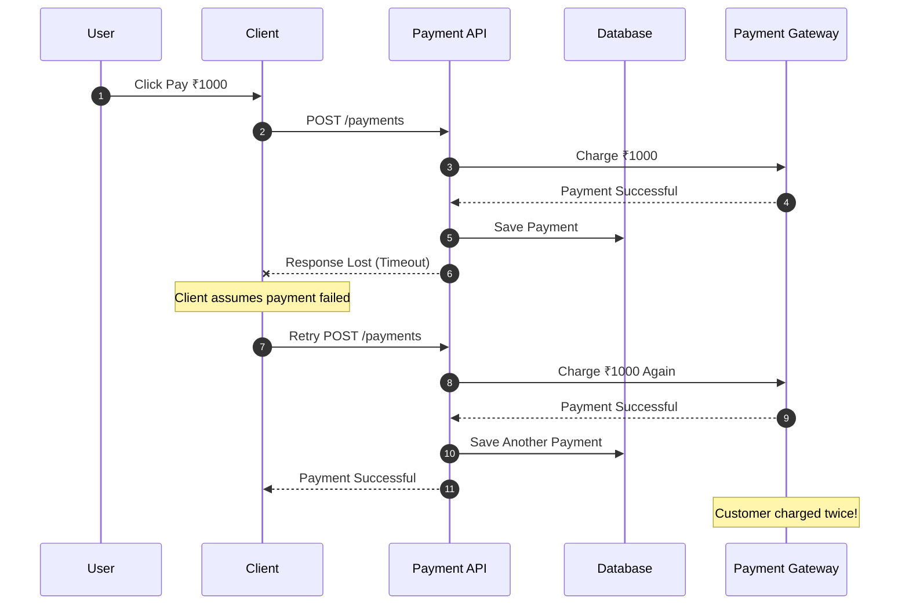
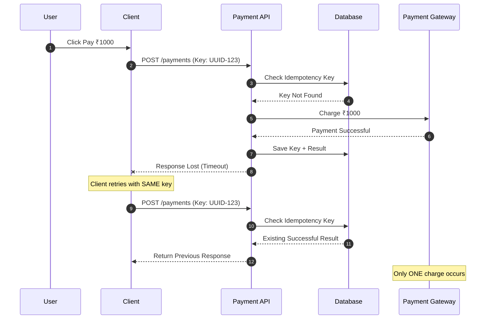
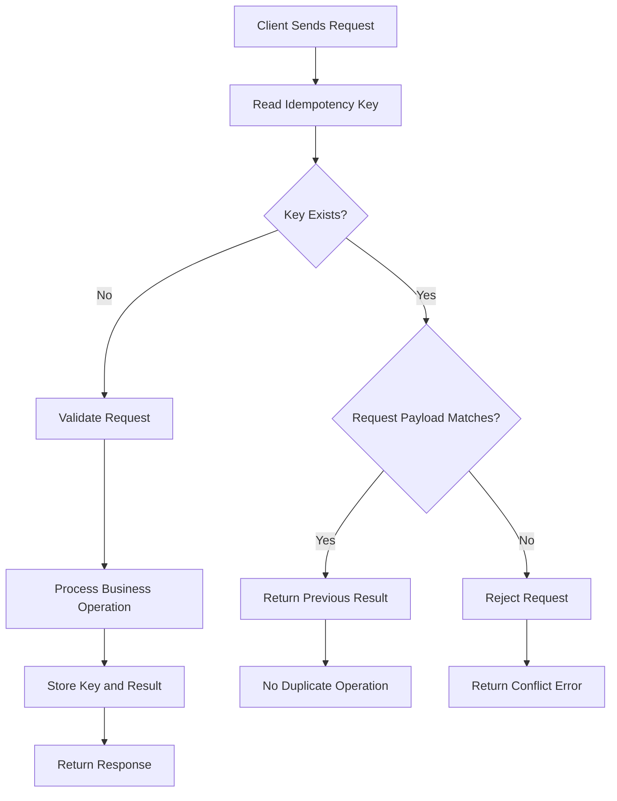
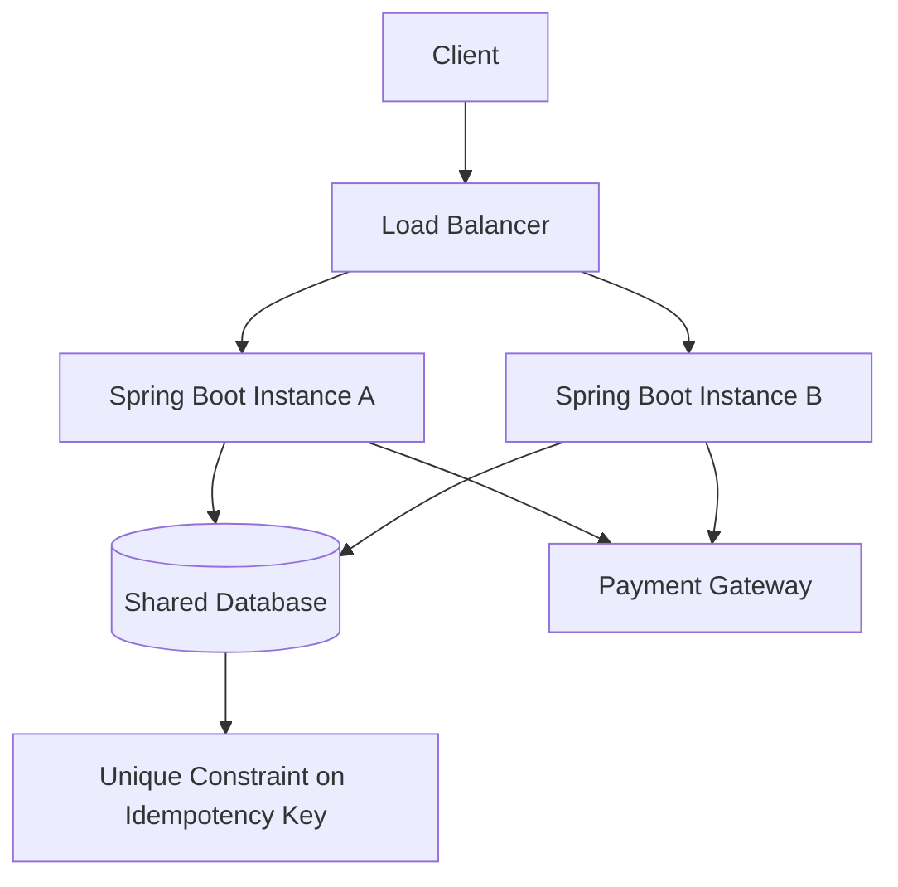
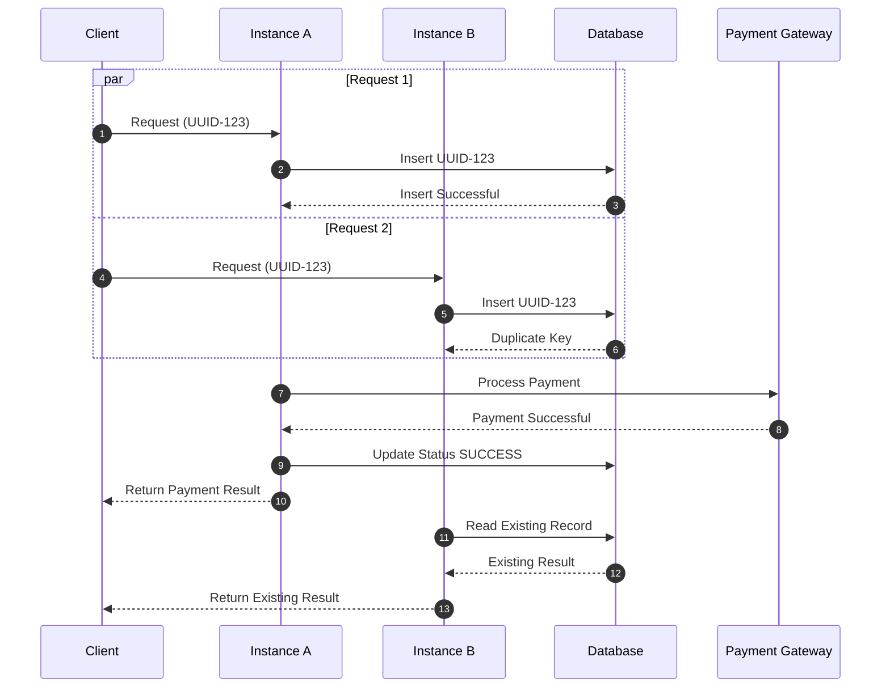
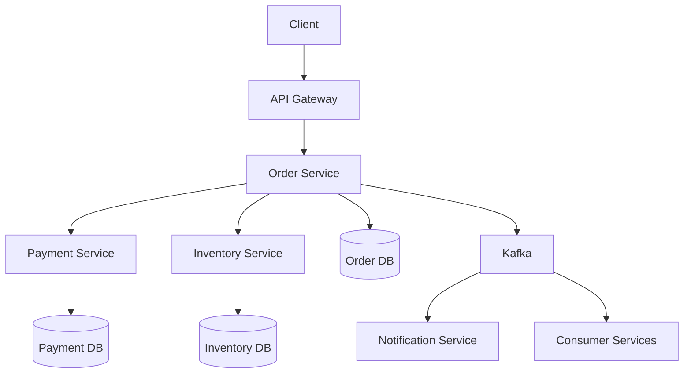
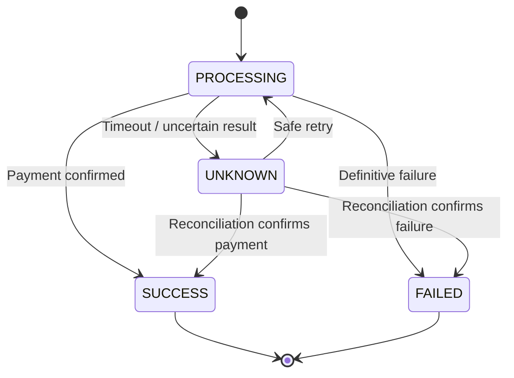

# Idempotency (One Key, One Charge)

<details open>
<summary><strong>1. What is Idempotency?</strong></summary>

## Definition

Idempotency is a property of an operation where executing the same operation multiple times produces the same final result as executing it once.

In simple words:

**No matter how many times the same request is submitted, the business operation should happen only once.**

For example, imagine a user clicks the Pay button multiple times because the application is slow.

Without idempotency:
- First request deducts ₹1,000.
- Second request deducts another ₹1,000.
- Third request deducts another ₹1,000.

The customer gets charged three times.

With idempotency:
- First request deducts ₹1,000.
- Second request returns the previous response.
- Third request also returns the previous response.

The customer gets charged only once.

### Core Concept

1. **Same Request:** Identify repeated requests using a unique request identity.
2. **Single Execution:** Execute the business operation only once.
3. **Same Result:** Return the previously stored result for duplicate requests.
4. **Safe Retry:** Allow clients to retry when network failures or timeouts occur.

### Real-World Examples

- Payment processing.
- Order creation.
- Money transfers.
- Ticket booking.
- Subscription creation.
- Webhook processing.

</details>

<details>
<summary><strong>2. Why Do We Need Idempotency?</strong></summary>

## The Real-World Problem

Consider a payment API.

The client sends a payment request to the server.

The server successfully processes the payment, but the response does not reach the client because of a network timeout.

The client cannot determine whether the payment succeeded or failed.

It retries the request.

### Without Idempotency



**Problem:** The first request was successful, but the client never received the response.

The retry created another payment.

### With Idempotency



**Solution:** The server recognizes the repeated request using its idempotency key and returns the previously stored result.

The payment is not processed again.

### Important Rule

A retry must use the **same idempotency key**.

If the client generates a new UUID for every retry, the server treats each request as a new operation.

</details>

<details>
<summary><strong>3. HTTP Methods and Idempotency</strong></summary>

HTTP methods have different idempotency characteristics.

| HTTP Method | Idempotent? | Explanation |
|---|---|---|
| GET | Yes | Reads data without changing server state. |
| HEAD | Yes | Same effect as GET, without returning the response body. |
| PUT | Yes | Replaces a resource with the specified representation. |
| DELETE | Yes | Repeating deletion does not create another deletion effect. |
| POST | Generally No | Repeated requests may create multiple resources or transactions. |
| PATCH | Depends | Depends on how the partial update is implemented. |

### GET Example

```http
GET /users/101
```

Calling this API multiple times does not change the user's data.

### PUT Example

```http
PUT /users/101
Content-Type: application/json

{
  "name": "Yashwanth",
  "city": "Hyderabad"
}
```

Calling the same request multiple times produces the same final user representation.

### DELETE Example

```http
DELETE /users/101
```

The first request deletes the resource.

Repeating the request does not delete another resource.

The response status may differ, but the intended server state remains the same.

### POST Example

```http
POST /payments

{
  "amount": 1000,
  "currency": "INR"
}
```

Calling this request multiple times may create multiple payments.

Therefore, POST APIs that perform critical business operations commonly implement idempotency explicitly.

### PATCH Example

PATCH idempotency depends on the operation.

**Idempotent PATCH:**

```http
PATCH /users/101

{
  "city": "Hyderabad"
}
```

Setting the city to Hyderabad repeatedly produces the same final state.

**Non-idempotent PATCH:**

```http
PATCH /accounts/101

{
  "operation": "incrementBalance",
  "amount": 1000
}
```

Repeating this operation increases the balance each time.

### Important Interview Point

HTTP method idempotency describes the intended effect on server state, not whether every response is identical.

For example, repeated DELETE requests can return different HTTP status codes while still being idempotent.

</details>

<details>
<summary><strong>4. What is an Idempotency Key?</strong></summary>

An idempotency key is a unique identifier generated by the client to identify a particular business operation.

Usually, UUID is used.

Example:

```http
POST /api/payments
Idempotency-Key: 550e8400-e29b-41d4-a716-446655440000
Content-Type: application/json

{
  "customerId": 101,
  "amount": 1000,
  "currency": "INR"
}
```

### How Does It Work?

1. Client generates a UUID.
2. Client sends the UUID in the request header.
3. Server checks whether the key already exists.
4. If the key does not exist, the server processes the operation.
5. Server stores the key and operation result.
6. If the same key arrives again, the server returns the stored result.
7. The business operation is not executed again.

### Flow Diagram



### Important: Same Key, Same Request

The server should also validate that the request payload matches the original request.

For example:

First request:

```json
{
  "amount": 1000,
  "currency": "INR"
}
```

Second request with the same key:

```json
{
  "amount": 5000,
  "currency": "INR"
}
```

This must not be treated as a valid retry.

The server should reject the request because the same idempotency key is being reused for a different business operation.

A common approach is to store a request fingerprint or payload hash.

</details>

<details>
<summary><strong>5. Database Design for Idempotency</strong></summary>

Idempotency must work even when multiple application instances are running.

A local Java HashMap or in-memory cache is not sufficient.

For example, consider two Spring Boot instances.

- Request 1 reaches Instance A.
- Request 2 reaches Instance B.
- Both instances check their local memory.
- Both find that the key does not exist.
- Both process the payment.

This creates a duplicate payment.

### Distributed Architecture



Both instances must coordinate through shared durable storage or an equivalent atomic mechanism.

### Suggested Database Table

```sql
CREATE TABLE idempotency_records (
    id BIGINT PRIMARY KEY GENERATED ALWAYS AS IDENTITY,
    idempotency_key VARCHAR(100) NOT NULL,
    request_hash VARCHAR(255) NOT NULL,
    status VARCHAR(30) NOT NULL,
    response_body TEXT,
    response_status INTEGER,
    created_at TIMESTAMP NOT NULL DEFAULT CURRENT_TIMESTAMP,
    updated_at TIMESTAMP,
    expires_at TIMESTAMP,

    CONSTRAINT uk_idempotency_key
        UNIQUE (idempotency_key)
);
```

### Important Columns

| Column | Purpose |
|---|---|
| id | Primary key |
| idempotency_key | Unique request identifier |
| request_hash | Identifies the original request payload |
| status | Processing, SUCCESS, FAILED |
| response_body | Previously generated response |
| response_status | Previously generated HTTP status |
| created_at | Record creation time |
| updated_at | Last status update |
| expires_at | Record expiration time |

### Why Unique Constraint?

Consider two requests arriving simultaneously.

Both execute:

```sql
SELECT *
FROM idempotency_records
WHERE idempotency_key = 'UUID-123';
```

Both may find no record.

Both may attempt to insert.

A database-level unique constraint ensures that only one insert succeeds.

The other request must handle the duplicate-key condition and retrieve the existing operation state.

**Never depend only on SELECT followed by INSERT.**

That pattern is vulnerable to race conditions.

</details>

<details>
<summary><strong>6. Handling Concurrent Duplicate Requests</strong></summary>

This is one of the most important topics in senior-level interviews.

Consider a user double-clicking the Pay button.

Both requests reach the server at almost the same time.

### Concurrent Request Problem



### Recommended Approach

Use a database uniqueness constraint combined with transactional state management.

Possible statuses:

```text
PROCESSING
SUCCESS
FAILED
```

### Handling Each Status

| Status | Server Behavior |
|---|---|
| No record | Claim the key and start processing. |
| PROCESSING | Return an in-progress response or wait for completion. |
| SUCCESS | Return the previously stored response. |
| FAILED | Apply the documented retry policy. |

### What HTTP Response Should We Return?

For an operation that is still processing:

```http
HTTP/1.1 409 Conflict
Content-Type: application/json
Retry-After: 2
```

```json
{
  "status": "PROCESSING",
  "message": "A request with this idempotency key is already being processed."
}
```

Another valid design is to return `202 Accepted` with an operation-status URL.

For a completed operation:

```http
HTTP/1.1 200 OK
```

```json
{
  "paymentId": "PAY-101",
  "status": "SUCCESS",
  "amount": 1000,
  "currency": "INR"
}
```

The response should represent the original operation.

</details>

<details>
<summary><strong>7. Java Spring Boot Implementation</strong></summary>

Let's understand how we can implement idempotency in a Spring Boot application.

### Step 1: Client Request

```java
@PostMapping("/payments")
public ResponseEntity<PaymentResponse> createPayment(
        @RequestHeader("Idempotency-Key") String idempotencyKey,
        @RequestBody PaymentRequest request) {

    PaymentResponse response =
            paymentService.createPayment(idempotencyKey, request);

    return ResponseEntity.ok(response);
}
```

### Step 2: Service Layer

The service coordinates the idempotency check and payment processing.

Conceptual example:

```java
@Transactional
public PaymentResponse createPayment(
        String key,
        PaymentRequest request) {

    String requestHash = generateRequestHash(request);

    IdempotencyRecord record =
            repository.findByIdempotencyKey(key).orElse(null);

    if (record != null) {

        if (!record.getRequestHash().equals(requestHash)) {
            throw new IdempotencyKeyConflictException(
                    "Idempotency key reused with different request");
        }

        if (record.isSuccess()) {
            return deserialize(record.getResponseBody());
        }

        if (record.isProcessing()) {
            throw new PaymentInProgressException();
        }
    }

    // Claim the key using an atomic database operation.
    // The database must enforce uniqueness.

    return processAndStorePayment(key, request, requestHash);
}
```

**Note:** This is a simplified illustration of the service flow, not a complete production implementation.

The initial lookup and subsequent insert must be coordinated atomically. Two requests can both pass the initial lookup before either inserts.

### Step 3: Store the Result

After successful payment processing:

```java
IdempotencyRecord record = new IdempotencyRecord();

record.setIdempotencyKey(key);
record.setRequestHash(requestHash);
record.setStatus("SUCCESS");
record.setResponseBody(serialize(paymentResponse));

repository.save(record);
```

### Important Production Considerations

1. Use a unique constraint on the idempotency key.
2. Handle duplicate-key exceptions.
3. Do not perform external payment calls inside a database transaction while assuming the database can roll back the payment.
4. Store the payment provider's transaction reference.
5. Handle network timeouts and unknown payment outcomes.
6. Use an atomic claim mechanism or durable state machine.
7. Ensure concurrent requests cannot execute the same business operation.

### Important: Database Transaction vs External Payment

A database transaction cannot automatically roll back a payment already completed by an external payment gateway.

For example:

```text
Spring Boot
    |
    |-- Call Payment Gateway
    |       |
    |       |-- Payment Successful
    |
    |-- Database Update Failed
```

The payment succeeded, but the database update failed.

The application must reconcile this state instead of blindly charging again.

Use the payment provider's own idempotency mechanism whenever available.

</details>

<details>
<summary><strong>8. Idempotency in Microservices</strong></summary>

In microservices, a single business operation may involve multiple services.

Example:

```text
Order Service
     |
     v
Payment Service
     |
     v
Inventory Service
     |
     v
Notification Service
```

Suppose a customer places an order.

The request may trigger:
1. Order creation.
2. Payment processing.
3. Inventory reservation.
4. Order confirmation.
5. Notification.

If a message or request is delivered multiple times, downstream services must avoid repeating the same business operation.

### Microservice Architecture



### Idempotency in Kafka Consumers

Kafka consumers may receive the same business event more than once.

For example:

```json
{
  "eventId": "EVT-101",
  "eventType": "PAYMENT_COMPLETED",
  "orderId": "ORD-101",
  "paymentId": "PAY-101"
}
```

The consumer should track processed event IDs.

Example:

```sql
CREATE TABLE processed_events (
    event_id VARCHAR(100) PRIMARY KEY,
    processed_at TIMESTAMP DEFAULT CURRENT_TIMESTAMP
);
```

Before processing:

```text
1. Receive Kafka event.
2. Check whether eventId was processed.
3. If already processed, skip business execution.
4. Otherwise, process the event.
5. Store eventId in the processed_events table.
6. Commit the database transaction.
7. Acknowledge the Kafka message.
```

The business changes and event ID insertion should be in the same database transaction.

Otherwise, a failure between those operations can cause inconsistent results.

### Important Interview Point

Kafka delivery and database transactions are separate concerns.

Kafka's exactly-once features do not automatically guarantee exactly-once effects in an external database or payment gateway.

For reliable processing, use:
- Idempotent consumers.
- Unique event IDs.
- Database uniqueness constraints.
- Transactional outbox where appropriate.
- Retry and dead-letter handling.

</details>

<details>
<summary><strong>9. Idempotency vs Exactly-Once Processing</strong></summary>

These concepts are related, but they are not the same.

| Concept | Meaning |
|---|---|
| Idempotency | Repeated execution produces the same final business state. |
| At-most-once | An operation is executed zero or one time. |
| At-least-once | An operation is retried until successful, so duplicates are possible. |
| Exactly-once effect | The business effect is applied once, despite retries or duplicate deliveries. |

### Example

A Kafka consumer receives an event.

```text
Event: PAYMENT_COMPLETED
```

The consumer processes the event and updates the database.

However, the consumer crashes before acknowledging the message.

Kafka delivers the event again.

Without idempotency:

```text
First delivery  -> Update account balance
Second delivery -> Update account balance again
```

With idempotency:

```text
First delivery  -> Update account balance
Second delivery -> Detect processed event and skip
```

The business effect happens once.

**Senior-level understanding:** Exactly-once business effects are generally achieved through a combination of idempotency, durable state, atomic database operations, and coordination with external systems. They should not be assumed merely because a messaging platform offers exactly-once processing features.

</details>

<details>
<summary><strong>10. Idempotency Key Scope and Expiration</strong></summary>

### How Long Should We Store Idempotency Keys?

We should not necessarily store idempotency records forever.

The retention period depends on the business operation.

Examples:

| Operation | Possible Retention Strategy |
|---|---|
| Payment | Based on payment provider and business retry window. |
| Order creation | Until the order retry and reconciliation window expires. |
| Webhook processing | Retain event IDs according to provider retry policy. |
| Inventory reservation | Retain according to reservation lifecycle. |

### What Happens After Expiration?

Suppose the original key is deleted after 24 hours.

If the client retries after 48 hours, the server may treat it as a new operation.

For financial operations, this can be dangerous.

Therefore:
- Choose retention based on business requirements.
- Consider longer retention for financial transactions.
- Keep permanent transaction references where necessary.
- Do not rely on expiration alone to prevent duplicate payments.

### Key Scope

An idempotency key should be scoped correctly.

For example:

```text
customerId + operationType + idempotencyKey
```

This prevents unrelated customers or operations from accidentally sharing the same request identity.

The database uniqueness constraint should match the chosen scope.

</details>

<details>
<summary><strong>11. Failure Scenarios and Recovery</strong></summary>

A production-ready idempotency implementation must handle failures carefully.

| Scenario | Expected Behavior |
|---|---|
| Client timeout | Retry with the same key. |
| Duplicate request | Return existing result or processing status. |
| Same key, different payload | Reject the request. |
| Two requests arrive simultaneously | Allow only one to claim the operation. |
| Server crashes during processing | Recover or reconcile the processing state. |
| Payment succeeds, DB update fails | Reconcile using provider transaction reference. |
| Kafka event delivered twice | Process the business event only once. |
| Database unavailable | Do not process an unprotected duplicate-sensitive operation. |
| Idempotency record expires | Apply the defined retention and recovery policy. |

### What If the Server Crashes After Claiming the Key?

Example:

```text
1. Request arrives.
2. Idempotency key is stored as PROCESSING.
3. Server calls payment gateway.
4. Server crashes.
5. Client retries.
```

Now the system must determine whether the payment actually happened.

Possible solutions:

- Query the payment provider using its transaction reference.
- Retry the provider request using the same provider idempotency key.
- Use a reconciliation job.
- Maintain a recoverable operation state.
- Avoid immediately treating stale PROCESSING records as failed.

### State Transition



**Important:** A timeout does not always mean the operation failed. It may mean the result is unknown.

</details>

<details>
<summary><strong>12. Idempotency vs Rate Limiting vs Debouncing</strong></summary>

These concepts are often confused.

| Feature | Purpose | Example |
|---|---|---|
| Idempotency | Prevent duplicate business effects. | Charge a customer only once. |
| Rate Limiting | Restrict the number of requests in a time period. | Allow 100 requests per minute. |
| Debouncing | Delay execution until repeated user actions stop. | Search after the user stops typing. |
| Throttling | Restrict how frequently an action executes. | Allow one operation every second. |

### Can We Use Rate Limiting Instead of Idempotency?

No.

Suppose the payment endpoint allows only one request per second.

A client can still send another request after one second.

Both requests may create separate payments.

Rate limiting protects system resources.

Idempotency protects business operations.

For critical operations, both can be used together.

</details>

<details>
<summary><strong>13. Senior Java Interview Questions and Answers</strong></summary>

### Q1. What is idempotency, and why is it important in REST APIs?

**Answer:**

Idempotency means executing the same operation multiple times produces the same final result as executing it once.

It is important when clients retry requests because of network failures or timeouts.

For example, in a payment application, if a user clicks Pay multiple times, we should not deduct money multiple times.

We achieve this using idempotency keys and durable storage.

**Interviewer expects:**
- Clear definition.
- Real-world payment example.
- Understanding of safe retries.
- Difference between idempotent and non-idempotent operations.

---

### Q2. How would you prevent duplicate payments in a microservices architecture?

**Answer:**

I would generate a unique idempotency key for each payment operation.

The client sends the key in the request header.

The payment service checks the key in a shared database.

If the key already exists, it returns the existing result instead of processing the payment again.

I would also enforce a unique database constraint to handle concurrent requests.

For external payment gateways, I would pass the same idempotency key if the provider supports it.

**Interviewer expects:**
- UUID-based identification.
- Database uniqueness.
- Concurrency handling.
- Payment provider integration.
- Recovery and reconciliation.

---

### Q3. Why is an in-memory HashMap not sufficient for idempotency?

**Answer:**

Because microservices usually run multiple instances.

Each instance has its own memory.

If one request reaches Instance A and another reaches Instance B, both may think the request is new.

Therefore, I would use a shared database or distributed atomic coordination mechanism.

A database unique constraint provides reliable protection against concurrent duplicate inserts.

**Interviewer expects:**
- Distributed systems understanding.
- Multi-instance architecture.
- Race conditions.
- Shared storage.

---

### Q4. What happens if two identical requests arrive simultaneously?

**Answer:**

Both requests may initially check the database and find no record.

If we only use SELECT followed by INSERT, both can proceed.

To prevent this, I would use a unique constraint on the idempotency key and an atomic insert or claim operation.

Only one request can successfully claim the key.

The other request should retrieve the existing operation status or response.

**Interviewer expects:**
- Race conditions.
- Database-level uniqueness.
- Atomic operations.
- Concurrency control.

---

### Q5. What if the same idempotency key is used with a different request payload?

**Answer:**

I would calculate a request fingerprint or hash and store it with the idempotency key.

When the same key arrives again, I compare the new request hash with the stored hash.

If they are different, I reject the request.

This prevents accidental reuse of the same key for different business operations.

**Interviewer expects:**
- Request fingerprinting.
- Data consistency.
- Validation.
- Conflict handling.

---

### Q6. What happens if the payment succeeds but the database update fails?

**Answer:**

This is an important distributed transaction problem.

The external payment gateway and our database do not participate in one common transaction.

I would store the operation state and payment provider reference.

If the database update fails after payment succeeds, I would reconcile the payment using the provider reference.

I would also use the provider's idempotency support to prevent duplicate charges during recovery.

**Interviewer expects:**
- Distributed transaction limitations.
- Failure recovery.
- Reconciliation.
- External provider idempotency.

---

### Q7. Is POST always non-idempotent?

**Answer:**

No. POST is generally non-idempotent by default, but we can design a POST endpoint to be idempotent.

For example, a payment API can accept an Idempotency-Key header and return the previous result for duplicate requests.

Therefore, idempotency depends on the operation's implementation, not only the HTTP method.

**Interviewer expects:**
- HTTP semantics.
- API design.
- Practical implementation knowledge.

---

### Q8. Is PATCH idempotent?

**Answer:**

It depends on the operation.

If PATCH sets a field to a specific value, repeating the request produces the same final state.

For example, setting the city to Hyderabad is idempotent.

But if PATCH increments an account balance, repeating the request changes the balance each time.

**Interviewer expects:**
- Understanding of HTTP semantics.
- Difference between setting and modifying values.

---

### Q9. How do you handle idempotency in Kafka consumers?

**Answer:**

I would assign a unique event ID to every business event.

The consumer checks whether the event ID has already been processed.

If it exists, the consumer skips the business operation.

Otherwise, it processes the event and stores the event ID in the same database transaction as the business update.

This prevents duplicate event delivery from producing duplicate business effects.

**Interviewer expects:**
- At-least-once delivery.
- Duplicate event handling.
- Processed-event table.
- Database transactions.
- Transactional outbox awareness.

---

### Q10. What is the difference between idempotency and exactly-once processing?

**Answer:**

Idempotency ensures that repeating an operation does not create additional business effects.

Exactly-once processing means the intended business effect is applied once, even when retries or duplicate deliveries happen.

In distributed systems, exactly-once business effects usually require idempotency, durable storage, atomic operations, and proper recovery mechanisms.

**Interviewer expects:**
- Distributed processing concepts.
- At-least-once delivery.
- Exactly-once semantics.
- Business-level consistency.

---

### Q11. How long should an idempotency key be stored?

**Answer:**

It depends on the business operation and retry window.

For payment operations, I would retain the key according to the payment provider's policy and business requirements.

I would not delete records too early because a delayed retry could create another payment.

For financial operations, I would also maintain permanent transaction references for reconciliation.

**Interviewer expects:**
- Retention policies.
- Business requirements.
- Data lifecycle management.

---

### Q12. What if the server crashes while the request is in PROCESSING state?

**Answer:**

I would not immediately mark the operation as failed.

The external operation may already have succeeded.

I would use a recovery mechanism to check the external provider's transaction status.

Based on the result, I would update the operation to SUCCESS or FAILED.

If the result is still unknown, I would keep it in a recoverable state and avoid blindly processing another payment.

**Interviewer expects:**
- Failure recovery.
- State management.
- Unknown outcomes.
- Reconciliation.

</details>

<details>
<summary><strong>14. Production Implementation Checklist</strong></summary>

Before implementing idempotency in a production application, verify the following:

### API Design
- [ ] Generate a UUID for every new business operation.
- [ ] Send the key using an HTTP request header.
- [ ] Reuse the same key for retries.
- [ ] Reject missing or invalid keys where required.
- [ ] Validate that repeated requests have the same payload.

### Database
- [ ] Store keys in durable shared storage.
- [ ] Add the appropriate unique constraint.
- [ ] Store request fingerprints.
- [ ] Store operation status.
- [ ] Store the original response.
- [ ] Define a retention policy.

### Concurrency
- [ ] Handle simultaneous duplicate requests.
- [ ] Use atomic insert or claim operations.
- [ ] Handle unique constraint violations.
- [ ] Avoid relying only on SELECT followed by INSERT.

### Microservices
- [ ] Handle duplicate Kafka events.
- [ ] Maintain unique event IDs.
- [ ] Make downstream consumers idempotent.
- [ ] Use transactional outbox where appropriate.
- [ ] Handle retries and dead-letter queues.

### Failure Handling
- [ ] Handle client timeouts.
- [ ] Handle application crashes.
- [ ] Handle database failures.
- [ ] Handle external payment gateway failures.
- [ ] Reconcile unknown payment outcomes.
- [ ] Avoid duplicate external transactions.

</details>

<details>
<summary><strong>15. Final Interview Summary – Explain in 60 Seconds</strong></summary>

**Question: Explain idempotency with a real-world example.**

Idempotency means performing the same operation multiple times should produce the same final result as performing it once.

For example, consider a payment application where a user clicks the Pay button and the request times out.

The payment might have succeeded on the server, but the response may not have reached the client.

If the client retries without idempotency, the customer could be charged twice.

To prevent this, we generate a unique UUID and send it through an Idempotency-Key header.

The server checks this key in a shared database. If it is a new request, we process the payment and store the result.

If the same request comes again, we return the previous response instead of processing the payment again.

In a microservices environment, I would also use database unique constraints to handle concurrent requests and ensure the implementation works across multiple application instances.

For Kafka consumers, I would use unique event IDs and maintain processed-event records to prevent duplicate business operations.

**The main goal is simple: one business operation should produce one business effect, even when the request is retried multiple times.**

</details>

---

## Related CodeTrove Topics

- [Timeouts and Retries](/content/tree/api-integration/resilience/timeouts-retries)
- [Rate Limiting](/content/tree/api-integration/resilience/rate-limiting)
- [API Gateway and Idempotency Implementation](/content/tree/interview-prep/microservices/project-flow/api-gateway-idempotency/api-gateway-idempotency)