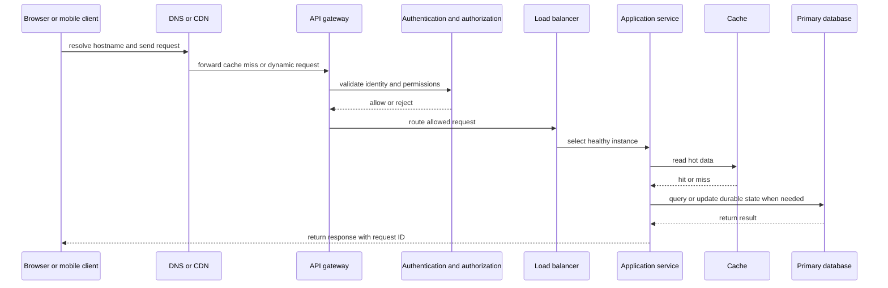
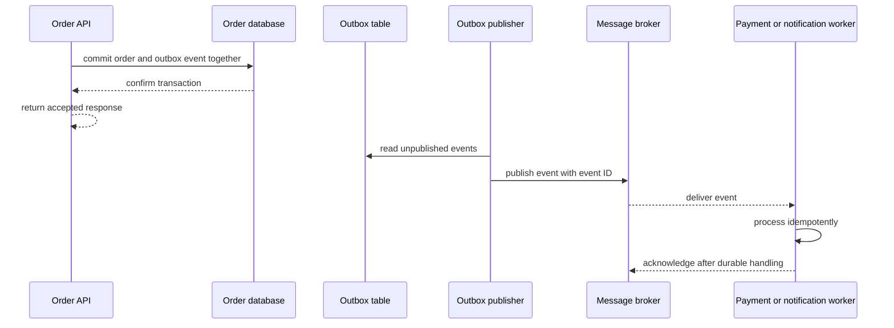
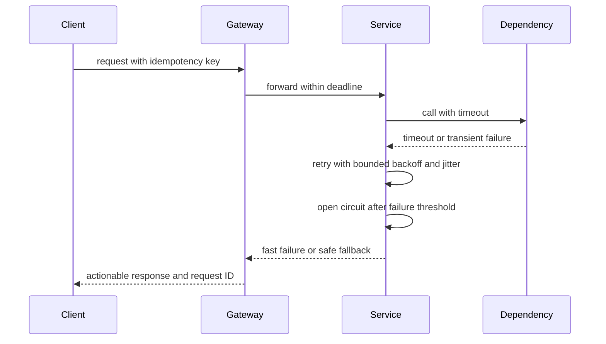

# System Design: From Requirements to Reliable Systems

System design is the practice of turning a product requirement into a system that can handle its expected traffic, data, failure modes, security needs, and operational constraints. A good design is not a collection of fashionable technologies. It is a set of explicit trade-offs that can be explained, measured, tested, and changed.

This page gives a practical learning order for a Java or backend architect. The linked child pages go deeper into capacity planning, consistency, partitioning, sharding, and disaster recovery.

## 1. Start with the problem, not the technology

Before drawing boxes, write down the contract of the system.

### Functional requirements

Functional requirements describe what users and other systems can do:

- A customer can create an order and view its status.
- A payment can be authorized exactly once for an order.
- An administrator can search orders by customer and date.
- A notification can be sent after an order is accepted.

### Non-functional requirements

Non-functional requirements describe how well the system must behave:

| Requirement | Questions to clarify |
| --- | --- |
| Traffic | How many requests per second are expected now and at peak? |
| Latency | Is the target an average, p95, or p99 response time? |
| Availability | Is the target 99.9%, 99.99%, or a different service level? |
| Durability | How much data loss is acceptable after a failure? |
| Consistency | Must every reader see the newest write immediately? |
| Security | Which identities, permissions, audit records, and data protections are required? |
| Cost | What is the budget and which resources are allowed to grow? |
| Recovery | How quickly must the service recover and how will recovery be tested? |

Do not silently choose a value. If a requirement is unknown, state an assumption and show how the design changes when it changes.

## 2. A repeatable design process

Use this order in a design interview or an architecture review:

1. **Clarify the use cases.** Identify the main actors, commands, queries, and business invariants.
2. **Estimate capacity.** Calculate request rate, storage growth, bandwidth, concurrency, and peak multipliers.
3. **Define the API and data model.** Make ownership, idempotency, pagination, validation, and error contracts explicit.
4. **Draw the simplest viable architecture.** Start with a modular monolith or a small number of services when that is enough.
5. **Find bottlenecks.** Check the database, hot keys, connection pools, queues, locks, and external dependencies.
6. **Design failure behavior.** Add timeouts, bounded retries, backpressure, fallbacks, isolation, and recovery paths.
7. **Add security and observability.** Protect every boundary and make the system diagnosable before production traffic arrives.
8. **Test the assumptions.** Load test, fail components deliberately, restore backups, and compare measurements with the targets.

The AWS Well-Architected guidance groups architecture review around operational excellence, security, reliability, performance efficiency, cost optimization, and sustainability [1]. These are review lenses, not a requirement to use a particular cloud provider.

## 3. A common request path

A typical web system separates the public edge from application services and stateful infrastructure. A request may pass through DNS, a CDN, a web server or reverse proxy, an API gateway, authentication, a load balancer, an application service, a cache, and a database.



### What each boundary does

- **DNS** maps a hostname to an address. It is not an authorization boundary.
- **CDN or edge cache** serves cacheable content close to users and absorbs repeated reads.
- **Reverse proxy** receives a client request, forwards it to an upstream service, receives the response, and sends it back. NGINX documents this request-forwarding model and its header and buffering controls [4].
- **API gateway** applies common edge policy such as routing, authentication integration, request size limits, rate limiting, version routing, and correlation IDs. It should not become a large business-logic monolith.
- **Load balancer** spreads traffic across healthy instances. Round robin, least connections, hashing, and latency-aware strategies have different behavior; choose one based on workload and statefulness [5].
- **Application service** owns a business capability and its invariants.
- **Cache** reduces repeated reads but introduces invalidation, staleness, eviction, and stampede concerns.
- **Database** is the durable source of truth for data that must survive process and machine failures.
- **Message broker** decouples work that does not need to finish inside the request-response latency budget.

## 4. Capacity planning with a small example

Suppose an order API receives 2 million requests per day. The average rate is approximately:

```text
2,000,000 / 86,400 ≈ 23 requests per second
```

If traffic peaks at 8 times the average, design for about 184 requests per second before adding a safety margin. The estimate is not a capacity guarantee. Validate it with realistic payloads, database queries, concurrency, and failure scenarios.

Also estimate storage. If 100,000 orders are created per day and each durable order record averages 4 KB:

```text
100,000 × 4 KB = 400 MB per day before indexes, replicas, backups, and history
```

### Useful capacity questions

- Is the workload read-heavy or write-heavy?
- Are requests uniform, or are a few customers or keys much hotter?
- How much of the response can be cached?
- Does the database connection pool support the expected concurrency?
- What happens when traffic doubles for ten minutes?
- Does a retry multiply the load during an outage?

## 5. Scaling strategies

### Vertical scaling

Vertical scaling gives one instance more CPU, memory, storage, or network capacity. It is simple and can be effective for a database or a small service, but there is a practical upper bound and a larger failure domain.

### Horizontal scaling

Horizontal scaling adds more instances. It works best when instances are stateless and requests can be routed to any healthy instance.

A stateless service should keep durable state in a database or object store, short-lived shared state in a carefully designed cache, and request-local state in memory only for the lifetime of one request. Sticky sessions can hide a state-management problem but reduce routing flexibility and complicate failover.

### Partitioning and sharding

Partitioning divides data into smaller pieces. A database can partition rows by time or a range. Sharding distributes partitions across independent database nodes. The shard key must distribute load evenly and support important queries; a poor key creates a hot shard or forces expensive cross-shard queries.

A shard key review should answer:

- Which queries include the shard key?
- What happens when a tenant becomes much larger than others?
- Can records be moved when a shard fills up?
- Are unique constraints local or global?
- How are cross-shard transactions and reporting handled?

## 6. Data and consistency choices

### Read and write paths

A write path validates the command, checks authorization, enforces a business invariant, commits durable state, and publishes any required event. A read path may use a cache or a read replica, but it must communicate whether stale data is acceptable.

### Strong versus eventual consistency

- **Strong consistency** gives a reader the newest committed value within the defined boundary. It simplifies some user-visible invariants but can increase coordination and latency.
- **Eventual consistency** allows replicas or projections to converge later. It improves availability and decoupling but requires users and code to tolerate temporary differences.

Choose consistency per operation rather than declaring the whole system strong or eventual. For example, payment authorization may require a strong invariant, while a search index can usually converge asynchronously.

### Replication

Replication keeps copies of data on multiple nodes. It can improve read capacity and availability, but it does not remove the need for conflict handling, lag monitoring, backup, and recovery testing. A replica is not automatically a backup: accidental deletes and corrupted writes can replicate too.

### Indexing

An index should support a known query pattern. Check its selectivity, ordering, write cost, storage cost, and whether the query can use it without scanning a large range. Measure with the database query plan rather than assuming that more indexes always improve performance.

## 7. Caching

Caching is useful when the same data is read repeatedly and can be reused for a defined period.

Common patterns include:

- **Cache-aside:** the application reads the cache first, reads the database on a miss, then stores the result.
- **Write-through:** a write updates the cache and durable store through one coordinated path.
- **Write-behind:** the cache acknowledges first and writes later; this needs explicit durability and loss handling.
- **Read-through:** a cache provider loads missing values on behalf of the application.

Define the cache key, TTL, maximum size, eviction policy, invalidation path, stale-data policy, and behavior when the cache is unavailable. Protect the database from a cache stampede with request coalescing, jittered TTLs, or a short-lived lock where appropriate.

## 8. Asynchronous work and messaging

Use a queue or event stream when work can complete after the request, when consumers need independent scaling, or when a temporary dependency failure should not block every caller.



The **transactional outbox** records the business change and the event in the same local database transaction. A publisher later sends the event. Consumers must still be idempotent because delivery can be repeated.

Useful messaging concepts include:

- **At-most-once:** a message is delivered zero or one time; loss is possible.
- **At-least-once:** a message can be redelivered; consumers must deduplicate or make operations idempotent.
- **Dead-letter queue:** stores messages that repeatedly fail so they can be inspected without blocking healthy work.
- **Backpressure:** slows producers or limits concurrency when consumers cannot keep up.
- **Ordering:** must be defined per key or partition; global ordering is expensive and often unnecessary.
- **Saga:** coordinates a multi-service business workflow using local transactions and compensating actions instead of one distributed transaction.

## 9. Reliability and failure handling

Distributed calls fail independently. A reliable design assumes that a dependency can be slow, unavailable, overloaded, misconfigured, or partially successful.

### Timeouts

Every network call needs a deadline. A timeout should be shorter than the caller's remaining request budget and should prevent threads or connections from waiting indefinitely.

### Retries with backoff and jitter

Retry only transient failures and only when the operation is safe to repeat. Use a bounded number of attempts, exponential backoff, and random jitter. A retry without a budget can amplify an outage into a retry storm.

### Circuit breaker

A circuit breaker observes failures or slow calls. It opens after a threshold, fails fast for a period, and then permits limited probes before closing again. It protects both the caller and the failing dependency, but it does not replace timeouts or a useful fallback.

### Bulkheads and rate limits

A bulkhead isolates resources such as thread pools, connection pools, queues, or tenants so one overloaded dependency does not consume everything. A rate limiter controls demand with a defined policy such as token bucket or leaky bucket. Rejected work needs a clear client response and retry guidance.

### Idempotency

An idempotent operation can be repeated without creating an unintended second effect. For a payment or order command, accept an idempotency key, store the result associated with that key, and return the original result for a safe repeat. Validate that the same key is not reused with a different request payload.

The AWS reliability guidance explicitly emphasizes loose coupling, idempotent mutating operations, throttling, bounded retries, timeouts, graceful degradation, and stateless designs [2].



## 10. Security at every boundary

Security is part of system design, not a final filter.

- Use TLS for data in transit and encryption at rest where the threat model requires it.
- Authenticate the caller and authorize the requested action separately.
- Validate JWT signature, issuer, audience, expiration, not-before time, and allowed algorithm before using claims.
- Apply least privilege to users, services, database roles, queues, and deployment identities.
- Validate input, constrain payload sizes, and avoid constructing queries or commands from untrusted strings.
- Store secrets in a secret manager or protected runtime configuration, not in source code or frontend bundles.
- Audit security-sensitive actions without logging passwords, tokens, or unnecessary personal data.
- Use network segmentation and deny-by-default access between services where practical.

An API gateway can centralize coarse edge policy, but each service must still enforce authorization for its own data and actions.

## 11. Configuration, discovery, and scheduling

### Configuration and secrets

Separate deploy-time configuration from secrets. Version non-secret defaults, validate configuration at startup, and make secret rotation possible without committing credentials. A configuration server can distribute environment-specific settings; a vault or secret manager should protect sensitive values and control access.

### Service discovery

A service can discover another service through a static endpoint, DNS, a registry, or a platform-native service name. Discovery is only useful when health, registration expiry, load balancing, and failure behavior are defined. Cache discovery results for a bounded time and do not assume that a discovered instance remains healthy.

### Scheduling

Schedulers run periodic or delayed work such as billing, cleanup, reconciliation, and report generation. Make jobs idempotent, record ownership or leases for distributed execution, define misfire behavior, and expose job duration, failure count, and last-success time.

## 12. Observability and operations

A production system should explain what happened for one request and whether the whole service is healthy.

- **Metrics** are numeric time series for rates, durations, sizes, and resource use.
- **Logs** are structured event records with timestamp, severity, service, environment, request ID, trace ID, and useful business identifiers.
- **Traces** connect spans across service boundaries so a slow request can be decomposed into gateway, application, cache, database, and downstream time.
- **Profiles** show CPU, memory allocation, lock, and code-level behavior when metrics identify a performance problem.

If only four user-facing signals can be measured, Google SRE recommends latency, traffic, errors, and saturation [3]. Track successful and failed latency separately, and use percentiles such as p95 or p99 when tail behavior matters.

A useful dashboard answers:

1. Are users reaching the service?
2. Is traffic within the expected range?
3. Are requests slow or failing?
4. Which dependency or resource is saturated?
5. Is the error isolated to one endpoint, tenant, region, or deployment?

Alerts should represent an action someone can take. A dashboard is not automatically an alert, and a log line is not automatically an incident.

## 13. Availability, disaster recovery, and data loss

Availability is the fraction of time the service is usable according to a defined measurement. Do not promise availability merely because there are multiple instances; the database, network, deployment process, and human runbook can still be single points of failure.

Define these recovery objectives:

- **RTO (Recovery Time Objective):** the maximum acceptable time to restore service.
- **RPO (Recovery Point Objective):** the maximum acceptable amount of data loss measured in time.

Possible recovery strategies range from restoring backups to a cold standby, warm standby, or active-active deployment. More availability usually increases cost and operational complexity. Test restoration and failover rather than treating a backup file or a second region as proof of recovery.

## 14. Deployment and change safety

A reliable design includes how it changes:

- Use immutable or reproducible build artifacts.
- Roll out gradually with canary, blue-green, or percentage-based deployment.
- Keep database migrations backward compatible when old and new application versions overlap.
- Use feature flags to separate deployment from release when appropriate.
- Define rollback and roll-forward actions before production deployment.
- Monitor error rate, latency, saturation, and business outcomes during the change.
- Record architecture decisions and the reason for important trade-offs.

## 15. A compact architecture review checklist

Before approving a design, ask:

- What is the most important user journey and its latency budget?
- Which component owns each piece of data?
- What happens when the database, cache, broker, or third-party API is slow?
- Can every mutating request be retried safely?
- Where are the single points of failure?
- What is the scaling unit: instance, partition, shard, tenant, or region?
- How is a request traced across boundaries?
- Which metrics trigger an action and who receives the alert?
- What are the RTO and RPO, and when was restore last tested?
- Which assumption is most likely to be wrong, and how will it be measured?

## Interview questions and answers

<details>
<summary>Why should an architect begin with requirements instead of choosing microservices?</summary>

Microservices solve some organizational and scaling problems, but they add network calls, operational overhead, distributed data, deployment complexity, and failure modes. Start with the required capabilities and constraints. A modular monolith may satisfy the initial requirements with fewer failure boundaries. Split a service when independent ownership, scaling, deployment, or fault isolation provides a measurable benefit.
</details>

<details>
<summary>What is the difference between a reverse proxy, API gateway, and load balancer?</summary>

A reverse proxy forwards client requests to upstream servers and returns their responses. A load balancer is responsible for selecting among multiple upstream instances and removing unhealthy capacity. An API gateway is an edge policy and routing layer that commonly adds authentication integration, rate limiting, request transformation, version routing, and observability. One product can provide more than one of these roles, but the responsibilities should remain clear.
</details>

<details>
<summary>Why are retries dangerous?</summary>

A retry repeats load while the dependency is already unhealthy. If many callers retry immediately, the extra work can cause a retry storm. Retry only transient failures, use timeouts, exponential backoff, jitter, a maximum attempt or time budget, and idempotency. Do not retry validation errors or an operation whose outcome is unknown unless the protocol makes repetition safe.
</details>

<details>
<summary>Is a read replica a backup?</summary>

No. A replica can improve read capacity or availability, but an accidental delete, corrupt write, or bad migration may be copied to it. Backups must have retention, access protection, integrity checks, and tested restoration.
</details>

<details>
<summary>When should a system use a queue?</summary>

Use a queue when work can be processed asynchronously, when consumers need independent scaling, or when a temporary downstream failure should not block every request. Do not put every operation behind a queue: users may need an immediate result, and a queue introduces delay, duplicate delivery, ordering decisions, monitoring, and replay behavior.
</details>

<details>
<summary>How do you make a payment request safe to retry?</summary>

The client sends a unique idempotency key. The service validates and stores the key with a request fingerprint and the final result in durable storage. A repeat with the same key and equivalent payload returns the stored result instead of charging again. A repeat with a different payload is rejected. The payment provider's own idempotency contract must also be understood.
</details>

<details>
<summary>What should an architecture diagram show?</summary>

Show actors, trust boundaries, request direction, stateful components, data ownership, synchronous calls, asynchronous messages, deployment boundaries, and the important failure or recovery paths. A diagram is useful only when its labels and arrows explain a decision. Add a short narrative for timeouts, retries, consistency, and ownership instead of drawing every implementation detail.
</details>

## References

[1]: https://docs.aws.amazon.com/wellarchitected/latest/framework/the-pillars-of-the-framework.html "AWS Well-Architected Framework pillars"
[2]: https://docs.aws.amazon.com/wellarchitected/latest/reliability-pillar/welcome.html "AWS Well-Architected Reliability Pillar"
[3]: https://sre.google/sre-book/monitoring-distributed-systems/ "Google SRE: Monitoring Distributed Systems"
[4]: https://docs.nginx.com/nginx/admin-guide/web-server/reverse-proxy/ "NGINX Reverse Proxy"
[5]: https://docs.nginx.com/nginx/admin-guide/load-balancer/http-load-balancer/ "NGINX HTTP Load Balancing"
