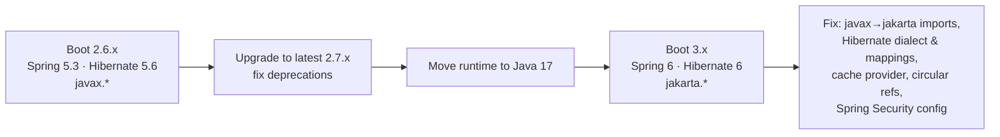
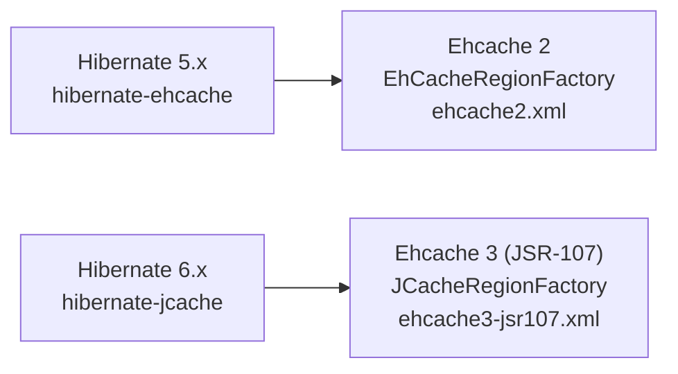
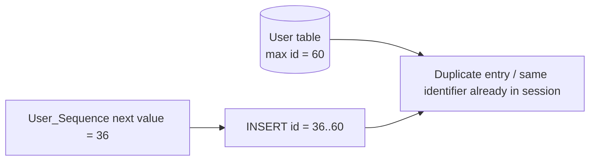
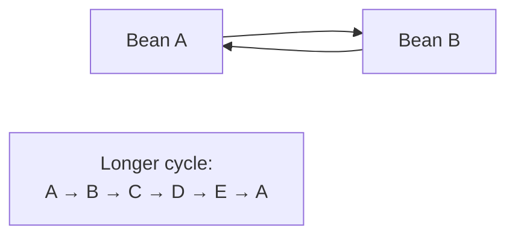

# Spring Boot Migration (2.x → 3.x)

Moving from Spring Boot 2.x to 3.x is not just a version bump. You get **Spring Framework 6**, **Java 17 as the minimum**, **Hibernate 6** as the default JPA provider, and the whole `javax.*` namespace becomes `jakarta.*`. Each block below explains one migration concept in simple words, then shows Java (and config) before/after examples.

---

<details>
<summary><strong>1. Migration roadmap and Java compatibility</strong> — upgrade to the latest 2.7.x first, move to Java 17, then jump to Boot 3.</summary>

**In simple words**

- Spring Boot **2.6.x** supports Java **8, 11 and 17**.
- Spring Boot **3.2.0** requires **Java 17 minimum**.
- Before upgrading, move to the **latest 2.7.x** release first and fix the deprecation warnings. Boot 3.0 is a major milestone with important changes to the core components.
- Guides: [Spring Boot 3.0 Migration Guide](https://github.com/spring-projects/spring-boot/wiki/Spring-Boot-3.0-Migration-Guide) · [baeldung.com](https://www.baeldung.com/spring-boot-3-migration) · [Starter parent on mvnrepository](https://mvnrepository.com/artifact/org.springframework.boot/spring-boot-starter-parent)



**Maven — change the parent**

```xml
<parent>
    <groupId>org.springframework.boot</groupId>
    <artifactId>spring-boot-starter-parent</artifactId>
    <version>3.2.0</version>            <!-- was 2.6.6 -->
    <relativePath/>                      <!-- lookup parent from repository -->
</parent>

<properties>
    <java.version>17</java.version>      <!-- was 8 or 11 -->
</properties>
```

**Java helper — find which JAR a class is loaded from** (handy for spotting old `javax` or duplicate classes after migrating)

```java runnable
public class Main {
    public static void main(String[] args) {
        Class<?> klass = java.lang.String.class;
        FindClassBelongsToJarFile.findJarFile(klass);
    }
    static class FindClassBelongsToJarFile {
        public static String findJarFile(Class<?> klass) {
            java.net.URL jarLocation = klass.getResource('/' + klass.getName().replace('.', '/') + ".class");
            System.out.println("jarLocation:" + jarLocation);
            return jarLocation.toString();
        }
    }
}
```

</details>

<details>
<summary><strong>2. Managed dependency versions</strong> — what the Boot parent pins for you in 2.6.6, 2.7.18 and 3.2.0.</summary>

**In simple words** — the Boot parent decides versions of Spring, Hibernate, Security and others, so changing the parent changes them all at once. Compare the BOMs: [2.6.6](https://repo1.maven.org/maven2/org/springframework/boot/spring-boot-dependencies/2.6.6/spring-boot-dependencies-2.6.6.pom) · [2.7.18](https://repo1.maven.org/maven2/org/springframework/boot/spring-boot-dependencies/2.7.18/spring-boot-dependencies-2.7.18.pom) · [3.2.0](https://repo1.maven.org/maven2/org/springframework/boot/spring-boot-dependencies/3.2.0/spring-boot-dependencies-3.2.0.pom)

<table>
  <tr>
    <th>Dependency</th>
    <th>Spring Boot 2.6.6</th>
    <th>Spring Boot 2.7.18</th>
    <th>Spring Boot 3.2.0</th>
  </tr>
  <tr>
    <td>Spring Framework (<code>spring-framework.version</code>)<br>spring-jdbc, spring-tx</td>
    <td>5.3.18</td><td>5.3.31 (<a href="https://repo1.maven.org/maven2/org/springframework/spring-framework-bom/5.3.31/spring-framework-bom-5.3.31.pom">bom</a>)</td><td>6.1.1</td>
  </tr>
  <tr>
    <td>Spring Data JPA<br>Hibernate (<code>org.hibernate</code>)</td>
    <td>spring-data-jpa 2.6.x<br>hibernate-core 5.6.7.Final</td><td>hibernate-core 5.6.15.Final</td><td>spring-data-jpa 3.2.x<br>hibernate-core 6.3.1.Final</td>
  </tr>
  <tr>
    <td>Spring Security</td>
    <td>spring-security-core 5.6.2</td><td>spring-security-bom 5.7.11<br>(<code>spring-security-oauth2-client</code>, <code>spring-security-oauth2-jose</code>)</td><td>spring-security-core 6.2.0</td>
  </tr>
  <tr>
    <td>Jackson</td>
    <td>Updated versions</td><td>—</td><td>Updated versions, Jakarta compatible</td>
  </tr>
  <tr>
    <td>Apache Commons Codec<br>(Base64 / password encode-decode)</td>
    <td>1.15</td><td>—</td><td>1.16.0</td>
  </tr>
</table>

**Java — Commons Codec Base64 (same API across these versions)**

```java
import org.apache.commons.codec.binary.Base64;

String encoded = Base64.encodeBase64String("secret".getBytes(StandardCharsets.UTF_8));
String decoded = new String(Base64.decodeBase64(encoded), StandardCharsets.UTF_8);
```

</details>

<details>
<summary><strong>3. javax → jakarta relocated dependencies</strong> — the same APIs, new Maven coordinates and package names.</summary>

**In simple words** — Java EE moved to the Eclipse Foundation and was renamed **Jakarta EE**. Starting with Spring Boot 3.x (Jakarta EE 9+), every `javax.*` EE package is now `jakarta.*`. Search for old ones: [mvn search](https://mvnrepository.com/search?q=javax).

<table>
  <tr>
    <th>Dependency</th>
    <th>Spring Boot 2.6.6 (javax)</th>
    <th>Spring Boot 3.2.0 (jakarta)</th>
  </tr>
  <tr><td>Servlet</td><td>javax.servlet 4.0.1</td><td>jakarta.servlet 6.0.0</td></tr>
  <tr><td>Persistence</td><td>javax.persistence 2.2.3</td><td>jakarta.persistence 3.0.0</td></tr>
  <tr><td>Annotations</td><td>javax.annotation 1.3.2</td><td>jakarta.annotation 2.0.0</td></tr>
  <tr><td>Transactions</td><td>javax.transaction 1.3</td><td>jakarta.transaction 2.0.0</td></tr>
  <tr>
    <td>JavaMail / Jakarta Mail API</td>
    <td><code>javax.mail:javax.mail-api</code> <a href="https://mvnrepository.com/artifact/javax.mail/javax.mail-api/1.6.2">1.6.2</a><br><code>jakarta.mail:jakarta.mail-api</code> 1.6.7</td>
    <td><code>jakarta.mail:jakarta.mail-api</code> <a href="https://mvnrepository.com/artifact/jakarta.mail/jakarta.mail-api/2.1.2">2.1.2</a></td>
  </tr>
  <tr>
    <td>Sun JavaMail API</td>
    <td><code>com.sun.mail:javax.mail</code> <a href="https://mvnrepository.com/artifact/com.sun.mail/javax.mail/1.6.2">1.6.2</a><br><code>com.sun.mail:jakarta.mail</code> <a href="https://mvnrepository.com/artifact/com.sun.mail/jakarta.mail/1.6.7">1.6.7</a></td>
    <td>—</td>
  </tr>
</table>

<table>
  <tr><th>Javax Annotation API (Boot 2.6.6)</th><th>Jakarta Annotations API (Boot 3.x)</th></tr>
  <tr>
    <td><a href="https://mvnrepository.com/artifact/javax.annotation/javax.annotation-api">javax.annotation:javax.annotation-api</a> <a href="https://mvnrepository.com/artifact/javax.annotation/javax.annotation-api/1.3.2">1.3.2</a></td>
    <td><a href="https://mvnrepository.com/artifact/jakarta.annotation/jakarta.annotation-api">jakarta.annotation:jakarta.annotation-api</a> <a href="https://mvnrepository.com/artifact/jakarta.annotation/jakarta.annotation-api/2.1.1">2.1.1</a></td>
  </tr>
</table>

```xml
<!-- Boot 2.x -->
<dependency>
    <groupId>javax.annotation</groupId>
    <artifactId>javax.annotation-api</artifactId>
    <version>1.3.2</version>
</dependency>

<!-- Boot 3.x -->
<dependency>
    <groupId>jakarta.annotation</groupId>
    <artifactId>jakarta.annotation-api</artifactId>
    <version>2.1.1</version>
</dependency>
```

</details>

<details>
<summary><strong>4. Namespace change in code (javax → jakarta)</strong> — update imports; the code itself stays the same.</summary>

**In simple words**

- When you move to Boot 3, update the **code** to use `jakarta.*` imports instead of `javax.*`. In most files that is only an import change.
- Not everything moves: `javax.sql.DataSource` is part of the **JDK**, so it stays `javax`.

<table>
  <tr><th>Javax (before)</th><th>Jakarta (after)</th></tr>
  <tr><td><code>javax.servlet.ServletInputStream</code><br><code>javax.servlet.http.HttpServletRequest</code></td><td><code>jakarta.servlet.ServletInputStream</code><br><code>jakarta.servlet.http.HttpServletRequest</code></td></tr>
  <tr><td><code>javax.websocket.server.PathParam</code></td><td><code>jakarta.websocket.server.PathParam</code></td></tr>
  <tr><td><code>javax.annotation.PostConstruct</code></td><td><code>jakarta.annotation.PostConstruct</code></td></tr>
  <tr><td><b><code>javax.sql.DataSource</code></b></td><td><b><code>javax.sql.DataSource</code></b> — <u>unchanged</u> (JDK package)</td></tr>
  <tr><td><code>javax.persistence.*</code> (Entity, EntityManager)</td><td><code>jakarta.persistence.*</code></td></tr>
  <tr><td><code>javax.transaction.*</code></td><td><code>jakarta.transaction.*</code></td></tr>
  <tr><td><code>javax.validation.*</code></td><td><code>jakarta.validation.*</code></td></tr>
</table>

```text
import javax.persistence.   ->   import jakarta.persistence.
@javax.persistence.         ->   @jakarta.persistence.
import javax.transaction.   ->   import jakarta.transaction.
import javax.servlet.       ->   import jakarta.servlet.
import javax.annotation.    ->   import jakarta.annotation.
import javax.validation.    ->   import jakarta.validation.

javax.sql.DataSource            (NOT changed - it is part of the JDK)
```

<details>
<summary>Example — JPA entity</summary>

```java
// Boot 2.x
import javax.persistence.Entity;
import javax.persistence.Id;
import javax.persistence.GeneratedValue;
import javax.persistence.GenerationType;

@Entity
public class User {
    @Id @GeneratedValue(strategy = GenerationType.IDENTITY)
    private Long id;
    private String name;
}

// Boot 3.x  - only the imports change
import jakarta.persistence.Entity;
import jakarta.persistence.Id;
import jakarta.persistence.GeneratedValue;
import jakarta.persistence.GenerationType;

@Entity
public class User {
    @Id @GeneratedValue(strategy = GenerationType.IDENTITY)
    private Long id;
    private String name;
}
```

</details>

<details>
<summary>Example — servlet filter and @PostConstruct</summary>

```java
// Boot 2.x
import javax.servlet.*;
import javax.servlet.http.HttpServletRequest;
import javax.annotation.PostConstruct;

// Boot 3.x
import jakarta.servlet.*;
import jakarta.servlet.http.HttpServletRequest;
import jakarta.annotation.PostConstruct;

@Component
public class RequestLogFilter implements Filter {

    @PostConstruct
    void init() { System.out.println("filter ready"); }

    @Override
    public void doFilter(ServletRequest req, ServletResponse res, FilterChain chain)
            throws IOException, ServletException {
        HttpServletRequest http = (HttpServletRequest) req;
        System.out.println(http.getMethod() + " " + http.getRequestURI());
        chain.doFilter(req, res);
    }
}
```

</details>

<details>
<summary>Example — EntityManager and DataSource together</summary>

```java
import jakarta.persistence.EntityManager;      // was javax.persistence.EntityManager
import jakarta.persistence.PersistenceContext;  // was javax.persistence.PersistenceContext
import javax.sql.DataSource;                    // UNCHANGED - JDK package

@Repository
public class UserDao {

    @PersistenceContext
    private EntityManager entityManager;

    @Autowired
    private DataSource dataSource;
}
```

</details>

**Code change checklist:** replace imports project-wide, then re-check entity mappings (especially `@ManyToMany` with a custom `@JoinColumn`, next block) and any library that still depends on `javax`.

</details>

<details>
<summary><strong>5. Hibernate 5 → 6</strong> — Boot 3 brings Hibernate 6.x (JPA 3.x), which changes mapping rules, dialects and caching.</summary>

**In simple words** — Spring Boot 3.x brings Spring Framework 6 and Java 17, and **Hibernate 6.x** becomes the default persistence provider. The big visible changes: `jakarta.persistence`, stricter mapping rules, a different set of dialects, and a different second-level cache module.

<table>
  <tr>
    <th>Hibernate ORM</th>
    <th>Boot 2.x (2.7.18)</th>
    <th>Boot 3.2.0</th>
    <th>Boot 3.3.3</th>
  </tr>
  <tr><td><code>org.hibernate:hibernate-core</code></td><td>5.6.7.Final</td><td>6.3.1.Final</td><td>—</td></tr>
  <tr>
    <td><code>org.hibernate:hibernate-ehcache</code><br>Deprecated: it uses Ehcache 2, which is itself deprecated in favor of Ehcache 3</td>
    <td>5.6.7.Final</td><td><a href="https://hibernate.atlassian.net/browse/HHH-12441">Deprecated</a></td><td>Deprecated</td>
  </tr>
</table>

**Where the Spring Data JPA starter version shows up in the POM profiles** (see the Maven profiles block):

```xml
<!-- Hibernate 5.x profile -->
<spring-boot-starter-data-jpa>2.7.18</spring-boot-starter-data-jpa>

<!-- Hibernate 6.x profile -->
<spring-boot-starter-data-jpa>3.3.3</spring-boot-starter-data-jpa>
```

</details>

<details>
<summary><strong>6. @ManyToMany with a direct @JoinColumn is rejected</strong> — Hibernate 6 wants the join column inside @JoinTable.</summary>

**In simple words**

- In Hibernate 5, putting `@JoinColumn` straight on a `@ManyToMany` field was tolerated. Hibernate 6 refuses to start.
- A many-to-many needs a **join table**, so the columns that point to each side belong inside `@JoinTable`.
- Fetching: the default fetch type for `@ManyToMany` is still `LAZY` unless you set `EAGER`; fetch behavior may differ subtly in 6.x, which gives finer-grained control. Apart from the namespace switch, mapping and querying many-to-many relationships is largely unchanged.

**The error**

```java
// Hibernate 6.x - this leads to an error:
@jakarta.persistence.ManyToMany
@jakarta.persistence.JoinColumn(name = "address_Id")

// Property 'com.yash.db.entities.User.address' is a '@ManyToMany' and is directly annotated '@JoinColumn'
//   (specify '@JoinColumn' inside '@JoinTable' or '@CollectionTable')
```

**The fix — `User` entity (owning side)**

```java
import jakarta.persistence.*;
import java.util.List;

@Entity
public class User {

    @Id
    private Long id;
    private String name;

    // Many-to-many relationship with Address
    @ManyToMany
    @JoinTable(
        name = "user_address",                                // join table name
        joinColumns = @JoinColumn(name = "user_id"),          // FK column for the owning entity (User)
        inverseJoinColumns = @JoinColumn(name = "address_id") // FK column for the inverse entity (Address)
    )
    private List<Address> addresses;

    // Getters and setters
}
```

**`Address` entity (inverse side — optional, but explicit)**

```java
import jakarta.persistence.*;

@Entity
public class Address {

    @Id
    private Long id;
    private String street;
    private String city;

    // Many-to-many relationship with User
    @ManyToMany(mappedBy = "addresses") // refers to the "addresses" field in User
    private List<User> users;

    // Getters and setters
}
```

**Explicit fetch type** (it's `LAZY` by default; set it when you want it visible in the code):

```java
@ManyToMany(fetch = FetchType.LAZY)
@JoinTable(name = "user_address",
           joinColumns = @JoinColumn(name = "user_id"),
           inverseJoinColumns = @JoinColumn(name = "address_id"))
private List<Address> addresses;
```

</details>

<details>
<summary><strong>7. Dialects and database compatibility</strong> — Hibernate 6 renamed or removed several dialect classes.</summary>

**In simple words** — the *dialect* tells Hibernate which SQL flavor to speak (MySQL, PostgreSQL, …). Old dialect classes such as `MySQL5Dialect` no longer exist in Hibernate 6, so the app fails at startup until you change the property.

```properties
# LocalContainerEntityManagerFactoryBean -> HibernateJpaVendorAdapter
#spring.jpa.properties.hibernate.dialect= org.hibernate.dialect.MySQLDialect
spring.jpa.properties.hibernate.dialect = org.hibernate.dialect.MySQL8Dialect
spring.jpa.database-platform = org.hibernate.dialect.MySQL8Dialect
spring.jpa.hibernate.ddl-auto = update
hibernate.hbm2ddl.auto = update
#hibernate.hbm2ddl.auto=validate
```

<table>
  <tr>
    <th>Database</th>
    <th>Hibernate 5.x dialect</th>
    <th>Hibernate 6.x dialect</th>
    <th>Notes</th>
  </tr>
  <tr><td>MySQL</td><td><code>org.hibernate.dialect.MySQLDialect</code></td><td><code>org.hibernate.dialect.MySQL8Dialect</code></td><td>Accommodates MySQL 8 features such as JSON support and SQL syntax changes. <i>(Newer 6.x releases deprecate the versioned dialects; plain <code>MySQLDialect</code> detects the version itself.)</i></td></tr>
  <tr><td>PostgreSQL</td><td><code>org.hibernate.dialect.PostgreSQLDialect</code></td><td><code>org.hibernate.dialect.PostgreSQL95Dialect</code></td><td>Reflects the advanced SQL features introduced in PostgreSQL 9.5</td></tr>
  <tr><td>Oracle</td><td><code>org.hibernate.dialect.Oracle12cDialect</code></td><td><code>org.hibernate.dialect.Oracle12cDialect</code></td><td>No change</td></tr>
  <tr><td>SQL Server</td><td><code>org.hibernate.dialect.SQLServer2012Dialect</code></td><td><code>org.hibernate.dialect.SQLServerDialect</code></td><td>Minor change; update to the latest dialect</td></tr>
</table>

**The error you get with an old dialect**

```text
Caused by: java.lang.ClassNotFoundException: Could not load requested class : org.hibernate.dialect.MySQL5Dialect
	at org.hibernate.boot.registry.classloading.internal.AggregatedClassLoader.findClass(AggregatedClassLoader.java:216)
	    ~[hibernate-core-6.5.2.Final.jar:6.5.2.Final]
```

**Java — `EntityManagerFactory` with the updated dialect**

```java
static String entitiesPackage = "com.yash.db.entities";

@Bean @Primary
public LocalContainerEntityManagerFactoryBean rdbmsEntityManager() {
    System.out.println("Creating rdbmsEntityManager Bean......................");
    LocalContainerEntityManagerFactoryBean em = new LocalContainerEntityManagerFactoryBean();
    em.setDataSource(getHikariCP());
    em.setPackagesToScan(entitiesPackage);
    HibernateJpaVendorAdapter vendorAdapter = new HibernateJpaVendorAdapter();
    em.setJpaVendorAdapter(vendorAdapter);

    HashMap<String, Object> properties = new HashMap<>();
    // MySQL5Dialect no longer exists in Hibernate 6:
    // properties.put("hibernate.dialect", "org.hibernate.dialect.MySQL5Dialect");
    properties.put("hibernate.dialect", "org.hibernate.dialect.MySQL8Dialect");
    properties.put("hibernate.hbm2ddl.auto", "update");
    properties.put("hibernate.show_sql", "true");
    em.setJpaPropertyMap(properties);
    return em;
}
```

</details>

<details>
<summary><strong>8. Second-level cache migration: the big picture</strong> — Hibernate 5 used Ehcache 2; Hibernate 6 uses Ehcache 3 through JCache.</summary>

**In simple words**

- A second-level (L2) cache shares in-memory data between sessions to cut database access.
- The cache module changed between versions, so **both the dependencies and the config file change**.
- **Warning:** an L2 cache by nature **undermines the ACID properties** of the database — changes to the cache and the database aren't atomic (there is no distributed two-phase commit). It is often the easiest performance win, but it makes concurrency harder to reason about and the cache is a source of bugs that are hard to isolate and reproduce.

<table>
  <tr><th>Hibernate version</th><th>Cache module</th><th>Ehcache version</th><th>Region factory</th><th>Config file</th></tr>
  <tr><td>5.x</td><td><code>hibernate-ehcache</code></td><td>Ehcache 2</td><td><code>org.hibernate.cache.ehcache.EhCacheRegionFactory</code></td><td><code>ehcache2.xml</code></td></tr>
  <tr><td>6.x</td><td><code>hibernate-jcache</code></td><td>Ehcache 3 (JSR-107)</td><td><code>org.hibernate.cache.jcache.internal.JCacheRegionFactory</code></td><td><code>ehcache3-jsr107.xml</code></td></tr>
</table>



Next blocks: the Hibernate 5 setup, the Hibernate 6 setup, then the Java configuration.

</details>

<details>
<summary><strong>9. Hibernate 5.x — Ehcache 2 setup</strong> — properties plus an <code>ehcache2.xml</code> file.</summary>

References: [Hibernate 5.x docs](https://docs.jboss.org/hibernate/orm/5.6/userguide/html_single/Hibernate_User_Guide.html#caching) · [Ehcache 2 settings](https://www.ehcache.org/documentation/2.8/integrations/hibernate.html#enable-second-level-cache-and-query-cache-settings) · [DigitalOcean tutorial](https://www.digitalocean.com/community/tutorials/hibernate-ehcache-hibernate-second-level-cache)

```properties
hibernate.cache.use_second_level_cache = true
hibernate.cache.use_query_cache = true
hibernate.cache.region.factory_class = org.hibernate.cache.ehcache.EhCacheRegionFactory
net.sf.ehcache.configurationResourceName = ehcache2.xml
```

`ehcache2.xml`

```xml
<ehcache xmlns:xsi="https://www.w3.org/2001/XMLSchema-instance"
    xsi:noNamespaceSchemaLocation="ehcache.xsd" updateCheck="true"
    monitoring="autodetect" dynamicConfig="true">

    <diskStore path="java.io.tmpdir/ehcache" />

    <defaultCache maxEntriesLocalHeap="10000" eternal="false"
        timeToIdleSeconds="120" timeToLiveSeconds="120" diskSpoolBufferSizeMB="30"
        maxEntriesLocalDisk="10000000" diskExpiryThreadIntervalSeconds="120"
        memoryStoreEvictionPolicy="LRU" statistics="true">
        <persistence strategy="localTempSwap" />
    </defaultCache>

    <cache name="com.yash.db.entities.Address" maxEntriesLocalHeap="10000" eternal="false"
        timeToIdleSeconds="5" timeToLiveSeconds="10">
        <persistence strategy="localTempSwap" />
    </cache>

    <cache name="org.hibernate.cache.internal.StandardQueryCache"
        maxEntriesLocalHeap="5" eternal="false" timeToLiveSeconds="120">
        <persistence strategy="localTempSwap" />
    </cache>

    <cache name="org.hibernate.cache.spi.UpdateTimestampsCache"
        maxEntriesLocalHeap="5000" eternal="true">
        <persistence strategy="localTempSwap" />
    </cache>
</ehcache>
```

**Java — the entity that uses the `com.yash.db.entities.Address` cache region above**

```java
import javax.persistence.Cacheable;
import javax.persistence.Entity;
import org.hibernate.annotations.Cache;
import org.hibernate.annotations.CacheConcurrencyStrategy;

@Entity
@Cacheable
@Cache(usage = CacheConcurrencyStrategy.READ_WRITE)   // cached in the region named after the class
public class Address {
    @Id private Long id;
    private String city;
}
```

</details>

<details>
<summary><strong>10. Hibernate 6.x — Ehcache 3 (JCache) setup</strong> — properties plus an <code>ehcache3-jsr107.xml</code> file, and the Java side.</summary>

References: [Hibernate 6.x docs](https://docs.jboss.org/hibernate/orm/6.5/introduction/html_single/Hibernate_Introduction.html#second-level-cache) · [HHH-12531](https://hibernate.atlassian.net/browse/HHH-12531) · [HHH-12635](https://hibernate.atlassian.net/browse/HHH-12635)

```properties
hibernate.cache.region.factory_class=org.hibernate.cache.jcache.internal.JCacheRegionFactory
hibernate.javax.cache.provider=org.ehcache.jsr107.EhcacheCachingProvider
hibernate.javax.cache.uri=ehcache3-jsr107.xml
```

`ehcache3-jsr107.xml`

```xml
<config
    xmlns:xsi='http://www.w3.org/2001/XMLSchema-instance'
    xmlns='http://www.ehcache.org/v3'
    xmlns:jsr107='http://www.ehcache.org/v3/jsr107'
    xsi:schemaLocation="
        http://www.ehcache.org/v3 http://www.ehcache.org/schema/ehcache-core-3.5.xsd
        http://www.ehcache.org/v3/jsr107 http://www.ehcache.org/schema/ehcache-107-ext-3.5.xsd">

 <service>
   <jsr107:defaults enable-management="true" enable-statistics="true"/>
 </service>

 <cache-template name="defaultCacheTemplate">
    <expiry>    <tti unit="seconds">1800</tti>      </expiry>
    <resources> <heap unit="entries">100000</heap>  </resources>
 </cache-template>

 <cache-template name="shortLivedDefaultCacheTemplate">
    <expiry>    <tti unit="seconds">60</tti>        </expiry>
    <resources> <heap unit="entries">1000000</heap> </resources>
 </cache-template>

 <cache alias="default-query-results-region">
    <expiry>    <tti unit="seconds">1200</tti>      </expiry>
    <heap>1024</heap>
 </cache>

 <cache alias="default-update-timestamps-region">
   <expiry>  <none />  </expiry>
   <heap>4096</heap>
 </cache>

 <cache alias="org.hibernate.cache.spi.UpdateTimestampsCache">
   <expiry>  <none />  </expiry>
   <heap>4096</heap>
 </cache>

 <cache alias="com.yash.db.entities.Address" uses-template="defaultCacheTemplate"/>

</config>
```

**Java — entity (note `jakarta` and the Hibernate cache annotation)**

```java
import jakarta.persistence.Cacheable;
import jakarta.persistence.Entity;
import org.hibernate.annotations.Cache;
import org.hibernate.annotations.CacheConcurrencyStrategy;

@Entity
@Cacheable
@Cache(usage = CacheConcurrencyStrategy.READ_WRITE)
public class Address {
    @Id private Long id;
    private String city;
}
```

**Java — turning L2 on in the `EntityManagerFactory` (Hibernate 6 / JCache)**

```java
HashMap<String, Object> properties = new HashMap<>();
properties.put("hibernate.cache.use_second_level_cache", true);
properties.put("hibernate.cache.use_query_cache", true);
properties.put("hibernate.cache.region.factory_class",
               "org.hibernate.cache.jcache.internal.JCacheRegionFactory");
properties.put("hibernate.javax.cache.provider", "org.ehcache.jsr107.EhcacheCachingProvider");
properties.put("hibernate.javax.cache.uri", "ehcache3-jsr107.xml");
em.setJpaPropertyMap(properties);
```

</details>

<details>
<summary><strong>11. Maven profiles — one POM, two Hibernate setups</strong> — switch between Hibernate 5.6 + Ehcache 2 and Hibernate 6.5 + Ehcache 3.</summary>

**In simple words** — a Maven **profile** includes or excludes dependencies per environment. Here `localdb5x` keeps the old stack and `localdb6x` (active by default) uses the new one, so you can migrate gradually and compare.

```xml
<profiles> <!-- Hibernate 5.6.15.Final to 6.5.2.Final -->
  <profile>
    <id>localdb5x</id>
    <activation>
      <activeByDefault>false</activeByDefault>
      <jdk>17</jdk>
    </activation>
    <properties>
      <spring-boot-starter-data-jpa>2.7.18</spring-boot-starter-data-jpa>
      <mysql.connector.j>8.0.33</mysql.connector.j>
      <querydsl.apt.classifier>jpa</querydsl.apt.classifier>
      <querydsl.apt.version>5.0.0</querydsl.apt.version>
      <ehcache.version>2.10.9.2</ehcache.version>
      <hibernate.5x.version>5.6.15.Final</hibernate.5x.version>
      <hibernate.ehcache.version>5.6.15.Final</hibernate.ehcache.version>
    </properties>
    <dependencies>
      <!-- Hibernate EHCache API -->
      <dependency>
        <groupId>org.hibernate</groupId>
        <artifactId>hibernate-ehcache</artifactId>
        <version>${hibernate.ehcache.version}</version>
      </dependency>
      <!-- EHCache core APIs -->
      <dependency>
        <groupId>net.sf.ehcache</groupId>
        <artifactId>ehcache</artifactId>
        <version>${ehcache.version}</version>
      </dependency>
      <dependency>
        <groupId>com.querydsl</groupId>
        <artifactId>querydsl-jpa</artifactId>
        <version>${querydsl.version}</version>
      </dependency>
      <dependency>
        <groupId>com.querydsl</groupId>
        <artifactId>querydsl-apt</artifactId>
        <version>${querydsl.apt.version}</version>
      </dependency>
    </dependencies>
  </profile>

  <profile>
    <id>localdb6x</id>
    <activation>
      <activeByDefault>true</activeByDefault>
      <jdk>17</jdk>
    </activation>
    <properties>
      <spring-boot-starter-data-jpa>3.3.3</spring-boot-starter-data-jpa>
      <mysql.connector.j>8.3.0</mysql.connector.j>
      <hibernate.6x.version>6.5.2.Final</hibernate.6x.version>
      <hibernate.jcache.version>6.5.2.Final</hibernate.jcache.version>
      <querydsl.apt.version>5.1.0</querydsl.apt.version>
    </properties>
    <dependencies>
      <dependency>
        <groupId>org.hibernate.orm</groupId>
        <artifactId>hibernate-jcache</artifactId>
        <version>${hibernate.jcache.version}</version>
      </dependency>
      <dependency>
        <groupId>org.ehcache</groupId>
        <artifactId>ehcache</artifactId>
        <version>${ehcache3.version}</version>
        <classifier>jakarta</classifier>
      </dependency>
      <dependency>
        <groupId>com.querydsl</groupId>
        <artifactId>querydsl-jpa</artifactId>
        <version>${querydsl.version}</version>
        <classifier>jakarta</classifier>
      </dependency>
      <dependency>
        <groupId>com.querydsl</groupId>
        <artifactId>querydsl-apt</artifactId>
        <version>${querydsl.apt.version}</version>
        <classifier>jakarta</classifier>
      </dependency>
    </dependencies>
  </profile>
</profiles>

<dependencies> <!-- common to both profiles -->
  <dependency>
    <groupId>com.mysql</groupId>
    <artifactId>mysql-connector-j</artifactId>
    <scope>compile</scope>
  </dependency>
  <dependency>
    <groupId>org.springframework.boot</groupId>
    <artifactId>spring-boot-starter-data-jpa</artifactId>
    <version>${spring-boot-starter-data-jpa}</version>
    <scope>compile</scope>
  </dependency>
</dependencies>
```

Pick a profile on the command line:

```bash
mvn clean package -Plocaldb5x     # Hibernate 5.6.15 + Ehcache 2
mvn clean package -Plocaldb6x     # Hibernate 6.5.2  + Ehcache 3 (default)
```

</details>

<details>
<summary><strong>12. Maven scope and the "provided" trap</strong> — a wrong scope hides classes at runtime.</summary>

**In simple words** — scope says *when* a dependency is on the classpath. If a JPA starter is `provided`, it is there to compile but **missing at runtime**, which causes `ClassNotFoundException`.

<table>
  <tr><th>Scope</th><th>Available at compile time</th><th>Available at runtime</th><th>Packaged in the artifact</th><th>Notes</th></tr>
  <tr><td><code>compile</code></td><td>✅</td><td>✅</td><td>✅</td><td>Default scope</td></tr>
  <tr><td><code>provided</code></td><td>✅</td><td>❌ (container supplies it)</td><td>❌</td><td>E.g. a servlet container</td></tr>
  <tr><td><code>runtime</code></td><td>❌</td><td>✅</td><td>✅</td><td>Needed at runtime only</td></tr>
  <tr><td><code>test</code></td><td>test only</td><td>test only</td><td>❌</td><td>Compiling and running tests</td></tr>
  <tr><td><code>system</code></td><td>✅</td><td>❌</td><td>❌</td><td>Like provided, but needs a local JAR path</td></tr>
</table>

**The error:** `ClassNotFoundException: org.springframework.orm.jpa.JpaVendorAdapter` when `spring-boot-starter-data-jpa` is declared with `provided` scope.

```xml
<!-- wrong: classes missing at runtime -->
<dependency>
  <groupId>org.springframework.boot</groupId>
  <artifactId>spring-boot-starter-data-jpa</artifactId>
  <version>3.3.3</version>
  <scope>provided</scope>
</dependency>

<!-- fixed -->
<dependency>
  <groupId>org.springframework.boot</groupId>
  <artifactId>spring-boot-starter-data-jpa</artifactId>
  <version>3.3.3</version>
  <scope>compile</scope>
</dependency>
```

**Java symptom** — the code compiles, then fails when the context starts:

```java
@Bean
public LocalContainerEntityManagerFactoryBean rdbmsEntityManager() {
    LocalContainerEntityManagerFactoryBean em = new LocalContainerEntityManagerFactoryBean();
    em.setJpaVendorAdapter(new HibernateJpaVendorAdapter());   // ← NoClassDefFoundError / ClassNotFoundException at runtime
    return em;
}
```

</details>

<details>
<summary><strong>13. Querydsl and the jakarta classifier</strong> — use the Jakarta build of Querydsl, or you get a javax/jakarta type mismatch.</summary>

**In simple words** — Querydsl's default JAR is built against `javax.persistence`. With Boot 3 your `EntityManager` is `jakarta.persistence.EntityManager`, so the compiler complains. Add the **`jakarta` classifier** and the types match.

**The compile error**

```text
JpaUserDaoImpl.java:[24,58] incompatible types: jakarta.persistence.EntityManager cannot be converted to javax.persistence.EntityManager
```

**Fix 1 — Maven**

```xml
<dependency>
    <groupId>com.querydsl</groupId>
    <artifactId>querydsl-jpa</artifactId>
    <version>${querydsl.version}</version>
    <classifier>jakarta</classifier>
</dependency>
<dependency>
    <groupId>com.querydsl</groupId>
    <artifactId>querydsl-apt</artifactId>
    <version>${querydsl.apt.version}</version>
    <classifier>jakarta</classifier>
</dependency>
```

**Fix 2 — Java code (the correct usage with the Jakarta `EntityManager`)**

```java
import jakarta.persistence.EntityManager;
import com.querydsl.jpa.impl.JPAQuery;

@Repository
public class JpaUserDaoImpl {

    @PersistenceContext
    private EntityManager entityManager;

    public List<User> findByName(String name) {
        QUser user = QUser.user;                                    // generated by querydsl-apt
        JPAQuery<User> userQuery = new JPAQuery<>(entityManager);   // compiles now
        return userQuery.select(user).from(user).where(user.name.eq(name)).fetch();
    }
}
```

</details>

<details>
<summary><strong>14. Flyway migration</strong> — versioned SQL scripts applied to the database, run from Maven or from Java.</summary>

**In simple words** — Flyway collects everything it needs to run a database migration from configuration files, then applies the scripts in version order. If something fails, run `clean` manually to see if the error persists, and turn on debug output.

```bash
mvn flyway:clean
mvn -X flyway:clean
```

**Run as a Maven build**

```text
Main
Base Dir: ${workspace_loc:/my-db}
GOALS: --non-recursive -Dflyway.configFiles=resources/flywayConfig/flyway.conf -Dflyway.locations=filesystem:resources/mySQL_Migration flyway:clean flyway:migrate
```

**Make sure `flyway.conf` is well-formed**

```properties
flyway.createSchemas=true
flyway.url=jdbc:mysql://localhost:3306/
flyway.user=root
flyway.password=root
flyway.schemas=myappschema
flyway.placeholderReplacement=false
```

**Flyway Maven plugin**

```xml
<plugin>
    <groupId>org.flywaydb</groupId>
    <artifactId>flyway-maven-plugin</artifactId>
    <version>8.5.13</version>
    <dependencies>
        <dependency>
            <groupId>org.flywaydb</groupId>
            <artifactId>flyway-core</artifactId>
            <version>8.5.13</version>
        </dependency>
        <dependency>
            <groupId>org.flywaydb</groupId>
            <artifactId>flyway-mysql</artifactId>
            <version>8.5.13</version>
        </dependency>
        <dependency>
            <groupId>com.mysql</groupId>
            <artifactId>mysql-connector-j</artifactId>
            <version>8.3.0</version>
        </dependency>
    </dependencies>
</plugin>
```

**Java — running the same migration from code** (equivalent of `flyway:clean flyway:migrate`; use `clean` only on throwaway databases)

```java
import org.flywaydb.core.Flyway;

public class MigrateDb {
    public static void main(String[] args) {
        Flyway flyway = Flyway.configure()
                .dataSource("jdbc:mysql://localhost:3306/", "root", "root")
                .schemas("myappschema")
                .createSchemas(true)
                .placeholderReplacement(false)
                .locations("filesystem:resources/mySQL_Migration")
                .load();

        flyway.clean();     // drops everything in the configured schemas!
        flyway.migrate();   // applies V1__..., V2__... scripts in order
    }
}
```

</details>

<details>
<summary><strong>15. Moved and renamed artifacts</strong> — libraries that changed group, name or major version, with before/after Java.</summary>

**In simple words** — several libraries changed coordinates or packages. The build fails with "package does not exist", or a class resolves from the wrong JAR. Use this table as a find-and-replace list.

<table>
  <tr><th>Old artifact</th><th>New artifact</th></tr>
  <tr>
    <td><a href="https://mvnrepository.com/artifact/commons-lang/commons-lang">Commons Lang</a><br><code>commons-lang:commons-lang</code> 2.6</td>
    <td><a href="https://mvnrepository.com/artifact/org.apache.commons/commons-lang3">Apache Commons Lang</a><br><code>org.apache.commons:commons-lang3</code> 3.13.0</td>
  </tr>
  <tr>
    <td><a href="https://mvnrepository.com/artifact/javax.validation/validation-api">Bean Validation API</a><br><code>javax.validation:validation-api</code> 2.0.1.Final<br><code>javax.validation.@Valid; .ValidationException;</code></td>
    <td><a href="https://mvnrepository.com/artifact/jakarta.validation/jakarta.validation-api">Jakarta Validation API</a><br><code>jakarta.validation:jakarta.validation-api</code> 3.0.2<br><code>jakarta.validation.@Valid; .ValidationException;</code></td>
  </tr>
  <tr>
    <td><a href="https://mvnrepository.com/artifact/mysql/mysql-connector-java">MySQL Connector Java</a><br><code>mysql:mysql-connector-java</code> 8.0.28</td>
    <td><a href="https://mvnrepository.com/artifact/com.mysql/mysql-connector-j">MySQL Connector/J</a><br><code>com.mysql:mysql-connector-j</code> 8.0.33 / 8.3.0</td>
  </tr>
  <tr>
    <td>Group <a href="https://mvnrepository.com/artifact/com.querydsl">QueryDSL</a><br><code>com.querydsl:querydsl-jpa</code>, <code>querydsl-apt</code></td>
    <td>Group <a href="https://mvnrepository.com/artifact/com.mysema.querydsl">Mysema QueryDSL</a> (as the wiki listed it; <code>com.mysema</code> is the older group name, so verify the direction before relying on this row)<br><code>com.mysema.querydsl:querydsl-jpa</code>, <code>querydsl-apt</code></td>
  </tr>
  <tr>
    <td><code>org.springframework.security.oauth:spring-security-oauth2</code><br>2.1.6.RELEASE → 2.5.2.RELEASE</td>
    <td><code>org.springframework.security:spring-security-oauth2-client</code><br><a href="https://mvnrepository.com/artifact/org.springframework.boot/spring-boot-starter-oauth2-client">Spring Boot Starter OAuth2 Client</a> 2.7.18 → <a href="https://mvnrepository.com/artifact/org.springframework.security/spring-security-oauth2-client/5.7.11">5.7.11</a></td>
  </tr>
  <tr>
    <td><a href="https://mvnrepository.com/artifact/junit">junit:junit</a> — max <a href="https://mvnrepository.com/artifact/junit/junit/4.13.2">4.13.2</a></td>
    <td><a href="https://mvnrepository.com/artifact/org.junit.jupiter">org.junit.jupiter:junit-jupiter-api</a> <a href="https://mvnrepository.com/artifact/org.junit.jupiter/junit-jupiter-api/5.11.3">5.11.3</a></td>
  </tr>
  <tr>
    <td><a href="https://mvnrepository.com/artifact/org.hamcrest">org.hamcrest:hamcrest-all</a> 1.3 (all sub-modules in one JAR)</td>
    <td><a href="https://mvnrepository.com/artifact/org.hamcrest">org.hamcrest:hamcrest</a> 2.2 (core API and matcher libraries)</td>
  </tr>
</table>

<details>
<summary>Java — Commons Lang 2 → 3</summary>

```java
// before: commons-lang:commons-lang 2.6
import org.apache.commons.lang.StringUtils;

// after: org.apache.commons:commons-lang3 3.13.0
import org.apache.commons.lang3.StringUtils;

boolean blank = StringUtils.isBlank("  ");   // same method, new package
```

</details>

<details>
<summary>Java — Bean Validation (javax.validation → jakarta.validation)</summary>

```java
// before
import javax.validation.Valid;
import javax.validation.ValidationException;
import javax.validation.constraints.NotBlank;

// after
import jakarta.validation.Valid;
import jakarta.validation.ValidationException;
import jakarta.validation.constraints.NotBlank;

public record CreateUserRequest(@NotBlank String name) { }

@PostMapping("/users")
public ResponseEntity<Void> create(@Valid @RequestBody CreateUserRequest request) {
    return ResponseEntity.ok().build();
}
```

</details>

<details>
<summary>Java — JUnit 4 → JUnit 5 and Hamcrest 1.3 → 2.2</summary>

```java
// JUnit 4 + hamcrest-all 1.3
import org.junit.Before;
import org.junit.Test;
import static org.junit.Assert.assertThat;
import static org.hamcrest.CoreMatchers.is;

public class CalculatorTest {
    @Before
    public void setUp() { }

    @Test
    public void adds() {
        assertThat(2 + 2, is(4));
    }
}

// JUnit 5 (Jupiter) + hamcrest 2.2
import org.junit.jupiter.api.BeforeEach;
import org.junit.jupiter.api.Test;
import static org.hamcrest.MatcherAssert.assertThat;   // moved here in Hamcrest 2
import static org.hamcrest.Matchers.is;

class CalculatorTest {
    @BeforeEach
    void setUp() { }

    @Test
    void adds() {
        assertThat(2 + 2, is(4));
    }
}
```

Quick mapping: `@Before` → `@BeforeEach`, `@After` → `@AfterEach`, `@BeforeClass` → `@BeforeAll`, `@Ignore` → `@Disabled`, `@RunWith` → `@ExtendWith`.

</details>

<details>
<summary>REST Assured 3.0.5 → 5.5.0 (Java DSL for testing REST services)</summary>

[REST Assured on mvnrepository](https://mvnrepository.com/artifact/io.rest-assured/rest-assured)

```xml
<dependency>
    <groupId>io.rest-assured</groupId>
    <artifactId>rest-assured</artifactId>
    <version>5.5.0</version> <!-- was 3.0.5 -->
    <scope>test</scope>
</dependency>
```

```java
import static io.restassured.RestAssured.given;
import static org.hamcrest.Matchers.equalTo;

class UserApiTest {
    @Test
    void getsUser() {
        given()
            .baseUri("http://localhost:8080")
        .when()
            .get("/users/1")
        .then()
            .statusCode(200)
            .body("name", equalTo("Yash"));
    }
}
```

</details>

</details>

<details>
<summary><strong>16. Parent POM comparison</strong> — starter parent, MySQL driver and Hazelcast in Boot 2.6.6 vs 3.2.0 vs a multi-module project.</summary>

**In simple words** — [start.spring.io](https://start.spring.io/) shows the managed version, e.g. *"The managed version is 8.1.0. The artifact is managed in `org.springframework.boot:spring-boot-dependencies:3.2.0`."* In a multi-module project the parent pins versions once and the child modules declare dependencies without versions.

<table>
  <tr>
    <th>Item</th>
    <th>Parent 2.6.6</th>
    <th>Parent 3.2.0</th>
    <th>Parent <code>MyProject</code> / SubModule</th>
  </tr>
  <tr>
    <td><b>Starter parent</b></td>
<td><pre><code>&lt;dependency&gt;
 &lt;groupId&gt;org.springframework.boot&lt;/groupId&gt;
 &lt;artifactId&gt;spring-boot-starter-parent&lt;/artifactId&gt;
 &lt;version&gt;2.6.6&lt;/version&gt;
 &lt;type&gt;pom&lt;/type&gt;
&lt;/dependency&gt;</code></pre></td>
<td><pre><code>&lt;dependency&gt;
 &lt;groupId&gt;org.springframework.boot&lt;/groupId&gt;
 &lt;artifactId&gt;spring-boot-starter-parent&lt;/artifactId&gt;
 &lt;version&gt;3.2.0&lt;/version&gt;
 &lt;type&gt;pom&lt;/type&gt;
&lt;/dependency&gt;</code></pre></td>
<td><pre><code>&lt;parent&gt;
 &lt;groupId&gt;org.springframework.boot&lt;/groupId&gt;
 &lt;artifactId&gt;spring-boot-starter-parent&lt;/artifactId&gt;
 &lt;version&gt;3.2.0&lt;/version&gt;
 &lt;relativePath /&gt; &lt;!-- lookup parent from repository --&gt;
&lt;/parent&gt;</code></pre></td>
  </tr>
  <tr>
    <td><b>MySQL driver</b></td>
<td><pre><code>&lt;dependency&gt;
 &lt;groupId&gt;mysql&lt;/groupId&gt;
 &lt;artifactId&gt;mysql-connector-java&lt;/artifactId&gt;
 &lt;version&gt;${mysql.version}&lt;/version&gt;
 &lt;!-- &lt;mysql.version&gt;8.0.28&lt;/mysql.version&gt; --&gt;
 &lt;exclusions&gt;&lt;exclusion&gt;
  &lt;groupId&gt;com.google.protobuf&lt;/groupId&gt;
  &lt;artifactId&gt;protobuf-java&lt;/artifactId&gt;
 &lt;/exclusion&gt;&lt;/exclusions&gt;
&lt;/dependency&gt;</code></pre></td>
<td><pre><code>&lt;dependency&gt;
 &lt;groupId&gt;com.mysql&lt;/groupId&gt;
 &lt;artifactId&gt;mysql-connector-j&lt;/artifactId&gt;
 &lt;version&gt;${mysql.version}&lt;/version&gt;
 &lt;!-- &lt;mysql.version&gt;8.1.0&lt;/mysql.version&gt; --&gt;
 &lt;exclusions&gt;&lt;exclusion&gt;
  &lt;groupId&gt;com.google.protobuf&lt;/groupId&gt;
  &lt;artifactId&gt;protobuf-java&lt;/artifactId&gt;
 &lt;/exclusion&gt;&lt;/exclusions&gt;
&lt;/dependency&gt;</code></pre></td>
<td><pre><code>// The managed version is 8.1.0 (managed in
// spring-boot-dependencies:3.2.0)
&lt;dependencies&gt; &lt;!-- child module --&gt;
 &lt;dependency&gt;
  &lt;groupId&gt;com.mysql&lt;/groupId&gt;
  &lt;artifactId&gt;mysql-connector-j&lt;/artifactId&gt;
 &lt;/dependency&gt;
&lt;/dependencies&gt;</code></pre></td>
  </tr>
  <tr>
    <td><b>Hazelcast</b></td>
<td><pre><code>&lt;hazelcast.version&gt;4.2.4&lt;/hazelcast.version&gt;
&lt;dependency&gt;
 &lt;groupId&gt;com.hazelcast&lt;/groupId&gt;
 &lt;artifactId&gt;hazelcast&lt;/artifactId&gt;
 &lt;version&gt;${hazelcast.version}&lt;/version&gt;
&lt;/dependency&gt;
&lt;dependency&gt;
 &lt;groupId&gt;com.hazelcast&lt;/groupId&gt;
 &lt;artifactId&gt;hazelcast-spring&lt;/artifactId&gt;
 &lt;version&gt;${hazelcast.version}&lt;/version&gt;
&lt;/dependency&gt;</code></pre></td>
<td><pre><code>&lt;hazelcast.version&gt;5.3.6&lt;/hazelcast.version&gt;
&lt;dependency&gt;
 &lt;groupId&gt;com.hazelcast&lt;/groupId&gt;
 &lt;artifactId&gt;hazelcast&lt;/artifactId&gt;
 &lt;version&gt;${hazelcast.version}&lt;/version&gt;
&lt;/dependency&gt;
&lt;dependency&gt;
 &lt;groupId&gt;com.hazelcast&lt;/groupId&gt;
 &lt;artifactId&gt;hazelcast-spring&lt;/artifactId&gt;
 &lt;version&gt;${hazelcast.version}&lt;/version&gt;
&lt;/dependency&gt;</code></pre></td>
<td><pre><code>&lt;dependencyManagement&gt; &lt;!-- parent --&gt;
 &lt;dependencies&gt;
  &lt;dependency&gt; &lt;!-- duplicate entry to override the version --&gt;
   &lt;groupId&gt;com.hazelcast&lt;/groupId&gt;
   &lt;artifactId&gt;hazelcast&lt;/artifactId&gt;
   &lt;version&gt;${hazelcast.version}&lt;/version&gt;
  &lt;/dependency&gt;
 &lt;/dependencies&gt;
&lt;/dependencyManagement&gt;

&lt;dependencies&gt; &lt;!-- child --&gt;
 &lt;dependency&gt;
  &lt;groupId&gt;com.hazelcast&lt;/groupId&gt;
  &lt;artifactId&gt;hazelcast-spring&lt;/artifactId&gt;
 &lt;/dependency&gt;
&lt;/dependencies&gt;</code></pre></td>
  </tr>
</table>

</details>

<details>
<summary><strong>17. WebMvcConfigurerAdapter → WebMvcConfigurer</strong> — the adapter class is gone; implement the interface instead.</summary>

**In simple words** — `WebMvcConfigurerAdapter` was only a convenience class with empty methods. Java 8 default methods made it unnecessary, and it is removed in Spring 6. Change `extends` to `implements`; the method bodies stay.

<table>
  <tr><th>Before (Boot 2.x)</th><th>After (Boot 3.x)</th></tr>
  <tr>
<td><pre><code>import org.springframework.web.servlet.config.annotation.WebMvcConfigurerAdapter;
import org.springframework.context.annotation.Configuration;

@Configuration
public class WebConfig extends WebMvcConfigurerAdapter {
    @Override
    public void addViewControllers(ViewControllerRegistry registry) {
        registry.addViewController("/home").setViewName("home");
    }
}</code></pre></td>
<td><pre><code>import org.springframework.context.annotation.Configuration;
import org.springframework.web.servlet.config.annotation.WebMvcConfigurer;
import org.springframework.web.servlet.config.annotation.ViewControllerRegistry;

@Configuration
public class WebConfig implements WebMvcConfigurer {
    @Override
    public void addViewControllers(ViewControllerRegistry registry) {
        registry.addViewController("/home").setViewName("home");
    }
}</code></pre></td>
  </tr>
</table>

</details>

<details>
<summary><strong>18. Spring Security 5 → 6 configuration</strong> — <code>antMatchers</code> and the old chained style are replaced by <code>requestMatchers</code> and a lambda DSL.</summary>

**In simple words**

- Spring Boot 3 ships Spring Security **6.x**. The old method names change: `authorizeRequests` → `authorizeHttpRequests`, `antMatchers` → `requestMatchers`.
- Spring Security 6 prefers the **lambda DSL** and a `SecurityFilterChain` bean instead of overriding `configure(HttpSecurity)`.

**Before — old style (Boot 2.x)**

```java
@Override
protected void configure2(HttpSecurity http) throws Exception {
    String[] match = {"/inbound-job/**", "/register/**", "/password", "/reset/**", "/translation/**",
                      "/login", "/country", "/user/401", "/mock/**", "/actuator/**"};
    http.csrf()
        .disable()
        .authorizeRequests()            // Spring 6: authorizeHttpRequests
            .antMatchers(match).permitAll() // Spring 6: requestMatchers()
            .anyRequest()
            .authenticated()
        .and()
        .exceptionHandling()
            .authenticationEntryPoint(authenticationEntryPoint)
            .accessDeniedHandler(accessDeniedHandler)
        .and()
        .sessionManagement()
            .maximumSessions(MAXIMUM_SESSIONS).maxSessionsPreventsLogin(false).expiredUrl("/user/401")
            .sessionRegistry(sessionRegistry());

    http.addFilter(basicAuthenticationFilter()); // AuthenticationFilter
    http.headers().frameOptions().sameOrigin();
    http.headers().httpStrictTransportSecurity().requestMatcher(AnyRequestMatcher.INSTANCE)
        .maxAgeInSeconds(MAX_AGE_SECONDS).includeSubDomains(true);
    http.headers().addHeaderWriter(new StaticHeadersWriter("X-Content-Security-Policy", "default-src 'self'"));
}
```

**After — lambda DSL with a `SecurityFilterChain` bean** (a sketch of the equivalent; check each method against your exact Spring Security 6.x version)

```java
@Configuration
@EnableWebSecurity
public class SecurityConfig {

    @Bean
    public SecurityFilterChain filterChain(HttpSecurity http) throws Exception {
        String[] match = {"/inbound-job/**", "/register/**", "/password", "/reset/**", "/translation/**",
                          "/login", "/country", "/user/401", "/mock/**", "/actuator/**"};

        http.csrf(csrf -> csrf.disable())
            .authorizeHttpRequests(auth -> auth
                .requestMatchers(match).permitAll()          // was antMatchers
                .anyRequest().authenticated())
            .exceptionHandling(ex -> ex
                .authenticationEntryPoint(authenticationEntryPoint)
                .accessDeniedHandler(accessDeniedHandler))
            .sessionManagement(session -> session
                .sessionConcurrency(c -> c
                    .maximumSessions(MAXIMUM_SESSIONS)
                    .maxSessionsPreventsLogin(false)
                    .expiredUrl("/user/401")
                    .sessionRegistry(sessionRegistry())))
            .headers(headers -> headers
                .frameOptions(frame -> frame.sameOrigin())
                .httpStrictTransportSecurity(hsts -> hsts
                    .requestMatcher(AnyRequestMatcher.INSTANCE)
                    .maxAgeInSeconds(MAX_AGE_SECONDS)
                    .includeSubDomains(true))
                .addHeaderWriter(new StaticHeadersWriter("X-Content-Security-Policy", "default-src 'self'")));

        http.addFilter(basicAuthenticationFilter());
        return http.build();
    }
}
```

Related artifact: [`org.springframework.security:spring-security-oauth2-client`](https://mvnrepository.com/artifact/org.springframework.security/spring-security-oauth2-client).

</details>

<details>
<summary><strong>19. JSR-107 JCache implementations</strong> — the standard caching API that Hibernate 6 plugs into.</summary>

**In simple words** — JSR-107 (JCache) is a standard Java caching API. Hibernate 6 talks to *any* compatible implementation through `JCacheRegionFactory`, so you can swap Ehcache for another provider. List of compatible implementations: [JSR-000107 JCACHE](https://jcp.org/aboutJava/communityprocess/implementations/jsr107/index.html)

<table>
  <tr><th>Implementation</th><th>Link</th><th>Notes</th></tr>
  <tr><td>Ehcache</td><td><a href="https://github.com/ehcache/ehcache-jcache">ehcache-jcache</a></td><td>Config: <a href="https://www.ehcache.org/documentation/2.8/integrations/hibernate.html#enable-second-level-cache-and-query-cache-settings">ehcache.xml</a></td></tr>
  <tr><td>Redisson</td><td><a href="http://redisson.org/">redisson.org</a></td><td>—</td></tr>
  <tr><td>cache2k</td><td><a href="https://cache2k.org/">cache2k.org</a></td><td>—</td></tr>
  <tr>
    <td>Hazelcast</td>
    <td><a href="http://download.hazelcast.com/downloads/hazelcast-3.3.1.zip">hazelcast-3.3.1.zip</a></td>
    <td>Docs: <a href="http://docs.hazelcast.org/docs/3.3/manual/html-single/hazelcast-documentation.html#hazelcast-jcache-implementation">JCache implementation</a><br>Maven: <code>com.hazelcast:hazelcast:3.3.1</code></td>
  </tr>
</table>

**Java — using the JCache API directly**

```java
import javax.cache.Cache;
import javax.cache.CacheManager;
import javax.cache.Caching;
import javax.cache.configuration.MutableConfiguration;

CacheManager manager = Caching.getCachingProvider().getCacheManager();
Cache<Long, String> cache = manager.createCache("names", new MutableConfiguration<Long, String>());

cache.put(1L, "Yash");
String name = cache.get(1L);      // "Yash"
```

(`javax.cache` is the JSR-107 API package and is a different thing from the `javax.*` EE packages that became `jakarta`; the Hibernate property is still named `hibernate.javax.cache.*`.)

</details>

<details>
<summary><strong>20. Duplicate-ID exceptions with sequences</strong> — the sequence is behind the table's max id, so inserts collide.</summary>

**In simple words** — after migrating data, the `@SequenceGenerator` sequence can be **behind** the highest id already in the table. Hibernate asks the sequence for the next id, gets one that already exists, and the insert fails.

Exceptions seen together: `DataIntegrityViolationException`, `EntityExistsException`, `SQLIntegrityConstraintViolationException`.

> **`org.springframework.dao.DataIntegrityViolationException`**: A different object with the same identifier value was already associated with the session : `[User#37]`; nested exception is `javax.persistence.EntityExistsException`: A different object with the same identifier value was already associated with the session : `[User#37]`

**Java — the entities involved**

```java
@Setter @Getter
@jakarta.persistence.MappedSuperclass
public class BaseEntity {
  @Column(name = "CreatedDate") @CreationTimestamp
  private Timestamp createdDate;

  @Column(name = "UpdatedDate") @UpdateTimestamp
  private Timestamp updatedDate;
}

@Table(name = "User")
public class User extends BaseEntity implements Serializable {
  private static final long serialVersionUID = 1L;

  @Id
  @GeneratedValue(strategy = GenerationType.SEQUENCE, generator = "idGeneratorSeq")
  @SequenceGenerator(name = "idGeneratorSeq", sequenceName = "User_Sequence", initialValue = 5, allocationSize = 1)
  @Column(name = "Id")
  private Long id;

  @ManyToMany // jakarta/javax.persistence.ManyToMany @JoinTable @JoinColumn
  @JoinTable( // @ManyToMany relationship with Address
      name = "user_address",                                // name of the join table
      joinColumns = @JoinColumn(name = "user_id"),          // join column for this entity
      inverseJoinColumns = @JoinColumn(name = "address_id") // join column for the Address entity
  )
  private List<Address> address;
}
```

**The problem**

- In the database `User_Sequence` is at **36**.
- The `User` table already holds records with max id **60**; some were deleted along the way (ids 32, 37, 39 are present).
- The sequence hands out an id that already exists → duplicate key.



<details>
<summary>Solution 1 — move the sequence past the max id</summary>

```sql
update User_Sequence set next_val = (select max(id) + 1 from User);
```

</details>

<details>
<summary>Solution 2 (best) — use IDENTITY and an auto-increment column</summary>

```java
// Caused by: java.sql.SQLIntegrityConstraintViolationException: Duplicate entry '37' for key 'feature.PRIMARY'
@GeneratedValue(strategy = GenerationType.IDENTITY)
@Id @Column(name = "Id")
private Long id;
```

```sql
ALTER TABLE `productcategory` CHANGE COLUMN `Id` `Id` BIGINT NOT NULL AUTO_INCREMENT;
```

> **`ERROR 1833`** — *Cannot change column 'Id': used in a foreign key constraint 'user_address_ibfk_1' of table 'user_address'.* Temporarily disable foreign-key checks:

```sql
SET FOREIGN_KEY_CHECKS = 0;
ALTER TABLE `productcategory` CHANGE COLUMN `Id` `Id` BIGINT NOT NULL AUTO_INCREMENT;
SET FOREIGN_KEY_CHECKS = 1;
```

</details>

</details>

<details>
<summary><strong>21. Circular references are prohibited by default</strong> — two beans that need each other can no longer start together.</summary>

**In simple words**

- A **circular reference** means bean A needs bean B, and bean B needs bean A (or a longer loop such as A → B → C → D → E → A).
- Without a cycle, Spring just creates beans bottom-up: for `A → B → C` it creates C, then B (injecting C), then A (injecting B).
- With a cycle, Spring can't decide which to create first and fails while loading the context.
- References: [Circular references prohibited by default (2.6.0 M2 release notes)](https://github.com/spring-projects/spring-boot/wiki/Spring-Boot-2.6.0-M2-Release-Notes#circular-references-prohibited-by-default) · [Older release notes](https://github.com/spring-projects/spring-boot/wiki/Spring-Boot-Older-Release-Notes)



**What changed**

- Spring 5.x allowed circular dependencies by default, resolving them with an early reference.
- From **Boot 2.6.0** they are **prohibited by default** (Boot 2.5.9 → Spring Framework 5.3.15; Boot 2.6.0 → 5.3.13). Cycles are considered poor design (tight coupling, harder to test and scale).
- If the app fails to start with `BeanCurrentlyInCreationException`, you are strongly encouraged to break the cycle. If you can't, you can allow them again with `spring.main.allow-circular-references=true`, or via the setters on `SpringApplication` / `SpringApplicationBuilder`, which restores 2.5's behaviour and automatically attempts to break the cycle.

> **Correction to the original wiki text:** the notes said `spring.main.allow-circular-references` was *removed* in Boot 3.x. As far as I know that is not the case — the property still exists in Boot 3; circular references are simply disallowed **by default** (since Boot 2.6). Check the Spring Boot 3 docs before relying on either statement.

**The startup error**

```text
org.springframework.beans.factory.UnsatisfiedDependencyException: Error creating bean with name 'beanName':
  Unsatisfied dependency expressed through field 'dependencyField'; nested exception is
org.springframework.beans.factory.BeanCurrentlyInCreationException: Error creating bean with name 'beanName':
  Requested bean is currently in creation: Is there an unresolvable circular reference?
```

<details>
<summary>Java — a bean chain that works, and a cycle that fails</summary>

```java
// No cycle (fine): A → B → C
@Component class C { }
@Component class B { B(C c) { } }
@Component class A { A(B b) { } }

// Cycle (fails on startup in Boot 2.6+ / Boot 3): A → B → A
@Component
class A {
    private final B b;
    A(B b) { this.b = b; }       // A needs B ...
}

@Component
class B {
    private final A a;
    B(A a) { this.a = a; }       // ... and B needs A  → BeanCurrentlyInCreationException
}
```

</details>

<details>
<summary>How to see the cycle — logging</summary>

```properties
logging.level.org.springframework.beans.factory=DEBUG
logging.level.org.springframework.context.annotation=DEBUG
```

Typical log lines:

```text
DEBUG 12345 --- [ main] o.s.b.f.s.DefaultListableBeanFactory :
 : Creating shared instance of singleton bean 'beanName'
 : Eagerly caching bean 'beanName' as a singleton
 : Post-processing bean definition 'beanName'
 : Creating bean instance for 'beanName'
 : Circular reference detected: 'beanName' depends on 'dependencyBeanName'
 : Circular dependency detected between 'beanName' and 'dependencyBeanName'
```

</details>

<details>
<summary>Fix 1 (best) — refactor: move shared logic into a third bean</summary>

```java
@Component
class PricingRules {                 // new class holding what A and B both needed
    BigDecimal discount(Order order) { ... }
}

@Component
class A {
    private final PricingRules rules;
    A(PricingRules rules) { this.rules = rules; }
}

@Component
class B {
    private final PricingRules rules;
    B(PricingRules rules) { this.rules = rules; }
}
```

Tips: depend on interfaces, split large beans into smaller focused ones. This removes the root cause (tight coupling).

</details>

<details>
<summary>Fix 2 — @Lazy on one injection point</summary>

```java
@Component
public class A {
    @Autowired
    @Lazy
    private B b;   // injected as a lazy proxy; the real B is created on first use
}

@Component
public class B {
    @Autowired
    private A a;
}
```

Constructor version: `A(@Lazy B b)`. Quick fix, but the design smell stays. In Boot 3 / Spring 6, proxy-based resolution of cycles is stricter, so expect to use `@Lazy` or refactor.

</details>

<details>
<summary>Fix 3 — setter injection instead of constructor injection</summary>

```java
@Component
class A {
    private B b;
    @Autowired
    void setB(B b) { this.b = b; }    // cycles are easier to resolve with setters
}
```

A cycle made only of constructor injections can never be resolved.

</details>

<details>
<summary>Fix 4 — allow cycles again (last resort)</summary>

```properties
spring.main.allow-circular-references=true
```

```java
SpringApplication app = new SpringApplication(MyApplication.class);
app.setAllowCircularReferences(true);
app.run(args);
```

Discouraged: it hides the design problem. Related option: avoid eager initialization with `spring.main.lazy-initialization=true`, so Spring creates and injects beans only when needed rather than at startup.

</details>

<table>
  <tr><th>#</th><th>Option</th><th>Comment</th></tr>
  <tr><td>1</td><td>Refactor the design (third bean, interfaces)</td><td>Best — removes the cause</td></tr>
  <tr><td>2</td><td><code>@Lazy</code> on one side</td><td>Quick fix, keeps the smell</td></tr>
  <tr><td>3</td><td>Setter injection</td><td>Constructor cycles can't be resolved</td></tr>
  <tr><td>4</td><td><code>spring.main.allow-circular-references=true</code></td><td>Last resort</td></tr>
  <tr><td>5</td><td>Lazy initialization</td><td>Beans are created and injected only when needed</td></tr>
</table>

</details>

<details>
<summary><strong>22. Migration checklist and quick recall</strong> — the order to do things, and the one-line hooks.</summary>

**Order of work**

1. Upgrade to the latest **2.7.x** and fix deprecations.
2. Move the build and runtime to **Java 17**.
3. Change the parent to **3.x** and update managed versions.
4. Replace `javax.*` imports with **`jakarta.*`** (except JDK packages like `javax.sql.DataSource`).
5. Fix **Hibernate 6** issues: `@JoinColumn` inside `@JoinTable`, dialect class, `jakarta` Querydsl classifier.
6. Switch the second-level cache to **hibernate-jcache + Ehcache 3** and a new XML file.
7. Replace moved artifacts (commons-lang3, `mysql-connector-j`, JUnit 5, Hamcrest 2, REST Assured 5).
8. Update **Spring Security 6** config (`SecurityFilterChain`, `requestMatchers`) and MVC config (`WebMvcConfigurer`).
9. Break **circular references**; verify the sequences/IDs after any data migration.
10. Re-check Hikari pool settings and run the app, the tests and Flyway against a copy of the database.

<table>
  <tr><th>Topic</th><th>One-line hook</th></tr>
  <tr><td>Java</td><td>Boot 3 = Java 17 minimum.</td></tr>
  <tr><td>Namespace</td><td><code>javax.persistence / servlet / annotation / validation / transaction</code> → <code>jakarta.*</code>; <code>javax.sql</code> stays.</td></tr>
  <tr><td>Hibernate</td><td>Join columns live inside <code>@JoinTable</code>; no <code>MySQL5Dialect</code>.</td></tr>
  <tr><td>Cache</td><td><code>hibernate-ehcache</code> + Ehcache 2 → <code>hibernate-jcache</code> + Ehcache 3.</td></tr>
  <tr><td>Querydsl</td><td>Use the <code>jakarta</code> classifier.</td></tr>
  <tr><td>Security</td><td><code>antMatchers</code> → <code>requestMatchers</code>; <code>SecurityFilterChain</code> bean.</td></tr>
  <tr><td>Beans</td><td>Circular references are off by default — refactor first, <code>@Lazy</code> second.</td></tr>
</table>

</details>