# Spring Boot — Transaction Management, Concurrency

Spring Boot transaction management keeps your data correct by grouping several database operations into **one all-or-nothing unit of work** that follows the ACID properties (Atomicity, Consistency, Isolation, Durability). Spring Boot auto-configures a `PlatformTransactionManager` for you (`JpaTransactionManager` or `DataSourceTransactionManager`, depending on the classpath), so you don't write manual `commit()` / `rollback()` calls.

Just adding `@Transactional` and `@EnableTransactionManagement` is not enough — you also need to know **how it works** and **where it silently does nothing**. Each block below explains one concept in simple words, then shows Java code.

---

<details>
<summary><strong>1. What is @Transactional?</strong> — run a method as ONE unit of work: everything succeeds together, or everything is undone.</summary>


**In simple words**

- `@Transactional` tells Spring: *"wrap this method in a database transaction."*
- If the method finishes normally → Spring **commits** (changes become permanent).
- If the method throws a runtime exception → Spring **rolls back** (all changes in the method are undone).
- **Memory hook:** *"All or nothing"*, like a bank transfer. Debit and credit must both happen, or neither.

```java
@Service
public class BankService {

    private final AccountRepository accountRepository;

    public BankService(AccountRepository accountRepository) {
        this.accountRepository = accountRepository;
    }

    @Transactional
    public void transferFunds(Long fromId, Long toId, BigDecimal amount) {
        Account sender = accountRepository.findById(fromId)
                .orElseThrow(() -> new IllegalArgumentException("Sender not found"));
        Account receiver = accountRepository.findById(toId)
                .orElseThrow(() -> new IllegalArgumentException("Receiver not found"));

        sender.debit(amount);
        receiver.credit(amount);

        accountRepository.save(sender);
        accountRepository.save(receiver); // If this fails, the sender's debit rolls back
    }
}
```

**The four features you control**

<table>
  <tr><th>Feature</th><th>What it does</th><th>Java</th><th>Everyday analogy (group project report)</th></tr>
  <tr>
    <td><b>Automatic rollback</b></td>
    <td>Rolls back on exceptions (unchecked by default)</td>
    <td><code>@Transactional(rollbackFor = Exception.class)</code></td>
    <td>Discard the drafts if errors are found</td>
  </tr>
  <tr>
    <td><b>Isolation level</b></td>
    <td>How concurrent transactions see each other's data</td>
    <td><code>@Transactional(isolation = Isolation.READ_COMMITTED)</code></td>
    <td>Team members avoid overwriting each other's work</td>
  </tr>
  <tr>
    <td><b>Propagation</b></td>
    <td>What happens when a transactional method calls another one</td>
    <td><code>@Transactional(propagation = Propagation.REQUIRED)</code></td>
    <td>Subtasks depend on the main task's success</td>
  </tr>
  <tr>
    <td><b>Read-only</b></td>
    <td>Optimizes performance when no updates are needed</td>
    <td><code>@Transactional(readOnly = true)</code></td>
    <td>Reviewing the report without editing</td>
  </tr>
</table>

**Which transaction manager does Spring Boot pick?**

<table>
  <tr><th>Classpath contains</th><th>Auto-configured transaction manager</th><th>Typical use</th></tr>
  <tr><td><code>spring-boot-starter-data-jpa</code></td><td><code>JpaTransactionManager</code></td><td>JPA / Hibernate repositories</td></tr>
  <tr><td><code>spring-boot-starter-jdbc</code></td><td><code>DataSourceTransactionManager</code></td><td><code>JdbcTemplate</code> / plain JDBC</td></tr>
  <tr><td>Your own <code>@Bean PlatformTransactionManager</code></td><td>Your bean</td><td>Multiple datasources</td></tr>
</table>

Enabling it explicitly (Spring Boot already does this through auto-configuration):

```java
@Configuration
@EnableTransactionManagement
public class TxConfig { }
```

References: [Spring reference — Transaction management](https://docs.spring.io/spring-framework/reference/data-access/transaction.html) · [Spring 4.2.x reference](https://docs.spring.io/spring-framework/docs/4.2.x/spring-framework-reference/html/transaction.html)

</details>

<details>
<summary><strong>2. ACID properties</strong> — the four promises a database transaction makes.</summary>

**In simple words**

- **A**tomicity — all or nothing.
- **C**onsistency — the data is valid before and after (rules like "balance can't go negative" still hold).
- **I**solation — two transactions running together don't disturb each other.
- **D**urability — once committed, it stays saved even after a crash.

<table>
  <tr>
    <th>Property</th><th>Responsibility</th><th>Meaning (easy words)</th><th>Example (transfer ₹100, X = 500, Y = 200)</th><th>How the DBMS maintains it</th>
  </tr>
  <tr>
    <td><b>Atomicity</b></td><td>Transaction Manager</td>
    <td>Completely or not at all. No partial work.</td>
    <td>₹100 deducted from X but not added to Y (system fails) → the whole transaction is cancelled.</td>
    <td><b>Commit</b> (save permanently) and <b>Abort</b> (cancel all changes). The "all-or-nothing rule".</td>
  </tr>
  <tr>
    <td><b>Consistency</b></td><td>Application programmer</td>
    <td>The database stays correct before and after.</td>
    <td>Before: X=500, Y=200 → total 700.<br>After: X=400, Y=300 → total 700.</td>
    <td>Integrity rules (balance can't be negative, totals must match). The DBMS checks constraints.</td>
  </tr>
  <tr>
    <td><b>Isolation</b></td><td>Concurrency Control Manager</td>
    <td>Transactions don't disturb each other.</td>
    <td>Two transfers run together; neither sees half-updated values of X or Y.</td>
    <td>Locking and concurrency-control methods.</td>
  </tr>
  <tr>
    <td><b>Durability</b></td><td>Recovery Manager</td>
    <td>Once completed, the data is permanent.</td>
    <td>After a successful transfer, balances survive a power failure.</td>
    <td>Data on non-volatile disk plus logs to recover after a crash.</td>
  </tr>
</table>

**How each property shows up in Java**

```java
@Transactional                                     // Atomicity + Isolation + Durability are handled by Spring + DB
public void transfer(Long fromId, Long toId, BigDecimal amount) {
    Account from = accountRepo.findById(fromId).orElseThrow();
    Account to   = accountRepo.findById(toId).orElseThrow();

    // Consistency is YOUR job: enforce the business rule.
    if (from.getBalance().compareTo(amount) < 0) {
        throw new InsufficientFundsException();    // RuntimeException → rollback (Atomicity)
    }

    from.debit(amount);                            // X: 500 → 400
    to.credit(amount);                             // Y: 200 → 300  (total still 700)
    accountRepo.save(from);
    accountRepo.save(to);
}                                                  // commit → Durability: now safely on disk

public class InsufficientFundsException extends RuntimeException { }
```

References: [ACID in DBMS (GeeksforGeeks)](https://www.geeksforgeeks.org/acid-properties-in-dbms/) · [Vlad Mihalcea — ACID and database transactions](https://vladmihalcea.com/a-beginners-guide-to-acid-and-database-transactions/)

</details>

<details>
<summary><strong>3. Autocommit vs an explicit transaction</strong> — without a transaction, every SQL statement commits on its own.</summary>

**In simple words**

- In a relational database every SQL statement runs inside a transaction. If you don't define one, the database wraps **each single statement** in its own mini-transaction that commits immediately. This is **autocommit**.
- That's a problem for multi-step work: if step 1 commits and step 2 fails, the data is half-done.
- For enterprise applications, autocommit is usually avoided: it has performance costs and can't group several DML statements into one atomic unit.
- Spring Boot's default without `@Transactional` is autocommit.

**Plain JDBC — what you would write by hand without Spring**

```java
try (Connection con = dataSource.getConnection()) {
    con.setAutoCommit(false);                       // start an explicit transaction
    try (PreparedStatement debit  = con.prepareStatement(
             "UPDATE account SET balance = balance - ? WHERE id = ?");
         PreparedStatement credit = con.prepareStatement(
             "UPDATE account SET balance = balance + ? WHERE id = ?")) {

        debit.setBigDecimal(1, amount);  debit.setLong(2, fromId);   debit.executeUpdate();
        credit.setBigDecimal(1, amount); credit.setLong(2, toId);    credit.executeUpdate();

        con.commit();                               // both succeeded → make permanent
    } catch (SQLException e) {
        con.rollback();                             // anything failed → undo both
        throw e;
    }
}
```

`@Transactional` replaces all of that boilerplate with one annotation.

</details>

<details>
<summary><strong>4. DBMS transaction states</strong> — the stages a transaction passes through, from start to commit or abort.</summary>

**In simple words**

- A transaction is *Active* while it runs, then *Partially Committed* after its last statement, then *Committed* when changes are safely saved.
- If anything goes wrong it becomes *Failed*, and the database rolls it back (*Aborted*).
- The recovery manager keeps a **transaction log** of everything the transaction did. After commit, the log entries are discarded.

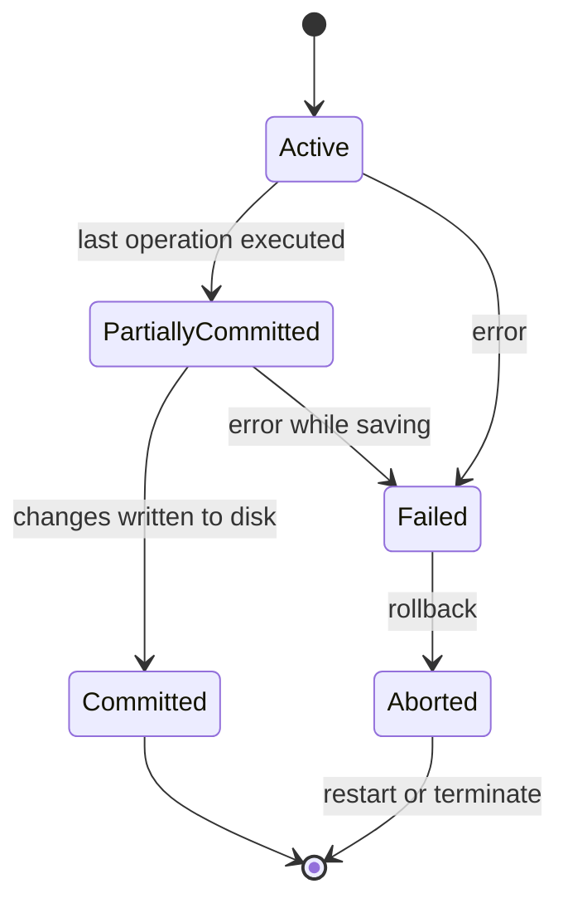

<table>
  <tr><th>Operations</th><th><a href="https://www.geeksforgeeks.org/transaction-states-in-dbms/">Transaction states</a></th></tr>
  <tr>
    <td></td>
    <td></td>
  </tr>
</table>

Reference: [Transaction Management in DBMS (PDF)](https://www.du.ac.in/du/uploads/departments/Operational%20Research/24042020_Transaction%20Management%20in%20DBMS.pdf)

</details>

<details>
<summary><strong>5. Spring transactional context</strong> — begin → commit or rollback, managed for you around the method.</summary>

**In simple words** — when a method is annotated with `@Transactional`, Spring does three things:

<table>
  <tr><th>#</th><th>Step</th><th>What Spring does</th><th>Shopping-trip analogy</th></tr>
  <tr><td>1</td><td><b>Begin</b></td><td>Before the method starts, opens a DB connection and begins a new transaction.</td><td>Start the trip, pick up a cart</td></tr>
  <tr><td>2</td><td><b>Commit</b></td><td>Method finished without an exception → changes become permanent.</td><td>Buy all items and check out</td></tr>
  <tr><td>3</td><td><b>Rollback</b></td><td>Unchecked exception (<code>RuntimeException</code> / <code>Error</code>) → all changes reverted.</td><td>Leave the store without buying anything</td></tr>
</table>

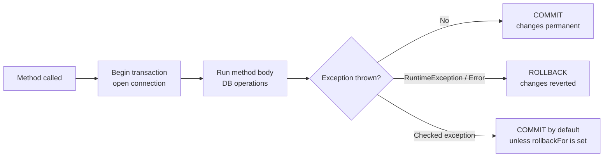


**The same lifecycle written by hand (programmatic transactions)** — this is exactly what the annotation does for you.

```java
@Service
public class BankServiceProgrammatic {

    private final PlatformTransactionManager txManager;
    private final TransactionTemplate txTemplate;

    public BankServiceProgrammatic(PlatformTransactionManager txManager) {
        this.txManager = txManager;
        this.txTemplate = new TransactionTemplate(txManager);
    }

    // Option 1: manual begin / commit / rollback
    public void transferManual(Long fromId, Long toId, BigDecimal amount) {
        TransactionStatus status = txManager.getTransaction(new DefaultTransactionDefinition()); // begin
        try {
            // ... debit and credit ...
            txManager.commit(status);                    // commit
        } catch (RuntimeException | Error e) {
            txManager.rollback(status);                  // rollback
            throw e;
        }
    }

    // Option 2: TransactionTemplate - Spring does begin/commit/rollback around your lambda
    public void transferTemplate(Long fromId, Long toId, BigDecimal amount) {
        txTemplate.executeWithoutResult(status -> {
            // ... debit and credit ...
            // status.setRollbackOnly();   // force a rollback without throwing
        });
    }
}
```

</details>

<details>
<summary><strong>6. How it works: proxy-based AOP</strong> — Spring wraps your bean in a proxy that opens and closes the transaction around your method.</summary>

**In simple words**

- Spring doesn't change your class. It creates a **proxy** (a stand-in object) around it.
- Callers talk to the proxy. The proxy begins the transaction, calls your real method, then commits or rolls back.
- **Memory hook:** *"Proxy opens the door, your method works, proxy closes it."*

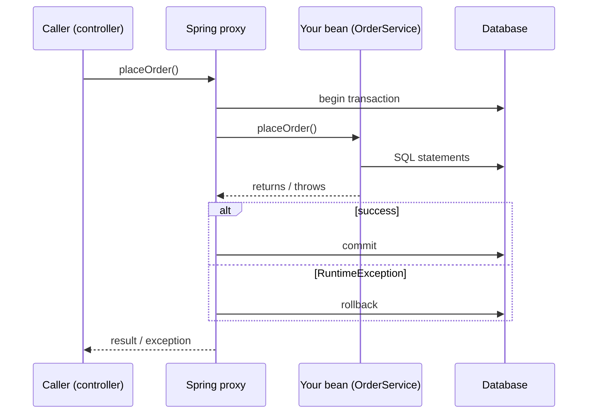

**What the proxy does, conceptually** (simplified — Spring generates this for you):

```java
public class OrderService$$SpringProxy extends OrderService {

    @Override
    public void placeOrder() {
        TransactionStatus status = txManager.getTransaction(definition); // begin
        try {
            super.placeOrder();                                          // your real method
            txManager.commit(status);                                    // commit
        } catch (RuntimeException | Error ex) {
            txManager.rollback(status);                                  // rollback
            throw ex;
        }
    }
}
```

Because everything depends on the proxy, a call that **doesn't go through the proxy gets no transaction**. The next two blocks show when that happens.

</details>

<details>
<summary><strong>7. AOP calls vs non-AOP calls</strong> — only calls that arrive through the proxy are transactional.</summary>

**In simple words**

- **AOP call** = comes from *outside* the bean (controller → service). It passes through the proxy → transaction works.
- **Non-AOP call** = the bean calls *itself* (`this.method()`). It skips the proxy → `@Transactional` is **ignored**.
- Only **public** methods are transactional by default, and the proxy cannot override **final** methods.

<table>
  <tr>
    <th>Scenario</th>
    <th>Call path</th>
    <th>Through the proxy?</th>
    <th>Transaction applied?</th>
    <th>Example / fix</th>
  </tr>
  <tr>
    <td><b>External call to a public method</b></td>
    <td>Controller → proxy → service</td>
    <td>✅ Yes (AOP call)</td>
    <td>✅ Yes</td>
<td><pre><code>@RestController
class OrderController {
  @Autowired OrderService service;
  void post() { service.placeOrder(); } // ✅
}</code></pre></td>
  </tr>
  <tr>
    <td><b>Self-invocation</b> (<code>this.method()</code>)</td>
    <td>Service → <b>same object</b></td>
    <td>❌ No (non-AOP call)</td>
    <td>❌ No — annotation ignored</td>
<td><pre><code>@Transactional
public class OrderService {
  public void placeOrder() {
    this.cancelOrder(); // ❌ bypasses proxy
  }
  public void cancelOrder() { ... }
}</code></pre>
Fix: next block.</td>
  </tr>
  <tr>
    <td><b>Call to another bean</b></td>
    <td>ServiceA → proxy of ServiceB</td>
    <td>✅ Yes</td>
    <td>✅ Yes (propagation decides join / new)</td>
<td><pre><code>class ServiceA {
  @Autowired ServiceB b;
  @Transactional void a() { b.work(); } // ✅
}</code></pre></td>
  </tr>
  <tr>
    <td><b>Non-public method</b></td>
    <td>Proxy cannot intercept</td>
    <td>❌ No</td>
    <td>❌ No (private / protected / package-private)</td>
<td><pre><code>@Transactional
private void save() { ... } // ❌ ignored</code></pre>
Fix: make it <code>public</code>. (Spring 6 relaxed this for class-based proxies, but <code>public</code> remains the safe rule.)</td>
  </tr>
  <tr>
    <td><b>final method / class</b></td>
    <td>Proxy cannot override</td>
    <td>❌ No</td>
    <td>❌ No</td>
<td><pre><code>@Transactional
public final void save() { ... } // ❌</code></pre>
Fix: remove <code>final</code>.</td>
  </tr>
  <tr>
    <td><b>Annotation only on interface</b></td>
    <td>Depends on proxy type</td>
    <td>⚠️ Not guaranteed</td>
    <td>⚠️ May be ignored with class-based proxies</td>
    <td>Annotate the <b>implementation class</b>, not the interface — Spring AOP proxies the implementation.</td>
  </tr>
</table>

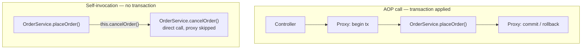

</details>

<details>
<summary><strong>8. Fixing self-invocation</strong> — four ways to make the inner call go through the proxy.</summary>

**The problem**

```java
@Service
public class OrderService {

    public void placeOrder() {
        this.cancelOrder();           // ❌ direct call: no proxy, no REQUIRES_NEW, no transaction
    }

    @Transactional(propagation = Propagation.REQUIRES_NEW)
    public void cancelOrder() { ... }
}
```

<details>
<summary>Fix A (best) — move the method to another bean</summary>

```java
@Service
public class OrderCancelService {
    @Transactional(propagation = Propagation.REQUIRES_NEW)
    public void cancelOrder() { ... }
}

@Service
public class OrderService {
    private final OrderCancelService cancelService;

    public OrderService(OrderCancelService cancelService) {
        this.cancelService = cancelService;
    }

    public void placeOrder() {
        cancelService.cancelOrder();   // ✅ goes through the proxy of another bean
    }
}
```

</details>

<details>
<summary>Fix B — inject the bean into itself (lazy self-injection)</summary>

```java
@Service
public class OrderService {

    @Autowired
    @Lazy
    private OrderService self;          // the PROXY of this very bean

    public void placeOrder() {
        self.cancelOrder();             // ✅ proxy call
    }

    @Transactional(propagation = Propagation.REQUIRES_NEW)
    public void cancelOrder() { ... }
}
```

</details>

<details>
<summary>Fix C — use TransactionTemplate inside the same class</summary>

```java
@Service
public class OrderService {

    private final TransactionTemplate requiresNew;

    public OrderService(PlatformTransactionManager txManager) {
        this.requiresNew = new TransactionTemplate(txManager);
        this.requiresNew.setPropagationBehavior(TransactionDefinition.PROPAGATION_REQUIRES_NEW);
    }

    public void placeOrder() {
        requiresNew.executeWithoutResult(status -> cancelOrder());   // ✅ explicit transaction
    }

    private void cancelOrder() { ... }
}
```

</details>

<details>
<summary>Fix D — fetch the current proxy (AopContext)</summary>

```java
@Configuration
@EnableAspectJAutoProxy(exposeProxy = true)
class AopConfig { }

@Service
public class OrderService {
    public void placeOrder() {
        ((OrderService) AopContext.currentProxy()).cancelOrder();    // ✅ proxy call
    }

    @Transactional(propagation = Propagation.REQUIRES_NEW)
    public void cancelOrder() { ... }
}
```

</details>

</details>

<details>
<summary><strong>9. Class-level vs method-level @Transactional</strong> — class-level sets a default for every public method; a method-level annotation overrides it.</summary>

**In simple words**

- **Priority: method-level > class-level.** The method annotation always wins.
- Class-level: every public method gets wrapped in a transaction with the same settings.
- Method-level: only the annotated method is transactional.

<table>
  <tr>
    <th>Aspect</th>
    <th><code>Class-level</code></th>
    <th><code>Method-level</code></th>
  </tr>
  <tr>
    <td><b>Scope</b></td>
    <td>Default behavior for <b>all public methods</b> of the class.</td>
    <td>Only the annotated method participates. Other methods are unaffected.</td>
  </tr>
  <tr>
    <td><b>Example</b></td>
<td>

```java
@Service
@Transactional(                       // class-level defaults
  propagation = Propagation.REQUIRED, // default
  isolation   = Isolation.DEFAULT,    // default
  readOnly    = false,                // default
  rollbackFor = RuntimeException.class// default
)
public class OrderService {
  public void placeOrder()  { ... } // transactional
  public void cancelOrder() { ... } // transactional
  public void getOrder()    { ... } // transactional
}
```

</td>
<td>

```java
@Service
public class OrderService {
  @Transactional
  public void placeOrder()  { ... } // transactional

  @Transactional
  public void cancelOrder() { ... } // transactional

  public void getOrder()    { ... } // NOT transactional
}
```

</td>
  </tr>
</table>

**Best practice — `readOnly = true` as the class default, override on write methods.** Reads get a performance benefit (Hibernate skips dirty checking) while writes stay properly transactional.

```java
@Service
@Transactional(readOnly = true)      // safe default for queries
public class OrderService {

    public Order getOrder(Long id) { ... }                      // uses the class-level default

    @Transactional                                               // overrides: read-write
    public void placeOrder() { ... }

    @Transactional(propagation = Propagation.REQUIRES_NEW)       // overrides
    public void auditOrder() { ... }

    @Transactional(rollbackFor = Exception.class)                // overrides
    public void refundOrder() throws Exception { ... }
}
```

</details>

<details>
<summary><strong>10. Application flow vs transaction flow</strong> — a logical unit of work (like entering an organization) must succeed or fail as a whole.</summary>

**In simple words** — `enterOrganization` (1) saves the Employee and (2) saves the HealthInsurance. If step 2 fails, step 1 must be undone too. The same goes for `exitOrganization`. That whole sequence is **one unit of work**.

<table>
  <tr><th>Application flow</th><th>Transaction flow</th></tr>
  <tr>
    <td></td>
    <td></td>
  </tr>
</table>

**Without a transaction (autocommit) — the bug**

```java
@Service
public class OrganizationService {

    public void enterOrganization(Employee employee, HealthInsurance insurance) {
        employeeRepository.save(employee);          // commits immediately
        healthInsuranceRepository.save(insurance);  // fails → employee row STAYS (inconsistent!)
    }
}
```

**With `@Transactional` — all or none**

```java
@Service
public class OrganizationService {

    @Transactional
    public void enterOrganization(Employee employee, HealthInsurance insurance) {
        employeeRepository.save(employee);
        healthInsuranceRepository.save(insurance);  // fails → employee insert is rolled back too
    }

    @Transactional
    public void exitOrganization(Long employeeId) {
        healthInsuranceRepository.deleteByEmployeeId(employeeId);
        employeeRepository.deleteById(employeeId);  // one unit of work
    }
}
```

</details>

<details>
<summary><strong>11. Transaction propagation</strong> — what a called method does when the caller already has (or doesn't have) a transaction.</summary>

**In simple words** — services call other services. Propagation answers: *"Should the called method join the caller's transaction, start its own, or run without one?"*

```java
@Transactional(propagation = Propagation.REQUIRES_NEW)
@Transactional(propagation = Propagation.SUPPORTS)
```


<table>
  <tr>
    <th>Propagation</th>
    <th>Behaviour</th>
    <th>If a tx exists</th>
    <th>If no tx exists</th>
    <th>Team-meeting analogy</th>
    <th>Memory hook</th>
  </tr>
  <tr><td><b>REQUIRED</b> (default)</td><td>Always runs in a transaction.</td><td>Joins it</td><td>Creates a new one</td><td>Join an existing meeting or start a new one</td><td>"Join if you can"</td></tr>
  <tr><td><b>SUPPORTS</b></td><td>May or may not run in a transaction.</td><td>Joins it</td><td>Runs without a tx</td><td>Join the meeting if it exists, else work independently</td><td>"Optional"</td></tr>
  <tr><td><b>NOT_SUPPORTED</b></td><td>Always runs without a transaction.</td><td>Suspends it</td><td>Runs without a tx</td><td>Avoid meetings; wait for the current one to finish</td><td>"No tx please"</td></tr>
  <tr><td><b>REQUIRES_NEW</b></td><td>Always runs in a <b>new</b> transaction.</td><td>Suspends it, starts new</td><td>Creates a new one</td><td>Start a separate meeting, pausing the current one</td><td>"Always fresh"</td></tr>
  <tr><td><b>NEVER</b></td><td>Always runs without a transaction.</td><td>Throws an exception</td><td>Runs without a tx</td><td>Refuse to work if a meeting is in progress</td><td>"Tx forbidden"</td></tr>
  <tr><td><b>MANDATORY</b></td><td>Always runs in a transaction.</td><td>Joins it</td><td>Throws an exception</td><td>Work only if a meeting is in progress; fail otherwise</td><td>"Tx or error"</td></tr>
  <tr><td><b>NESTED</b></td><td>Nested transaction (savepoint) inside the existing one.</td><td>Nested tx; inner rollback can revert to the savepoint</td><td>Behaves like REQUIRED</td><td>Start a sub-meeting inside the main one</td><td>"Mini tx inside"</td></tr>
</table>

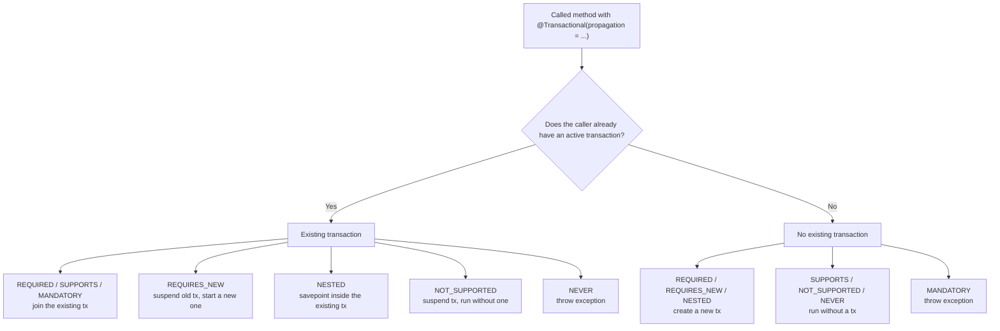

Each type has a Java example in the blocks inside this one. (Remember: propagation only works for calls that go through the proxy — see the self-invocation blocks.)

<details>
<summary>REQUIRED (default) — join the caller's transaction, or create one</summary>

```java
@Service
public class OrderService {
    private final PaymentService paymentService;
    public OrderService(PaymentService paymentService) { this.paymentService = paymentService; }

    @Transactional                       // TX-1 starts here
    public void placeOrder() {
        orderRepository.save(new Order());
        paymentService.charge();         // joins TX-1: one commit / one rollback for both
    }
}

@Service
public class PaymentService {
    @Transactional(propagation = Propagation.REQUIRED)   // the default; joins if one exists
    public void charge() { ... }
}
```

**Pitfall:** if `charge()` throws a runtime exception and `placeOrder()` catches it and carries on, the shared transaction is already marked *rollback-only*, so the final commit fails with `UnexpectedRollbackException`. Joining means sharing the same fate.

```java
@Transactional
public void placeOrder() {
    try {
        paymentService.charge();         // throws → whole TX-1 marked rollback-only
    } catch (RuntimeException e) {
        // swallowed - but TX-1 will still roll back and the commit throws UnexpectedRollbackException
    }
}
```

</details>

<details>
<summary>REQUIRES_NEW — always start a fresh transaction (classic use: audit logging)</summary>

```java
@Service
public class AuditService {
    @Transactional(propagation = Propagation.REQUIRES_NEW)   // own transaction, commits independently
    public void log(String message) {
        auditRepository.save(new AuditLog(message));
    }
}

@Service
public class OrderService {
    @Transactional
    public void placeOrder() {
        auditService.log("order attempted");   // committed in its own TX-2
        throw new IllegalStateException("payment failed");   // TX-1 rolls back, audit row STAYS
    }
}
```

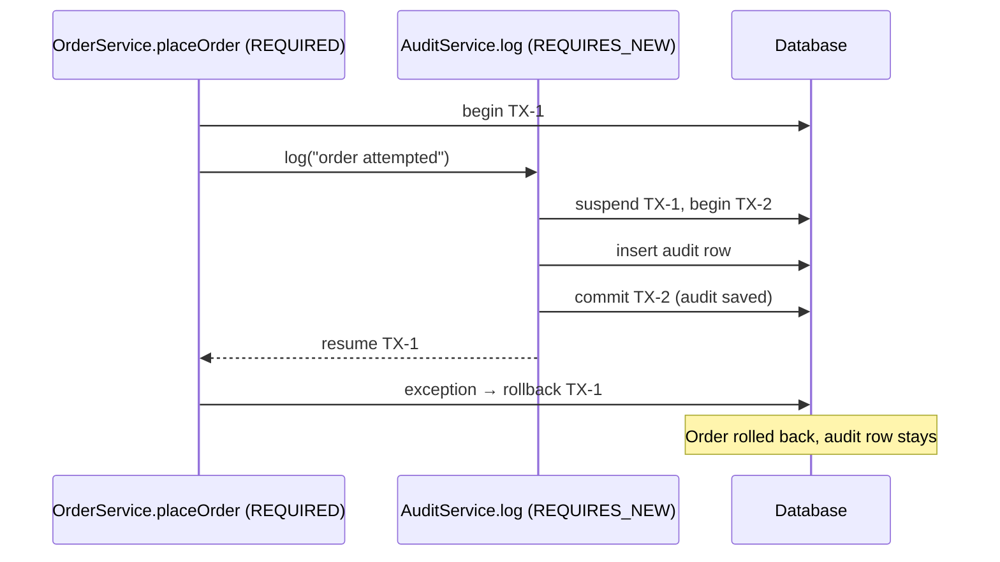

</details>

<details>
<summary>SUPPORTS — use a transaction if there is one, otherwise run without</summary>

```java
@Service
public class PriceService {
    // Works inside a caller's transaction (sees its uncommitted changes),
    // and also works fine when called with no transaction at all.
    @Transactional(propagation = Propagation.SUPPORTS, readOnly = true)
    public BigDecimal currentPrice(Long productId) {
        return priceRepository.findPrice(productId);
    }
}
```

</details>

<details>
<summary>NOT_SUPPORTED — run without a transaction, suspending any existing one</summary>

```java
@Service
public class NotificationService {
    // Slow external call: don't keep a DB transaction (and its locks) open while waiting for it.
    @Transactional(propagation = Propagation.NOT_SUPPORTED)
    public void sendEmail(String to, String body) {
        mailClient.send(to, body);
    }
}
```

</details>

<details>
<summary>MANDATORY — must be called inside a transaction, otherwise throw</summary>

```java
@Service
public class LedgerService {
    // This must never be used on its own: it only makes sense as part of a bigger transaction.
    @Transactional(propagation = Propagation.MANDATORY)
    public void writeEntry(Long accountId, BigDecimal amount) {
        ledgerRepository.save(new LedgerEntry(accountId, amount));
    }
}

// Called with no transaction → IllegalTransactionStateException:
// "No existing transaction found for transaction marked with propagation 'mandatory'"
```

</details>

<details>
<summary>NEVER — must NOT be called inside a transaction, otherwise throw</summary>

```java
@Service
public class ReportService {
    @Transactional(propagation = Propagation.NEVER)
    public void generateBigReport() {
        // streams from the database in autocommit mode; a surrounding transaction is a bug
    }
}

// Called from inside a @Transactional method → IllegalTransactionStateException
```

</details>

<details>
<summary>NESTED — a savepoint inside the existing transaction</summary>

```java
@Service
public class ImportService {
    private final RowImporter rowImporter;
    public ImportService(RowImporter rowImporter) { this.rowImporter = rowImporter; }

    @Transactional
    public void importAll(List<Row> rows) {
        for (Row row : rows) {
            try {
                rowImporter.importRow(row);       // NESTED: inner failure rolls back to its savepoint only
            } catch (RuntimeException e) {
                log.warn("Skipping bad row {}", row, e);   // outer transaction keeps going
            }
        }
    }   // good rows are committed together
}

@Service
public class RowImporter {
    @Transactional(propagation = Propagation.NESTED)
    public void importRow(Row row) { ... }
}
```

NESTED needs savepoint support from the database driver and the transaction manager. With no existing transaction it behaves like REQUIRED.

</details>

</details>

<details>
<summary><strong>12. Transaction rollback</strong> — runtime exceptions roll back automatically; checked exceptions do NOT unless you say so.</summary>

**In simple words**

- Hook: **"Runtime = Rollback."**
- In real applications the exception is usually a *checked business exception*, and Spring **commits** by default in that case — even with `@Transactional` present. Tell Spring with `rollbackFor`.

<table>
  <tr>
    <th>Exception type</th>
    <th>Examples</th>
    <th>Default behavior</th>
    <th>How to change</th>
  </tr>
  <tr><td>Unchecked</td><td><code>RuntimeException</code>, <code>Error</code></td><td><b>Rollback</b></td><td><code>noRollbackFor = X.class</code></td></tr>
  <tr><td>Checked / business</td><td><code>IOException</code>, <code>InvalidInsuranceAmountException</code></td><td><b>Commit</b> (no rollback!)</td><td><code>rollbackFor = X.class</code> or <code>rollbackFor = Exception.class</code></td></tr>
</table>

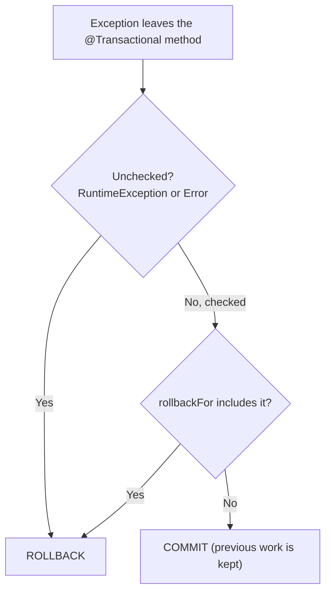

<details>
<summary>Example 1 — unchecked exception: automatic rollback</summary>

```java
@Transactional
public void enterOrganization(Employee employee, HealthInsurance insurance) {
    employeeRepository.save(employee);
    if (insurance.getAmount() <= 0) {
        throw new IllegalArgumentException("Invalid insurance amount");   // RuntimeException
    }
    healthInsuranceRepository.save(insurance);
}   // employee insert is rolled back automatically
```

</details>

<details>
<summary>Example 2 — checked exception NOT informed: no rollback (the trap)</summary>

```java
public class InvalidInsuranceAmountException extends Exception { }   // checked

@Transactional                                   // no rollbackFor
public void enterOrganization(Employee employee, HealthInsurance insurance)
        throws InvalidInsuranceAmountException {
    employeeRepository.save(employee);
    if (insurance.getAmount() <= 0) {
        throw new InvalidInsuranceAmountException();   // checked → Spring COMMITS the employee row
    }
    healthInsuranceRepository.save(insurance);
}
```

</details>

<details>
<summary>Example 3 — checked exception informed with rollbackFor</summary>

```java
@Transactional(rollbackFor = InvalidInsuranceAmountException.class)
public void enterOrganization(Employee employee, HealthInsurance insurance)
        throws InvalidInsuranceAmountException {
    employeeRepository.save(employee);
    if (insurance.getAmount() <= 0) {
        throw new InvalidInsuranceAmountException();   // now the employee insert IS rolled back
    }
    healthInsuranceRepository.save(insurance);
}

// Roll back on every exception:
@Transactional(rollbackFor = Exception.class)
public void anything() throws Exception { ... }

// Keep the data for a specific runtime exception:
@Transactional(noRollbackFor = DuplicateEmailWarning.class)
public void register(User user) { ... }
```

<table>
  <tr>
    <th>Checked exception, <b>not informed</b> to roll back<br><code>@Transactional</code></th>
    <th>Checked exception, <b>informed</b> to roll back<br><code>@Transactional(rollbackFor = InvalidInsuranceAmountException.class)</code></th>
  </tr>
  <tr>
    <td></td>
    <td></td>
  </tr>
</table>

</details>

<details>
<summary>Example 4 — swallowed exception: Spring commits</summary>

```java
@Transactional
public void register(User user) {
    try {
        userRepository.save(user);
        emailRepository.save(new Email(user));      // throws a RuntimeException
    } catch (RuntimeException e) {
        log.error("failed", e);                     // caught and NOT rethrown → Spring sees a normal return → COMMIT
    }
}
```

Fix: rethrow, or mark the transaction rollback-only yourself:

```java
} catch (RuntimeException e) {
    log.error("failed", e);
    TransactionAspectSupport.currentTransactionStatus().setRollbackOnly();   // force rollback
}
```

</details>

</details>

<details>
<summary><strong>13. Transaction isolation</strong> — how much one running transaction can see of another's work.</summary>

**In simple words**

- Isolation decides what the database shows a transaction while *another* transaction is changing the same rows at the same time. It works by **locking records**.
- It is one of the ACID properties, so it's a **database concept** — Spring just lets you choose the level. The ANSI/ISO standard defines four levels.
- **Memory hook:** each level up adds one more protection, but gets slower.

```java
// Any isolation level supported by the underlying database can be used.
@Transactional(isolation = Isolation.SERIALIZABLE)
```


**Try it at the database level (MySQL)**

```sql
CREATE TABLE employee (
  empId   VARCHAR(10)  NOT NULL,
  empName VARCHAR(100) NOT NULL
);
```

```sql
-- Show existing transaction isolation level: MySQL >= 8
SELECT @@TRANSACTION_ISOLATION;

-- MySQL < 8
SELECT @@TX_ISOLATION;

-- Set transaction isolation level to serializable (same syntax for the others)
SET SESSION TRANSACTION ISOLATION LEVEL SERIALIZABLE;

-- Auto commit is enabled by default in MySQL, so disable it for the experiment
SET AUTOCOMMIT=0;

-- Start transaction
BEGIN

-- Commit transaction
COMMIT
```

**The four levels**

<table>
  <tr>
    <th>SERIALIZABLE</th>
    <th>REPEATABLE_READ</th>
    <th>READ_COMMITTED</th>
    <th>READ_UNCOMMITTED</th>
  </tr>
  <tr>
    <td>If two transactions run concurrently, it is as if they ran <b>one after the other</b>: the second runs only after the first commits. This is <b>total isolation</b>. Downside: <b>low performance and possible deadlocks</b>.</td>
    <td>Until the first transaction commits, <b>existing records cannot be changed</b> by the second, but <b>new records can be added</b>. After the second commits, the new records show up in the first (still uncommitted). <b>MySQL's default is REPEATABLE_READ</b>, though in MySQL the newly committed records are <i>not</i> visible to the first transaction.</td>
    <td>Before the first transaction commits, the second can change existing records and add new ones. After the second commits, <b>both updated and newly added records become visible</b> in the still-running first transaction.</td>
    <td>Same as READ_COMMITTED, but <b>even if the second transaction has not committed</b>, its newly added and updated records are visible in the first transaction.</td>
  </tr>
  <tr>
    <td></td>
    <td></td>
    <td></td>
    <td></td>
  </tr>
</table>

**Using each level in Java**

```java
@Transactional(isolation = Isolation.DEFAULT)           // use the database's own default
public void a() { ... }

@Transactional(isolation = Isolation.READ_UNCOMMITTED)  // fastest, least safe: dirty reads possible
public void b() { ... }

@Transactional(isolation = Isolation.READ_COMMITTED)    // never see uncommitted data
public void c() { ... }

@Transactional(isolation = Isolation.REPEATABLE_READ)   // same rows read twice give the same values
public void d() { ... }

@Transactional(isolation = Isolation.SERIALIZABLE)      // as if transactions ran one at a time
public void e() { ... }
```

`Isolation.DEFAULT` uses the database's default — **not always READ_COMMITTED**. MySQL (InnoDB) defaults to `REPEATABLE_READ`; many other databases default to `READ_COMMITTED`.

</details>

<details>
<summary><strong>14. Dirty, non-repeatable and phantom reads</strong> — the three problems isolation levels prevent, with a Java example for each.</summary>

**In simple words**

- **Dirty read** — you read data another transaction hasn't committed; it may be rolled back, so you hold a value that never really existed.
- **Non-repeatable read** — you read the same row twice and get *different values* because someone changed it in between.
- **Phantom read** — you run the same query twice and get a *different number of rows* because someone inserted new ones in between.

> In these examples the reads use `JdbcTemplate`. If you read the same entity twice with JPA `findById`, the second read comes from the Hibernate first-level cache and hides the effect.

<details>
<summary>Dirty read</summary>

```java
// Transaction A (isolation READ_UNCOMMITTED for B)
@Transactional
public void transactionA() {
    jdbcTemplate.update("UPDATE account SET balance = 0 WHERE id = 1");   // not committed yet
    // ... later: throws → ROLLBACK
}

// Transaction B
@Transactional(isolation = Isolation.READ_UNCOMMITTED)
public void transactionB() {
    Integer balance = jdbcTemplate.queryForObject(
            "SELECT balance FROM account WHERE id = 1", Integer.class);   // sees 0 → DIRTY READ
}
```

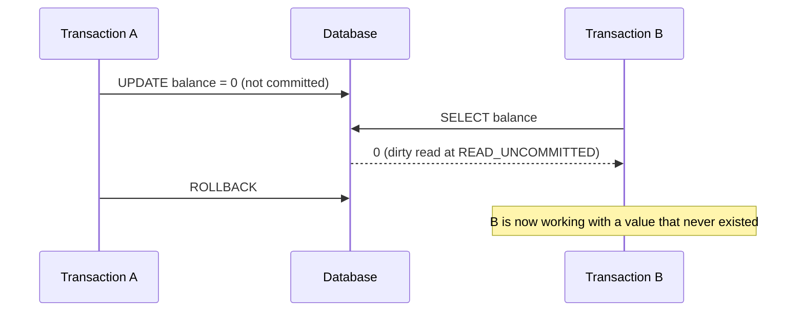

Prevented by: READ_COMMITTED and above.

</details>

<details>
<summary>Non-repeatable read</summary>

```java
@Transactional(isolation = Isolation.READ_COMMITTED)
public void report() {
    Integer first = jdbcTemplate.queryForObject(
            "SELECT balance FROM account WHERE id = 1", Integer.class);    // 100

    // ... another transaction updates balance to 150 and COMMITS here ...

    Integer second = jdbcTemplate.queryForObject(
            "SELECT balance FROM account WHERE id = 1", Integer.class);    // 150 → NON-REPEATABLE READ
}
```

Prevented by: REPEATABLE_READ and above.

</details>

<details>
<summary>Phantom read</summary>

```java
@Transactional(isolation = Isolation.REPEATABLE_READ)
public void countOrders() {
    Integer before = jdbcTemplate.queryForObject(
            "SELECT COUNT(*) FROM orders WHERE status = 'NEW'", Integer.class);   // 10

    // ... another transaction inserts a NEW order and COMMITS here ...

    Integer after = jdbcTemplate.queryForObject(
            "SELECT COUNT(*) FROM orders WHERE status = 'NEW'", Integer.class);   // 11 → PHANTOM READ
}
```

(In MySQL's REPEATABLE_READ the second count usually stays at 10, as the page above notes.) Prevented by: SERIALIZABLE.

</details>

**Which level prevents which problem**

<table>
  <tr>
    <th>Isolation level</th>
    <th>Dirty reads</th>
    <th>Non-repeatable reads</th>
    <th>Phantom reads</th>
    <th>Speed / concurrency</th>
  </tr>
  <tr>
    <td><b>SERIALIZABLE</b></td>
    <td>Not possible — the second transaction can't start until the first commits (sequential execution).</td>
    <td>Not possible — same reason.</td>
    <td>Not possible — same reason.</td>
    <td>Slowest, highest deadlock risk</td>
  </tr>
  <tr>
    <td><b>REPEATABLE_READ</b></td>
    <td>Not possible — changes become visible only after commit.</td>
    <td>Not possible — records change only after commit, so repeated SELECTs return the same existing records.</td>
    <td><b>Possible</b> — others can insert new records before the first commits.</td>
    <td>Slower</td>
  </tr>
  <tr>
    <td><b>READ_COMMITTED</b></td>
    <td>Not possible — changes are visible only after commit.</td>
    <td><b>Possible</b> — others can modify existing records before the first commits.</td>
    <td><b>Possible</b></td>
    <td>Faster</td>
  </tr>
  <tr>
    <td><b>READ_UNCOMMITTED</b></td>
    <td><b>Possible</b> — records are readable even if uncommitted; a rollback leaves others with wrong values.</td>
    <td><b>Possible</b></td>
    <td><b>Possible</b></td>
    <td>Fastest, least safe</td>
  </tr>
</table>

</details>

<details>
<summary><strong>15. Isolation in practice: a concurrency test</strong> — 100 parallel increments show what goes wrong without locking.</summary>

**In simple words** — we build a tiny salary account, call "add 1 to the balance" 100 times in parallel, and watch the final balance come out wrong.

**Entity**

```java
@Getter @Setter @Builder @AllArgsConstructor @NoArgsConstructor
@Entity
public class SalaryAccount {
    @Id
    @GeneratedValue(strategy = GenerationType.IDENTITY)
    Long id;

    private BigDecimal balance;

    @OneToOne
    @JsonIgnore
    private Employee employee;
}
```

**Repository**

```java
@Repository
public interface SalaryAccountRepository extends CrudRepository<SalaryAccount, Long> { }
```

**Controller** — a PUT mapping that increments the balance by 1

```java
@RestController
@RequestMapping("/employees")
@RequiredArgsConstructor
public class EmployeeController {

    private final EmployeeService employeeService;
    private final SalaryAccountService salaryAccountService;

    @PostMapping
    public ResponseEntity<EmployeeDto> createNewEmployee(@RequestBody EmployeeDto employeeDto) {
        EmployeeDto createdEmployeeDto = employeeService.createNewEmployee(employeeDto);
        return new ResponseEntity<>(createdEmployeeDto, HttpStatus.CREATED);
    }

    @PutMapping("/incrementBalance/{accountId}")
    public ResponseEntity<SalaryAccount> incrementBalance(@PathVariable Long accountId) {
        SalaryAccount salaryAccount = salaryAccountService.incrementBalance(accountId);
        return ResponseEntity.ok(salaryAccount);
    }
}
```

**Service** — default isolation (the database default, e.g. READ_COMMITTED or REPEATABLE_READ), no locking

```java
@Service
@RequiredArgsConstructor
@Transactional(propagation = Propagation.REQUIRED)
// creates a transactional context; without it, create() fails with "employee not found"
public class SalaryAccountServiceImpl implements SalaryAccountService {

    private final SalaryAccountRepository salaryAccountRepository;

    @Override
    public void createAccount(Employee employee) {
        SalaryAccount salaryAccount = SalaryAccount.builder()
                .employee(employee)
                .balance(BigDecimal.ZERO)
                .build();
        salaryAccountRepository.save(salaryAccount);
    }

    @Override
    public SalaryAccount incrementBalance(Long accountId) {
        SalaryAccount salaryAccount = salaryAccountRepository.findById(accountId)
                .orElseThrow(() -> new RuntimeException("Account not found"));

        BigDecimal prevBalance = salaryAccount.getBalance();
        BigDecimal newBalance = prevBalance.add(BigDecimal.valueOf(1L));
        salaryAccount.setBalance(newBalance);

        return salaryAccountRepository.save(salaryAccount);
    }
}
```

**Run 100 concurrent requests** after creating the employee (`xargs -P 10` sends 10 at a time):

```bash
# Run 100 concurrent requests to increment the balance
seq 100 | xargs -P 10 -I {} curl --location --request PUT 'http://127.0.0.1:8080/employees/incrementBalance/1'

# Alternative: ApacheBench (may need installation)
ab -n 100 -c 10 -T 'application/json' -m PUT http://127.0.0.1:8080/items/incrementCount/1
```

**What you see:** the final balance is **below 100**, and if you don't handle the exception, some requests return HTTP 500 (stale-data / version conflicts). Why:

- **Concurrent reads and writes** — several threads read the same starting state (e.g. `balance=1.00`) and update at the same time.
- **Outdated data overwriting** — threads holding stale data overwrite newer updates; the balance can "jump backward" (a *lost update*).
- **Stale data errors** — version mismatches raise errors when conflicting updates collide.
- **No transactional locking** — without locks or optimistic locking, consistency can't be guaranteed.
- Other contributors: caching, network delays, and concurrency conflicts that feed inconsistent or outdated data into the transaction.

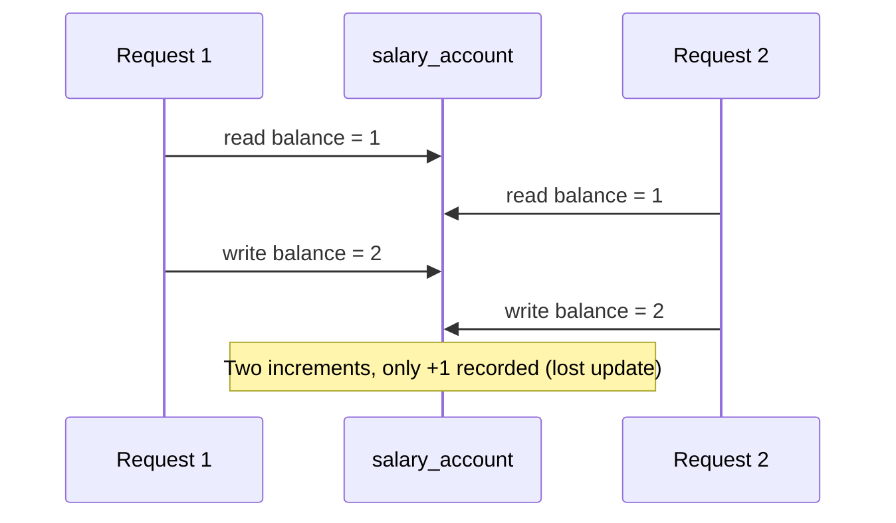

The next block shows four ways to fix it.

</details>

<details>
<summary><strong>16. Fixing lost updates</strong> — optimistic lock, pessimistic lock, atomic update, or a stricter isolation level.</summary>

**In simple words**

- **Optimistic:** "assume nobody collides; if someone did, fail and retry." (uses a `@Version` column)
- **Pessimistic:** "lock the row first so nobody else can touch it." (uses `SELECT … FOR UPDATE`)
- **Atomic update:** "let the database do `balance = balance + 1` in one statement."
- **SERIALIZABLE:** "force transactions to run one after another" — safe but slow, and you must be ready to retry.

<details>
<summary>Option 1 — Optimistic locking with @Version (+ retry)</summary>

```java
@Entity
public class SalaryAccount {
    @Id @GeneratedValue(strategy = GenerationType.IDENTITY)
    private Long id;

    private BigDecimal balance;

    @Version                        // Hibernate adds "AND version = ?" to every UPDATE and bumps it
    private Long version;
}
```

A conflicting update now fails with `ObjectOptimisticLockingFailureException` instead of silently overwriting. Retry **outside** the transaction so each attempt gets a fresh one:

```java
@Service
@RequiredArgsConstructor
public class SalaryAccountFacade {

    private final TransactionTemplate txTemplate;
    private final SalaryAccountRepository repository;

    public SalaryAccount incrementWithRetry(Long id) {
        for (int attempt = 1; ; attempt++) {
            try {
                return txTemplate.execute(status -> {            // new transaction per attempt
                    SalaryAccount account = repository.findById(id).orElseThrow();
                    account.setBalance(account.getBalance().add(BigDecimal.ONE));
                    return repository.save(account);
                });
            } catch (ObjectOptimisticLockingFailureException e) {
                if (attempt == 3) throw e;                         // give up after 3 tries
            }
        }
    }
}
```

</details>

<details>
<summary>Option 2 — Pessimistic locking (row lock)</summary>

```java
public interface SalaryAccountRepository extends JpaRepository<SalaryAccount, Long> {

    @Lock(LockModeType.PESSIMISTIC_WRITE)                 // SELECT ... FOR UPDATE
    @Query("select a from SalaryAccount a where a.id = :id")
    Optional<SalaryAccount> findByIdForUpdate(@Param("id") Long id);
}

@Transactional
public SalaryAccount incrementBalance(Long accountId) {
    SalaryAccount account = repository.findByIdForUpdate(accountId).orElseThrow();   // others wait here
    account.setBalance(account.getBalance().add(BigDecimal.ONE));
    return account;
}
```

Keep these transactions short. Long ones increase waiting and deadlock risk (see the deadlock block).

</details>

<details>
<summary>Option 3 — Atomic update in the database</summary>

```java
public interface SalaryAccountRepository extends JpaRepository<SalaryAccount, Long> {

    @Modifying
    @Query("update SalaryAccount a set a.balance = a.balance + 1 where a.id = :id")
    int increment(@Param("id") Long id);                   // one SQL statement, no read-modify-write gap
}

@Transactional
public void incrementBalance(Long accountId) {
    repository.increment(accountId);
}
```

</details>

<details>
<summary>Option 4 — Stricter isolation level</summary>

```java
@Transactional(isolation = Isolation.SERIALIZABLE)
public SalaryAccount incrementBalance(Long accountId) {
    // The database serializes conflicting transactions; one may fail with a
    // deadlock / serialization error → be ready to retry.
    ...
}
```

</details>

</details>

<details>
<summary><strong>17. readOnly and timeout</strong> — two small attributes that speed up reads and stop runaway transactions.</summary>

**In simple words**

- `readOnly = true` → "I only read." The persistence provider can skip dirty checking and the driver/database can optimize.
- `timeout = 5` → "if this takes longer than 5 seconds, roll back" so locks aren't held indefinitely.

```java
@Service
public class OrderQueryService {

    @Transactional(readOnly = true)               // read-only transaction
    public List<Order> findOpenOrders() {
        return orderRepository.findByStatus("OPEN");
    }

    @Transactional(timeout = 5)                   // seconds; rolls back if exceeded
    public void slowButBounded() {
        // ...
    }

    @Transactional(readOnly = true, timeout = 3, isolation = Isolation.READ_COMMITTED)
    public Order findOrder(Long id) {
        return orderRepository.findById(id).orElseThrow();
    }
}
```

Don't call a `readOnly = true` method that writes — the write may be ignored or rejected depending on the provider and database.

</details>

<details>
<summary><strong>18. Hibernate flush and write-behind</strong> — Hibernate delays SQL until the last possible moment.</summary>

**In simple words**

- When you change an entity, Hibernate does **not** run SQL immediately. It remembers the change in the **persistence context** (the first-level cache) and writes it later — at commit, before a query that needs it, or when you call `flush()`.
- This delaying is called **transactional write-behind**.
- A transaction can flush **many times**. Flushed changes are visible only to the **current** transaction until it commits; other transactions can't see them.
- The persistence context is a **buffer** between your code and the database. In caching theory, write-behind means all changes happen against the cache, which later synchronizes with the backing store.

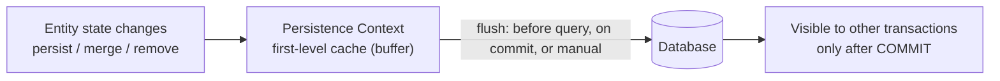


```java
@Service
public class UserService {

    @PersistenceContext
    private EntityManager entityManager;

    @Transactional
    public void rename(Long id) {
        User user = entityManager.find(User.class, id);   // SELECT, entity now managed (L1 cache)
        user.setName("Yash");                             // no SQL yet - just remembered (write-behind)

        entityManager.flush();                            // UPDATE runs NOW (still inside the transaction,
                                                          // invisible to other transactions)

        user.setName("Yash K");                           // another change, again deferred
    }                                                     // commit → flush (2nd UPDATE) → COMMIT
}
```

Flushes also happen automatically before a JPQL query that could be affected by pending changes (`FlushModeType.AUTO`).

</details>

<details>
<summary><strong>19. Hibernate caching: L1, L2 and query cache</strong> — three layers that save database round trips.</summary>

**In simple words**

- A cache sits between your app and the database so repeated reads don't hit the DB. It's one of the main ways to make a Hibernate app fast.
- **L1** = per session, always on. **L2** = shared by all sessions, opt-in. **Query cache** = remembers query result sets, opt-in.

<table>
  <tr>
    <th>Cache</th>
    <th>Scope</th>
    <th>Default</th>
    <th>Details</th>
  </tr>
  <tr>
    <td><b>First-level (L1)</b></td>
    <td>Per <code>Session</code> / <code>EntityManager</code></td>
    <td>Always on</td>
    <td>Each session caches independently, nothing is shared across sessions, and the cache is discarded when the session closes.</td>
  </tr>
  <tr>
    <td><b>Second-level (L2)</b></td>
    <td>Per <code>SessionFactory</code> (shared by all sessions)</td>
    <td>Disabled; enable by configuration</td>
    <td>Requests can be served from the cache even across sessions, with much lower latency than the DB. <b>Ehcache</b> is a pluggable second-level cache for Hibernate that caches common queries in memory.</td>
  </tr>
  <tr>
    <td><b>Query cache</b></td>
    <td>Result sets of queries</td>
    <td>Disabled</td>
    <td>Caches query result sets. Only useful for <b>repeated</b> queries with the same parameters.</td>
  </tr>
</table>

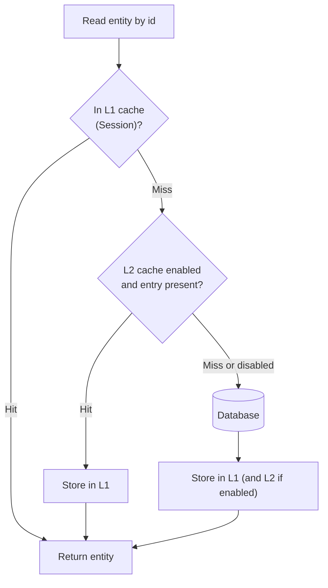

<table>
  <tr><th>Hibernate cache diagrams</th></tr>
  <tr>
    <td>
      <br>
      <br>
      Sources: <a href="https://hazelcast.com/glossary/hibernate-second-level-cache/">Hazelcast glossary</a>, <a href="https://stackoverflow.com/a/23454195/5081877">StackOverflow</a>
    </td>
  </tr>
</table>

**L1 in action — same session, same object, one SELECT**

```java
@Transactional
public void l1Demo() {
    User a = entityManager.find(User.class, 1L);   // SELECT
    User b = entityManager.find(User.class, 1L);   // no SQL: served from the first-level cache
    System.out.println(a == b);                     // true - the very same instance
}
```

**L2 — turning it on and marking an entity as cacheable** (the Ehcache setup details are in the migration file)

```java
// properties: hibernate.cache.use_second_level_cache = true
//             hibernate.cache.region.factory_class   = (Ehcache / JCache region factory)

@Entity
@jakarta.persistence.Cacheable
@org.hibernate.annotations.Cache(usage = CacheConcurrencyStrategy.READ_WRITE)
public class Address {
    @Id private Long id;
    private String city;
}
```

**Query cache — also needs a hint on the query**

```java
// properties: hibernate.cache.use_query_cache = true
@QueryHints(@QueryHint(name = "org.hibernate.cacheable", value = "true"))
List<Address> findByCity(String city);
```

</details>

<details>
<summary><strong>20. JPA locking and @Version</strong> — how JPA protects data: optimistic versioning plus database row locks.</summary>

**In simple words**

- JPA has a thorough concurrency-control mechanism with **implicit** and **explicit** locking. The implicit one relies on two things:

<table>
  <tr><th>Mechanism</th><th>How it works</th><th>Triggered by</th></tr>
  <tr><td><b>Optimistic locking</b></td><td>Entity state changes can trigger a <b>version increment</b>. A concurrent update holding an old version fails.</td><td>A <code>@Version</code> field on the entity</td></tr>
  <tr><td><b>Row-level locking</b></td><td>Depending on the current <b>transaction isolation level</b>, <code>INSERT/UPDATE/DELETE</code> statements may acquire <b>exclusive row locks</b>.</td><td>The database, while the transaction is open</td></tr>
</table>

Supported types for version properties: `int`, `Integer`, `short`, `Short`, `long`, `Long`, `java.sql.Timestamp`.

```java
@Entity
public class MyEntity implements Serializable {
    // ...

    @Version
    @Column(name = "optlockversion", columnDefinition = "integer DEFAULT 0", nullable = false)
    private long version = 0L;

    // ...
}
```

**What a conflict looks like**

```java
// Two users load the same row (version = 5) and both save a change.
// First save:  UPDATE my_entity SET ..., optlockversion = 6 WHERE id = ? AND optlockversion = 5   → 1 row updated
// Second save: UPDATE my_entity SET ..., optlockversion = 6 WHERE id = ? AND optlockversion = 5   → 0 rows updated
//              → jakarta.persistence.OptimisticLockException
//              → Spring translates it to ObjectOptimisticLockingFailureException

try {
    service.updateName(id, "New name");
} catch (ObjectOptimisticLockingFailureException e) {
    // reload the entity, show the user the newer data, or retry
}
```

Reference: [`@Version` Javadoc](https://docs.oracle.com/javaee/7/api/javax/persistence/Version.html) (in Jakarta: `jakarta.persistence.Version`).

</details>

<details>
<summary><strong>21. @Entity vs dynamic tables and the first-level cache</strong> — Hibernate only tracks entities you load through the EntityManager, not tables you hit with raw SQL.</summary>

**In simple words**

- `@Entity` classes accessed through JPA repositories / the `EntityManager` are **managed by Hibernate** and use the first-level cache.
- Raw SQL (`JdbcTemplate`, native queries) **bypasses Hibernate**. Hibernate doesn't know about those changes and can't cache or track them.
- A **dynamic table** (e.g. `UserDynamic_202301`, `UserDynamic_202302` — one table per month, created at runtime) has no `@Entity`, so it's plain SQL only.

```java
@Entity // ORM - first-level cache
public class UserTable {
    // Fields, getters, setters, etc.
}

// Assume UserDynamic is created dynamically (not a standard entity):
// UserDynamic_YYYYMM, UserDynamic_202301, UserDynamic_202302 ...
public class UserDynamic {  // Non-ORM, so no cache
    // Fields, getters, setters, etc.
}
```

<table>
  <tr>
    <th>Access path</th>
    <th>Managed by Hibernate / EntityManager?</th>
    <th>First-level cache?</th>
    <th>What it means</th>
  </tr>
  <tr>
    <td><code>@Entity</code> + JPA repository / <code>EntityManager</code></td>
    <td>✅ Yes</td>
    <td>✅ Yes</td>
    <td>Automatic caching, dirty checking and flush on commit.</td>
  </tr>
  <tr>
    <td><code>@Entity</code> table accessed with <b>native SQL / JdbcTemplate</b></td>
    <td>❌ Bypassed</td>
    <td>❌ Not used automatically</td>
    <td>Hibernate is unaware of the change. You manage entity state yourself — no automatic caching or consistency.</td>
  </tr>
  <tr>
    <td>Non-entity table (e.g. <code>UserDynamic_YYYYMM</code>, no <code>@Entity</code>)</td>
    <td>❌ Not managed</td>
    <td>❌ No</td>
    <td>Plain SQL only; no ORM state tracking.</td>
  </tr>
</table>

**Writing to a dynamic table with JdbcTemplate**

```java
@Service
@RequiredArgsConstructor
public class UserDynamicService {

    private final JdbcTemplate jdbcTemplate;

    @Transactional
    public void insertIntoMonthTable(YearMonth month, String name) {
        String table = "UserDynamic_" + month.format(DateTimeFormatter.ofPattern("yyyyMM"));

        // Table names can't be bound as parameters, so validate them to avoid SQL injection.
        if (!table.matches("UserDynamic_\\d{6}")) {
            throw new IllegalArgumentException("Bad table name");
        }
        jdbcTemplate.update("INSERT INTO " + table + " (name) VALUES (?)", name);
    }
}
```

With `JpaTransactionManager`, a `JdbcTemplate` built on the **same DataSource** joins the same transaction, so this insert commits or rolls back together with your JPA work.

**The stale-cache trap after native SQL**

```java
@Transactional
public void renameNative(Long id, String newName) {
    UserTable user = userRepository.findById(id).orElseThrow();      // loaded into the first-level cache

    entityManager.flush();                                           // push pending ORM changes first
    jdbcTemplate.update("UPDATE user_table SET name = ? WHERE id = ?", newName, id);   // Hibernate doesn't know

    System.out.println(user.getName());      // OLD name - the cached entity is stale!
    entityManager.refresh(user);             // re-read from the database (or entityManager.clear())
    System.out.println(user.getName());      // new name
}
```

**Transaction lifecycle with the first-level cache**

- **Open transaction:** starts when the annotated method begins.
- **Successful operation:** if every DB operation succeeds, changes are committed. Entity changes (e.g. `UserTable`) are held in the first-level cache and **flushed to the database on commit**.
- **Failed operation:** any failure triggers a rollback; the first-level cache (the persistent state of entities) is reverted to its state before the transaction.

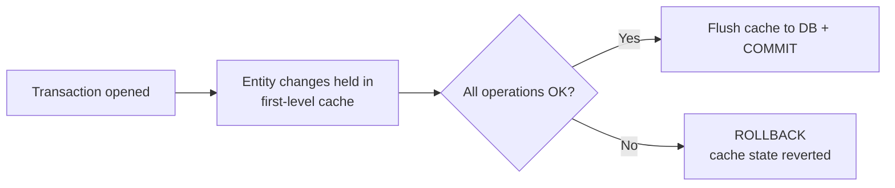

</details>

<details>
<summary><strong>22. Deadlock and lock-wait timeout</strong> — two transactions waiting on each other forever; the database kills one.</summary>

**In simple words**

- **Deadlock:** Transaction 1 holds row A and wants row B. Transaction 2 holds row B and wants row A. Both wait forever. The database detects it and **rolls one back** with *"Deadlock found when trying to get lock; try restarting transaction"*.
- **Lock-wait timeout:** a transaction waits too long for a lock that someone else holds (MySQL default: 50 seconds) and gives up.
- Reference: [Deadlock found when trying to get lock (article)](https://karbachinsky.medium.com/deadlock-found-when-trying-to-get-lock-try-restarting-transaction-54a3ed118068)


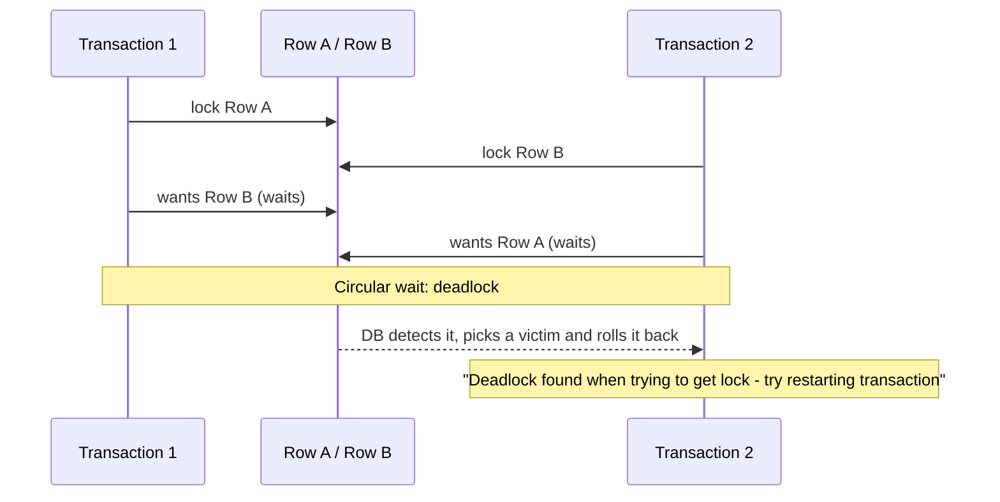

**Useful MySQL diagnostics**

```sql
-- Normally shows the full SQL of the query that is locking
SHOW FULL PROCESSLIST;

-- Check the isolation level (REPEATABLE READ is the InnoDB default)
SELECT @@GLOBAL.transaction_isolation, @@session.transaction_isolation, @@transaction_isolation;

SHOW VARIABLES LIKE 'innodb_buffer_pool_size';   -- 134217728

SHOW VARIABLES LIKE 'innodb_lock_wait_timeout';  -- by default 50 seconds
SELECT @@GLOBAL.innodb_lock_wait_timeout, @@session.innodb_lock_wait_timeout, @@innodb_lock_wait_timeout;

-- Modify globally or per session
SET GLOBAL  innodb_lock_wait_timeout = 50;   -- e.g. 300 for 5 minutes
SET SESSION innodb_lock_wait_timeout = 50;
SET         innodb_lock_wait_timeout = 50;
```

**How a deadlock happens in Java**

```java
@Transactional
public void transferAtoB() {
    accountRepository.findByIdForUpdate(1L);    // lock row 1
    accountRepository.findByIdForUpdate(2L);    // then row 2
    // ...
}

@Transactional
public void transferBtoA() {
    accountRepository.findByIdForUpdate(2L);    // lock row 2  ← opposite order!
    accountRepository.findByIdForUpdate(1L);    // then row 1  → deadlock when both run together
    // ...
}
```

**Easiest fix — always lock rows in the same order**

```java
@Transactional
public void transfer(Long fromId, Long toId, BigDecimal amount) {
    Long first  = Math.min(fromId, toId);       // always lock the lower id first
    Long second = Math.max(fromId, toId);

    Account a = accountRepository.findByIdForUpdate(first).orElseThrow();
    Account b = accountRepository.findByIdForUpdate(second).orElseThrow();

    Account from = a.getId().equals(fromId) ? a : b;
    Account to   = (from == a) ? b : a;
    from.debit(amount);
    to.credit(amount);
}
```

**Four ways to reduce deadlocks**

<table>
  <tr>
    <th>#</th>
    <th>Strategy</th>
    <th>How to apply it</th>
  </tr>
  <tr>
    <td>1</td>
    <td><b>Optimistic locking</b></td>
    <td>Use version- or timestamp-based locking. In Spring Data JPA add a <code>@Version</code> field (auto-incremented on update). When two transactions update the same entity concurrently, the one with the older version fails — no blocking.</td>
  </tr>
  <tr>
    <td>2</td>
    <td><b>Isolation levels</b></td>
    <td>Choose the level to reduce contention (<code>READ_COMMITTED</code>, <code>REPEATABLE_READ</code>, <code>SERIALIZABLE</code>) based on requirements and how likely concurrent access is.</td>
  </tr>
  <tr>
    <td>3</td>
    <td><b>Avoid long transactions</b></td>
    <td>Keep transactions as short as possible; long ones raise the conflict risk. Set a <b>transaction timeout</b> (<code>@Transactional(timeout = 5)</code>) so locks aren't held indefinitely.</td>
  </tr>
  <tr>
    <td>4</td>
    <td><b>Retry mechanism</b></td>
    <td>Retry a failed transaction after a short delay if it hit a deadlock. Cap the retries — never loop forever.</td>
  </tr>
</table>

**RetryJdbcTemplate — retry to re-acquire the DB-record lock**

```java
import org.springframework.dao.DeadlockLoserDataAccessException;
import org.springframework.jdbc.core.JdbcTemplate;

/*
 * In your DataSourceConfig, create a RetryJdbcTemplate bean in the Spring context:
 *
 * @Service
 * public class YourService {
 *     @Autowired JdbcTemplate      jdbcTemplate;
 *     @Autowired RetryJdbcTemplate retryJdbcTemplate;
 * }
 */
public class RetryJdbcTemplate extends JdbcTemplate {
    private static final int MAX_RETRIES = 3;
    private static final long WAIT_TIME_MS = 100; // adjust as needed

    public RetryJdbcTemplate() {
        super();
    }

    public RetryJdbcTemplate(javax.sql.DataSource dataSource) {
        super(dataSource);
    }

    @Override
    public int update(String sql) {
        return doWithRetry(() -> super.update(sql));
    }

    @Override
    public int update(String sql, Object... args) {
        return doWithRetry(() -> super.update(sql, args));
    }

    private int doWithRetry(Operation operation) {
        int retries = 0;
        while (true) {
            try {
                return operation.execute();
            } catch (DeadlockLoserDataAccessException e) {
                System.err.println("Retry :" + e.getLocalizedMessage());
                if (retries < MAX_RETRIES) {
                    retries++;
                    try {
                        Thread.sleep(WAIT_TIME_MS);
                    } catch (InterruptedException ignored) {
                        Thread.currentThread().interrupt();
                    }
                } else {
                    throw e; // retries exceeded, rethrow
                }
            }
        }
    }

    private interface Operation {
        int execute();
    }
}
```

</details>

<details>
<summary><strong>23. DataSourceConfig: Hikari, EntityManager, TransactionManager</strong> — the full manual JPA + transaction setup.</summary>

**In simple words** — this is what Spring Boot normally auto-configures. Writing it by hand is useful for multiple datasources or custom settings. The pieces are: the connection pool (Hikari), the `EntityManagerFactory` (Hibernate), the `PlatformTransactionManager`, and the JDBC templates.

```java
@Configuration
@EnableTransactionManagement
@EnableJpaRepositories(
  entityManagerFactoryRef = "rdbmsEntityManager",
  transactionManagerRef = "transactionManager",
  basePackages = { "com.github.myworld.repositories" }
)
@ConditionalOnProperty(value = "datasourceType", havingValue = "RDBMS", matchIfMissing = false)
public class DataSourceConfig2 {

    static String packagesToScan = "com.github.myworld.entities";
    static boolean useL2Cache = false, useQueryCache = false;

    @Autowired
    Environment env;

    /*
    app.datasource.myworld.url=jdbc:mysql://localhost:3306/flywaydb?createDatabaseIfNotExist=true
    app.datasource.myworld.username=root
    app.datasource.myworld.password=root
    app.datasource.myworld.driver-class-name=com.mysql.cj.jdbc.Driver
    */
    @Bean(name = "hikariDataSource")
    public DataSource getDataSourceHikariConfig() {
        String propertiesPrefix = "app.datasource.myworld.";
        String jdbcURL         = env.getProperty(propertiesPrefix + "url",               String.class);
        String driverClassName = env.getProperty(propertiesPrefix + "driver-class-name", String.class);
        String username        = env.getProperty(propertiesPrefix + "username",          String.class);
        String password        = env.getProperty(propertiesPrefix + "password",          String.class);

        com.zaxxer.hikari.HikariConfig hikariConfig = new com.zaxxer.hikari.HikariConfig();
        hikariConfig.setJdbcUrl(jdbcURL);
        hikariConfig.setDriverClassName(driverClassName);
        hikariConfig.setUsername(username);
        hikariConfig.setPassword(password);

        hikariConfig.setConnectionTimeout(10000L);
        hikariConfig.setIdleTimeout(10000L);
        hikariConfig.setMaxLifetime(1000L);
        hikariConfig.setKeepaliveTime(1000L);
        hikariConfig.setMaximumPoolSize(100);
        hikariConfig.setMinimumIdle(30);

        return new com.zaxxer.hikari.HikariDataSource(hikariConfig);
    }

    @Bean
    public LocalContainerEntityManagerFactoryBean rdbmsEntityManager() { // entityManagerFactoryRef
        LocalContainerEntityManagerFactoryBean em = new LocalContainerEntityManagerFactoryBean();
        em.setDataSource(getDataSourceHikariConfig());
        em.setPackagesToScan(packagesToScan);

        HibernateJpaVendorAdapter vendorAdapter = new HibernateJpaVendorAdapter();
        em.setJpaVendorAdapter(vendorAdapter);

        HashMap<String, Object> properties = new HashMap<>();
        // properties.put("hibernate.allow_update_outside_transaction", true);
        properties.put("hibernate.hbm2ddl.auto", env.getProperty("hibernate.hbm2ddl.auto"));
        properties.put("hibernate.dialect",      env.getProperty("hibernate.dialect"));

        // Tell Hibernate that L2 caching is enabled and give it the region factory class
        if (useL2Cache) { // https://www.baeldung.com/hibernate-second-level-cache
            properties.put("hibernate.cache.use_second_level_cache", true);
            properties.put("hibernate.cache.region.factory_class",
                           "org.hibernate.cache.ehcache.EhCacheRegionFactory"); // RegionFactory impl
            if (useQueryCache) {
                properties.put("hibernate.cache.use_query_cache", true);
            }
        }

        em.setJpaPropertyMap(properties);
        return em;
    }

    @Bean
    public PlatformTransactionManager transactionManager() { // transactionManagerRef
        JpaTransactionManager transactionManager = new JpaTransactionManager();
        transactionManager.setEntityManagerFactory(rdbmsEntityManager().getObject());
        return transactionManager;
    }

    // JDBC style - templates implement JdbcOperations
    @Bean
    public JdbcTemplate jdbcTemplate() {
        return new JdbcTemplate(getDataSourceHikariConfig());
    }

    @Bean
    public NamedParameterJdbcTemplate namedParameterJdbcTemplate() {
        return new NamedParameterJdbcTemplate(getDataSourceHikariConfig());
    }
}
```

**Which bean does what**

<table>
  <tr><th>Bean</th><th>Role</th><th>Referenced by</th></tr>
  <tr><td><code>hikariDataSource</code></td><td>Connection pool</td><td>EntityManagerFactory, JdbcTemplates</td></tr>
  <tr><td><code>rdbmsEntityManager</code></td><td>Hibernate / JPA setup (entities package, dialect, cache)</td><td><code>entityManagerFactoryRef</code> in <code>@EnableJpaRepositories</code></td></tr>
  <tr><td><code>transactionManager</code></td><td>Begins / commits / rolls back transactions</td><td><code>transactionManagerRef</code>, every <code>@Transactional</code></td></tr>
  <tr><td><code>jdbcTemplate</code>, <code>namedParameterJdbcTemplate</code></td><td>Plain SQL access on the same pool</td><td>Your services</td></tr>
</table>

</details>

<details>
<summary><strong>24. HikariCP pool tuning</strong> — connection-pool timeouts and a short max lifetime cause timeouts after a Java 8 → 17 move.</summary>

**In simple words** — HikariCP timeouts and suspected memory leaks after migrating from Java 8 to Java 17 usually come from configuration mismatches, changes in garbage collection / memory management, or dependency compatibility. Review the pool settings, update libraries, and diagnose memory usage.

```java
//@Bean(name = "dataSource")
public DataSource getHikariCP() { // configuration adjustments for HikariCP
    HikariConfig config = new HikariConfig();
    config.setJdbcUrl("jdbc:mysql://localhost:3306/dspro?createDatabaseIfNotExist=true");
    config.setDriverClassName("com.mysql.cj.jdbc.Driver");
    config.setUsername("root");
    config.setPassword("root");

    config.setMaximumPoolSize(10);      // adjust to your needs        (was 100   -> 10)
    config.setConnectionTimeout(30000); // increase timeout if needed  (was 10000 -> 30000)
    config.setIdleTimeout(600000);      // adjust idle timeout         (was 10000 -> 600000)
    config.setMaxLifetime(1800000);     // adjust max lifetime         (was 1000  -> 1800000)
    config.setKeepaliveTime(1000);      // keep below maxLifetime
    config.setMinimumIdle(30);

    return new HikariDataSource(config);
}
```

<table>
  <tr><th>Setting</th><th>Old value</th><th>Adjusted value</th><th>Why it matters</th></tr>
  <tr><td><code>maximumPoolSize</code></td><td>100</td><td>10</td><td>Fewer, reused connections; avoids exhausting DB resources</td></tr>
  <tr><td><code>connectionTimeout</code></td><td>10000 ms</td><td>30000 ms</td><td>Time to wait for a free connection before failing</td></tr>
  <tr><td><code>idleTimeout</code></td><td>10000 ms</td><td>600000 ms</td><td>How long an idle connection stays in the pool</td></tr>
  <tr><td><code>maxLifetime</code></td><td>1000 ms</td><td>1800000 ms</td><td>A 1-second lifetime churns connections constantly; keep it below the database's own timeout but not tiny</td></tr>
</table>

</details>

<details>
<summary><strong>25. Log4jdbc: logging SQL queries</strong> — see the real SQL (and bound values) that your transactions run.</summary>

**In simple words** — when debugging transactions you want to *see* each SQL statement. Two libraries do this. Reference: [StackOverflow post](https://stackoverflow.com/q/52376778/5081877)

**Option 1 — `com.integralblue` starter** ([candrews/log4jdbc-spring-boot-starter](https://github.com/candrews/log4jdbc-spring-boot-starter))

<table>
  <tr><th>POM dependency</th><th>Properties</th></tr>
  <tr>
    <td><pre><code>&lt;dependency&gt;
  &lt;groupId&gt;com.integralblue&lt;/groupId&gt;
  &lt;artifactId&gt;log4jdbc-spring-boot-starter&lt;/artifactId&gt;
  &lt;version&gt;2.0.0&lt;/version&gt;
&lt;/dependency&gt;</code></pre></td>
    <td><pre><code>hibernate.type:TRACE;
hibernate.format_sql:true;
hibernate.show_sql:true;
logging.level.org.hibernate.SQL:DEBUG;
logging.level.org.hibernate.type:TRACE;</code></pre></td>
  </tr>
</table>

If you see *"Loading class `com.mysql.jdbc.Driver`. This is deprecated. The new driver class is `com.mysql.cj.jdbc.Driver`…"*, set the correct driver:

```properties
log4jdbc.drivers=com.mysql.cj.jdbc.Driver
log4jdbc.auto.load.popular.drivers=false
```

**Option 2 — `org.bgee.log4jdbc-log4j2` (and the `net.disy.oss` fork)**

<table>
  <tr><th><code>org.bgee.log4jdbc-log4j2</code></th><th><code>net.disy.oss</code> (fork of org.bgee.log4jdbc-log4j2)</th></tr>
  <tr>
    <td><pre><code>&lt;dependency&gt;
  &lt;groupId&gt;org.bgee.log4jdbc-log4j2&lt;/groupId&gt;
  &lt;artifactId&gt;log4jdbc-log4j2-jdbc4.1&lt;/artifactId&gt;
  &lt;version&gt;[INSERT VERSION HERE]&lt;/version&gt;
&lt;/dependency&gt;</code></pre></td>
    <td><pre><code>&lt;dependency&gt;
  &lt;groupId&gt;net.disy.oss&lt;/groupId&gt;
  &lt;artifactId&gt;log4jdbc&lt;/artifactId&gt;
  &lt;version&gt;3.0.0&lt;/version&gt;
&lt;/dependency&gt;</code></pre></td>
  </tr>
</table>

</details>

<details>
<summary><strong>26. Quick recall and interview answers</strong> — hooks, the PRIDE mnemonic, pitfalls and a 30-second answer.</summary>

**Memory hooks**

<table>
  <tr><th>Topic</th><th>One-line hook</th></tr>
  <tr><td>What it is</td><td>"All or nothing" — begin, then commit or roll back as one unit.</td></tr>
  <tr><td>How it works</td><td>"Proxy opens the door, your method works, proxy closes it."</td></tr>
  <tr><td>Rollback</td><td>"Runtime = Rollback." Checked exceptions commit unless <code>rollbackFor</code> says otherwise.</td></tr>
  <tr><td>Propagation</td><td>REQUIRED = join if you can · REQUIRES_NEW = always fresh · NESTED = mini tx inside.</td></tr>
  <tr><td>Isolation</td><td>Each level up (READ_UNCOMMITTED → SERIALIZABLE) removes one more problem and costs more speed.</td></tr>
  <tr><td>Concurrency</td><td><code>@Version</code> for optimistic locking · keep transactions short · retry on deadlock.</td></tr>
  <tr><td>Hibernate</td><td>L1 = per session, always on · L2 = shared, opt-in · changes flush at the last moment.</td></tr>
</table>

**PRIDE mnemonic**

- **P**roxy-based
- **R**olls back on **R**untime exceptions
- **I**solation levels
- **D**efault propagation = `REQUIRED`
- **E**xternal call needed (self-invocation fails)

**Top pitfalls (interviewers love these)**

1. **Self-invocation** — calling a `@Transactional` method from the same class bypasses the proxy.
2. **Private / protected / final methods** — the proxy can't intercept them; use `public`.
3. **Swallowed exceptions** — catch without rethrow → Spring commits.
4. **Checked exceptions** — no rollback by default; add `rollbackFor`.
5. **Put `@Transactional` on the service layer**, not on controllers or repositories, and on the implementation class rather than the interface.
6. **Joining with REQUIRED shares fate** — an inner failure marks the whole transaction rollback-only.
7. **Native SQL bypasses Hibernate's first-level cache** — refresh or clear after it.

**30-second interview answer**

> `@Transactional` makes a method run in a database transaction using Spring AOP proxies. If it completes, Spring commits; if a runtime exception is thrown, it rolls back. I can control behavior with propagation, isolation, `readOnly`, and `rollbackFor`. A common gotcha is self-invocation, where calling a transactional method within the same class bypasses the proxy, so the transaction doesn't apply.

**Practice questions**

<details>
<summary>What is the default rollback behavior?</summary>

Unchecked exceptions (`RuntimeException`, `Error`) roll back; checked exceptions commit. Use `rollbackFor = Exception.class` to roll back on everything.

</details>

<details>
<summary>REQUIRED vs REQUIRES_NEW?</summary>

REQUIRED joins the caller's transaction (or creates one). REQUIRES_NEW suspends the caller's transaction and always starts its own, so it commits or rolls back independently. Classic use: audit logging.

</details>

<details>
<summary>Why is my @Transactional ignored?</summary>

Most likely self-invocation, a non-public or final method, or the bean isn't managed by Spring. Move the method to another bean and call it through the injected reference.

</details>

<details>
<summary>How do you stop two users overwriting each other?</summary>

Optimistic locking with `@Version` (and retry), pessimistic locking with `PESSIMISTIC_WRITE`, an atomic `UPDATE … SET x = x + 1`, or a stricter isolation level.

</details>

</details>

**Related:** [AOP](/content/tree/backend/spring/aop), [Distributed Transactions](/content/tree/architecture/microservices/distributed-transactions), [Saga Orchestration](/content/tree/interview-prep/microservices/project-flow/saga-pattern/orchestration/saga-orchestration).