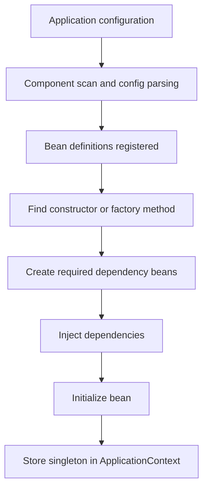
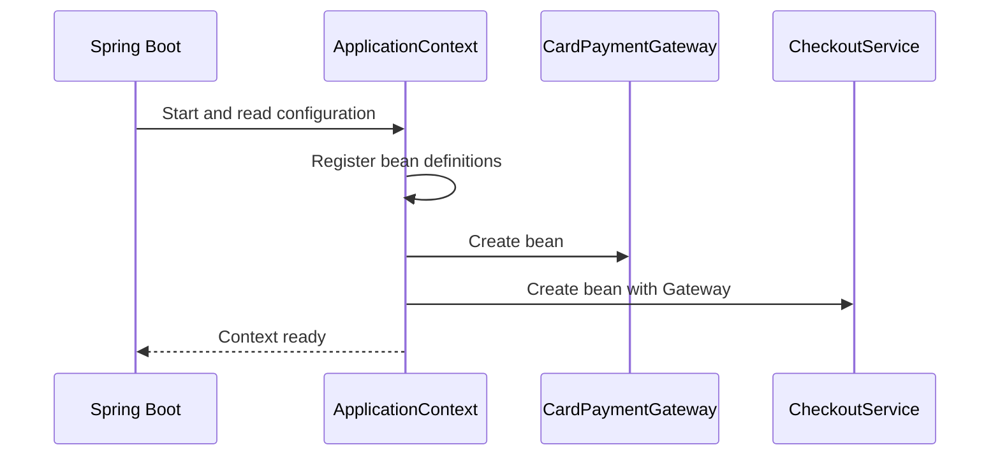
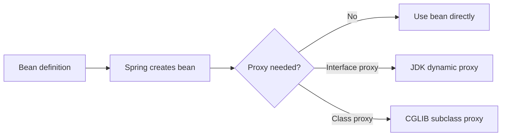

# Spring IoC and Dependency Injection

**Inversion of Control (IoC)** is a **`design principle`** where the responsibility for creating objects (called **beans**), managing their dependencies, and controlling their lifecycle is transferred from the application code to the Spring IoC container.

**Dependency Injection (DI)** is a **`technique used to implement IoC`**. Instead of a class creating its own dependencies using `new`, Spring injects the required objects into that class.

- **IoC** is the principle.
- **DI** is the technique that applies it.

## Object creation without Spring

If a service creates its own dependency with `new`, it is tightly coupled to a specific class:

```java
public class CheckoutService {
    private final PaymentGateway paymentGateway;

    public CheckoutService() {
        this.paymentGateway = new StripePaymentGateway();
    }

    public Receipt checkout(Order order) {
        return paymentGateway.charge(order);
    }
}
```

This works, but changing the gateway (for a test, a new provider, or another environment) means editing the service.

With DI, the service only declares what it needs:

```java
public class CheckoutService {
    private final PaymentGateway paymentGateway;

    public CheckoutService(PaymentGateway paymentGateway) {
        this.paymentGateway = paymentGateway;
    }

    public Receipt checkout(Order order) {
        return paymentGateway.charge(order);
    }
}
```

Now the service does not decide how the gateway is created or found. Spring (or a unit test) provides it. That shift of control is the "inversion".

## Key terms

| Term | Meaning |
| --- | --- |
| **IoC** | A principle where a container controls object creation, configuration, and lifecycle. |
| **DI** | Supplying a class's dependencies from outside instead of creating them inside. |
| **Bean** | An object created and managed by the Spring container. A plain Java object is not automatically a bean. |
| **Bean definition** | Metadata that tells Spring how to build a bean: its class or factory method, scope, constructor arguments, and lifecycle settings. |
| **ApplicationContext** | Spring's main container. It registers beans, wires dependencies, and provides extra application services. |
| **Wiring** | Finding the right bean and passing it into a constructor, setter, or property. |

## How Spring builds objects

Spring needs configuration to know which classes to manage. This can come from annotations, Java configuration, or XML. Spring turns it into bean definitions and uses them to build the object graph.



Spring does not create every Java class in your project. A class must be registered, for example by component scanning or an `@Bean` method.

## Example: register and inject

Define an interface:

```java
public interface PaymentGateway {
    Receipt charge(Order order);
}
```

Register an implementation as a bean:

```java
import org.springframework.stereotype.Component;

@Component
public class CardPaymentGateway implements PaymentGateway {
    @Override
    public Receipt charge(Order order) {
        // Call the payment provider here.
        return new Receipt(order.id(), "APPROVED");
    }
}
```

Inject it through a constructor:

```java
import org.springframework.stereotype.Service;

@Service
public class CheckoutService {
    private final PaymentGateway paymentGateway;

    public CheckoutService(PaymentGateway paymentGateway) {
        this.paymentGateway = paymentGateway;
    }

    public Receipt checkout(Order order) {
        return paymentGateway.charge(order);
    }
}
```

Start the application:

```java
import org.springframework.boot.SpringApplication;
import org.springframework.boot.autoconfigure.SpringBootApplication;

@SpringBootApplication
public class ShopApplication {
    public static void main(String[] args) {
        SpringApplication.run(ShopApplication.class, args);
    }
}
```

`@SpringBootApplication` enables component scanning for its `own package` and `all subpackages`. Keep your components inside that package tree, or configure scanning explicitly.

At startup, Spring:

1. Finds `CardPaymentGateway` and `CheckoutService`.
2. Registers their bean definitions.
3. Creates the gateway.
4. Passes it into the `CheckoutService` constructor.



Application code should receive services through injection. Avoid repeatedly asking the context for beans by name.

## What bean definitions contain

A bean definition can describe:

- The bean class, or a factory method that returns it.
- Constructor arguments and references to other beans.
- Property values and references.
- The bean name, scope, and lazy-initialization setting.
- Selection hints such as `@Primary` and `@Qualifier`.
- Initialization and destruction callbacks.

## Ways to register beans

| Style | Example | Best for |
| --- | --- | --- |
| Component scanning | `@Component`, `@Service`, `@Repository`, `@Controller` | Your own classes inside the scanned packages. |
| Java configuration | `@Configuration` with `@Bean` | Third-party classes or custom construction. |
| XML configuration | `<bean id="..." class="..."/>` | Older XML-based applications. |

Example of Java configuration:

```java
import org.springframework.context.annotation.Bean;
import org.springframework.context.annotation.Configuration;

@Configuration
public class PaymentConfiguration {
    @Bean
    public PaymentGateway paymentGateway() {
        return new CardPaymentGateway();
    }
}
```

> [!IMPORTANT]
> Use **one** registration method per bean. If you use this `@Bean` method, remove `@Component` from `CardPaymentGateway`, otherwise the same implementation is registered twice.

## How Spring picks a dependency

For a parameter such as `PaymentGateway paymentGateway`, Spring looks for beans of that type:

- **One match:** it is injected.
- **No match:** startup fails with a missing-bean error.
- **Several matches:** Spring cannot guess and reports an ambiguity.

Fix ambiguity by making the choice explicit.

Set a default with `@Primary`:

```java
@Component
@Primary
public class CardPaymentGateway implements PaymentGateway {
}
```

Or pick one at the injection point with `@Qualifier`:

```java
@Service
public class CheckoutService {
    private final PaymentGateway paymentGateway;

    public CheckoutService(@Qualifier("cardPaymentGateway") PaymentGateway paymentGateway) {
        this.paymentGateway = paymentGateway;
    }
}
```

Use `@Primary` for a default choice and `@Qualifier` when one injection point needs a specific bean. See [Spring @Primary vs @Qualifier](/content/tree/backend/spring/annotations/primary-qualifier).

If a class has a single constructor, Spring uses it automatically, with no `@Autowired` needed. If a class has several constructors, mark the one Spring should use with `@Autowired`, or simplify the class.

## What "stored in the context" means

By default, beans are **singletons**: Spring keeps one instance per bean definition, per application context. Every bean that needs it receives the same reference. This is not "one per JVM", only one per container.

Other scopes change this:

- **Prototype:** a new instance each time it is requested.
- **Request / Session:** one instance per web request or session.

Simplified bean lifecycle:

1. Spring reads configuration and registers bean definitions.
2. It calls the constructor or factory method to create the bean.
3. It injects the dependencies.
4. It runs post-processors and initialization callbacks.
5. For a singleton, it keeps the bean for reuse.
6. On shutdown, it runs destruction callbacks.

Lazy initialization, scopes, and proxies can change the exact timing. See [Spring Bean Lifecycle](/content/tree/backend/spring/bean-lifecycle) and [Spring ApplicationContext](/content/tree/backend/spring/application-context).

## Reflection and CGLIB

**Reflection:** Spring uses reflection internally to inspect classes and call constructors or factory methods. You do not write this yourself.

**CGLIB:** Spring does **not** use CGLIB to create every bean. Ordinary beans are created by calling a constructor or factory method. CGLIB is only used when Spring needs a runtime subclass, for example:

- Class-based AOP proxies (such as `@Transactional` on a class with no interface).
- `@Configuration` classes, so `@Bean` methods return the shared singleton.
- Scoped proxies and lookup-method injection.



CGLIB cannot subclass a `final` class or override `final` methods. It is an implementation detail of some Spring features, not part of the definition of IoC or DI. See [Spring AOP proxying mechanisms](https://docs.spring.io/spring-framework/reference/core/aop/proxying.html).

## Constructor vs setter injection

**Constructor injection** is the best default for required dependencies:

- Dependencies are visible in the constructor.
- Fields can be `final`.
- Objects are never half-built.
- Unit tests do not need Spring.

```java
@Test
void checkoutUsesTheInjectedGateway() {
    PaymentGateway fakeGateway = order -> new Receipt(order.id(), "TEST-APPROVED");
    CheckoutService service = new CheckoutService(fakeGateway);

    Receipt receipt = service.checkout(new Order("order-42"));

    assertEquals("TEST-APPROVED", receipt.status());
}
```

**Setter injection** suits optional dependencies or values that can change after construction.

**Field injection** (`@Autowired` on a field) is short but hides dependencies and makes tests harder. Prefer constructor injection.

## Common mistakes

### The class is not a bean

A class is not discovered just because it exists in your project. Add `@Component` (or similar), return it from an `@Bean` method, and make sure its package is scanned.

### More than one bean matches

Use `@Primary`, `@Qualifier`, or change the configuration. Do not rely on discovery order.

### Using `new` for a managed dependency

`new StripePaymentGateway()` creates an object outside Spring. It gets no injection, lifecycle callbacks, or proxies. Inject it instead.

### Circular constructor dependencies

If `ServiceA` needs `ServiceB` and `ServiceB` needs `ServiceA`, neither can be created first, and startup fails. Fix the design: split responsibilities, extract a third class, or change the dependency direction.

### Using the context as a service locator

Calling `applicationContext.getBean(...)` in business code hides dependencies and ties your code to Spring. Use injection instead. Keep `getBean` for framework or bootstrap code.

## Quick summary

```text
Configuration describes the beans.
Spring registers them as bean definitions.
When a bean is created, Spring resolves its dependencies.
Spring injects them through constructors or setters.
The container manages the bean by its scope and lifecycle.
```

Further reading: [IoC container overview](https://docs.spring.io/spring-framework/reference/core/beans/basics.html) and [Dependency Injection guide](https://docs.spring.io/spring-framework/reference/core/beans/dependencies/factory-collaborators.html).

**Related:** [Bean Lifecycle](/content/tree/backend/spring/bean-lifecycle), [ApplicationContext](/content/tree/backend/spring/application-context), [@Primary vs @Qualifier](/content/tree/backend/spring/annotations/primary-qualifier), [Spring AOP](/content/tree/backend/spring/aop), [Java Abstraction](/content/tree/languages/java/core/oop/abstraction).