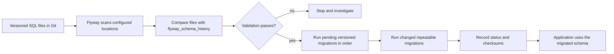
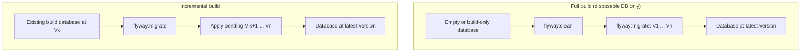
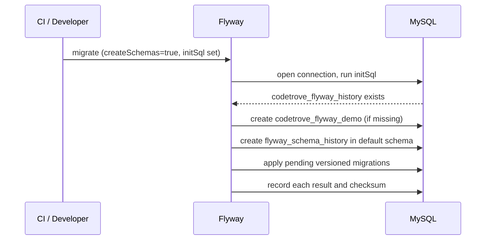
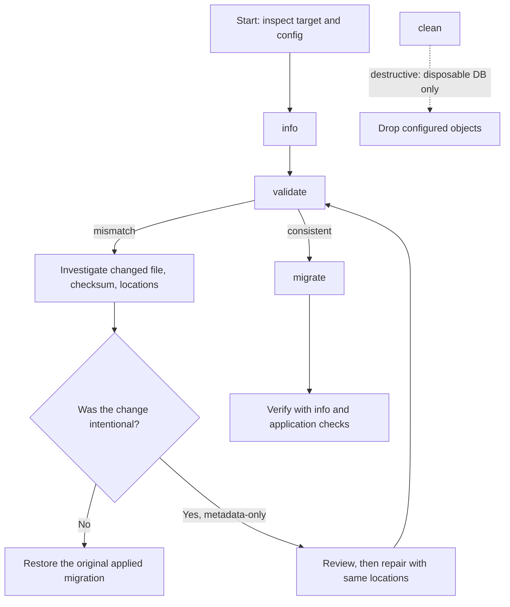
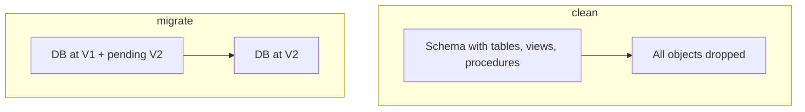
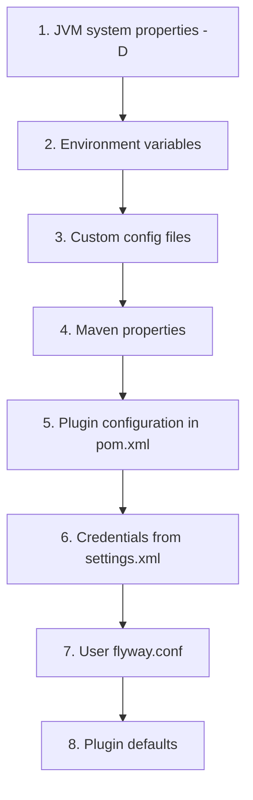
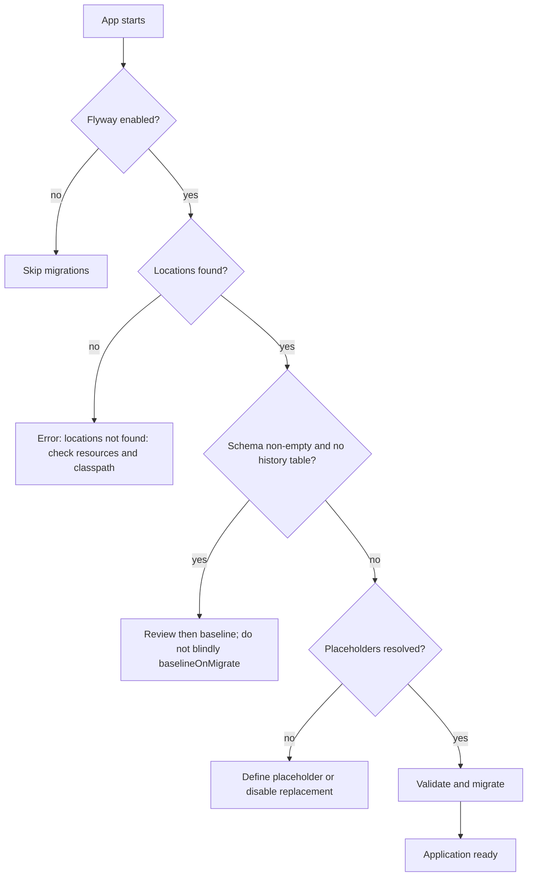
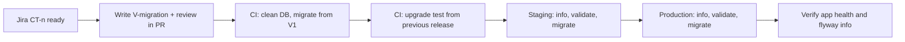

# Flyway database migrations

Flyway is an open-source database schema and data migration tool ([Redgate Flyway documentation](https://documentation.red-gate.com/fd/redgate-flyway-documentation-138346877.html)). A team keeps database changes in version control beside application code, applies them in a defined order, and can check what has already run in each environment.

This page consolidates the two legacy guides (the *MyWorld* GitHub wiki page and the earlier CodeTrove page) into one reference: build approaches, migration types and naming, schema history, commands, configuration, Maven, Spring Boot, troubleshooting, observed output, best practices and interview questions.

All examples use a **CodeTrove namespace** so they never collide with unrelated examples:

| Item | CodeTrove convention |
| --- | --- |
| Application schema | `codetrove_flyway_demo` |
| History schema (optional) | `codetrove_flyway_history` |
| Tables | `ct_flyway_employee`, `ct_flyway_department`, `ct_flyway_users` |
| Migration user | `ct_flyway_migrator` |
| Jira project key | `CT` (e.g. `CT-101`) |
| Filename | `V<version>__CT_<ticket>_<what_changed>.sql` |
| Config file | `resources/config/local/codetrove-flyway.conf` |
| Migration folder | `src/main/resources/db/migration/codetrove` |

> **Version note.** Several preserved examples were written for Flyway 8.x or 10.0.1 and older MySQL Connector/J coordinates. They explain the integration but are **not** a current dependency-version recommendation. Keep the Flyway engine, build plugin, database-support module, JDBC driver, database server and Spring Boot release compatible, and check the official docs for the exact version you use: [Migrations](https://documentation.red-gate.com/fd/migrations-271585107.html), [Maven goal](https://documentation.red-gate.com/fd/maven-goal-277579365.html).

---

## Table of contents

1. [Why migrations, and the two build approaches](#1-why-migrations-and-the-two-build-approaches)
2. [Migration types and naming](#2-migration-types-and-naming)
3. [Jira-driven versioning for CodeTrove](#3-jira-driven-versioning-for-codetrove)
4. [Schema-history table](#4-schema-history-table)
5. [Core commands: purpose and risk](#5-core-commands-purpose-and-risk)
6. [Configuration: properties, environment, files, precedence](#6-configuration-properties-environment-files-precedence)
7. [Versioned SQL migrations: complete CodeTrove example](#7-versioned-sql-migrations-complete-codetrove-example)
8. [Maven plugin setup and historical version details](#8-maven-plugin-setup-and-historical-version-details)
9. [Legacy SQL examples adapted to CodeTrove](#9-legacy-sql-examples-adapted-to-codetrove)
10. [Spring Boot integration](#10-spring-boot-integration)
11. [Observed output logs](#11-observed-output-logs)
12. [MySQL-specific troubleshooting](#12-mysql-specific-troubleshooting)
13. [Best practices and release safety](#13-best-practices-and-release-safety)
14. [Interview questions and answers](#14-interview-questions-and-answers)
15. [Further reading](#15-further-reading)

---

## 1. Why migrations, and the two build approaches

A **migration** is a version-controlled change to a database schema or its data: creating or altering a table, adding an index, inserting reference data, or changing a stored procedure. The same set is applied in the same logical order to development, test, staging and production, so each environment can be recreated and audited.

There are two approaches to a database build:

| Approach | Maven goals | What it does | Appropriate use | Caution |
| --- | --- | --- | --- | --- |
| **Full build from scratch** | `flyway:clean` + `flyway:migrate` | Spin up a new empty database, **or** clean a database dedicated to builds, then apply all migrations from 0 to the latest version. | Reproducible local/test databases, CI, disposable integration environments. | `clean` is destructive. Never run it on a shared or production database. |
| **Incremental build** | `flyway:migrate` | Use an existing database dedicated to builds. **Do not clean it.** Run `migrate` to apply only new migrations. | Normal development and deployment of an initialised environment. | Applied versioned scripts are history. Do not edit them; add a new forward migration. |

### How `migrate` behaves

`migrate` discovers migrations in the configured locations, compares them with the target database's schema history, validates the resolved migrations, and applies pending **versioned** migrations in version order. Changed **repeatable** migrations run after the pending versioned ones. If everything is already applied, another `migrate` is normally a no-op. That is **command-level idempotence**; it does not make each SQL statement idempotent.

> The legacy page says Flyway "will only execute the latest migration file and add its entry in `flyway_schema_history`". Read that as *"applies whatever is newer than the database's current state"*. When several versioned migrations are pending, Flyway applies the whole pending sequence in order.

Example: migrations exist through `V1_0_9`, database is at `V1_0_5`:

```text
migrate  →  V1_0_6 → V1_0_7 → V1_0_8 → V1_0_9   (applied in order)
migrate  →  Schema is up to date. No migration necessary.
```



### Full build vs incremental build



### Typical CodeTrove layout

```text
src/main/resources/db/migration/codetrove/
├── V1_0_0__CT_100_create_flyway_demo_schema.sql
├── V1_0_1__CT_101_create_employee_table.sql
├── V1_1_0__CT_110_add_department_reference.sql
└── R__CT_refresh_reference_views.sql
```

The first legacy guide's original directory was `flyway/sql/` with `V1__init_schema.sql`, `V1.1__create_users_table.sql`, `V1.2__insert_seed_data.sql`, `V1.3__alter_users_table.sql`, `V1.4__update_emails.sql`. The CodeTrove equivalent:

```text
src/main/resources/db/migration/codetrove/
├── V1_0_0__CT_100_init_schema.sql
├── V1_0_1__CT_101_create_employee_table.sql
├── V1_0_2__CT_102_insert_employee_seed_data.sql
├── V1_0_3__CT_103_alter_employee_table.sql
└── V1_0_4__CT_104_update_employee_emails.sql
```

Migration locations may be on the classpath or the filesystem. Scanning is **recursive** beneath a location, so use a deliberate directory layout and give the same locations to `migrate`, `validate` and `repair`.

---

## 2. Migration types and naming

The leading prefix tells Flyway the kind of migration.

| Type | Pattern | Ordering / re-run behaviour | CodeTrove example |
| --- | --- | --- | --- |
| **Versioned** (`V`) | `V<version>__<description>.sql` | Runs **once**, in version order. One new version per database change. | `V1_0_1__CT_101_create_employee_table.sql` |
| **Undo** (`U`) | `U<matching-version>__<description>.sql` | Reverses the corresponding versioned change. Edition/version dependent. | `U1_0_1__CT_101_drop_employee_table.sql` |
| **Repeatable** (`R`) | `R__<description>.sql` | No version. Re-runs whenever its checksum changes. Good for views and routines. | `R__CT_refresh_employee_summary_view.sql` |
| **Baseline** | command/configuration, not a file | Marks the starting point of an existing database. Migrations at or below it are treated as already represented. | Baseline an existing `codetrove_flyway_demo` before applying newer versions. |

General file shape: **prefix + version (if applicable) + separator + description + suffix**.

```text
<Prefix><Version>__<Description>.sql
   V      1_1_1   __  CT_101_create_employee_table  .sql
```

| Part | Description |
| --- | --- |
| `<Prefix>` | Default `V`. Change it with `flyway.sqlMigrationPrefix`. Other prefixes: `U` (undo), `R` (repeatable). |
| `<Version>` | Migration version. Major and minor parts may be separated by an underscore (or a dot in the filename). Must be unique and correctly ordered. |
| `__` (separator) | Default double underscore. Change it with `flyway.sqlMigrationSeparator`. |
| `<Description>` | Textual description. A double underscore separates it from the version. |
| Suffix | Default `.sql`. Change it with `flyway.sqlMigrationSuffixes`. |

Notes on version rules:

- `V1.1.1__...` and `V1_1_0__...` illustrate dot- and underscore-separated version parts. Flyway compares versions **numerically and logically**, not by string length.
- The legacy guides state that semantic-looking versions such as `1.1.1` are supported in **Flyway 5.0 and later**. Verify the naming grammar for your release.
- One legacy table says "the migration version should always start with 1". Treat that as the convention for that example's *initial* sequence, **not** a rule that every future version must begin with `1`.


### Naming configuration properties

```properties
# Prefix for versioned SQL migrations (default: V)
flyway.sqlMigrationPrefix=V

# Prefix for undo SQL migrations (default: U; availability is edition/version dependent)
flyway.undoSqlMigrationPrefix=U

# Prefix for repeatable SQL migrations (default: R)
flyway.repeatableSqlMigrationPrefix=R

# Separator between version and description (default: __)
flyway.sqlMigrationSeparator=__

# Comma-separated suffixes (default: .sql)
# Several suffixes (e.g. .sql,.pkg,.pkb) help compatibility with tools that need specific file types
flyway.sqlMigrationSuffixes=.sql

# Out-of-order execution is normally disabled; enable only with a deliberate release policy
flyway.outOfOrder=false
```

| Property | Meaning |
| --- | --- |
| `flyway.sqlMigrationPrefix` | File name prefix for versioned SQL migrations (default `V`), e.g. `V1_1__My_description.sql`. |
| `flyway.sqlMigrationSeparator` | Separator for SQL migrations (default `__`). |
| `flyway.sqlMigrationSuffixes` | Comma-separated suffix list (default `.sql`); `.sql`, `.pkg`, `.pkb` allowed together. |
| `flyway.outOfOrder` | If `true`, a newly found lower version (e.g. 2) can be applied after higher ones (1 and 3). Changes replay order versus already-deployed environments. |

### Good and bad names

| Filename | Verdict | Why |
| --- | --- | --- |
| `V1_0_1__CT_101_create_users_table.sql` | ✅ | Says what changes and links to the ticket. |
| `V1_0_2__CT_102_update_user_roles.sql` | ✅ | Purpose-based. |
| `V1.1.1__schema.sql`, `V1.1.2__migration.sql` | ✔ valid, ⚠ vague | Valid for Flyway 5.0+, but better named by purpose. |
| `V1__migration.sql` | ❌ | Too vague. |
| `V1.2__changes.sql` | ❌ | Unclear what changed. |
| `V2_0_create_department_schema.sql` | ❌ | Missing the `__` separator. Correct: `V2_0__CT_200_create_department_schema.sql`. |

Rules of thumb: lowercase words separated by underscores (consistent across filesystems, clean Git diffs); once applied in a shared environment, **never rewrite** a versioned migration. Create a new one.

---

## 3. Jira-driven versioning for CodeTrove

Use `V1`, `V2`, `V3` for simple projects. Use dotted/underscore versions when several migrations ship per feature or sprint. A CodeTrove-friendly scheme:

```text
V<major>_<minor>_<patch>__CT_<jira-number>_<purpose>.sql
```

| Jira ticket | Summary | Migration file |
| --- | --- | --- |
| CT-100 | Create demo schema | `V1_0_0__CT_100_create_flyway_demo_schema.sql` |
| CT-101 | Employee table | `V1_0_1__CT_101_create_employee_table.sql` |
| CT-102 | Department table | `V1_0_2__CT_102_add_department_table.sql` |
| CT-103 | Employee → department FK | `V1_0_3__CT_103_add_employee_department_fk.sql` |
| CT-110 | Seed reference data | `V1_1_0__CT_110_insert_department_seed_data.sql` |
| CT-115 | Refresh summary view | `R__CT_115_refresh_employee_summary_view.sql` |

Branch/commit convention that pairs with it:

```text
branch:  feature/CT-101-create-employee-table
commit:  CT-101: add V1_0_1 migration to create ct_flyway_employee
```

Why the ticket key belongs in the filename: the history table's `description` column then shows the Jira key, so `info` and `flyway_schema_history` map directly to tickets during audits.

---

## 4. Schema-history table

Flyway records applied migrations in a table normally named `flyway_schema_history` (see the [reference](https://documentation.red-gate.com/fd/flyway-schema-history-table-273973417.html)). It stores migration identity, execution details, checksums and success state. Inspect it with:

```sql
SELECT *
FROM flyway_schema_history
ORDER BY installed_rank;
```

(The legacy pages use the shorter `select * from flyway_schema_history;`.) Query the correct database/schema, and **never edit this table by hand as a repair strategy**. Use `info` first and `validate` to check consistency.

### Example `info` output

```text
+-----------+---------+---------------------------------------------+----------+---------+
| Category  | Version | Description                                 | Type     | State   |
+-----------+---------+---------------------------------------------+----------+---------+
|           |         | << Flyway Schema Creation >>                | SCHEMA   | Success |
|           |         | << Flyway Baseline >>                       | BASELINE | Success |
| Versioned | 1.0.0   | CT 100 create flyway demo schema            | SQL      | Success |
| Versioned | 1.0.1   | CT 101 create employee table                | SQL      | Success |
+-----------+---------+---------------------------------------------+----------+---------+
```

The second legacy guide's own sample showed a `<< Flyway Schema Creation >>` row, a `<< Flyway Baseline >>` row annotated *"Created before Versioned and removed"*, then versions `1.1.1` (*Initial Build*) and `1.1.2` (*Pubs Original Data*), all successful. Columns and labels vary by Flyway release.

### Migration states

`Pending`, `Success`, `Ignored`, `Deleted`, `Available`, `Undone`, `Above Target`, `Baseline`, `Below Baseline`, `Missing`, `Failed`, `Failed (Missing)`, `Failed (Future)`, `Future`, `Out of Order`, `Outdated`, `Superseded`.

Some labels are type- or version-specific. `Out of Order` warns that replaying from scratch may not reproduce the order used by a database that received the migration late.

### Schema creation and history-table placement

Flyway can try to create the configured `schemas` / `defaultSchema` when `createSchemas` is on. If `createSchemas=false`, the schema meant to hold the history table must **already exist** (or be created first). This matters when the application schema is created by a migration but the history table must exist *before* that migration runs.

| Setting | Purpose |
| --- | --- |
| `flyway.createSchemas` | Whether Flyway attempts to create configured schemas. |
| `flyway.schemas` | Comma-separated schemas Flyway manages (may be case-sensitive on the target DB). |
| `flyway.defaultSchema` | Schema used for the history table and as default schema where applicable. If unset, the first item of `schemas` may be used. |
| `flyway.initSql` | SQL run after opening a connection (default none); can prepare a history schema. |

**Option A: create history schema out-of-band** (`createSchemas=false`):

```properties
# Example only: confirm SQL syntax and privileges for your database.
flyway.createSchemas=false
flyway.defaultSchema=codetrove_flyway_history
flyway.schemas=codetrove_flyway_history,codetrove_flyway_demo
flyway.initSql=CREATE SCHEMA IF NOT EXISTS codetrove_flyway_history
flyway.locations=filesystem:src/main/resources/db/migration/codetrove
```

**Option B: legacy create-schemas flow** (`createSchemas=true` + `initSql`):

```properties
# Use only after testing against the target database.
flyway.createSchemas=true
flyway.initSql=CREATE SCHEMA IF NOT EXISTS codetrove_flyway_history
flyway.schemas=codetrove_flyway_history,codetrove_flyway_demo
flyway.defaultSchema=codetrove_flyway_history
flyway.url=jdbc:mysql://localhost:3306/
flyway.user=ct_flyway_migrator
# Supply flyway.password from a protected secret source.
flyway.locations=filesystem:resources/db/migration
flyway.placeholderReplacement=false
```

Described sequence for Option B: run `migrate` → Flyway creates the application schema → `initSql` creates the history schema → Flyway creates its history table in the default/history schema.

Notes preserved from the legacy material:

- The old config used `flyway.user=root` / `flyway.password=root`. The CodeTrove version never includes those credentials.
- One old example wrote `CREATE IF NOT EXISTS flyway_history_schema`. That lacks the database-specific `CREATE SCHEMA` form and is **not portable SQL**; do not copy it.
- The old config also showed `schemas=my_schema` with `createSchemas=false`, which requires the history schema to be created in a bootstrap step.
- Options A and B are **alternatives**, not settings to combine blindly.



---

## 5. Core commands: purpose and risk

| Command | Purpose | Risk / guidance |
| --- | --- | --- |
| [`migrate`](https://documentation.red-gate.com/fd/migrate-184127460.html) | Scan, validate and apply pending migrations; create the history table automatically if missing. Migrates the schema to the latest version. | Normal deployment command. Run in a controlled release flow and watch the logs. |
| `info` | Show resolved/applied/pending status, execution info and success state. | Safe diagnostic. Start here when state is unclear. |
| `validate` | Compare resolved migrations with applied history (checksums, metadata). | Fix the underlying source/history mismatch. Do not suppress validation casually. |
| `baseline` | Mark an existing database at a chosen baseline version so Flyway manages versions above it. | Review the existing schema first. It does **not** execute the baselined historical scripts. |
| `repair` | Repair history metadata: remove failed entries (only on databases **without** DDL transactions), realign checksums/descriptions/types with resolved files, mark missing migrations as deleted. | Not a rollback and not a "make the error go away" button. Use the **same locations** as `migrate`. Review what will change first. |
| [`clean`](https://documentation.red-gate.com/fd/clean-184127458.html) | Drop **all objects** (tables, views, procedures...) in the configured schemas. If Flyway created the schemas, they are dropped too. | **Destructive. Never on production or shared databases.** Disposable dev/test only. |
| `undo` | Reverse the most recently applied versioned migration when a matching undo script exists. | Edition/version/licence dependent. Prefer a forward corrective migration for ordinary production recovery. |

The legacy command list also mentioned `Check` and `Snapshot` but did not describe them. Those depend on Flyway version/edition; verify against current product docs. The old command screenshots (Baseline, Clean, Info, Repair, Undo, Validate) could no longer be retrieved (404), so the explanations and diagrams below replace them.





### Undo (historical Maven/API note)

One historical example said Undo needed `flyway-proprietary` `10.0.1`:

```xml
<!-- Historical, edition/version-specific example; verify current licensing and coordinates. -->
<dependency>
    <groupId>com.redgate.flyway</groupId>
    <artifactId>flyway-proprietary</artifactId>
    <version>10.0.1</version>
</dependency>
```

Undo reverses the most recent versioned migration. The same guide mentioned a **28-day Teams trial**; a properties comment in the other source said **30 days**. These are historical notes, not current licence or trial promises.

### Controlled `migrate` workflow

If both the database and the resolved set are at `V1_0_9`, `migrate` does nothing. Flyway may run at application start-up to keep code and schema aligned, but design that around deployment permissions, concurrent application instances, readiness checks and a rollback strategy.

```bash
# Incremental migration (normal development/deployment path)
mvn --non-recursive \
  -Dflyway.url=jdbc:mysql://localhost:3306/codetrove_flyway_demo \
  -Dflyway.user="$FLYWAY_USER" \
  -Dflyway.password="$FLYWAY_PASSWORD" \
  -Dflyway.schemas=codetrove_flyway_history,codetrove_flyway_demo \
  -Dflyway.configFiles=resources/config/local/codetrove-flyway.conf \
  flyway:info flyway:validate flyway:migrate
```

Destructive full rebuild: **disposable database only**:

```bash
mvn --non-recursive \
  -Dflyway.configFiles=resources/config/local/codetrove-flyway.conf \
  flyway:clean flyway:migrate
```

> Do not put production passwords in shell history, process arguments, checked-in `.conf` files or CI logs. Use a secret manager or masked pipeline secret.

---

## 6. Configuration: properties, environment, files, precedence

Common properties across both legacy guides: `flyway.url`, `flyway.user`, `flyway.password`, `flyway.schemas`, `flyway.defaultSchema`, `flyway.locations`, `flyway.createSchemas`, `flyway.initSql`, `flyway.placeholderReplacement`, `flyway.placeholders.*`.

| Property | Meaning |
| --- | --- |
| `flyway.url` | JDBC connection URL. May include host, port, database and parameters, e.g. an Aurora-style `jdbc:mysql://<instance>.<region>.rds.amazonaws.com:<port>/<database>?<key>=<value>`. |
| `flyway.user` | Database user. If none is supplied and the connection is not passwordless, Flyway may prompt. |
| `flyway.password` | Database secret. |
| `flyway.schemas` | Schemas Flyway manages. Case sensitivity depends on the DB. Flyway may attempt to create them, clean them in order, and drop schemas it created on `clean`. |
| `flyway.defaultSchema` | Default schema; also holds the history table. |
| `flyway.initSql` | SQL after opening a connection (default none). |
| `flyway.placeholderReplacement` | Enable/disable `${...}` substitution (often true by default). |

Verify these behaviours for your Flyway version and database.

### Ways Flyway reads configuration

Flyway can read the necessary properties through several channels:

#### 1. Command-line arguments

Specify properties directly with `-D` flags: handy to override files or for a single run.

```bash
mvn --non-recursive \
  -Dflyway.url=jdbc:mysql://localhost:3306/codetrove_flyway_demo \
  -Dflyway.user="$FLYWAY_USER" \
  -Dflyway.password="$FLYWAY_PASSWORD" \
  -Dflyway.schemas=codetrove_flyway_history,codetrove_flyway_demo \
  flyway:migrate
```

The exact option prefix and quoting depend on the CLI, Maven plugin, Gradle plugin or API.

#### 2. Environment variables

Keeps secrets out of command lines and config files. Flyway detects specific variable names automatically.

```bash
export FLYWAY_URL='jdbc:mysql://localhost:3306/codetrove_flyway_demo'
export FLYWAY_USER='ct_flyway_migrator'
# CI secret manager injects CT_FLYWAY_PASSWORD; never echo or commit it
export FLYWAY_PASSWORD="$CT_FLYWAY_PASSWORD"
export FLYWAY_SCHEMAS='codetrove_flyway_history,codetrove_flyway_demo'
```

```bash
flyway migrate          # CLI form
mvn flyway:migrate      # Maven picks up the variables too
```

#### 3. Custom config files

A file keeps non-secret settings repeatable.

```properties
# resources/config/local/codetrove-flyway.conf
flyway.url=jdbc:mysql://localhost:3306/codetrove_flyway_demo
flyway.user=ct_flyway_migrator
# Supply the password through an approved secret mechanism; do not commit it.
flyway.schemas=codetrove_flyway_history,codetrove_flyway_demo
flyway.defaultSchema=codetrove_flyway_history
flyway.locations=filesystem:src/main/resources/db/migration/codetrove
flyway.createSchemas=false
flyway.placeholderReplacement=false
```

Select it explicitly:

```bash
mvn flyway:migrate -Dflyway.configFiles=resources/config/local/codetrove-flyway.conf
```

Default `flyway.conf` locations (loaded in this search set):

- `installDir/conf/flyway.conf`
- `userhome/flyway.conf`
- `workingDir/flyway.conf`

For another filename (e.g. `codetrove-flyway.conf`) you must say so explicitly. The older wording `resources/config/local/ flyway.conf / myFlywayConfig.conf` was ambiguous; use one unambiguous path. See [configuration files](https://documentation.red-gate.com/fd/configuration-files-224003079.html) and the [parameter list](https://documentation.red-gate.com/fd/flyway-cli-and-api/configuration/parameters), including [`workingDirectory`](https://documentation.red-gate.com/fd/flyway-cli-and-api/configuration/parameters/flyway/working-directory).

Maven-specific details:

- `flyway.configFiles` accepts multiple comma-separated files; relative paths resolve against the directory containing the POM.
- If `FLYWAY_CONFIG_FILES` is set it takes precedence over the command-line parameter.
- Encoding: `flyway.configFileEncoding` / `FLYWAY_CONFIG_FILE_ENCODING` (UTF-8 default).
- Credentials can come from a `<server>` in `settings.xml` (default id `flyway-db`, changeable with `serverId`), including encrypted settings.

```xml
<!-- ~/.m2/settings.xml; use Maven's encrypted-password workflow where appropriate -->
<settings>
    <servers>
        <server>
            <id>flyway-db</id>
            <username>ct_flyway_migrator</username>
            <password>INJECTED_OR_ENCRYPTED_SECRET</password>
        </server>
    </servers>
</settings>
```

#### 4. Flyway built-in defaults

If no value is given for a property, Flyway falls back to defaults.

### Fuller properties sketch

```properties
# JDBC connection and managed schema
flyway.url=jdbc:mysql://localhost:3306/codetrove_flyway_demo
flyway.user=ct_flyway_migrator
flyway.schemas=codetrove_flyway_history,codetrove_flyway_demo
flyway.defaultSchema=codetrove_flyway_history

# Migration source and schema setup
flyway.locations=filesystem:src/main/resources/db/migration/codetrove
flyway.createSchemas=false
# flyway.initSql=CREATE SCHEMA IF NOT EXISTS codetrove_flyway_history

# Placeholder replacement is true by default in many configurations.
# Turn it off only when `${...}` is not meant to be replaced by Flyway.
flyway.placeholderReplacement=false
# flyway.placeholders.user=ct_app_user
# flyway.placeholders.keyABC=valueXYZ
```

### Precedence (higher wins)

> If `flyway.url` is in a config file **and** passed as `-Dflyway.url=...` on the command line, the command line wins.

The first legacy guide listed: command-line arguments → environment variables → custom config files → built-in defaults (its numbering skipped from 3 to 5, a typo). For the **Maven plugin**, the official precedence is, highest first:



Do not assume this exact order for the standalone CLI, Gradle, Spring Boot or the API. See the [CLI configuration-order guide](https://documentation.red-gate.com/fd/cli-configuration-order-224919668.html).

---

## 7. Versioned SQL migrations: complete CodeTrove example

SQL is MySQL-flavoured (`AUTO_INCREMENT`, `ENGINE=InnoDB`, charset clauses). Adjust for your database.

### `V1_0_1__CT_101_create_employee_table.sql`

```sql
-- CT-101: create employee table
CREATE TABLE IF NOT EXISTS ct_flyway_employee (
    id INT NOT NULL AUTO_INCREMENT PRIMARY KEY,
    employee_name VARCHAR(80) NOT NULL,
    email VARCHAR(160),
    date_of_birth TIMESTAMP NULL,
    created_at TIMESTAMP NOT NULL DEFAULT CURRENT_TIMESTAMP
) ENGINE=InnoDB DEFAULT CHARSET=utf8mb4;
```

### `V1_0_2__CT_102_add_department_table.sql`

```sql
-- CT-102: department table and employee link column
CREATE TABLE IF NOT EXISTS ct_flyway_department (
    id INT NOT NULL AUTO_INCREMENT PRIMARY KEY,
    department_name VARCHAR(80) NOT NULL UNIQUE
) ENGINE=InnoDB DEFAULT CHARSET=utf8mb4;

ALTER TABLE ct_flyway_employee
    ADD COLUMN department_id INT NULL;
```

### `V1_0_3__CT_103_add_employee_department_fk.sql`

```sql
-- CT-103: enforce employee -> department relationship
ALTER TABLE ct_flyway_employee
    ADD CONSTRAINT fk_ct_flyway_employee_department
    FOREIGN KEY (department_id)
    REFERENCES ct_flyway_department (id);
```

### `R__CT_115_refresh_employee_summary_view.sql` (repeatable)

```sql
-- CT-115: re-applied whenever this file's checksum changes
CREATE OR REPLACE VIEW ct_flyway_employee_summary AS
SELECT e.id, e.employee_name, d.department_name
FROM ct_flyway_employee e
LEFT JOIN ct_flyway_department d ON d.id = e.department_id;
```

### Run and inspect

```bash
mvn clean flyway:migrate \
  -Dflyway.configFiles=resources/config/local/codetrove-flyway.conf

mvn flyway:info \
  -Dflyway.configFiles=resources/config/local/codetrove-flyway.conf
```

`mvn clean` is Maven's build-directory cleanup, **not** Flyway `clean`. The Flyway goal only runs if `flyway:clean` is listed explicitly.

For a parent POM in a multi-module build, `--non-recursive` (`-N`) stops Maven descending into subprojects:

```bash
mvn --non-recursive clean flyway:migrate \
  -Dflyway.configFiles=resources/config/local/codetrove-flyway.conf
```

```text
mvn --help
...
-N,--non-recursive    Do not recurse into sub-projects
```

IDE run configuration (legacy name `Flyway Migrate`, base dir `${workspace_loc:/MyApp}`), mapped to CodeTrove:

| Field | CodeTrove value |
| --- | --- |
| Name | `CodeTrove Flyway Migrate` |
| Base directory | `$PROJECT_ROOT` (legacy: `${workspace_loc:/MyApp}`) |
| Arguments | `--non-recursive -Dflyway.url=jdbc:mysql://${env.FLYWAY_HOST}:3306/codetrove_flyway_demo -Dflyway.configFiles=resources/config/local/codetrove-flyway.conf` |
| Goal | `flyway:migrate` |

---

## 8. Maven plugin setup and historical version details

Flyway + Maven quickstart: <https://documentation.red-gate.com/fd/quickstart-maven-184127578.html>. Configure inline or via an external properties file. Use **one coherent, tested version set**.

```xml
<properties>
    <flyway.version>REPLACE_WITH_TESTED_FLYWAY_VERSION</flyway.version>
    <mysql.connector.version>REPLACE_WITH_TESTED_CONNECTOR_VERSION</mysql.connector.version>
    <skip.flyway>false</skip.flyway>
</properties>

<build>
    <plugins>
        <plugin>
            <groupId>org.flywaydb</groupId>
            <artifactId>flyway-maven-plugin</artifactId>
            <version>${flyway.version}</version>

            <!-- mvn -Dskip.flyway=true clean install  → skips Flyway -->
            <executions>
                <execution>
                    <id>codetrove-flyway-migrate</id>
                    <phase>none</phase> <!-- disable default lifecycle binding -->
                    <goals>
                        <goal>migrate</goal>
                    </goals>
                    <configuration>
                        <skip>${skip.flyway}</skip>
                    </configuration>
                </execution>
            </executions>

            <dependencies>
                <!-- Core Flyway runtime -->
                <dependency>
                    <groupId>org.flywaydb</groupId>
                    <artifactId>flyway-core</artifactId>
                    <version>${flyway.version}</version>
                </dependency>
                <!-- MySQL/MariaDB database support module -->
                <dependency>
                    <groupId>org.flywaydb</groupId>
                    <artifactId>flyway-mysql</artifactId>
                    <version>${flyway.version}</version>
                </dependency>
                <!-- MySQL JDBC driver -->
                <dependency>
                    <groupId>com.mysql</groupId>
                    <artifactId>mysql-connector-j</artifactId>
                    <version>${mysql.connector.version}</version>
                </dependency>
            </dependencies>
        </plugin>
    </plugins>
</build>
```

Optional inline configuration (prefer an external file so secrets stay out of the POM):

```xml
<!-- Historical alternative only -->
<configuration>
    <url>jdbc:mysql://localhost:3306/codetrove_flyway_demo</url>
    <user>ct_flyway_migrator</user>
    <schemas>codetrove_flyway_history,codetrove_flyway_demo</schemas>
</configuration>
```

### Driver-specific modules named in the legacy POM

`quarkus-jdbc-postgresql`, `flyway-sqlserver`, `flyway-mysql`, `flyway-database-oracle`, `flyway-database-postgresql`, `flyway-database-db2`, `flyway-database-derby`, `flyway-database-hsqldb`.

These are preserved as historical examples, not one POM's dependency set and not a guarantee of current coordinates. Select only the support module for your target engine and the matching Flyway release.

### Historical versions seen in the sources (provenance only)

| Source example | Versions |
| --- | --- |
| MyWorld POM | plugin/core/MySQL support `8.5.13`, Connector/J `8.0.33`, `<phase>none</phase>`, `migrate`, `<skip>${skip.flyway}</skip>` |
| Older POM | plugin `8.5.13`, `flyway-core` `8.0.5`, `mysql-connector-java` `8.0.28` |
| Output line | Flyway Community Edition `8.0.5` |
| Undo / Teams example | `com.redgate.flyway` plugin `10.0.1` |

These mixed versions are **not** a compatibility matrix.

### Upgrade issue: "No database found to handle jdbc:mysql"

```text
Failed to execute goal org.flywaydb:flyway-maven-plugin:8.5.13:clean (default-cli) on project MyApp:
org.flywaydb.core.api.FlywayException: No database found to handle jdbc:mysql://localhost:3306/
```

Cause: after upgrading the Flyway core module, the MySQL-specific support was missing. Fix: add **`flyway-mysql`** to the plugin dependencies (as shown above). Module packaging differs between releases, so check what your version needs.

### Community edition via Redgate repository (historical, `10.0.1`)

```xml
<pluginRepositories>
    <pluginRepository>
        <id>redgate</id>
        <url>https://download.red-gate.com/maven/release</url>
    </pluginRepository>
</pluginRepositories>

<build>
    <plugins>
        <plugin>
            <groupId>com.redgate.flyway</groupId>
            <artifactId>flyway-maven-plugin</artifactId>
            <version>10.0.1</version>
        </plugin>
    </plugins>
</build>
```

Per the official Maven docs: the Community plugin is published through the Redgate repository and downloading it means agreeing to the Redgate EULA; the group ID changed at Flyway 10.0.0 from `org.flywaydb.enterprise` to `com.redgate.flyway` (both published for convenience through 10.22.0); Open Source Edition uses `org.flywaydb`. Java/Maven requirements change by release (the fetched doc text said Flyway v14 needs Java 21 and showed plugin version 13.12.0). Verify Java, Maven, Flyway, plugin, engine and database-module compatibility for the release you select.

### Licence and report properties (historical note)

```properties
# Licence-key availability and product names change by release.
# Teams/Enterprise only in this example; check current licensing docs.
# flyway.licenseKey=<provided-by-approved-secret-store>

# Report destination: current directory, base filename `report`
# flyway.reportFilename=report
```

A key beginning `FL01...` applied to Teams/Enterprise. Downloading the Teams/Enterprise plugin implied accepting the Redgate EULA.

### Build run configuration and the `skip.flyway` contradiction

The legacy build, named `Flyway (Non-Recursive Clean & Migrate)`:

- Base directory: `${workspace_loc:/my-parent}`
- Goals: `--non-recursive`, `-Dclient=IN`, `-Dskip.flyway=true`, `-Dmaven.test.skip=true`, `-Dflyway.configFiles=resources/config/local/flyway.conf`, two locations (`.../migration/common` and `.../migration/env`), then `flyway:clean flyway:migrate`.

```bash
mvn --non-recursive \
  -Dclient=IN \
  -Dskip.flyway=true \
  -Dmaven.test.skip=true \
  -Dflyway.configFiles=resources/config/local/flyway.conf \
  -Dflyway.locations=filesystem:resources/mySqlDB/migration/common,filesystem:resources/mySqlDB/migration/env \
  flyway:clean flyway:migrate
```

Original notes: Flyway execution skipped via `-Dskip.flyway=true`; tests skipped via `-Dmaven.test.skip=true`; config and locations specified manually.

⚠ **These statements conflict.** A skip flag plus explicit `flyway:clean flyway:migrate` goals is contradictory unless you inspect the plugin execution and how the skip property is read. Do not copy that combination blindly. In CodeTrove, set `skip.flyway=false` when you intentionally invoke `migrate`, and do not let a broad build command imply which Flyway goals run.

Corrected incremental CodeTrove configuration: one location `filesystem:src/main/resources/db/migration/codetrove`, **no** `flyway:clean`, and `-Dskip.flyway=false` if your POM execution supports it. If multiple locations are really needed (e.g. `common` + `env`), pass the same complete list to `migrate`, `validate` and `repair`.

---

## 9. Legacy SQL examples adapted to CodeTrove

These come from different source contexts. Do not combine them into one ordered set without checking versions and dialect support.

### Users / schema example (`V1_1_1__CT_111_schema.sql`)

Original: `V1.1.1__schema.sql`. Creates a users table, adds an `is_active` flag, and removes a temporary record. `SERIAL` is database-specific.

```sql
-- CT-111: create the CodeTrove sample users table
CREATE TABLE ct_flyway_users (
    id SERIAL PRIMARY KEY,
    username VARCHAR(50) NOT NULL,
    email VARCHAR(100),
    created_at TIMESTAMP DEFAULT CURRENT_TIMESTAMP
);

-- Add an active flag
ALTER TABLE ct_flyway_users
    ADD COLUMN is_active BOOLEAN DEFAULT TRUE;

-- Optional cleanup of an explicitly temporary fixture record
DELETE FROM ct_flyway_users
WHERE username = 'ct_temp_user';
```

### Seed and update example (`V1_1_2__CT_112_migration.sql`)

```sql
-- CT-112: insert sample CodeTrove users
INSERT INTO ct_flyway_users (username, email) VALUES
    ('ct_john_demo', 'ct-john@example.invalid'),
    ('ct_jane_demo', 'ct-jane@example.invalid');

-- Update one sample record
UPDATE ct_flyway_users
SET email = 'ct-john-updated@example.invalid'
WHERE username = 'ct_john_demo';
```

Originals: `john_doe` / `jane_doe`, `john@example.com` / `jane@example.com`, John updated to `john_updated@example.com`, optional `temp_user` deletion. `.invalid` addresses cannot be mistaken for deliverable email.

### Employee / department example (second guide)

Original files: `V1_1_0__my_first_migration.sql` (employee table with auto-increment id, `name`, `email`, `date_of_birth`) and `V2_0_create_department_schema.sql` (department table, then `dept_id` added after `email`). The second name lacked the `__` separator.

```sql
-- V1_1_0__CT_110_create_employee_table.sql (MySQL)
CREATE TABLE IF NOT EXISTS ct_flyway_employee (
    id INT NOT NULL AUTO_INCREMENT PRIMARY KEY,
    employee_name VARCHAR(80),
    email VARCHAR(160),
    date_of_birth TIMESTAMP NULL
) ENGINE=InnoDB DEFAULT CHARSET=utf8mb4;
```

```sql
-- V2_0__CT_200_create_department_schema.sql (MySQL)
CREATE TABLE IF NOT EXISTS ct_flyway_department (
    id INT NOT NULL AUTO_INCREMENT PRIMARY KEY,
    department_name VARCHAR(80)
) ENGINE=InnoDB DEFAULT CHARSET=utf8mb4;

ALTER TABLE ct_flyway_employee
    ADD COLUMN department_id INT NULL;
```

The original used `ALTER TABLE employee ADD dept_id int AFTER email`. `AFTER` is MySQL-specific and omitted here, since explicit column order isn't required relationally. The key lesson: introduce a **new migration** for the new table and relationship; never edit one already applied elsewhere.

### Valid-name demonstration (Flyway 5.0+)

`V1.1.1__schema.sql` ✔ and `V1.1.2__migration.sql` ✔ are valid but generic. Purpose-based CodeTrove names: `__CT_111_create_users_table`, `__CT_112_update_user_roles`.

### Semantic-version granularity

- Keep it simple with `V1, V2, V3` unless several migrations ship per feature or sprint.
- Use `V1.1.1`-style only for very granular tracking.
- Avoid generic names (`V1__migration.sql`, `V1.2__changes.sql`).
- Lowercase with underscores.

---

## 10. Spring Boot integration

With the Flyway integration on the classpath, Spring Boot can configure and run migrations at startup. This reduces schema/code mismatch, but production migrations still need an explicit release owner, appropriate database role, deployment ordering, logs, readiness behaviour and recovery plan.

| Spring Boot generation | Disable property |
| --- | --- |
| 1.x | `flyway.enabled=false` |
| 2.x and later | `spring.flyway.enabled=false` (default: enabled) |

Spring Boot 1.x used older property names; 2.x+ uses the `spring.flyway.*` namespace. Confirm against your Boot version.

**Datasource selection:** use the `@Primary DataSource` or a dedicated `@FlywayDataSource`. Flyway uses either `spring.datasource.url/username/password` or Flyway-specific `spring.flyway.url`, `spring.flyway.user`, `spring.flyway.password`.

```properties
spring.flyway.url=jdbc:mysql://localhost:3306/codetrove_flyway_demo?useSSL=false
spring.flyway.user=ct_flyway_migrator
# Supply the password via a secret provider/environment; do not commit it.

# Keep Hibernate from generating schema changes that conflict with Flyway
spring.jpa.hibernate.ddl-auto=validate

# Default location is often classpath:db/migration; this selects the CodeTrove subfolder
spring.flyway.locations=classpath:db/migration/codetrove
# Alternative split (use only if ordering/env behaviour is clear):
# spring.flyway.locations=classpath:db/migration/common,classpath:db/migration/local

# Only for a reviewed existing non-empty database without history:
# spring.flyway.baseline-on-migrate=true

# Set false only if `${...}` strings in SQL are NOT Flyway placeholders
spring.flyway.placeholder-replacement=false
```

Do not accidentally apply local-only scripts in production when using separate locations.

### Dependencies

The historical fragment (`org.flywaydb:flyway-core` + runtime `mysql:mysql-connector-java`) contained stray `</dependencyManagement>` tags and was not valid XML. A well-formed version:

```xml
<dependencies>
    <dependency>
        <groupId>org.flywaydb</groupId>
        <artifactId>flyway-core</artifactId>
    </dependency>
    <dependency>
        <groupId>com.mysql</groupId>
        <artifactId>mysql-connector-j</artifactId>
        <scope>runtime</scope>
    </dependency>
</dependencies>
```

Historical coordinates: `mysql:mysql-connector-java:8.0.28` (Maven plugin example), `mysql:mysql-connector-java` runtime (Boot snippet), `com.mysql:mysql-connector-j:8.0.33` (another guide). Use **one** driver coordinate/version; don't include both.

### Troubleshooting: Spring Boot startup

| Symptom | Cause / action |
| --- | --- |
| `Found non-empty schema(s) ... but no schema history table` (e.g. schema `app_fly`) | Existing database not managed by Flyway. Message suggests `baseline()` or `baselineOnMigrate=true`. Inspect the schema, pick the correct baseline version, then baseline. Do not enable indiscriminately. |
| `Flyway failed to initialize: none of the following migration scripts locations could be found: classpath:db/migration` | Confirm the resources directory exists and the location is present in the built artifact. |
| `No value provided for placeholder: ${lastName}` in `V1__basicSchma.sql` | Either define it (`flyway.placeholders.lastName=...`) or disable replacement (`-Dflyway.placeholderReplacement=false`; Boot: `spring.flyway.placeholder-replacement=false`; the source's camelCase `spring.flyway.placeholderReplacement=false` may bind differently, so confirm). First decide whether `${lastName}` is meant for Flyway or another template engine. |
| `spring.flyway.baselineOnMigrate=true` seen in a properties example | Review the existing database before enabling. |



---

## 11. Observed output logs

### Legacy Maven output (project `MyApp`)

```text
[INFO] --- flyway-maven-plugin:8.5.13:migrate (default-cli) @ MyApp ---
[INFO] Flyway Community Edition 8.0.5 by Redgate
[INFO] Database: jdbc:mysql://localhost:3306/ (MySQL 8.0)
[INFO] Creating schema `schema1` ...
[INFO] Creating Schema History table `schema1`.`flyway_schema_history` ...
[INFO] Current version of schema `schema1`: null
```

The plugin line says `8.5.13` while the edition line says `8.0.5`: historical output, **not** a dependency recommendation.

### Three successive runs (CodeTrove names)

Empty schema → three migrations through 1.3 → one more to 1.4 → no-op:

```text
Flyway Community Edition 8.0.5 by Redgate
Database: jdbc:mysql://localhost:3306/codetrove_flyway_demo (MySQL 8.0)
Successfully validated 3 migrations (source: 00:00.042s)
Creating Schema History table `codetrove_flyway_demo`.`flyway_schema_history` ...
Current version of schema `codetrove_flyway_demo`: << Empty Schema >>
Migrating schema `codetrove_flyway_demo` to version "1 - CT 100 init"
Migrating schema `codetrove_flyway_demo` to version "1.2 - CT 102 S16"
Migrating schema `codetrove_flyway_demo` to version "1.3 - CT 103 S17"
Successfully applied 3 migrations to schema `codetrove_flyway_demo`, now at version v1.3 (source: 00:00.138s)

Flyway Community Edition 8.0.5 by Redgate
Successfully validated 4 migrations (source: 00:00.039s)
Current version of schema `codetrove_flyway_demo`: 1.3
Migrating schema `codetrove_flyway_demo` to version "1.4 - CT 104 S18"
Successfully applied 1 migration to schema `codetrove_flyway_demo`, now at version v1.4 (source: 00:00.089s)

Flyway Community Edition 8.0.5 by Redgate
Successfully validated 4 migrations (source: 00:00.082s)
Current version of schema `codetrove_flyway_demo`: 1.4
Schema `codetrove_flyway_demo` is up to date. No migration necessary.
```

### Spring Boot style log (original names)

An empty `my_schema` on MySQL 8.0: Flyway applies `V1__initialSchema.sql`, creates `my_schema.flyway_schema_history`, and advances from `null` through a migration described as `1 - my_schemabaseschemadata` (an oddly concatenated description kept as a source quirk, not a recommended name). The next run validates 2 migrations `[my_schema, V1__initialSchema.sql]` and says "No migration necessary". The source labelled the engine Flyway Community Edition `8.5.13`.

---

## 12. MySQL-specific troubleshooting

MySQL error `#1118` (*Row size too large*; maximum row size for the table type, not counting BLOBs, is 65535): consider converting suitable wide columns to `TEXT` or `BLOB`. These are diagnostics, **not** universal fixes. Check MySQL version, row format, index widths, existing schema, privileges, and whether a global setting is safe.

```sql
-- Diagnostic examples retained from the legacy material
SELECT @@innodb_default_row_format;
-- Historical proposal; do not run globally without DBA review:
-- SET GLOBAL innodb_default_row_format=COMPACT;
SET GLOBAL innodb_default_row_format=DYNAMIC;

SELECT @@innodb_strict_mode;
-- Historical proposal; disabling strict mode can hide invalid design/configuration:
-- SET GLOBAL innodb_strict_mode=0;
```

Corrections to the legacy text:

- The source linked `DYNAMIC` row format with an "Index column size too large" message and a 767-byte limit. Current MySQL 8.0 docs list a **3072-byte** index-prefix limit for `DYNAMIC`/`COMPRESSED` and **767 bytes** for `REDUNDANT`/`COMPACT` at the 16 KB page size.
- MySQL also documents a 65,535-byte combined row limit, a 4096-column hard limit, and an InnoDB limit of 1017 columns; the local-page row-size limit is a separate constraint.
- The `utf8mb3` warning is real in MySQL 8.0: prefer explicit `utf8mb4`.
- `SET NAMES 'utf8mb4'` sets the **client** character set; it does not convert existing table or column definitions. `SET character_set_client = utf8mb4;` is session-only and not a complete schema migration.
- Prefer inspecting the offending columns/indexes and fixing character set or row format over disabling strict checks.

References: [column-count and row-size limits](https://dev.mysql.com/doc/refman/8.0/en/column-count-limit.html), [InnoDB limits](https://dev.mysql.com/doc/refman/8.0/en/innodb-limits.html), [Unicode character sets](https://dev.mysql.com/doc/refman/8.0/en/charset-unicode.html).

---

## 13. Best practices and release safety

1. Keep migrations in version control; give every forward change a unique, ordered version and its Jira key (`CT-<n>`).
2. Treat applied versioned migrations as **immutable**. Fix mistakes with a new migration (unless no database has received the old file and the team explicitly agrees to edit it).
3. Use descriptive lowercase `CT_` names. The `codetrove_flyway_demo` schema, `ct_flyway_*` tables and `V...__CT_...` files keep examples apart from real data.
4. Test the full chain from an empty database **and** the incremental upgrade from a representative prior version.
5. Run `info` and `validate` before deployment; inspect pending migrations and checksums. Sequence `migrate`, the app release and health checks deliberately.
6. Reserve `clean` for disposable dev/test databases. Guard it in CI and never point it at production.
7. Use least-privilege migration credentials, protected secrets and an auditable pipeline. Keep credentials out of POMs, shell history, source control and logs.
8. Set `locations` explicitly when there are several migration trees, and give `repair` the same complete locations as `migrate`.
9. Use `baseline` only after reviewing an existing schema; don't enable baseline-on-migrate globally as a workaround.
10. Don't edit old scripts to clear a checksum error. Distinguish a source correction, a history repair and a new forward migration.
11. Keep placeholders intentional: define them or disable replacement based on the SQL's real syntax.
12. Pick version granularity to suit your release process: `V1, V2, V3` is simplest; dotted/underscore versions suit multiple migrations per feature/sprint. Avoid `outOfOrder` without a documented policy.
13. Verify database-specific SQL, transactional behaviour and driver support. Flyway can automatically roll back a failed migration only when the database/driver supports DDL transactions (MySQL DDL is implicitly committed).
14. Keep ORM schema generation (e.g. Hibernate `ddl-auto`) from competing with Flyway; use `validate`.
15. Keep file names lowercase with underscores for platform consistency and clean Git diffs.

### Release checklist



---

## 14. Interview questions and answers

<details>
<summary>What problem does Flyway solve, and how does it differ from ad hoc SQL changes?</summary>

Flyway turns database changes into ordered, version-controlled migration artifacts. Instead of an operator remembering a sequence of manual commands, the team commits, reviews and tests the change, then applies it through the same workflow in every environment. The schema-history table records identity and checksum, so you can see what ran and detect many post-application edits. It does not replace database design, backups, operational controls or release sequencing.

</details>

<details>
<summary>What does it mean that `migrate` is idempotent, and what does it not mean?</summary>

Calling `migrate` repeatedly with the same migration files and a consistent history does not re-apply successful versioned migrations; with nothing pending it does no schema work. It does **not** mean a migration's SQL is safe to run twice manually, that concurrent deployments are automatically safe in every setup, or that editing an applied script is harmless. Changed repeatable migrations *do* re-run.

</details>

<details>
<summary>Why should an applied versioned migration be immutable?</summary>

The history table stores its checksum. If it is edited after one environment applied it, other environments keep the old state while the repository holds new content. Validation reports a mismatch and a fresh database could differ from the old one. Fix it with a new, higher-version migration; use `repair` only for an intentional metadata correction after investigation.

</details>

<details>
<summary>When should a team use a baseline?</summary>

When introducing Flyway to a non-empty database whose schema already represents a known version. Inspect and compare, choose a truthful baseline version, and record it via the supported command or reviewed config. Flyway then applies only newer migrations. Baseline does not run the older scripts, and `baselineOnMigrate` without checking can silently accept an unexpected schema as the start.

</details>

<details>
<summary>What is the difference between `repair`, `undo` and `clean`?</summary>

`repair` fixes history metadata (failed entries on non-DDL-transaction databases, checksums/descriptions/types, missing → deleted); it is not a rollback. `undo` reverses the latest versioned migration when the edition supports it and a matching undo script exists. `clean` drops everything in the configured schemas: disposable environments only. In production, prefer a forward-fix migration and a separately planned recovery procedure.

</details>

<details>
<summary>Why does the history table need an existing schema before migration starts?</summary>

Flyway records state before or while applying changes. With automatic schema creation disabled and no existing schema for `flyway_schema_history`, it cannot create the table. A common setup creates a dedicated history schema first (or via `initSql`), sets it as `defaultSchema`, then lets migrations manage application schemas. Bootstrap SQL is database-specific; test it and grant the migration account only required permissions.

</details>

<details>
<summary>When are repeatable migrations useful, and how do they differ from versioned ones?</summary>

A versioned migration is a one-time ordered step (e.g. adding `ct_flyway_employee.department_id`). A repeatable migration has no version and re-runs when its checksum changes, which suits replaceable views and routines. Pending versioned migrations run before changed repeatables. Use repeatables only for objects that can be safely replaced as a whole.

</details>

<details>
<summary>What risks come with `clean` and `outOfOrder`?</summary>

`clean` drops configured objects (and schemas Flyway created), so a wrong connection string can destroy data; restrict it to disposable environments and add policy or permission safeguards. `outOfOrder` can apply a lower version after a higher one, so an existing database's order differs from a clean replay; enable only with a documented release workflow and test both upgrade and fresh-install histories.

</details>

<details>
<summary>How do you make Flyway history traceable to Jira?</summary>

Put the ticket key in the migration description (`V1_0_1__CT_101_create_employee_table.sql`) and in the branch and commit message. The history table's `description` column then shows `CT 101 create employee table`, so `info` and audits map straight to tickets.

</details>

<details>
<summary>Which configuration wins if the same property appears in several places?</summary>

The more specific, higher-priority source wins: command-line/system properties override environment variables, which override config files, then defaults. The Maven plugin has its own longer order (system properties, env vars, custom config files, Maven properties, plugin configuration, `settings.xml` credentials, user `flyway.conf`, plugin defaults); don't assume it applies unchanged to the CLI, Gradle or Spring Boot.

</details>

<details>
<summary>What does `flyway-mysql` fix, and why did the upgrade fail without it?</summary>

Newer Flyway releases split database support into separate modules. After upgrading core, `clean` failed with "No database found to handle jdbc:mysql://...". Adding `flyway-mysql` (matching the Flyway version) to the plugin dependencies restores MySQL handling.

</details>

---

## 15. Further reading

- [Redgate Flyway documentation](https://documentation.red-gate.com/fd/redgate-flyway-documentation-138346877.html)
- [Getting started: schema history](https://documentation.red-gate.com/fd/getting-started-with-flyway-184127223.html)
- [Migrations, discovery, execution, callbacks, placeholders](https://documentation.red-gate.com/fd/migrations-271585107.html)
- [Schema-history table, states, `info`, `validate`, `repair`](https://documentation.red-gate.com/fd/flyway-schema-history-table-273973417.html)
- [Clean command](https://documentation.red-gate.com/fd/clean-184127458.html) · [Migrate command](https://documentation.red-gate.com/fd/migrate-184127460.html)
- [Configuration files](https://documentation.red-gate.com/fd/configuration-files-224003079.html) · [CLI configuration order](https://documentation.red-gate.com/fd/cli-configuration-order-224919668.html)
- [Maven quickstart](https://documentation.red-gate.com/fd/quickstart-maven-184127578.html) · [Maven goal](https://documentation.red-gate.com/fd/maven-goal-277579365.html)
- [Flyway naming patterns (Redgate)](https://www.red-gate.com/blog/database-devops/flyway-naming-patterns-matter)
- [Spring Boot SQL database and Flyway reference](https://docs.spring.io/spring-boot/reference/data/sql.html#data.sql.flyway)