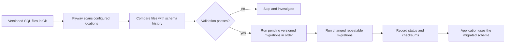
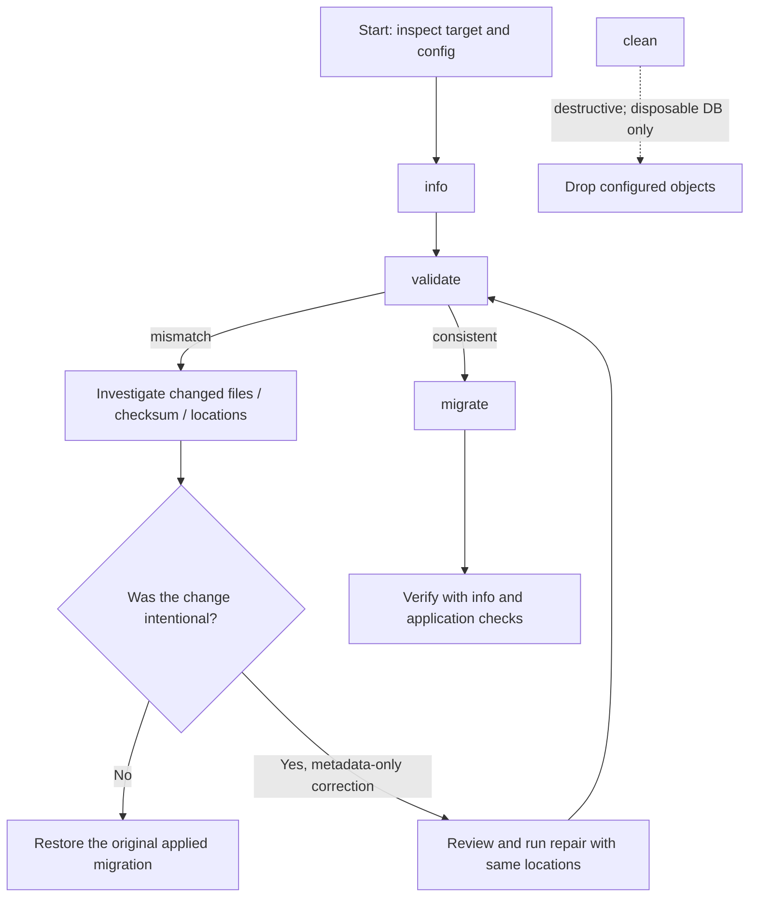

# Flyway database migrations

Flyway is a database schema and data migration tool. It lets a team keep database changes in version control beside application code, apply those changes in a defined order, and check what has already run in each environment. This guide consolidates the practical Flyway material from the two supplied legacy guides, including their Maven and Spring Boot examples, schema-history setup, naming rules, commands, troubleshooting notes, and observed output. Examples below use a CodeTrove-specific namespace—`codetrove_flyway_demo`, `ct_flyway_employee`, `ct_flyway_department`, and `ct_` migration descriptions—so they are easy to identify and do not collide with unrelated examples.

> **Version note:** Several preserved examples were written for Flyway 8.x or 10.0.1 and older MySQL Connector/J coordinates. They are useful for understanding the integration, but they are not a current dependency-version recommendation. Keep the Flyway engine, build plugin, database support module, JDBC driver, database server, and Spring Boot release compatible. Check the official [Flyway migrations guide](https://documentation.red-gate.com/fd/migrations-271585107.html), [Maven goal documentation](https://documentation.red-gate.com/fd/maven-goal-277579365.html), and the documentation for the exact version in your project before copying historical configuration.

## 1. Why migrations, and the two build approaches

A migration is a version-controlled change to a database schema or its data: for example, creating or altering a table, adding an index, inserting reference data, or changing a stored procedure. A migration set is applied in the same logical order to development, test, staging, and production so each environment can be recreated and audited.

| Build approach | What it does | Appropriate use | Important caution |
| --- | --- | --- | --- |
| Full build from zero | Start with a new empty database, then apply every migration from the first version to the latest. | Reproducible local/test database creation, CI, disposable integration environments. | Do not confuse a full build with `clean` on a shared database. |
| Incremental build | Run `migrate` against the existing database; Flyway applies only migrations that are pending for that database. | Normal development and deployment of a previously initialized environment. | Applied versioned scripts are history; do not edit them to change an already-deployed schema. Add a new forward migration. |

`migrate` discovers migrations in configured locations, compares them with the target database's schema history, validates the resolved migrations, and applies pending versioned migrations in version order. Changed repeatable migrations run after pending versioned migrations. If all available migrations are already applied, another `migrate` is normally a no-op. This is **command-level idempotence**; it does not make every SQL statement intrinsically idempotent.

One legacy sentence says Flyway “will only execute the latest migration file.” Read that as an imprecise description of applying the newest pending state, not as the literal runtime algorithm: when several versioned migrations are pending, Flyway applies the pending sequence in version order, as the `V1_0_5` to `V1_0_9` example below illustrates.



A typical CodeTrove-local layout is:

```text
src/main/resources/db/migration/codetrove/
├── V1_0_0__ct_create_flyway_demo_schema.sql
├── V1_0_1__ct_create_employee_table.sql
├── V1_1_0__ct_add_department_reference.sql
└── R__ct_refresh_reference_views.sql
```

The first source's original directory was `flyway/sql/` and showed this progression: `V1__init_schema.sql`, `V1.1__create_users_table.sql`, `V1.2__insert_seed_data.sql`, `V1.3__alter_users_table.sql`, and `V1.4__update_emails.sql`. The source's final `pgsql` fence was unclosed; the sequence is normalized above into a valid CodeTrove-specific path and naming scheme.

Migration locations may be on the classpath or filesystem. Scanning is recursive beneath a configured location, so use a deliberate directory layout and ensure the same locations are supplied to commands such as `migrate`, `validate`, and `repair`.

## 2. Migration types and naming

The leading prefix indicates the migration kind. A versioned migration has a version; an undo migration corresponds to a versioned migration; a repeatable migration has no version and is re-applied when its checksum changes. A baseline is a marker for an existing database, not a substitute for running all historical scripts against it.

| Type | Usual pattern | Ordering / re-run behavior | Example |
| --- | --- | --- | --- |
| Versioned | `V<version>__<description>.sql` | Runs once, in version order. Use a new version for each new database change. | `V1_0_1__ct_create_employee_table.sql` |
| Undo (edition/version dependent) | `U<matching-version>__<description>.sql` | Intended to reverse the corresponding versioned change when the installed edition supports Undo. | `U1_0_1__ct_drop_employee_table.sql` |
| Repeatable | `R__<description>.sql` | No version; re-runs when the file's checksum changes. Useful for replaceable views or reference routines. | `R__ct_refresh_employee_summary_view.sql` |
| Baseline | Baseline command/configuration | Records the starting point for an already-existing schema; migrations at or below the baseline version are treated as already represented. | Baseline an existing `codetrove_flyway_demo` before applying newer versions. |

The general file shape is **prefix + version (when applicable) + separator + description + suffix**. With the usual SQL defaults, the separator is two underscores (`__`), and the suffix is `.sql`. For a versioned script, `V1.1.1__ct_create_employee_table.sql` and `V1_1_0__ct_create_employee_table.sql` illustrate dot- and underscore-separated version components. Flyway compares versions numerically/logically, not by the apparent length of the string; keep each version unique and in the intended order. The legacy guides state that semantic-looking versions such as `1.1.1` are supported in Flyway 5.0 and later; verify the naming grammar for the exact Flyway release in use.

One legacy naming table also says “the migration version should always start with 1.” Treat that as the convention used by that example's initial migration sequence, not as a general rule that every future version begins with `1`; versions must be valid, unique, and ordered according to the project's chosen scheme.


Common naming settings shown in the legacy material are:

```properties
# Prefix for versioned SQL migrations (default: V)
flyway.sqlMigrationPrefix=V

# Prefix for undo SQL migrations (default: U; availability is edition/version dependent)
flyway.undoSqlMigrationPrefix=U

# Prefix for repeatable SQL migrations (default: R)
flyway.repeatableSqlMigrationPrefix=R

# Separator between the functional filename parts and description (default: __)
flyway.sqlMigrationSeparator=__

# Comma-separated suffixes (default: .sql; some setups use .pkg or .pkb)
flyway.sqlMigrationSuffixes=.sql

# Out-of-order execution is normally disabled; enable only with a deliberate release policy.
flyway.outOfOrder=false
```

The source examples also list `.sql,.pkg,.pkb` as multiple suffixes for compatibility with database object scripts and editor file associations. `outOfOrder` is normally `false`; turning it on can apply a newly discovered version 2 after versions 1 and 3 have already been applied. That may make a fresh replay differ from the order used by an already-deployed environment, so treat it as a release-policy decision rather than a quick fix.

Choose descriptions that state the database change. Prefer `V1_0_1__ct_create_employee_table.sql` or `V1_1_0__ct_add_employee_department_id.sql` over vague names such as `V1__migration.sql` or `V1.2__changes.sql`. Lowercase words separated by underscores help keep names consistent across filesystems and source-control diffs. Once a versioned migration has been applied in a shared environment, do not rewrite its SQL: create a new migration instead.

## 3. What happens to the schema-history table

Flyway records applied migrations in a schema-history table, normally named `flyway_schema_history`. The official [schema-history reference](https://documentation.red-gate.com/fd/flyway-schema-history-table-273973417.html) explains that the table records migration identity, execution details, checksums, and success state. You can inspect it with:

```sql
SELECT *
FROM flyway_schema_history
ORDER BY installed_rank;
```

The legacy examples also use the shorter query `select * from flyway_schema_history;`. In a real deployment, query the correct database/schema and avoid treating a direct edit of this table as a repair strategy. `info` is the intended first place to inspect migration state; `validate` checks consistency between resolved migration files and applied history.

An example history view may contain entries like these (the exact columns and state labels depend on the Flyway version):

```text
+-----------+---------+----------------------------------------+----------+---------+
| Category  | Version | Description                            | Type     | State   |
+-----------+---------+----------------------------------------+----------+---------+
| NULL      | NULL    | << Flyway Schema Creation >>           | SCHEMA   | Success |
| NULL      | NULL    | << Flyway Baseline >>                  | BASELINE | Success |
| Versioned | 1.0.0   | ct create flyway demo schema           | SQL      | Success |
| Versioned | 1.0.1   | ct create employee table               | SQL      | Success |
+-----------+---------+----------------------------------------+----------+---------+
```

The second legacy guide's displayed sample uses a `<< Flyway Schema Creation >>` row, a `<< Flyway Baseline >>` row annotated “Created before Versioned and removed,” then version `1.1.1` (`Initial Build`) and `1.1.2` (`Pubs Original Data`), all shown as successful. The exact labels and historical annotation are retained here; schema-history columns/states and how they are displayed vary by Flyway release.

Useful states include `Pending`, `Success`, `Ignored`, `Deleted`, `Available`, `Undone`, `Above Target`, `Baseline`, `Below Baseline`, `Missing`, `Failed`, `Failed (Missing)`, `Failed (Future)`, `Future`, `Out of Order`, `Outdated`, and `Superseded`. Some labels are specific to particular migration types or newer/older versions. An `Out of Order` migration is a warning that replaying all migrations from scratch may not reproduce the same execution order as the database that received it.

### Schema creation and history-table placement

Flyway can attempt to create the configured `schemas` and `defaultSchema` when `createSchemas` is enabled. If `createSchemas=false`, the schema intended to hold the history table must already exist or be created before Flyway attempts to create that table. This is especially important when the application schema should be created by a migration but the history table must exist before that migration can run.

| Setting | Purpose |
| --- | --- |
| `flyway.createSchemas` | Controls whether Flyway attempts to create configured schemas. |
| `flyway.schemas` | Comma-separated schemas managed by Flyway; names may be case-sensitive for the target database. |
| `flyway.defaultSchema` | Schema used for the history table and as the default schema where applicable. |
| `flyway.initSql` | SQL run after opening a database connection; can be used to prepare a history schema where appropriate. |

For a MySQL-style example, create the history schema out-of-band or use database-specific initialization SQL, and set the default schema deliberately. Grant only the permissions required by the migration account:

```properties
# Example only: confirm SQL syntax and privileges for the selected database.
flyway.createSchemas=false
flyway.defaultSchema=codetrove_flyway_history
flyway.schemas=codetrove_flyway_history,codetrove_flyway_demo
flyway.initSql=CREATE SCHEMA IF NOT EXISTS codetrove_flyway_history
flyway.locations=filesystem:src/main/resources/db/migration/codetrove
```

The source material gives a second configuration path with `createSchemas=true`, `initSql`, and `schemas=flyway_history_schema,my_schema`. Its described sequence is: run `migrate`; Flyway creates `my_schema`; initialization SQL creates `flyway_history_schema`; then Flyway creates its history table in the default/history schema. The original legacy block also specifies a local MySQL URL, `flyway.user=root`, `flyway.password=root`, `flyway.locations=filesystem:resources/db/migration`, and `flyway.placeholderReplacement=false`. The CodeTrove-translated sketch below keeps those choices visible but never includes the old `root/root` credentials:

```properties
# Legacy-style create-schemas flow; use only after testing the target database.
flyway.createSchemas=true
flyway.initSql=CREATE SCHEMA IF NOT EXISTS codetrove_flyway_history
flyway.schemas=codetrove_flyway_history,codetrove_flyway_demo
flyway.defaultSchema=codetrove_flyway_history
flyway.url=jdbc:mysql://localhost:3306/
flyway.user=ct_flyway_migrator
# Supply flyway.password from a protected secret source.
flyway.locations=filesystem:resources/db/migration
flyway.placeholderReplacement=false
```

The history schema must exist when Flyway creates the history table. One old example spells its initialization value as `CREATE IF NOT EXISTS flyway_history_schema`; that lacks an explicit database-specific `CREATE SCHEMA` form and should not be copied as portable SQL. The historical configuration also shows `schemas=my_schema` with `createSchemas=false`, which requires that history schema to be created out-of-band or in a bootstrap step. These two approaches are alternatives, not settings to combine blindly. The modern documentation for your database/version is authoritative.


## 4. Core commands: purpose and risk

| Command | What it is for | Risk / guidance |
| --- | --- | --- |
| `migrate` | Scan, validate, and apply pending migrations; create the history table when needed. | The normal deployment command. Run in a controlled release flow and observe logs. |
| `info` | Show resolved/applied/pending migration status, execution information, and success state. | Safe diagnostic; start here when status is unclear. |
| `validate` | Compare resolved migrations with applied history, including checksums and migration metadata. | Fix the underlying source/history mismatch; do not suppress validation casually. |
| `baseline` | Mark an existing database at a configured baseline version so Flyway can manage migrations above it. | Review the existing schema and choose the baseline version carefully. It does not execute the historical migrations being baselined. |
| `repair` | Repair metadata in the schema-history table, including certain failed/missing migration states and metadata realignment. | Not a general rollback or “make the error go away” command. Review the effect and use the same locations as `migrate`. |
| `clean` | Drop objects in configured schemas; if Flyway created the schemas, it may drop those schemas too. | **Destructive. Never use against production or a shared database.** Restrict it to disposable development/test databases. |
| `undo` | Reverse the most recently applied versioned migration when a matching undo migration exists and the installed edition supports it. | Availability and licensing are version/edition dependent. Prefer a forward corrective migration for ordinary production recovery. |

The source's Clean explanation explicitly calls out tables, views, and procedures and frames a reset as a development/test action. Its Repair section lists three operations: remove failed migration entries only for databases that do **not** support DDL transactions; realign checksums, descriptions, and types of applied migrations with the resolved files; and mark missing migrations as deleted. Repair must receive the same migration `locations` as Migrate. Review which entries will change before invoking it; it is not a generic recovery command.

One historical Maven/API example says Undo required `flyway-proprietary` version `10.0.1`:

```xml
<!-- Historical, edition/version-specific example; verify current licensing and coordinates. -->
<dependency>
    <groupId>com.redgate.flyway</groupId>
    <artifactId>flyway-proprietary</artifactId>
    <version>10.0.1</version>
</dependency>
```

The same guide described Undo as a way to reverse the most recent versioned migration and mentioned a 28-day Teams trial. A different source comment says 30 days. These are historical notes, not current licensing or trial-duration promises.

The two old guides list `Check` and `Snapshot` in a command-reference list but do not include them in the accompanying command table. Those features and names depend on Flyway version/edition; check current product documentation rather than assuming they are standard commands in every installation. The old command screenshots for Baseline, Clean, Info, Repair, Undo, and Validate could not be retrieved (their URLs returned 404), so the command table and diagrams here preserve the useful explanations without broken images.



### `migrate` workflow and build modes

If migrations through `V1_0_9` exist and the database is at `V1_0_5`, `migrate` applies `V1_0_6`, `V1_0_7`, `V1_0_8`, and `V1_0_9` in order. If both the database and resolved migration set are already at `V1_0_9`, it does no migration work. Flyway may be invoked at application startup to keep code and schema expectations aligned, but startup migration should be designed with deployment permissions, concurrent application instances, readiness checks, and rollback strategy in mind.

A clean-and-migrate build is appropriate only for a database intentionally reserved for disposable builds. An incremental build runs `migrate` without `clean`. One historical build command combined `-Dskip.flyway=true` with explicit `flyway:clean flyway:migrate` goals; the source also claimed the property skipped Flyway, so those statements conflict. Do not copy that combination blindly. The following is an incremental example; the destructive command is shown separately and should be restricted to a disposable database:

```bash
# Incremental migration (normal development/deployment path)
mvn --non-recursive \
  -Dflyway.url=jdbc:mysql://localhost:3306/codetrove_flyway_demo \
  -Dflyway.user="$FLYWAY_USER" \
  -Dflyway.password="$FLYWAY_PASSWORD" \
  -Dflyway.schemas=codetrove_flyway_history,codetrove_flyway_demo \
  -Dflyway.configFiles=resources/config/local/codetrove-flyway.conf \
  flyway:info flyway:validate flyway:migrate
```

> Avoid putting production passwords directly into shell history, process arguments, checked-in `.conf` files, or CI logs. Prefer a secret manager or masked pipeline secret and follow the Flyway version's supported secret/environment configuration.

## 5. Configuration: properties, environment, and files

Common properties used across both legacy guides are `flyway.url` (JDBC connection URL), `flyway.user`, `flyway.password`, `flyway.schemas`, `flyway.defaultSchema`, `flyway.locations`, `flyway.createSchemas`, `flyway.initSql`, `flyway.placeholderReplacement`, and `flyway.placeholders.*`.

### Command-line properties

The older MySQL example passes URL, user, password, and schema as Maven `-D` properties. Use placeholders or protected environment variables rather than literal credentials in committed examples:

```bash
mvn --non-recursive \
  -Dflyway.url=jdbc:mysql://localhost:3306/codetrove_flyway_demo \
  -Dflyway.user="$FLYWAY_USER" \
  -Dflyway.password="$FLYWAY_PASSWORD" \
  -Dflyway.schemas=codetrove_flyway_history,codetrove_flyway_demo \
  flyway:migrate
```

`flyway.url` is the database connection URL; `flyway.user` is the authentication user; `flyway.password` is the authentication secret; and `flyway.schemas` names the schemas Flyway manages. The exact option prefix and quoting rules depend on whether you invoke the CLI, Maven plugin, Gradle plugin, or API.

The source properties comments add these operational details: the JDBC URL can include a host, port, database, and connection parameters (for example, an Aurora-style `jdbc:mysql://<instance>.<region>.rds.amazonaws.com:<port>/<database>?<key>=<value>` URL); a user may be prompted for when no username is supplied and the connection is not passwordless; and `initSql` defaults to none. Schema names may be case-sensitive for the database. If `defaultSchema` is unset, the first item in `schemas` may be used as the default. Flyway can attempt to create all configured schemas, clean them in the configured order, and drop schemas it created when `clean` runs. Verify these behaviors for the installed version and database before relying on them.

### Environment variables

The legacy page uses the conventional environment names below, then invokes Flyway. Environment values keep secrets out of source files, but the secret still must be supplied securely by the shell, CI, or secret manager:

```bash
export FLYWAY_URL='jdbc:mysql://localhost:3306/codetrove_flyway_demo'
export FLYWAY_USER='ct_flyway_migrator'
# The CI secret manager injects CT_FLYWAY_PASSWORD; do not echo or commit it.
export FLYWAY_PASSWORD="$CT_FLYWAY_PASSWORD"
export FLYWAY_SCHEMAS='codetrove_flyway_history,codetrove_flyway_demo'
```

```bash
# CLI form
flyway migrate

# Maven form, as in the legacy material
mvn flyway:migrate
```

The shell example expects `CT_FLYWAY_PASSWORD` to be injected into the process by a secret manager; configure the actual value outside the repository. Confirm the environment-variable naming supported by the Flyway version and execution interface in use.

### `flyway.conf` and custom configuration files

A configuration file makes non-secret settings repeatable. A safe CodeTrove-local example is:

```properties
# resources/config/local/codetrove-flyway.conf
flyway.url=jdbc:mysql://localhost:3306/codetrove_flyway_demo
flyway.user=ct_flyway_migrator
# Supply the password through an approved secret mechanism; do not commit it here.
flyway.schemas=codetrove_flyway_history,codetrove_flyway_demo
flyway.defaultSchema=codetrove_flyway_history
flyway.locations=filesystem:src/main/resources/db/migration/codetrove
flyway.createSchemas=false
flyway.placeholderReplacement=false
```

A custom file can be selected in a Maven invocation with a property such as:

```bash
mvn flyway:migrate -Dflyway.configFiles=resources/config/local/codetrove-flyway.conf
```

The legacy pages describe the default `flyway.conf` locations as the working directory (`workingDir/flyway.conf`), the user's home (`userhome/flyway.conf`), and the installation's `conf` directory (`installDir/conf/flyway.conf`). For another filename, use an explicit configuration-file setting and a real path. The older wording for a custom path was ambiguous (`resources/config/local/ flyway.conf / myFlywayConfig.conf`); the example above uses one unambiguous filename instead.

The Maven plugin can accept multiple additional config files as a comma-separated `flyway.configFiles` value; relative paths are relative to the directory containing the POM. The official [Maven plugin configuration guide](https://documentation.red-gate.com/fd/maven-goal-277579365.html) says `FLYWAY_CONFIG_FILES`, when set, takes precedence over the command-line parameter that selects config files. It also documents config-file encoding settings such as `flyway.configFileEncoding` / `FLYWAY_CONFIG_FILE_ENCODING` (UTF-8 is the default). For credentials, the Maven plugin supports a `<server>` entry in `settings.xml` (default server id `flyway-db`, configurable with `serverId`) and supports regular or encrypted settings files. Use protected settings/secret storage rather than checking credentials into the project.

```xml
<!-- ~/.m2/settings.xml; use Maven's encrypted-password workflow where appropriate. -->
<settings>
    <servers>
        <server>
            <id>flyway-db</id>
            <username>ct_flyway_migrator</username>
            <password>INJECTED_OR_ENCRYPTED_SECRET</password>
        </server>
    </servers>
</settings>
```

A fuller properties sketch from the legacy pages included these settings. It is adapted to a distinct CodeTrove schema and omits a literal password:

```properties
# JDBC connection and managed schema
flyway.url=jdbc:mysql://localhost:3306/codetrove_flyway_demo
flyway.user=ct_flyway_migrator
flyway.schemas=codetrove_flyway_history,codetrove_flyway_demo
flyway.defaultSchema=codetrove_flyway_history

# Migration source and schema setup
flyway.locations=filesystem:src/main/resources/db/migration/codetrove
flyway.createSchemas=false
# flyway.initSql=CREATE SCHEMA IF NOT EXISTS codetrove_flyway_history

# Placeholder replacement is true by default in many Flyway configurations.
# Turn it off only when `${...}` is not intended to be replaced by Flyway.
flyway.placeholderReplacement=false
# flyway.placeholders.user=ct_app_user
# flyway.placeholders.keyABC=valueXYZ
```

The first legacy guide describes a configuration order, says higher items take precedence, and enumerates command-line arguments, environment variables, a custom config file, and built-in defaults—but the numbering jumps from item 3 to item 5. Its explicit example says a command-line value overrides a config-file value. The official [Maven plugin configuration guide](https://documentation.red-gate.com/fd/maven-goal-277579365.html) supplies this Maven-specific precedence, highest first: JVM system properties; environment variables; custom config files; Maven properties; plugin configuration; credentials from `settings.xml`; the user's `flyway.conf`; then plugin defaults. It also states that `-Dflyway.url=...` overrides the same setting in a config file. Do not assume this exact order applies unchanged to the standalone CLI, Gradle, Spring Boot, or the API; see the corresponding [CLI configuration-order guide](https://documentation.red-gate.com/fd/cli-configuration-order-224919668.html) for that interface.

## 6. Versioned SQL migrations: complete CodeTrove example

The examples here preserve the older guides' MySQL table-creation, schema, seed, alteration, and update scenarios while adding unique `ct_` identifiers. Adjust SQL types and syntax to the selected database; `AUTO_INCREMENT`, backticks, `ENGINE=InnoDB`, and charset clauses are MySQL-specific.

### `V1_0_1__ct_create_employee_table.sql`

```sql
CREATE TABLE IF NOT EXISTS ct_flyway_employee (
    id INT NOT NULL AUTO_INCREMENT PRIMARY KEY,
    employee_name VARCHAR(80) NOT NULL,
    email VARCHAR(160),
    date_of_birth TIMESTAMP NULL,
    created_at TIMESTAMP NOT NULL DEFAULT CURRENT_TIMESTAMP
) ENGINE=InnoDB DEFAULT CHARSET=utf8mb4;
```

### `V1_0_2__ct_add_department_table.sql`

```sql
CREATE TABLE IF NOT EXISTS ct_flyway_department (
    id INT NOT NULL AUTO_INCREMENT PRIMARY KEY,
    department_name VARCHAR(80) NOT NULL UNIQUE
) ENGINE=InnoDB DEFAULT CHARSET=utf8mb4;

ALTER TABLE ct_flyway_employee
    ADD COLUMN department_id INT NULL;
```

### `V1_0_3__ct_add_employee_department_fk.sql`

```sql
ALTER TABLE ct_flyway_employee
    ADD CONSTRAINT fk_ct_flyway_employee_department
    FOREIGN KEY (department_id)
    REFERENCES ct_flyway_department (id);
```

Run migrations, then inspect status:

```bash
mvn clean flyway:migrate \
  -Dflyway.configFiles=resources/config/local/codetrove-flyway.conf

mvn flyway:info \
  -Dflyway.configFiles=resources/config/local/codetrove-flyway.conf
```

`mvn clean` here is Maven's build-directory cleanup, not the Flyway `clean` goal. The Flyway goal is only invoked if `flyway:clean` is explicitly included. For the parent POM in a multi-module Maven build, `--non-recursive` (short form `-N`) means do not recurse into subprojects:

```bash
mvn --non-recursive clean flyway:migrate \
  -Dflyway.configFiles=resources/config/local/codetrove-flyway.conf
```

The source's `mvn --help` excerpt is:

```text
mvn --help
...
-N,--non-recursive    Do not recurse into sub-projects
```

The legacy `mvn --help` excerpt defines `-N,--non-recursive` as “Do not recurse into sub-projects.” The legacy run-configuration example is named `Flyway Migrate`, uses `${workspace_loc:/MyApp}` as its base directory, and passes `--non-recursive`, a JDBC URL using `${env.FLYWAY_HOST}`, a config file path, and `flyway:migrate`. For this project, those values map to a CodeTrove run configuration with base directory `$PROJECT_ROOT`, `-Dflyway.url=jdbc:mysql://${env.FLYWAY_HOST}:3306/codetrove_flyway_demo`, `-Dflyway.configFiles=resources/config/local/codetrove-flyway.conf`, and the goal `flyway:migrate`.

## 7. Maven plugin configuration and historical version details

The Maven plugin can be configured inline or through an external properties file. Prefer one coherent, tested Flyway version set. The following trimmed configuration demonstrates the pieces from the legacy Maven examples; align the version property with the actual plugin, engine, database-support module, and JDBC driver versions approved for your project:

```xml
<properties>
    <flyway.version>REPLACE_WITH_TESTED_FLYWAY_VERSION</flyway.version>
    <mysql.connector.version>REPLACE_WITH_TESTED_CONNECTOR_VERSION</mysql.connector.version>
    <skip.flyway>false</skip.flyway>
</properties>

<build>
    <plugins>
        <plugin>
            <groupId>org.flywaydb</groupId>
            <artifactId>flyway-maven-plugin</artifactId>
            <version>${flyway.version}</version>
            <executions>
                <execution>
                    <id>codetrove-flyway-migrate</id>
                    <phase>none</phase>
                    <goals>
                        <goal>migrate</goal>
                    </goals>
                    <configuration>
                        <skip>${skip.flyway}</skip>
                    </configuration>
                </execution>
            </executions>
            <dependencies>
                <dependency>
                    <groupId>org.flywaydb</groupId>
                    <artifactId>flyway-core</artifactId>
                    <version>${flyway.version}</version>
                </dependency>
                <dependency>
                    <groupId>org.flywaydb</groupId>
                    <artifactId>flyway-mysql</artifactId>
                    <version>${flyway.version}</version>
                </dependency>
                <dependency>
                    <groupId>com.mysql</groupId>
                    <artifactId>mysql-connector-j</artifactId>
                    <version>${mysql.connector.version}</version>
                </dependency>
            </dependencies>
        </plugin>
    </plugins>
</build>
```

The MyWorld example used Maven plugin/core/MySQL support at `8.5.13`, MySQL Connector/J `8.0.33`, `<phase>none</phase>`, a `migrate` goal, and a `<skip>${skip.flyway}</skip>` switch. It also showed optional inline `url`, `user`, `password`, and `schemas` configuration; external configuration is preferable for separating secrets from the POM. Another old POM example used plugin `8.5.13`, `flyway-core` `8.0.5`, and `mysql-connector-java` `8.0.28`; an output line separately reported Flyway Community Edition `8.0.5`. These mixed historical versions are preserved here as provenance, not recommended as a compatibility matrix.

The first guide's observed Maven output is reproduced with its original historical project/schema names:

```text
[INFO] --- flyway-maven-plugin:8.5.13:migrate (default-cli) @ MyApp ---
[INFO] Flyway Community Edition 8.0.5 by Redgate
[INFO] Database: jdbc:mysql://localhost:3306/ (MySQL 8.0)
[INFO] Creating schema `schema1` ...
[INFO] Creating Schema History table `schema1`.`flyway_schema_history` ...
[INFO] Current version of schema `schema1`: null
```

This is a historical observation, not a version recommendation: the plugin line says `8.5.13` while the Flyway edition line says `8.0.5`.

One old page reported this MySQL upgrade error:

```text
Failed to execute goal org.flywaydb:flyway-maven-plugin:8.5.13:clean (default-cli)
No database found to handle jdbc:mysql://localhost:3306/
```

Its project-specific fix was to add the MySQL Flyway database-support dependency (`flyway-mysql`) to the plugin. Check the module naming and required dependencies for the Flyway version currently used; older and newer releases differ in database-module packaging.

The first legacy POM's driver-specific list also names `quarkus-jdbc-postgresql`, `flyway-sqlserver`, `flyway-mysql`, `flyway-database-oracle`, `flyway-database-postgresql`, `flyway-database-db2`, `flyway-database-derby`, and `flyway-database-hsqldb`. These identifiers are preserved as historical examples, not as one POM's dependency set or a guarantee of current coordinates. Select only the support module for the target engine and the matching Flyway release.

A second historical Community Edition example added the Redgate Maven plugin repository and used the `com.redgate.flyway` group with plugin version `10.0.1`:

```xml
<pluginRepositories>
    <pluginRepository>
        <id>redgate</id>
        <url>https://download.red-gate.com/maven/release</url>
    </pluginRepository>
</pluginRepositories>

<build>
    <plugins>
        <plugin>
            <groupId>com.redgate.flyway</groupId>
            <artifactId>flyway-maven-plugin</artifactId>
            <version>10.0.1</version>
        </plugin>
    </plugins>
</build>
```

The official Maven documentation says the Community plugin is published through the Redgate repository and downloading it agrees to the Redgate EULA. It records that the Maven group ID changed at Flyway 10.0.0 from `org.flywaydb.enterprise` to `com.redgate.flyway` (both were published as a convenience through 10.22.0); Open Source Edition uses `org.flywaydb`. The page's Maven 3/Java 17 support note and version-specific Java requirement can change: its fetched text says Flyway v14 requires Java 21 and displays plugin version 13.12.0. Verify the Java, Maven, Flyway, plugin, engine, and database-module compatibility for the release you select.

The same guide included a license/report properties note. It said a key beginning `FL01...` applied to Teams/Enterprise, and that a report defaults to the current directory with base filename `report`:

```properties
# Historical note: license-key availability and product names change by release.
# Flyway Teams/Enterprise only in this example; check the current licensing docs.
# flyway.licenseKey=<provided-by-approved-secret-store>

# Report destination (the historical example says current directory, base filename `report`)
# flyway.reportFilename=report
```

The legacy page notes that downloading the Teams/Enterprise plugin implied accepting the Redgate EULA. Product tiers, licensing terms, trial durations, and report features can change; consult the current Redgate terms before use. The two source guides themselves differ on trial duration: one says 28 days, while a properties comment says 30 days. Neither duration is treated here as current product guidance.

One historical MyWorld Maven fragment configured `<phase>none</phase>` to disable default binding and showed `-Dskip.flyway=true clean install` as a way to skip Flyway. Its separate build command also listed explicit `flyway:clean flyway:migrate` goals. These statements are contradictory unless the project's exact plugin execution and skip property semantics are inspected. In the CodeTrove example, set `skip.flyway=false` when intentionally invoking `migrate`; do not rely on a broad build command to imply which Flyway goals execute.

The same historical Maven fragment included optional inline settings:

```xml
<!-- Historical alternative only; prefer an external config file for secrets. -->
<configuration>
    <url>jdbc:mysql://localhost:3306/codetrove_flyway_demo</url>
    <user>ct_flyway_migrator</user>
    <schemas>codetrove_flyway_history,codetrove_flyway_demo</schemas>
</configuration>
```

An older build run configuration was named `Flyway (Non-Recursive Clean & Migrate)`, used `${workspace_loc:/my-parent}` as the base directory, and supplied a client selector (`-Dclient=IN`), `-Dskip.flyway=true`, `-Dmaven.test.skip=true`, an external config path, two filesystem migration locations (common and environment-specific), and explicit `flyway:clean flyway:migrate` goals. Those original goals/settings conflict with the stated skip behavior. A corrected incremental CodeTrove configuration uses a single `filesystem:src/main/resources/db/migration/codetrove` location, omits `flyway:clean`, and uses `-Dskip.flyway=false` if the selected POM execution supports that property.

## 8. Legacy SQL examples, adapted to the CodeTrove namespace

The older guides contain both employee/department examples and users/schema/data examples. This section preserves both patterns while prefixing the database objects and sample names with `ct_`. These snippets are illustrations from different source contexts; do not combine them as one ordered migration set without checking naming versions and dialect support.

### Schema and user-data example (`V1_1_1__ct_schema.sql`)

The source called the file `V1.1.1__schema.sql`. It creates a users table, adds an `is_active` flag, and optionally removes a temporary record. Here the table and temporary user are renamed to make their ownership explicit. `SERIAL` is database-specific; use the target database's identity/sequence syntax.

```sql
-- Create the CodeTrove sample users table
CREATE TABLE ct_flyway_users (
    id SERIAL PRIMARY KEY,
    username VARCHAR(50) NOT NULL,
    email VARCHAR(100),
    created_at TIMESTAMP DEFAULT CURRENT_TIMESTAMP
);

-- Add an active flag
ALTER TABLE ct_flyway_users
    ADD COLUMN is_active BOOLEAN DEFAULT TRUE;

-- Optional cleanup of an explicitly temporary fixture record
DELETE FROM ct_flyway_users
WHERE username = 'ct_temp_user';
```

### Seed and update example (`V1_1_2__ct_migration.sql`)

The source inserts two sample users and updates one email. This adapted example uses reserved, non-real sample addresses:

```sql
-- Insert sample CodeTrove users
INSERT INTO ct_flyway_users (username, email) VALUES
    ('ct_john_demo', 'ct-john@example.invalid'),
    ('ct_jane_demo', 'ct-jane@example.invalid');

-- Update one sample record
UPDATE ct_flyway_users
SET email = 'ct-john-updated@example.invalid'
WHERE username = 'ct_john_demo';
```

The original examples used usernames `john_doe` and `jane_doe`, emails `john@example.com` and `jane@example.com`, updated John to `john_updated@example.com`, and described an optional `temp_user` deletion. `.invalid` is used above so example addresses cannot be mistaken for deliverable email addresses.

### Employee/department example from the second guide

The legacy guide names its first file `V1_1_0__my_first_migration.sql` and creates an `employee` table with an auto-increment identity, `name`, `email`, and `date_of_birth`. Its second file is written as `V2_0_create_department_schema.sql`, then creates a `department` table and adds `dept_id` after `email` in the employee table. The second filename is missing the required separator in the stated convention; a canonical CodeTrove version is `V2_0__ct_create_department_schema.sql`.

```sql
-- V1_1_0__ct_create_employee_table.sql (MySQL)
CREATE TABLE IF NOT EXISTS ct_flyway_employee (
    id INT NOT NULL AUTO_INCREMENT PRIMARY KEY,
    employee_name VARCHAR(80),
    email VARCHAR(160),
    date_of_birth TIMESTAMP NULL
) ENGINE=InnoDB DEFAULT CHARSET=utf8mb4;
```

```sql
-- V2_0__ct_create_department_schema.sql (MySQL)
CREATE TABLE IF NOT EXISTS ct_flyway_department (
    id INT NOT NULL AUTO_INCREMENT PRIMARY KEY,
    department_name VARCHAR(80)
) ENGINE=InnoDB DEFAULT CHARSET=utf8mb4;

ALTER TABLE ct_flyway_employee
    ADD COLUMN department_id INT NULL;
```

The original second migration used `ALTER TABLE employee ADD dept_id int AFTER email`; `AFTER` is MySQL-specific and is omitted from the adapted statement because explicit column ordering is not required for a relational schema. The key idea is to introduce a new migration for the new department table and employee relationship, not edit a migration already applied elsewhere.

The two older guides show Maven commands to migrate and inspect state:

```bash
mvn clean flyway:migrate \
  -Dflyway.configFiles=resources/config/local/codetrove-flyway.conf

mvn flyway:info \
  -Dflyway.configFiles=resources/config/local/codetrove-flyway.conf
```

The first source also shows common and environment-specific locations together:

```bash
-Dflyway.locations=filesystem:resources/mySqlDB/migration/common,filesystem:resources/mySqlDB/migration/env
```

Use one intentional CodeTrove path in this curriculum, for example `filesystem:src/main/resources/db/migration/codetrove`; if multiple locations are required, pass the same complete list to `migrate`, `validate`, and `repair`.

A directory example from the first guide grouped `V1`, `V1.1`, `V1.2`, `V1.3`, and `V1.4` scripts under `flyway/sql/`. The CodeTrove version below keeps the same ordered progression with distinct names:

```text
src/main/resources/db/migration/codetrove/
├── V1_0_0__ct_init_schema.sql
├── V1_0_1__ct_create_employee_table.sql
├── V1_0_2__ct_insert_employee_seed_data.sql
├── V1_0_3__ct_alter_employee_table.sql
└── V1_0_4__ct_update_employee_emails.sql
```

## 9. Spring Boot integration

When the Flyway integration is on the application classpath, Spring Boot can configure and run migrations during application startup. This can reduce schema/code mismatch, but production migrations should still have an explicit release owner, an appropriate database role, deployment ordering, logs, health/readiness behavior, and a recovery plan. Spring Boot 1.x used older property names in the legacy note; Boot 2.x and later use the `spring.flyway.*` namespace.

| Spring Boot generation in the legacy note | Disable property shown |
| --- | --- |
| 1.x | `flyway.enabled=false` |
| 2.x and later | `spring.flyway.enabled=false` |

The later property defaults to enabled in the source example. Confirm the exact property name against the Spring Boot version in the project. For datasource selection, the legacy guide mentions the `@Primary DataSource` or a dedicated `@FlywayDataSource`. It also lists either the application's `spring.datasource.url`, `spring.datasource.username`, and `spring.datasource.password`, or Flyway-specific `spring.flyway.url`, `spring.flyway.user`, and `spring.flyway.password` properties.

A CodeTrove-namespaced properties example, adapted from the original MySQL configuration, is:

```properties
spring.flyway.url=jdbc:mysql://localhost:3306/codetrove_flyway_demo?useSSL=false
spring.flyway.user=ct_flyway_migrator
# Supply the password through a secret provider/environment; do not commit it.

# Keep Hibernate from generating schema changes that conflict with Flyway.
spring.jpa.hibernate.ddl-auto=validate

# Default Spring Boot location is often classpath:db/migration;
# this example explicitly selects the CodeTrove subfolder.
spring.flyway.locations=classpath:db/migration/codetrove

# Only for a reviewed existing non-empty database without history:
# spring.flyway.baseline-on-migrate=true

# Set false only when `${...}` strings in SQL are not Flyway placeholders.
spring.flyway.placeholder-replacement=false
```

The source also shows a common/custom migration-location split, `classpath:db/migration/common,classpath:db/migration/local`, as a commented alternative. Use separate locations only when their ordering and environment-specific behavior are clear; do not accidentally apply local-only scripts in production.

### Baseline and placeholder troubleshooting

One reported startup failure says the schema `app_fly` is non-empty but has no schema-history table and suggests `baseline()` or `baselineOnMigrate=true`. Baseline is an adoption decision: inspect the current schema, select the correct baseline version, and make the history record match the intended starting point. Do not enable baseline-on-migrate indiscriminately, because an unexpected database might otherwise be accepted as the starting state.

Another reported error is `No value provided for placeholder: ${lastName}` in `V1__basicSchma.sql`. The legacy examples suggest either defining the placeholder (`flyway.placeholders.lastName=...`) or disabling replacement with `flyway.placeholderReplacement=false` (Maven: `-Dflyway.placeholderReplacement=false`; the source's Spring Boot spelling is `spring.flyway.placeholderReplacement=false`, while current configuration guidance commonly uses the kebab-case form `spring.flyway.placeholder-replacement=false`; confirm binding for the Boot version). Determine whether `${lastName}` is intended for Flyway substitution or belongs to another template engine before changing the setting.

Other reported Spring Boot diagnostics were:

- `Flyway failed to initialize: none of the following migration scripts locations could be found: classpath:db/migration` — confirm the resources directory and configured classpath location are present in the built artifact.
- `Found non-empty schema(s) ... but no schema history table` — assess baseline/adoption and schema-history placement as above.
- A reference to `spring.flyway.baselineOnMigrate=true` in a properties example — review the existing database before enabling it.

### Dependencies and observed startup logs

A historical dependency fragment included `org.flywaydb:flyway-core` and the runtime MySQL connector `mysql:mysql-connector-java`. That fragment also contains stray closing `</dependencyManagement>` tags and is not valid standalone XML. The following is a well-formed illustration using current-style Connector/J coordinates; use the dependency-management BOM or versions required by the application's actual Spring Boot/Flyway release:

```xml
<dependencies>
    <dependency>
        <groupId>org.flywaydb</groupId>
        <artifactId>flyway-core</artifactId>
    </dependency>
    <dependency>
        <groupId>com.mysql</groupId>
        <artifactId>mysql-connector-j</artifactId>
        <scope>runtime</scope>
    </dependency>
</dependencies>
```

The older guide's MySQL coordinates were `mysql:mysql-connector-java:8.0.28` in one Maven plugin example and `mysql:mysql-connector-java` with runtime scope in the Spring Boot snippet. Another guide used `com.mysql:mysql-connector-j:8.0.33`. These are historical alternatives from different versions; do not include both drivers, and use one coordinate/version supported by the selected MySQL connector and build setup.

The second legacy page includes three successive Flyway Community Edition `8.0.5` / MySQL 8.0 logs. They show an empty `codetrove_flyway_demo` schema receiving three migrations through version 1.3, then one new migration to version 1.4, then a no-op after four migrations validate:

```text
Flyway Community Edition 8.0.5 by Redgate
Database: jdbc:mysql://localhost:3306/codetrove_flyway_demo (MySQL 8.0)
Successfully validated 3 migrations (source: 00:00.042s)
Creating Schema History table `codetrove_flyway_demo`.`flyway_schema_history` ...
Current version of schema `codetrove_flyway_demo`: << Empty Schema >>
Migrating schema `codetrove_flyway_demo` to version "1 - init"
Migrating schema `codetrove_flyway_demo` to version "1.2 - S16"
Migrating schema `codetrove_flyway_demo` to version "1.3 - S17"
Successfully applied 3 migrations to schema `codetrove_flyway_demo`, now at version v1.3 (source: 00:00.138s)

Flyway Community Edition 8.0.5 by Redgate
Successfully validated 4 migrations (source: 00:00.039s)
Current version of schema `codetrove_flyway_demo`: 1.3
Migrating schema `codetrove_flyway_demo` to version "1.4 - S18"
Successfully applied 1 migration to schema `codetrove_flyway_demo`, now at version v1.4 (source: 00:00.089s)

Flyway Community Edition 8.0.5 by Redgate
Successfully validated 4 migrations (source: 00:00.082s)
Current version of schema `codetrove_flyway_demo`: 1.4
Schema `codetrove_flyway_demo` is up to date. No migration necessary.
```

Another source log reports applying `V1__initialSchema.sql` to an empty `my_schema` on MySQL 8.0, creating `my_schema.flyway_schema_history`, and advancing from `null` through a migration described as `1 - my_schemabaseschemadata`; its following run says “No migration necessary,” after validating 2 migrations `[my_schema, V1__initialSchema.sql]`. The source labels its engine output Flyway Community Edition `8.5.13`. The oddly concatenated description is preserved as a source-output quirk, not a recommended migration name.

A separate older Maven output labels the plugin as `flyway-maven-plugin:8.5.13`, the edition as `Flyway Community Edition 8.0.5`, reports MySQL 8.0 at `jdbc:mysql://localhost:3306/`, creates schema `schema1` and table `schema1.flyway_schema_history`, then reports the current schema version as `null`. The versions are retained as historical output, but their mismatch is not a dependency recommendation.

## 10. MySQL-specific troubleshooting notes

The legacy guide reports MySQL error `#1118` (“Row size too large”; maximum row size for the table type, not counting BLOBs, is 65535) and says to consider converting suitable wide columns to `TEXT` or `BLOB`. It also includes global InnoDB commands and a charset warning. These are diagnostic examples—not universal fixes. Check the exact MySQL version, row format, index widths, existing schema, privileges, and whether a global setting is safe before changing server configuration.

```sql
-- Diagnostic examples retained from the legacy material.
SELECT @@innodb_default_row_format;
-- Historical proposal; do not run globally without DBA review:
-- SET GLOBAL innodb_default_row_format=COMPACT;
SET GLOBAL innodb_default_row_format=DYNAMIC;

SELECT @@innodb_strict_mode;
-- Historical proposal; disabling strict mode can hide invalid design/configuration.
-- SET GLOBAL innodb_strict_mode=0;
```

The source text associates `DYNAMIC` row format with an “Index column size too large” message and a 767-byte limit; current MySQL 8.0 documentation instead lists a 3072-byte index-prefix limit for `DYNAMIC`/`COMPRESSED` and 767 bytes for `REDUNDANT`/`COMPACT` at the documented 16-KB page size. MySQL also documents a 65,535-byte combined-row limit, a 4096 hard column limit, and an InnoDB limit of 1017 columns; InnoDB's local-page row-size limit is a separate constraint. The old `utf8mb3` warning is also confirmed for MySQL 8.0: prefer explicit `utf8mb4`. Prefer inspecting the offending columns/indexes and using an appropriate character set/row format over disabling strict checks. `SET NAMES 'utf8mb4'` configures the client character set; it does not convert existing table/column definitions. The old snippet `SET character_set_client = utf8mb4;` is session-specific and is not, by itself, a complete schema migration.

For current limits and syntax, consult the [MySQL column-count and row-size documentation](https://dev.mysql.com/doc/refman/8.0/en/column-count-limit.html), [InnoDB limits](https://dev.mysql.com/doc/refman/8.0/en/innodb-limits.html), and [Unicode character-set documentation](https://dev.mysql.com/doc/refman/8.0/en/charset-unicode.html). The old `utf8mb3` warning corresponds to MySQL's move toward `utf8mb4`; confirm server-version specifics before planning a conversion.

## 11. Best practices and release safety

1. Keep migration files in version control and use a clear, unique, ordered version for every forward schema change.
2. Treat applied versioned migrations as immutable. Correct a mistake with a new migration, unless a database has not yet received the old file and the team explicitly coordinates the edit.
3. Use descriptive lowercase `ct_` names. The unique `codetrove_flyway_demo` schema, `ct_flyway_*` tables, and `V...__ct_...` filenames distinguish these examples from existing application data.
4. Test the full migration chain from an empty database and test the incremental upgrade path from a representative prior version.
5. Run `info` and `validate` before deployment; inspect the pending set and checksums. Keep `migrate`, the application release, and health/readiness checks in a controlled deployment sequence.
6. Reserve `clean` for disposable development/test databases. Guard it in CI and never point it at production.
7. Use least-privilege migration credentials, protected secrets, and an auditable pipeline. Keep credentials out of POMs, command history, source control, and logs.
8. Set `locations` explicitly when the project has multiple migration trees, and give `repair` the same complete locations as `migrate`.
9. Use `baseline` only after reviewing an existing schema; do not enable baseline-on-migrate globally as a workaround for an unexplained database state.
10. Do not change old scripts just to clear a checksum error. Understand the difference between a source correction, a database-history repair, and a new forward migration.
11. Keep placeholders intentional. A missing placeholder can stop migration; decide whether to define it or disable replacement based on the SQL's intended syntax.
12. Choose semantic version granularity to fit the team's release process. `V1`, `V2`, `V3` is simpler; dotted/underscore versions can be useful where several migrations are released per feature or sprint. Avoid enabling out-of-order execution without a documented policy.
13. Verify database-specific SQL, transactional behavior, and driver support. DDL transaction semantics vary across database engines; Flyway can automatically roll back a failed migration only when the database/driver supports it.
14. Keep application ORM schema generation (for example, Hibernate `ddl-auto`) from competing with Flyway. The old Spring Boot example uses `validate` rather than letting Hibernate create or update production schema.

## 12. Detailed interview questions and answers

<details>
<summary>What problem does Flyway solve, and how does it differ from writing ad hoc SQL changes?</summary>

Flyway turns database changes into ordered, version-controlled migration artifacts. Rather than relying on a developer or operator to remember a sequence of manual SQL commands, the team commits the change, reviews it, tests it, and applies it consistently through the same migration workflow in each environment. Flyway records the applied migration identity and checksum in its schema-history table, so the team can see what ran and detect many cases where a file has been changed after application. It does not remove the need for database design, backups, operational controls, or careful release sequencing.

</details>

<details>
<summary>What does it mean that `migrate` is idempotent, and what does it not mean?</summary>

It means that invoking `migrate` repeatedly with the same resolved migration files and a consistent schema-history state does not repeatedly apply already-successful versioned migrations; if no migration is pending, the command does no schema-change work. It does **not** mean that a migration's SQL can safely be executed twice manually, that two concurrent deployment processes are automatically safe in every setup, or that changing an applied script is harmless. Flyway validates migration state and may execute changed repeatable migrations when their checksum changes.

</details>

<details>
<summary>Why should an applied versioned migration be immutable?</summary>

The history table stores the migration's checksum. If a developer edits a migration after one environment has applied it, other environments may still have the old database state while the repository contains new contents. Validation then reports a mismatch, and replaying a new database may yield a different schema from the old environment. The normal fix is a new, higher-version migration that moves every environment forward. `repair` is for an intentional metadata correction after investigation, not a routine way to suppress a checksum error.

</details>

<details>
<summary>When should a team use a baseline for an existing database?</summary>

Use a baseline when Flyway is being introduced to a non-empty database whose existing schema already represents a known version. First inspect and compare that database with the migration history, choose a baseline version that truthfully represents it, and record the baseline through the supported Flyway command or carefully reviewed configuration. Flyway then applies migrations newer than that baseline. Baseline does not execute all older scripts against the existing database, and enabling `baselineOnMigrate` without confirming the target can silently accept an unexpected schema as the starting point.

</details>

<details>
<summary>What is the difference between `repair`, `undo`, and `clean`?</summary>

`repair` adjusts schema-history metadata in supported scenarios; it is not a data or schema rollback. `undo`, when available in the installed Flyway edition/version and backed by a matching undo script, reverses the latest versioned migration. `clean` drops objects in the configured schemas and can be destructive; it is intended only for disposable environments. For production, a new forward-fix migration and a separately planned recovery procedure are usually safer than using `clean` or assuming an undo script exists.

</details>

<details>
<summary>Why does the schema-history table need an existing schema before a migration starts?</summary>

Flyway needs to record migration state before or while it applies changes. If automatic schema creation is disabled and the configured location for `flyway_schema_history` does not exist, Flyway cannot create that table. A common controlled setup creates a dedicated history schema first, sets it as `defaultSchema`, then lets migrations manage application schemas. The exact bootstrap SQL and order are database-specific; test them on the actual engine and ensure the migration account has only the required permissions.

</details>

<details>
<summary>When are repeatable migrations useful, and how are they different from versioned migrations?</summary>

A versioned migration represents a one-time ordered transition, such as adding `ct_flyway_employee.department_id`. A repeatable migration has no version and is re-applied when its checksum changes, which is useful for replaceable definitions such as views or routines. Flyway runs pending versioned migrations before changed repeatable migrations in a migration run. Use repeatables only for objects whose definition can be safely replaced as a whole; they are not a substitute for ordered data/schema transformations.

</details>

<details>
<summary>What risks should be discussed when a team proposes `clean` or `outOfOrder`?</summary>

`clean` drops configured objects and may remove schemas Flyway created, so a mistaken connection string can destroy valuable data. Restrict it to disposable environments and consider policy or permission safeguards. `outOfOrder` may apply a lower version after a higher one is already installed, so the order of operations on an existing database differs from a clean replay. Enable it only for a documented release workflow and test both upgrade and fresh-install histories.

</details>

## 13. Further reading

- [Flyway migrations, discovery, execution, callbacks, and placeholders](https://documentation.red-gate.com/fd/migrations-271585107.html)
- [Flyway schema-history table, states, `info`, `validate`, and `repair`](https://documentation.red-gate.com/fd/flyway-schema-history-table-273973417.html)
- [Flyway CLI configuration order](https://documentation.red-gate.com/fd/cli-configuration-order-224919668.html)
- [Flyway Maven goal](https://documentation.red-gate.com/fd/maven-goal-277579365.html)
- [Spring Boot SQL database and Flyway integration reference](https://docs.spring.io/spring-boot/reference/data/sql.html#data.sql.flyway)
- [Flyway Clean command](https://documentation.red-gate.com/fd/clean-184127458.html)
- [Flyway Migrate command](https://documentation.red-gate.com/fd/migrate-184127460.html)
- [Flyway naming patterns explained by Redgate](https://www.red-gate.com/blog/flyway-naming-patterns-matter/)
