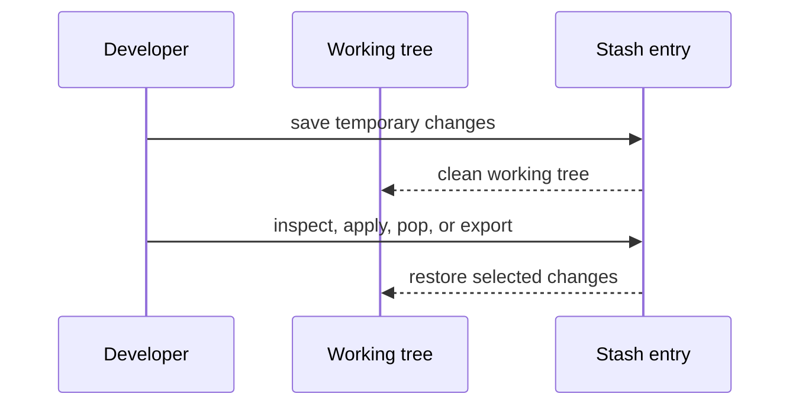

# Stash local work

A stash records selected working-tree and index changes so you can return to a clean worktree temporarily. It is stored in your **local repository**, not automatically pushed to a hosted remote. Stash is useful for short-lived context switches; a small WIP commit or separate branch can be easier to share and preserve long-term.

## Save and inspect changes

```bash
git status
git stash push -m "WIP: search filter"
git stash push -u -m "WIP including new files"  # also include untracked files
git stash list
git stash show --stat stash@{0}
git stash show -p stash@{0}
```

By default, untracked files are not included. `-u` / `--include-untracked` includes them. `-a` also includes ignored files; use it carefully because it can collect generated files or local data you did not intend to stash.

## Apply without deleting, or pop and remove

```bash
git stash apply stash@{0}   # restore it; keep stash entry
git stash pop stash@{0}     # restore it and drop entry if application succeeds
```

If applying conflicts, Git keeps the stash entry. Resolve the files, test the result, then drop the stash manually if you no longer need it:

```bash
git stash drop stash@{0}
```

Do not run `git stash clear` unless you intentionally want to remove all stash references.

## Restore a Single File from a Git Stash

If you want to restore only one file from a stash, use `git restore` or `git checkout` instead of `git stash apply`.

### Syntax

```bash
git checkout 'stash@{<stash_index>}' -- <file_path>
git restore --source='stash@{<stash_index>}' --worktree -- <file_path>
```

- `<stash_index>` – The stash you want to restore from.
- `<file_path>` – The file you want to restore.
- `stash@{0}` – Most recent stash.
- `stash@{1}` – Previous stash.

> [!IMPORTANT]
> Replace the stash index and file path with your actual values.

### 1. Restore a file to the Working Tree (Unstaged)

```bash
git restore --source='stash@{0}' --worktree -- src/config.yml
```

This restores the file from the stash without staging it.

Review the changes:

```bash
git diff -- src/config.yml
```

### 2. Restore a file to the Staged Area

```bash
git restore --source='stash@{0}' --staged --worktree -- src/config.yml
```

This restores the file and stages it.

Review the staged changes:

```bash
git diff --cached -- src/config.yml
```

### 3. Alternative: Restore using `git checkout`

```bash
git checkout 'stash@{0}' -- src/config.yml
```

This restores the file and stages it in the index.

### 4. View a File's Changes in a Stash

To inspect the stash changes before restoring the file:

```bash
git stash show -p 'stash@{0}' -- src/config.yml
```

### 5. Find and Use a Specific Stash

List your available stashes:

```bash
git stash list
```

Example: Restore a file from the previous stash.

```bash
git restore --source='stash@{1}' --worktree -- src/config.yml
```

### Important Notes

- These commands do not remove the stash.
- `git restore --worktree` restores the file without staging it.
- `git restore --staged --worktree` restores the file and stages it.
- `git checkout` also stages the restored file.
- Review your local changes before restoring, as existing changes to the file may be overwritten.
- If the stash contains untracked files (saved using `git stash -u`), check the stash contents and destination carefully before restoring them.

## Export/import a stash between repositories

Newer Git versions provide `git stash export` and `git stash import`. Export creates a transferable commit chain; it does not upload by itself. These commands are not available in every packaged Git version (including the Git 2.43 installed in this validation environment), so check `git stash -h` first. For a version that supports them:

```bash
git stash export --to-ref refs/stash-export stash@{0}
git push origin refs/stash-export:refs/stash-export
```

On the destination clone, the host must permit this custom ref to be fetched:

```bash
git fetch origin refs/stash-export:refs/stash-import
git stash import refs/stash-import
git stash list
```

The repository's hosting rules may prohibit pushing custom refs. In that case, use a temporary branch/commit or a patch file instead. Check `git stash -h` because export/import require a sufficiently recent Git version. Do not confuse exporting a stash with publishing a normal branch.



Further reading: [Git `stash`](https://git-scm.com/docs/git-stash); [Git `restore`](https://git-scm.com/docs/git-restore).
## Questions and answers

<details>
<summary>Does <code>git stash</code> include untracked files?</summary>

Not by default. Use `git stash push -u -m "message"` to include untracked files. `-a` includes ignored files as well, which can be risky if ignored files contain build output, secrets, or local databases.
</details>

<details>
<summary>Does <code>git stash pop</code> delete the stash if it conflicts?</summary>

No. If the changes cannot be applied cleanly, Git leaves the stash entry in the stash list so you can resolve the conflict and retry or inspect it. `pop` removes it only when application succeeds.
</details>

<details>
<summary>How can I apply only one path from a stash?</summary>

Use `git restore --source='stash@{0}' --worktree -- path/to/file` to restore that tracked file's stashed working-tree version. Then inspect the diff and stage it only if intended. `git stash apply` itself applies the stash as a whole and has no direct path-limited form.
</details>
