# Java Data Types: Primitives, Wrappers, Strings, Enums and Conversions

Java classifies all data types into two main categories:
 * Primitive Data Types
 * Non-Primitive (Reference) Data Types

A **data type** tells Java what kind of value a variable holds, how much memory it uses, and which operations are allowed. Java is **statically typed**: every variable has a type that is checked at compile time.

---

<details open><summary>Data types at a glance</summary>

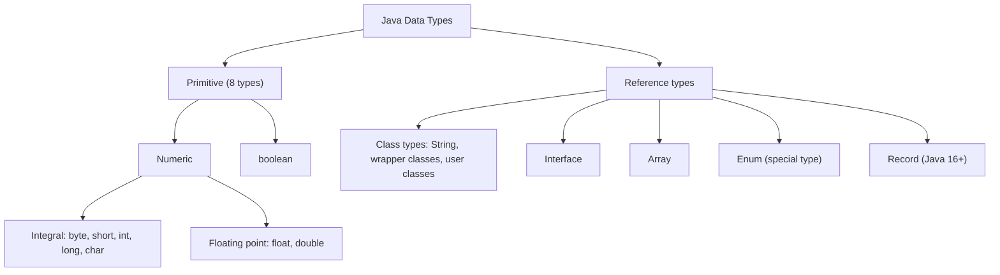

| | Primitive | Reference (object) |
|---|---|---|
| What it stores | The **value** itself | The **address** of an object on the heap |
| Examples | `int`, `double`, `char`, `boolean` | `String`, `Integer`, `int[]`, `List`, user classes |
| Default value | `0`, `0.0`, `'\u0000'`, `false` | `null` |
| Can be `null`? | No | Yes |
| Has methods? | No | Yes |
| Used in generics? | No (`List<int>` ❌) | Yes (`List<Integer>` ✅) |
| Memory | Stack (as a local variable) | Object on the heap, reference on the stack |
| Comparison with `==` | Compares values | Compares **references** (use `equals()` for content) |

**Special types:** `String` (a class with special language support), **Enum** (a fixed set of constants), **Record** (Java 16+), arrays, and interfaces.

</details>

<details open><summary>CodeTrove infographic: Java Primitive Types, Wrapper Classes and Type Conversions</summary>


**The infographic covers:**

- Primitive types and the corresponding wrapper classes
- `Object → Number → Wrapper class` hierarchy
- Autoboxing and auto-unboxing
- Auto-widening
- Widening and narrowing conversions
- Upcasting and downcasting with Java examples

</details>

<details open><summary>Data types: detailed concepts with examples</summary>

## 1. String, StringBuffer and StringBuilder

<details><summary>String, StringBuffer and StringBuilder (text types)</summary>

A **String** is a sequence of characters, such as `"Yash"`. `String` is a **final class** in `java.lang`, so you cannot extend it, and its value is **immutable**: once created, it can never change. Every "change" (like `toUpperCase()`) creates a **new** object.

When you need to change text many times (in a loop, for example), use a **mutable** type: **`StringBuilder`** (fast, not thread-safe) or **`StringBuffer`** (thread-safe, slower).

```java
String str = "Yash";             // immutable: value can't be changed
int strLength = str.length();    // 4

String up = str.toUpperCase();   // creates a NEW String
System.out.println(str);         // Yash  (the original is unchanged)
System.out.println(up);          // YASH
```

### The String pool (why literals and `new` behave differently)

Java keeps a special area on the heap called the **String pool**. String **literals** with the same text share one object. `new String(...)` always creates a separate object outside the pool.

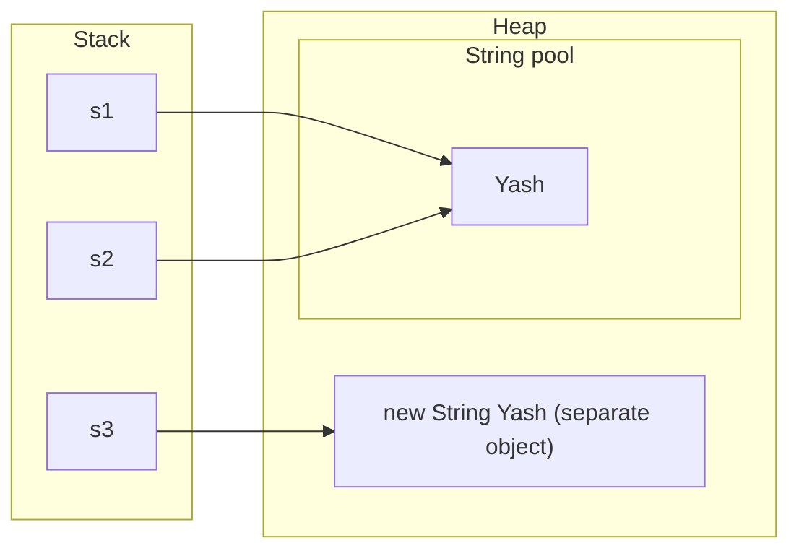

```java
String s1 = "Yash";
String s2 = "Yash";
String s3 = new String("Yash");

System.out.println(s1 == s2);          // true   (same pooled object)
System.out.println(s1 == s3);          // false  (different objects)
System.out.println(s1.equals(s3));     // true   (same content)
System.out.println(s1 == s3.intern()); // true   (intern() returns the pooled one)
```

> **Rule:** compare string **content** with `equals()` (or `equalsIgnoreCase()`), never with `==`.

### String vs StringBuffer vs StringBuilder

<table>
<tr>
  <th>Feature</th>
  <th>String</th>
  <th>StringBuffer</th>
  <th>StringBuilder</th>
</tr>
<tr>
  <td><b>Mutability</b></td>
  <td>Immutable</td>
  <td>Mutable</td>
  <td>Mutable</td>
</tr>
<tr>
  <td><b>Thread safety</b></td>
  <td>Safe (immutable)</td>
  <td>Safe (methods are <code>synchronized</code>)</td>
  <td>Not safe</td>
</tr>
<tr>
  <td><b>Speed</b></td>
  <td>Slow when changed often (new object each time)</td>
  <td>Slower than StringBuilder (locking)</td>
  <td>Fastest</td>
</tr>
<tr>
  <td><b>Since</b></td>
  <td>JDK 1.0</td>
  <td>JDK 1.0</td>
  <td>JDK 1.5</td>
</tr>
<tr>
  <td><b>Memory</b></td>
  <td>String pool / heap</td>
  <td>Heap</td>
  <td>Heap</td>
</tr>
<tr>
  <td><b><code>equals()</code></b></td>
  <td>Compares content</td>
  <td>Not overridden (compares reference)</td>
  <td>Not overridden (compares reference)</td>
</tr>
<tr>
  <td><b>Use when</b></td>
  <td>Text does not change (keys, constants, messages)</td>
  <td>Text changes and many threads share it</td>
  <td>Text changes inside one thread (most cases)</td>
</tr>
<tr>
  <td><b>Example</b></td>
  <td>

```java
String s = "Hello";
s = s.concat(" World");
// new object created
```

  </td>
  <td>

```java
StringBuffer sf =
    new StringBuffer("Hello");
sf.append(" World");
// same object changed
```

  </td>
  <td>

```java
StringBuilder sb =
    new StringBuilder("Hello");
sb.append(" World");
// same object changed
```

  </td>
</tr>
</table>

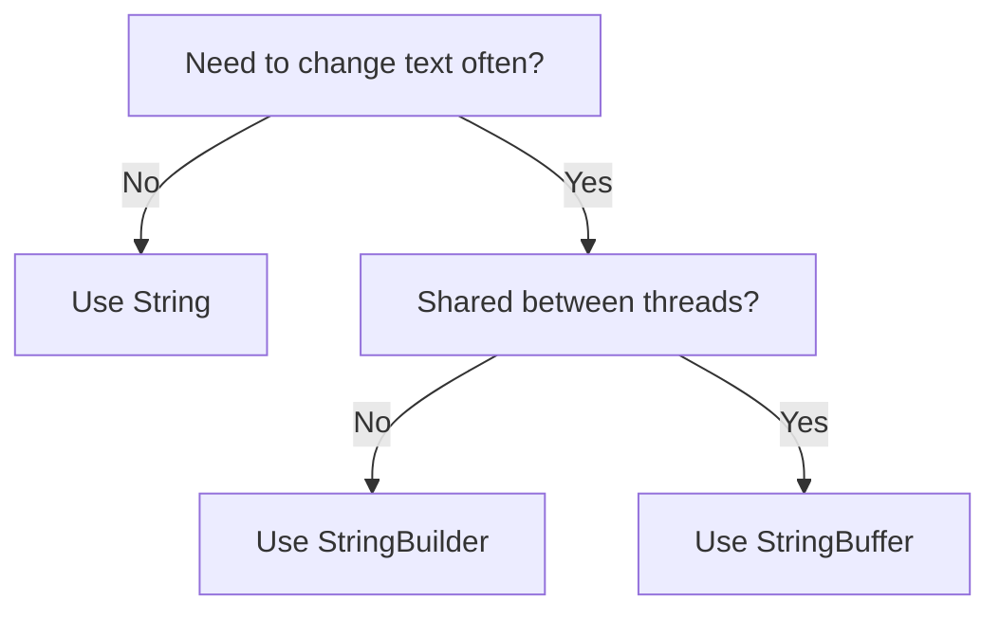

### Creating a String

<table>
<tr><th>Way</th><th>Simple meaning</th><th>Example</th></tr>
<tr>
  <td>Literal</td>
  <td>Stored in the pool (preferred)</td>
  <td>

```java
String a = "Java";
```

  </td>
</tr>
<tr>
  <td><code>new</code></td>
  <td>Always a new heap object</td>
  <td>

```java
String b = new String("Java");
```

  </td>
</tr>
<tr>
  <td>From <code>char[]</code></td>
  <td>Build from characters</td>
  <td>

```java
char[] ch = {'J','a','v','a'};
String c = new String(ch);
String d = String.valueOf(ch);
```

  </td>
</tr>
<tr>
  <td><code>String.valueOf()</code></td>
  <td>Convert any value to text</td>
  <td>

```java
String n = String.valueOf(100);   // "100"
String t = String.valueOf(true);  // "true"
```

  </td>
</tr>
<tr>
  <td><code>String.join()</code></td>
  <td>Join with a delimiter (Java 8)</td>
  <td>

```java
String j = String.join("-", "a", "b", "c"); // a-b-c
```

  </td>
</tr>
<tr>
  <td><code>String.format()</code></td>
  <td>Formatted text</td>
  <td>

```java
String f = String.format("%s is %d", "Yash", 30);
```

  </td>
</tr>
<tr>
  <td>Text block (Java 15)</td>
  <td>Multi-line string</td>
  <td>

```java
String json = """
    { "name": "Yash" }
    """;
```

  </td>
</tr>
</table>

### Common String methods

| Method | Simple meaning | Example → result |
|---|---|---|
| `length()` | Number of characters | `"Yash".length()` → `4` |
| `charAt(i)` | Character at index | `"Yash".charAt(1)` → `'a'` |
| `substring(b, e)` | Part from `b` up to (not including) `e` | `"Yash777".substring(0, 4)` → `"Yash"` |
| `indexOf(x)` / `lastIndexOf(x)` | Position of text (`-1` if missing) | `"banana".indexOf("an")` → `1` |
| `contains(x)` | Is text inside? | `"Yash".contains("as")` → `true` |
| `startsWith(x)` / `endsWith(x)` | Prefix / suffix test | `"Yash".startsWith("Y")` → `true` |
| `equals(x)` / `equalsIgnoreCase(x)` | Content equality | `"Yash".equalsIgnoreCase("YASH")` → `true` |
| `compareTo(x)` | Dictionary order: negative, 0 or positive | `"a".compareTo("b")` → `-1` |
| `toUpperCase()` / `toLowerCase()` | Change case | `"Yash".toUpperCase()` → `"YASH"` |
| `trim()` | Remove ASCII spaces at both ends | `"  hi ".trim()` → `"hi"` |
| `strip()` (11) | Unicode-aware trim | `"\u2003hi".strip()` → `"hi"` |
| `isEmpty()` | Length is 0 | `"".isEmpty()` → `true` |
| `isBlank()` (11) | Empty or only whitespace | `"  ".isBlank()` → `true` |
| `replace(a, b)` | Replace text or char | `"a-b".replace("-", "+")` → `"a+b"` |
| `replaceAll(regex, r)` | Replace using a regular expression | `"a1b2".replaceAll("\\d", "")` → `"ab"` |
| `split(regex)` | Split into an array | `"a,b,c".split(",")` → `[a, b, c]` |
| `split(regex, limit)` | Split into at most `limit` parts | `"a,b,c".split(",", 2)` → `[a, b,c]` |
| `toCharArray()` | Convert to `char[]` | `"Yash".toCharArray()` |
| `chars()` | `IntStream` of characters | `"abc".chars().count()` → `3` |
| `repeat(n)` (11) | Repeat n times | `"ab".repeat(3)` → `"ababab"` |
| `lines()` (11) | Stream of lines | `"a\nb".lines().count()` → `2` |
| `formatted(args)` (15) | Instance `String.format` | `"Hi %s".formatted("Yash")` |
| `intern()` | Return the pooled instance | `new String("x").intern()` |

```java
String str = "Yash777";
System.out.println(str.substring(0, 4));        // Yash
System.out.println(str.indexOf("777"));         // 4
System.out.println(str.replace("Y", "y"));      // yash777
System.out.println(Arrays.toString("a,b,c".split(",")));  // [a, b, c]
```

### Immutability: why and how

| Why `String` is immutable | Benefit |
|---|---|
| String pool can share objects | Saves memory |
| Safe as `HashMap` keys (hashCode never changes) | Reliable lookups and cached hash |
| Thread-safe without locking | Safe sharing |
| Used for class names, file paths, URLs, passwords | Security (value can't be altered after checks) |

```java
// Immutable objects: once created they can't be modified
Integer val  = Integer.valueOf("100");
String  str2 = String.valueOf(100);              // immutable classes

final class Employee {                           // all wrapper classes, java.util.UUID, java.io.File ...
    private final String empName;                // field is final (assigned only once)
    public Employee(String name) { this.empName = name; }
    public String getEmpName() { return empName; }   // only getters, no setters
}
```

> To create your own immutable class: make the class `final`, make all fields `private final`, set them only in the constructor, add no setters, and defensively copy any mutable fields (like `Date` or `List`).

### StringBuffer and StringBuilder methods

Both have the same API. The default capacity is **16**; when full it grows to `(old × 2) + 2`.

| Method | Simple meaning | Example → result |
|---|---|---|
| `append(x)` | Add to the end | `sb.append("A").append(1)` → `"A1"` |
| `insert(i, x)` | Insert at a position | `new StringBuilder("ac").insert(1, "b")` → `"abc"` |
| `delete(s, e)` | Remove from `s` up to (not incl.) `e` | `new StringBuilder("abcd").delete(1, 3)` → `"ad"` |
| `deleteCharAt(i)` | Remove one char | `new StringBuilder("abc").deleteCharAt(1)` → `"ac"` |
| `replace(s, e, str)` | Replace a range | `new StringBuilder("abcd").replace(1, 3, "X")` → `"aXd"` |
| `reverse()` | Reverse the text | `new StringBuilder("abc").reverse()` → `"cba"` |
| `setCharAt(i, c)` | Change one char | `sb.setCharAt(0, 'Z')` |
| `setLength(n)` | Cut or pad to a length | `sb.setLength(0)` clears it |
| `length()` / `capacity()` | Size now / size before growing | `new StringBuilder().capacity()` → `16` |
| `charAt`, `indexOf`, `substring` | Same as `String` | – |
| `toString()` | Convert to an immutable `String` | `sb.toString()` |

```java
StringBuilder sb = new StringBuilder("Yash");
sb.append(" M").insert(0, "Mr. ").reverse();
System.out.println(sb);                       // M sahY .rM

// Why not use += in a loop?
String s = "";
for (int i = 0; i < 5; i++) s += i;           // creates a new String every round (slow for big loops)

StringBuilder b = new StringBuilder();
for (int i = 0; i < 5; i++) b.append(i);      // one object, fast
System.out.println(b);                        // 01234

// Thread-safe version has the same API
StringBuffer buffer = new StringBuffer();
buffer.append("safe");
```

### String programs (interview favourites)

<table>
<tr><th>Task</th><th>Example</th></tr>
<tr>
  <td>Reverse a string</td>
  <td>

```java
String r = new StringBuilder("Yash").reverse().toString(); // hsaY
```

  </td>
</tr>
<tr>
  <td>Palindrome check</td>
  <td>

```java
boolean pal = s.equals(new StringBuilder(s).reverse().toString());
```

  </td>
</tr>
<tr>
  <td>Count a character</td>
  <td>

```java
long n = "banana".chars().filter(c -> c == 'a').count(); // 3
```

  </td>
</tr>
<tr>
  <td>Remove a character</td>
  <td>

```java
String x = "banana".replace("a", "");   // bnn
```

  </td>
</tr>
<tr>
  <td>Anagram check</td>
  <td>

```java
char[] a = "listen".toCharArray(), b = "silent".toCharArray();
Arrays.sort(a); Arrays.sort(b);
boolean anagram = Arrays.equals(a, b);  // true
```

  </td>
</tr>
<tr>
  <td>First non-repeating char</td>
  <td>

```java
Map<Character, Long> m = "swiss".chars().mapToObj(c -> (char) c)
    .collect(Collectors.groupingBy(c -> c, LinkedHashMap::new, Collectors.counting()));
char first = m.entrySet().stream().filter(e -> e.getValue() == 1)
    .map(Map.Entry::getKey).findFirst().get();   // 'w'
```

  </td>
</tr>
<tr>
  <td>Longest string in an array</td>
  <td>

```java
String longest = Arrays.stream(arr).max(Comparator.comparingInt(String::length)).get();
```

  </td>
</tr>
</table>

### Common pitfalls

| Pitfall | Why | Fix |
|---|---|---|
| `s1 == s2` for content | Compares references | `s1.equals(s2)` |
| `+=` in a big loop | New `String` each time | `StringBuilder` |
| `str.toUpperCase();` result ignored | Strings are immutable | `str = str.toUpperCase();` |
| `null` text: `str.equals("a")` | NPE if `str` is null | `"a".equals(str)` |
| `switch` on a null string | NPE | Check for `null` first |
| `'a' + 1` | `char + int` is an `int` (`98`) | `(char) ('a' + 1)` → `'b'` |
| `"" + 1 + 2` vs `1 + 2 + ""` | Evaluated left to right | `"12"` vs `"3"` |
| Sharing a `StringBuilder` between threads | Not thread-safe | Use `StringBuffer` or confine to one thread |

</details>

<details><summary>⭐ String Pool: == vs equals(), new String(), intern(), StringBuilder.equals()</summary>

Literals and compile-time constants share one object in the String Constant Pool (SCP). `new String()` and runtime concatenation always create a new heap object. `intern()` returns the pool object. `StringBuilder` and `StringBuffer` do not override `equals()`, so it compares references.

Use `show()` to see the truth: **same identityHashCode = same object**, which is exactly what `==` checks.

```java runnable
public class Main {

    // Legend used in the comments below (the real numbers change on every run):
    // H1 = SCP object "Java",  H2, H3, H4... = other objects.  Same H = same object = == is true

    public static void main(String[] args) {

        // ---------- 1. Literal vs new String() ----------
        String literalJava1 = "Java";
        String literalJava2 = "Java";
        String heapJava1 = new String("Java");
        String heapJava2 = new String("Java");

        show("literalJava1", literalJava1);  // H1 -> SCP object
        show("literalJava2", literalJava2);  // H1 -> same SCP object, reused
        show("heapJava1", heapJava1);        // H2 -> new heap object
        show("heapJava2", heapJava2);        // H3 -> another new heap object

        System.out.println(literalJava1 == literalJava2);    // true  -> H1 == H1
        System.out.println(literalJava1 == heapJava1);       // false -> H1 vs H2 (pool vs heap)
        System.out.println(heapJava1 == heapJava2);          // false -> H2 vs H3 (every new String() is a separate object)
        System.out.println(literalJava1.equals(heapJava1));  // true  -> equals() compares content, not hash
        System.out.println(heapJava1.equals(heapJava2));     // true  -> same content

        // ---------- 2. intern() ----------
        String internedJava = heapJava2.intern();

        show("heapJava1.intern()", heapJava1.intern());      // H1 -> "Java" already in SCP, so the pool object is returned
        show("internedJava", internedJava);                  // H1 -> same pool object
        show("heapJava2 (after intern)", heapJava2);         // H3 -> unchanged, intern() does not modify the original reference

        System.out.println(internedJava == literalJava1);    // true  -> H1 == H1
        System.out.println(heapJava2 == internedJava);       // false -> H3 vs H1

        // ---------- 3. Concatenation: compile time vs runtime ----------
        String nonFinalPrefix = "Ja";                  // not final -> compiler cannot fold it
        String nonFinalSuffix = "va";
        final String finalPrefix = "Ja";               // final + literal = compile-time constant
        final String finalSuffix = "va";
        final String finalFromNew = new String("Ja");  // final, but value comes from new -> NOT a constant

        // Compile-time constants: folded into the literal "Java" -> SCP
        String literalPlusLiteral = "Ja" + "va";
        String finalPlusFinal = finalPrefix + finalSuffix;
        String finalPlusLiteral = finalPrefix + "va";
        String literalPlusFinal = "Ja" + finalSuffix;

        show("literalPlusLiteral", literalPlusLiteral);  // H1 -> folded at compile time
        show("finalPlusFinal", finalPlusFinal);          // H1 -> both are constants, folded
        show("finalPlusLiteral", finalPlusLiteral);      // H1 -> constant + literal, folded
        show("literalPlusFinal", literalPlusFinal);      // H1 -> literal + constant, folded

        // Runtime concatenation: new heap object every time
        String nonFinalPlusNonFinal = nonFinalPrefix + nonFinalSuffix;
        String nonFinalPlusLiteral = nonFinalPrefix + "va";
        String literalPlusNonFinal = "Ja" + nonFinalSuffix;
        String finalPlusNonFinal = finalPrefix + nonFinalSuffix;
        String finalFromNewPlusLiteral = finalFromNew + "va";

        show("nonFinalPlusNonFinal", nonFinalPlusNonFinal);        // H4 -> runtime, new heap object
        show("nonFinalPlusLiteral", nonFinalPlusLiteral);          // H5 -> one non-final operand makes it runtime
        show("literalPlusNonFinal", literalPlusNonFinal);          // H6 -> one non-final operand makes it runtime
        show("finalPlusNonFinal", finalPlusNonFinal);              // H7 -> constant + non-final is still runtime
        show("finalFromNewPlusLiteral", finalFromNewPlusLiteral);  // H8 -> final alone is not enough, it must be a constant
        show("nonFinalPlusNonFinal.intern()", nonFinalPlusNonFinal.intern()); // H1 -> intern() brings it back to the pool object

        System.out.println(literalPlusLiteral == literalJava1);         // true  -> H1 == H1
        System.out.println(finalPlusFinal == literalJava1);             // true  -> H1 == H1
        System.out.println(finalPlusLiteral == literalJava1);           // true  -> H1 == H1
        System.out.println(literalPlusFinal == literalJava1);           // true  -> H1 == H1
        System.out.println(nonFinalPlusNonFinal == literalJava1);       // false -> H4 vs H1
        System.out.println(nonFinalPlusLiteral == literalJava1);        // false -> H5 vs H1
        System.out.println(literalPlusNonFinal == literalJava1);        // false -> H6 vs H1
        System.out.println(finalPlusNonFinal == literalJava1);          // false -> H7 vs H1
        System.out.println(finalFromNewPlusLiteral == literalJava1);    // false -> H8 vs H1
        System.out.println(nonFinalPlusNonFinal.equals(literalJava1));  // true  -> content is the same
        System.out.println(nonFinalPlusNonFinal.intern() == literalJava1); // true -> H1 == H1

        // ---------- 4. String created from char[] (no literal involved) ----------
        char[] poolXChars = {'P', 'o', 'o', 'l', 'X'};
        String heapFromCharArray = new String(poolXChars);          // heap object, not created from any literal
        String internedFromCharArray = heapFromCharArray.intern();  // "PoolX" is not in SCP yet
        String literalPoolX = "PoolX";

        show("heapFromCharArray", heapFromCharArray);          // H9 -> heap object
        show("internedFromCharArray", internedFromCharArray);  // H9 -> proof: intern() added THIS heap object to the pool (Java 7+) and returned it
        show("literalPoolX", literalPoolX);                    // H9 -> literal now finds that pool entry (HotSpot resolves a literal when the line first runs)

        System.out.println(internedFromCharArray == heapFromCharArray); // true -> nothing matching was in SCP before (if a "PoolX" literal had existed, this would be false)
        System.out.println(literalPoolX == heapFromCharArray);          // true -> H9 == H9

        // String charString = new String('Y');   // COMPILE ERROR: constructor String(char) is undefined, use String.valueOf('Y') or "Y"

        // ---------- 5. StringBuilder and StringBuffer ----------
        StringBuilder builderJava1 = new StringBuilder("Java");
        StringBuilder builderJava2 = new StringBuilder("Java");
        StringBuffer bufferJava1 = new StringBuffer("Java");
        StringBuffer bufferJava2 = new StringBuffer("Java");

        show("builderJava1", builderJava1);  // H10 -> own object
        show("builderJava2", builderJava2);  // H11 -> different object, same content
        show("bufferJava1", bufferJava1);    // H12 -> own object
        show("bufferJava2", bufferJava2);    // H13 -> different object, same content

        System.out.println(builderJava1.equals(builderJava2));                       // false -> equals() not overridden, compares references (H10 vs H11)
        System.out.println(bufferJava1.equals(bufferJava2));                         // false -> StringBuffer behaves the same (H12 vs H13)
        System.out.println(literalJava1.equals(builderJava1));                       // false -> String.equals() accepts only a String
        System.out.println(builderJava1.toString().equals(builderJava2.toString())); // true  -> convert to String, then compare content
        System.out.println(literalJava1.contentEquals(builderJava1));                // true  -> contentEquals() compares with any CharSequence
        System.out.println(literalJava1.contentEquals(bufferJava1));                 // true  -> works for StringBuffer too
        System.out.println(builderJava1.compareTo(builderJava2) == 0);               // true  -> compareTo() compares content (Java 11+)
    }

    // Prints the variable name, its value and its identityHashCode (same number = same object)
    private static void show(String name, Object value) {
        System.out.printf("%-32s | value: %-8s | identityHashCode: %d%n",
                name, value, System.identityHashCode(value));
    }
}
```

- Live visual flow: https://interviewdepth.com/java-works

</details>

<details><summary>String concatenation with the + operator (evaluated left to right)</summary>

The `+` operator in Java is evaluated **strictly left to right**, and its behavior depends on the **types of operands** at each step. Two numbers → addition. As soon as one side is a `String` → concatenation.

| Variable | Expression | Evaluation order | Output |
|---|---|---|---|
| SC1 | `1 + 2 + "Hi"` | Addition → Concatenation | `3Hi` |
| SC2 | `"Hi" + 1 + 2` | Concat → Concat | `Hi12` |
| Bonus | `"Hi" + (1 + 2)` | Addition (forced) → Concat | `Hi3` |

```java
String numThenText  = 1 + 2 + "Hi";
    // "3Hi"  — numbers first, addition happens
String textThenNums = "Hi" + 1 + 2;
    // "Hi12" — string first, all concatenation
String forced = "Hi" + (1 + 2);
    // "Hi3" — parentheses force addition first
```

🧠 Wrapping `(1 + 2)` in parentheses forces arithmetic first, then concatenates the result `3` with `"Hi"`.

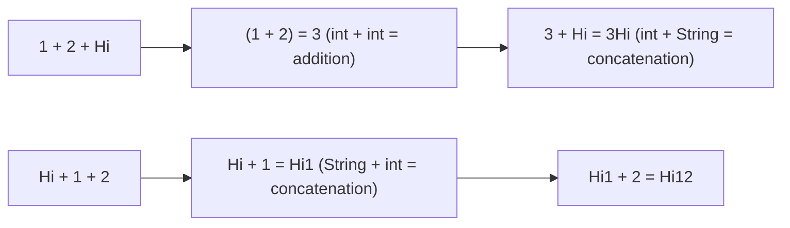

<table>
<tr><th>More examples</th><th>Result</th><th>Why</th></tr>
<tr>
  <td>

```java
1 + 2 + "Hi" + 1 + 2
```

  </td>
  <td><code>"3Hi12"</code></td>
  <td>First <code>1 + 2</code> adds, then everything concatenates</td>
</tr>
<tr>
  <td>

```java
"" + 1 + 2
```

  </td>
  <td><code>"12"</code></td>
  <td>An empty string at the start forces concatenation</td>
</tr>
<tr>
  <td>

```java
'a' + 'b' + "c"
```

  </td>
  <td><code>"195c"</code></td>
  <td><code>char + char</code> is numeric addition (97 + 98)</td>
</tr>
<tr>
  <td>

```java
"" + 'a' + 'b'
```

  </td>
  <td><code>"ab"</code></td>
  <td>String first, so characters are appended</td>
</tr>
<tr>
  <td>

```java
String s = null;
s = s + "x";
```

  </td>
  <td><code>"nullx"</code></td>
  <td><code>null</code> is converted to the text <code>"null"</code></td>
</tr>
</table>

</details>

<details><summary>== vs equals() vs hashCode() (hash code collision: "Aa" and "BB")</summary>

| Check | What it compares | Simple meaning |
|---|---|---|
| `==` | Reference (memory address / identity) | Are these the **same object**? |
| `equals()` | Logical content | Do they **mean the same thing**? |
| `hashCode()` | A number used by hash-based collections (`HashMap`, `HashSet`) | A quick "bucket number"; **can collide** for different objects |

> ⚠️ Even if two strings have the same hash code, they may not be equal. And `==` does not care about hash codes at all. It is only about whether they are the exact same object.

<table>
<tr><th><code>== vs equals()</code>, <code>hashCode()</code></th><th>Result</th></tr>
<tr>
  <td>

```java
String s1 = "Aa", s2 = "BB";
System.out.println("objects in memory ➩ ["
    + System.identityHashCode(s1) + ", " + System.identityHashCode(s2) + "]");
if (s1.hashCode() == s2.hashCode()) {
    System.out.println(" - Hash codes are equal (collision): " + s1.hashCode());
}
if (!s1.equals(s2)) {
    System.out.println(" - But strings are not equal: \"" + s1 + "\" != \"" + s2 + "\"");
}
```

  </td>
  <td>

```text
/* Key Concepts:
 * - `==` checks reference equality (same object in memory)
 * - `equals()` checks logical/content equality
 * - `hashCode()` provides a numeric representation used in
 *   hash-based collections like HashMap
 *
 * ⚠️ Even if two strings have the same hash code,
 *    they may not be equal. */
Output:
objects in memory ➩ [2018699554, 1311053135]
 - Hash codes are equal (collision): 2112
 - But strings are not equal: "Aa" != "BB"
```

  </td>
</tr>
</table>

### Hash Code Collision in Java Strings

The behavior of `String`'s `hashCode()`, `equals()`, and the `==` operator, using a known hash code collision.

```text
String[Aa], Hash[2112], System Hash[366712642]
String[BB], Hash[2112], System Hash[1829164700]
```

📄 Java class: **`StringHashCollisionExample.java`**. This example illustrates how Java's `String` class behaves when comparing strings using:

- **`==`** (reference equality): **`== checks memory address (identity)`**.
- **`.equals()`** (logical equality): **`.equals() checks logical equality (content)`**.
- **`.hashCode()`** (hashing logic used in collections): **`.hashCode() is used mainly for hashing (e.g. in HashMap, HashSet), and can collide for different objects.`**

```java
/**
 * Demonstrates the difference between ==, equals(), and hashCode() using Strings in Java.
 * Also shows an example of a hash code collision between two distinct strings: "Aa" and "BB".
 *
 * Key Concepts:
 * - `==` checks reference equality (same object in memory)
 * - `equals()` checks logical/content equality
 * - `hashCode()` provides a numeric representation used in hash-based collections like HashMap
 *
 * ⚠️ Even if two strings have the same hash code, they may not be equal.
 *
 * Usage:
 * - Run this class as a Java application to see the behavior printed in the console.
 *
 * @author 🔐 Yash
 */
public class StringHashCollisionExample {

  public static void main(String[] args) {
    String s1 = "Aa";
    String s2 = "BB";

    System.out.println("String s1 = \"Aa\";");
    System.out.println("String s2 = \"BB\";\n");

    System.out.println("s1 == s2: " + (s1 == s2));
    System.out.println("s1.equals(s2): " + s1.equals(s2));
    System.out.println("s1.hashCode(): " + s1.hashCode());
    System.out.println("s2.hashCode(): " + s2.hashCode());

    System.out.println("\nSummary:");
    if (s1.hashCode() == s2.hashCode()) {
      System.out.println("- Hash codes are equal (collision): " + s1.hashCode());
    }
    if (!s1.equals(s2)) {
      System.out.println("- But strings are not equal: \"" + s1 + "\" != \"" + s2 + "\"");
    }
  }
}
```

*Expected output (worked out by hand from the code):*

```text
String s1 = "Aa";
String s2 = "BB";

s1 == s2: false
s1.equals(s2): false
s1.hashCode(): 2112
s2.hashCode(): 2112

Summary:
- Hash codes are equal (collision): 2112
- But strings are not equal: "Aa" != "BB"
```

⚠️ Important notes:

- `"Aa"` and `"BB"` have the same hash code: `2112`.
- They are not equal by content (**`equals()`** returns `false`).
- They are not the same object in memory (**`==`** returns `false`).
- This is a classic example of a **hash collision** in Java.

> 🔬 **Why does it happen?** Java computes the hash code for a string like this:

```java
// s[0]*31^(n-1) + s[1]*31^(n-2) + ... + s[n-1]
public int hashCode() {
    int h = 0;
    for (int i = 0; i < value.length; i++) {
        h = 31 * h + value[i];
    }
    return h;
}
```

Using this logic:

```text
"Aa" → 65*31 + 97 = 2112

"BB" → 66*31 + 66 = 2112
```

ASCII codes table:

| ASCII (Decimal) | Hex | ASCII Character |
|---|---|---|
| 65 | 41 | A |
| 66 | 42 | B |
| 97 | 61 | a |
| 98 | 62 | b |

❗ **Important note:** even if two objects have the same hash code, they are not guaranteed to be equal, and `==` does not care about hash codes at all. It is only about whether they are the exact same object.

| Rule (the `equals` / `hashCode` contract) | Meaning |
|---|---|
| Equal objects **must** have equal hash codes | If `a.equals(b)` then `a.hashCode() == b.hashCode()` |
| Equal hash codes do **not** mean equal objects | Collisions are allowed (`"Aa"` / `"BB"`) |
| Override both together | Override `equals()` and `hashCode()` in the same class, or `HashMap` / `HashSet` break |
| How `HashMap` copes | Same-hash keys go into the same bucket; `equals()` then tells them apart |

</details>

<details><summary>String text blocks (Java 15; preview in Java 13 and 14)</summary>

A **text block** is a multi-line string literal written between `"""` delimiters. It looks exactly like the content, so you do not need `\n`, `\"` or `+` concatenation.

**Purpose:**

- Write multi-line strings without escape characters.
- Improves readability: it looks exactly like the content.
- No need for `\n`, `\"`, `+` concatenation.

**Rules**

```java
String s = """Hello""";   // ❌ compile error — no newline after opening """
String s = """
           Hello""";      // ✅ ← no trailing newline
// closing """ position decides how much indent is stripped
String json = """
              Hello
              """;   // ← closing here — strips leading spaces ✅
```

| Rule | Simple meaning |
|---|---|
| Opening `"""` must be followed by a **line break** | Content starts on the next line |
| Closing `"""` position | Decides how much indentation is stripped (the smallest indent among all lines, including the closing line, is removed) |
| Closing `"""` on its own line | The string **ends with a newline** |
| Closing `"""` right after the last word | No trailing newline |
| Trailing spaces on each line | Stripped automatically (use `\s` to keep one) |
| Quotes inside | `"` needs no escape; three in a row (`"""`) do |
| `\` at the end of a line | Joins the next line (no newline) |
| `%s` and `.formatted()` | Insert values (Java 15+) |

### Normal String vs Text Block, side by side

<table>
<tr>
  <th>Normal String Concatenation — Messy ❌</th>
  <th>Text Block — Clean ✅ (Java 15+)</th>
</tr>
<tr>
  <td colspan="2"><b>JSON String</b></td>
</tr>
<tr>
  <td>

```java
// hard to read, escape characters(\n) everywhere ❌
String json = "{\n" +
"  \"name\": \"John\",\n" +
"  \"age\": 25,\n" +
"  \"email\": \"john@gmail.com\",\n" +
"  \"address\": {\n" +
"    \"city\": \"Chennai\",\n" +
"    \"country\": \"India\"\n" +
"  }\n" +
"}";
```

  </td>
  <td>

```java
// no escape chars, no concatenation, readable ✅
String json = """
    {
      "name": "John",
      "age": 25,
      "email": "john@gmail.com",
      "address": {
        "city": "Chennai",
        "country": "India"
      }
    }
    """;
```

  </td>
</tr>
<tr>
  <td colspan="2"><b>JSON String: Text Block with Dynamic Values</b><br>
  <code>String name = "John"; int age = 25; String city = "Chennai";</code></td>
</tr>
<tr>
  <td>

```java
// normal string — messy ❌
String json = "{\n" +
"  \"name\": \"" + name + "\",\n" +
"  \"age\": " + age + ",\n" +
"  \"city\": \"" + city + "\"\n" +
"}";
```

  </td>
  <td>

```java
// text block + formatted() — clean ✅ (Java 15+)
String json = """
    {
      "name": "%s",
      "age": %d,
      "city": "%s"
    }
    """.formatted(name, age, city);   // ✅ String.formatted()
```

  </td>
</tr>
<tr>
  <td colspan="2"><b>HTML / XML / SQL String</b></td>
</tr>
<tr>
  <td>

```java
// normal ❌
String html = "<html>\n" +
"  <body>\n" +
"    <p>Hello World</p>\n" +
"  </body>\n" +
"</html>\n";

// normal ❌
String sql = "SELECT u.name, u.email, o.amount " +
"FROM users u " +
"JOIN orders o ON u.id = o.user_id " +
"WHERE u.country = 'India' " +
"AND o.status = 'ACTIVE'";
```

  </td>
  <td>

```java
// text block ✅
String html = """
    <html>
      <body>
        <p>Hello World</p>
      </body>
    </html>
    """;

// text block ✅
String sql = """
    SELECT u.name, u.email, o.amount
    FROM users u
    JOIN orders o ON u.id = o.user_id
    WHERE u.country = 'India'
    AND o.status = 'ACTIVE'
    """;
```

  </td>
</tr>
</table>

</details>

<details><summary>String spaces: isEmpty, isBlank, trim and strip</summary>


| Method | Simple meaning | Since |
|---|---|---|
| `isEmpty()` | `true` only if the length is `0` | 1.6 |
| `isBlank()` | `true` if empty **or only whitespace** (Unicode-aware) | 11 |
| `trim()` | Removes characters up to `\u0020` (ASCII space, tab, newline...) from both ends | 1.0 |
| `strip()` | Removes Unicode whitespace (`Character.isWhitespace`) from both ends | 11 |

<table>
<tr><th><code>String Spaces</code></th><th>Output</th></tr>
<tr>
  <td>

```java
String stt = " "; // a Unicode space such as \u2003, not a plain ASCII space
System.out.println(":" + stt.length() + ":");
System.out.println("isEmpty() [@since 1.6]:" + stt.isEmpty());
System.out.println("isBlank() [@since 11]:" + stt.isBlank());
System.out.println("trim() .length() [@since 1]:" + stt.trim().length());
System.out.println("strip().length() [@since 11]:" + stt.strip().length());
```

  </td>
  <td>

```text
:1:
isEmpty() [@since 1.6]:false
isBlank() [@since 11]:true
trim() .length() [@since 1]:1
strip().length() [@since 11]:0
```

  </td>
</tr>
</table>

The output (`trim()` leaves length `1`, `strip()` gives `0`) happens when the string holds a **Unicode space** that `trim()` cannot see. With a plain ASCII space, `trim().length()` would be `0`. Compare the three kinds of space:

| String | `length()` | `isEmpty()` | `isBlank()` | `trim().length()` | `strip().length()` |
|---|---|---|---|---|---|
| `" "` (ASCII space `\u0020`) | 1 | false | true | 0 | 0 |
| `"\u2003"` (EM SPACE) | 1 | false | true | 1 | 0 |
| `"\u00A0"` (NO-BREAK SPACE) | 1 | false | **false** | 1 | **1** |

> `\u00A0` (non-breaking space, `&nbsp;`) is **not** treated as whitespace by `isBlank()`/`strip()` either. Use the custom trim in the "Trim special characters" block below.

</details>

<details><summary>String intern(), String pool and memory address (ReverseObject program)</summary>

> `public String intern()`

A pool of strings, initially empty, is maintained privately by the class `String`.

When the `intern` method is invoked, if the pool already contains a string equal to this `String` object as determined by the `equals(Object)` method, then the string from the pool is returned. Otherwise, this `String` object is added to the pool and a reference to this `String` object is returned.

**String ReverseObject, memory address, `{equals (==)}`**

```java
public class ReverseObject {
  public static void main(String[] args) {
    // String is immutable Object, once created we cannot change the object
    //The SCP is an area inside the heap memory. It contains the unique strings. 
    //In order to put the strings in the string pool, one needs to call the intern().
    String s1_scp = "Yash";
    System.out.println("SCP intern():"+s1_scp.intern());
    String s2_scp = "Yash";
    System.out.println("SCP intern():"+s2_scp.intern());
    
    String s3_h = new String("Yash");
    String s4_h = new String("Yash");
    
    System.out.println("Memory Address & Content :"+ (s1_scp == s2_scp));
    System.out.println("Memory Address & Content :"+ (s3_h   == s4_h));
    
    System.out.println("Content :"+ s1_scp.equals(s2_scp) );
    System.out.println("Content :"+ s3_h.equals(s4_h));
    
    String str = "Yashwanth";
    stringReverse(str, false);
    stringReverse(str, true);
    
    int num = 1234;
    reverseNumberString(num);
    reverseNumber(num);
    
    StringBuffer buff = new StringBuffer(str);
    System.out.println("String Buffer : "+ buff.reverse());
    
    // Use List interface to reverse string.
    char[] ch = str.toCharArray();
    List<Character> reverse = new LinkedList<>();
    for (int i = ch.length - 1; i >= 0; i--) {
      reverse.add(ch[i]);
    }
    System.out.println("Reverse of a String with LIST : "+ reverse);
  }
  
  public static String stringReverse(String str, boolean isDistinct) {
    char[] ch = str.toCharArray();
    String reverse = "";
    for (int i = ch.length - 1; i >= 0; i--) {
      if ( isDistinct && !(reverse.indexOf(ch[i]) > -1) ) // Remove duplicates
        reverse += ch[i];
      if (!isDistinct) reverse += ch[i];
    }
    System.out.println("Reverse of a String: "+ reverse +", DISTINCT:"+isDistinct);
    return reverse;
  }

  public static int reverseNumberString(int num) {
    String str = new Integer(num).toString();
    char[] ch = str.toCharArray();
    String reverse = "";
    for (int i = ch.length - 1; i >= 0; i--) {
        reverse += ch[i];
    }
    System.out.println("Reverse of a String Number : "+ reverse);
    return Integer.parseInt(reverse);
  }

  public static int reverseNumber(int num) {
    int temp = num;
    int rev = 0;
    int sum = 0; // sumOfDigits
    while (temp > 0 ) {
      rev = (rev * 10) + temp % 10;
      sum += temp % 10;
      temp = temp / 10;
    }
    System.out.println("Reverse of a Number : "+ rev);
    System.out.println("Sum of Digits of a Number : "+ sum);
    
    if(rev == num) {
      System.out.println("Polyndrome Number : [121 = 121]");
    }
    return rev;
  }
}
```

*Expected output (worked out by hand from the code):*

```text
SCP intern():Yash
SCP intern():Yash
Memory Address & Content :true
Memory Address & Content :false
Content :true
Content :true
Reverse of a String: htnawhsaY, DISTINCT:false
Reverse of a String: htnawsY, DISTINCT:true
Reverse of a String Number : 4321
Reverse of a Number : 4321
Sum of Digits of a Number : 10
String Buffer : htnawhsaY
Reverse of a String with LIST : [h, t, n, a, w, h, s, a, Y]
```

| Line | Why |
|---|---|
| `s1_scp == s2_scp` → `true` | Both literals point to the **one** pooled object |
| `s3_h == s4_h` → `false` | Each `new String(...)` makes its own heap object |
| `equals` → `true` for both pairs | Same content |
| `DISTINCT:true` | `reverse.indexOf(ch[i]) > -1` skips letters already added (`h`, `a` repeat in "Yashwanth") |

> **Notes:** `new Integer(num)` is deprecated (since Java 9); use `Integer.toString(num)` or `String.valueOf(num)`. `reverse += ...` in a loop creates a new `String` each round; `StringBuilder` is better for big inputs. `reverseNumber` works for positive numbers only (`while (temp > 0)`).

</details>

<details><summary>String and number reverse programs (reverse, sum of digits, palindrome)</summary>

<table>
<tr>
  <th>Number ➩ String Reverse</th>
  <th>Number Reverse</th>
</tr>
<tr>
  <td>

```java
public static int reverseNumberString(int num) {
    String str = new Integer(num).toString();
    char[] ch = str.toCharArray();
    String reverse = "";
    for (int i = ch.length - 1; i >= 0; i--) {
        reverse += ch[i];
    }
    System.out.println("Reverse of a String Number : "+ reverse);
    return Integer.parseInt(reverse);
}
```

  </td>
  <td>

```java
public static int reverseNumber(int num) {
    int temp = num;
    int rev = 0;
    int sum = 0; // sumOfDigits
    while (temp > 0 ) {
        rev = (rev * 10) + temp % 10;
        sum += temp % 10;
        temp = temp / 10;
    }
    System.out.println("Reverse of a Number : "+ rev);
    System.out.println("Sum of Digits of a Number : "+ sum);
    if(rev == num) {
        System.out.println("Polyndrome Number : [121 = 121]");
    }
    return rev;
}
```

  </td>
</tr>
</table>

**How the number reverse works** for `num = 1234`:

| Loop | `temp` | `temp % 10` | `rev` | `sum` |
|---|---|---|---|---|
| start | 1234 | – | 0 | 0 |
| 1 | 1234 | 4 | `0*10 + 4 = 4` | 4 |
| 2 | 123 | 3 | `4*10 + 3 = 43` | 7 |
| 3 | 12 | 2 | `43*10 + 2 = 432` | 9 |
| 4 | 1 | 1 | `432*10 + 1 = 4321` | 10 |

> A number is a **palindrome** when `rev == num` (for example `121`).

**String reverse program (IntStream version)**

```java
public static String reverseStr(String str) {
    //String str = "Yashwanth";
    String collect = IntStream.range(0, str.length())
            .boxed().sorted(Collections.reverseOrder())
            .map(i -> { 
                System.out.println(i);
                return String.valueOf(str.charAt(i)); 
                })
            .distinct().collect(Collectors.joining("")); //htnawsY
            //.collect(Collectors.joining("")); //htnawhsaY
            //.collect(Collectors.joining(".")); //h.t.n.a.w.h.s.a.Y
    System.out.println("Reverse Str:"+collect);
    return collect;
}
```

| Variation | Result for `"Yashwanth"` |
|---|---|
| with `.distinct()` and `joining("")` | `htnawsY` |
| without `.distinct()`, `joining("")` | `htnawhsaY` |
| without `.distinct()`, `joining(".")` | `h.t.n.a.w.h.s.a.Y` |

*(Also prints the indexes `8, 7, 6, ... 0` first because of the `System.out.println(i)` inside `map`.)*

**Other ways to reverse a string**

```java
String str = "Yashwanth";

// StringBuffer / StringBuilder
System.out.println("String Buffer : " + new StringBuffer(str).reverse());     // htnawhsaY

// Using a List
char[] ch = str.toCharArray();
List<Character> reverse = new LinkedList<>();
for (int i = ch.length - 1; i >= 0; i--) reverse.add(ch[i]);
System.out.println("Reverse with LIST : " + reverse);   // [h, t, n, a, w, h, s, a, Y]
```

</details>

<details><summary>String trim for special characters (Unicode spaces and invisible characters)</summary>

Two strings can **look identical** but contain different, invisible characters (non-breaking space, zero-width space, BOM...). `equals()` then returns `false`, and `trim()` does not remove them. Compare the bytes to find the difference.

```java
// String equals with Unicode chars: "My Sample Space Data"
String s1 = "My Sample Space Data", s2 = "My Sample Space Data";
System.out.format("S1: %s\n", java.util.Arrays.toString(s1.getBytes()));
System.out.format("S2: %s\n", java.util.Arrays.toString(s2.getBytes()));
// If the arrays differ, one of the "spaces" is not a normal ASCII space (32).
```

| Common invisible / special characters | Code | Name |
|---|---|---|
| Space | `\u0020` | SP, whitespace |
| No-break space | `\u00A0` | NBSP (`&nbsp;`) |
| En / Em space | `\u2002` / `\u2003` | ENSP / EMSP |
| Zero-width space | `\u200B` | ZWSP |
| Zero-width non-joiner / joiner | `\u200C` / `\u200D` | ZWNJ / ZWJ |
| Left-to-right / right-to-left mark | `\u200E` / `\u200F` | LRM / RLM |
| Line / paragraph separator | `\u2028` / `\u2029` | LS / PS |
| Word joiner | `\u2060` | WJ |
| Zero-width no-break space (BOM) | `\uFEFF` | ZWNBSP |
| Ideographic space | `\u3000` | IDSP |

**Trim example with Unicode chars**

```java
public class StringUtil {
  public static void main(String[] args) {
    //String text = "  Hello World!  \uFEFF\u200B\u00A0 "; // Example string with various spaces
    String text = "    Hello   World! -  "+getUnicodeSpaces(); // \u2060-\u237D-\uFEFF
    
    // Print the original and trimmed text
    System.out.println("Original text: \"" + text + "\"");
    System.out.println("Original text: \"" + text.trim() + "\""); // Space, TabSpace
    System.out.println("Trimmed text: \"" + trimSpaces(text) + "\"");
    System.out.println("Trimmed text: \"" + trimAdvanced(text, getUnicodeSpaces()) + "\"");
    
  }
  
  //@Data - Only supported on the class, @Setter - On Class/Fields
  @AllArgsConstructor @NoArgsConstructor @Getter
  enum Unicodes {
    WHITESPACE("\u0020", ".", "SP - WhiteSpace"),
    
    // # FORMAT chars
    ENSP ("\u2002", "ENSP", "EN SPACE"),
    EMSP ("\u2003", "EMSP", "EM SPACE"),
    EMSP3("\u2004", "3/EMSP", "THREE-PER-EM SPACE"),
    EMSP4("\u2005", "4/EMSP", "FOUR-PER-EM SPACE"),
    EMSP6("\u2006", "6/EMSP", "SIX-PER-EM SPACE"),
    FSP  ("\u2007", "FSP", "FIGURE SPACE"),
    PSP  ("\u2008", "PSP", "PUNCTUATION SPACE"),
    THSP ("\u2009", "THSP", "THIN SPACE"),
    
    HSP  ("\u200A", "HSP", "HAIR SPACE"),
    ZWSP ("\u200B", "ZWSP", "ZERO WIDTH SPACE"),
    ZWNJ ("\u200C", "ZWNJ", "ZERO WIDTH NON-JOINER"),
    ZWJ  ("\u200D", "ZWJ", "ZERO WIDTH JOINER"),
    LRM  ("\u200E", "LRM", "LEFT-TO-RIGHT MARK"),
    RLM  ("\u200F", "RLM", "RIGHT-TO-LEFT MARK"),
    
    LS  ("\u2028", "LS", "LINE SEPARATOR"),
    PS  ("\u2029", "PS", "PARAGRAPH SEPARATOR"),
    LRE ("\u202A", "LRE", "LEFT-TO-RIGHT EMBEDDING"),
    RLE ("\u202B", "RLE", "RIGHT-TO-LEFT EMBEDDING"),
    PDF ("\u202C", "PDF", "POP DIRECTIONAL FORMATTING"),
    LRO ("\u202D", "LRO", "LEFT-TO-RIGHT OVERRIDE"),
    RLO ("\u202E", "RLO", "RIGHT-TO-LEFT EMBEDDING"),
    NNBSP("\u202F", "NNBSP", "ZERO WIDTH SPACE"),
    
    MMSP("\u205F", "MMSP", "MEDIUM MATHEMATICAL SPACE"),
    WJ  ("\u2060", "WJ",   "WORD JOINER"),
    ZWNBSP("\uFEFF", "ZWNBSP", "ZERO WIDTH NO-BREAK SPACE"),
    
    // # INVISIBLE chars
    FA  ("\u2061", "(FA)",   "Function application"),
    IT  ("\u2062", "(IT)",   "invisible times"),
    IS  ("\u2063", "(IS)",   "invisible separator"),
    IP  ("\u2064", "(IP)",   "invisible plus"),
    
    // # DEPRECATED chars
    ISS  ("\u206A", "ISS",   "INHIBIT SYMMETRIC SWAPPING"),
    ASS  ("\u206B", "ASS",   "ACTIVATE SYMMETRIC SWAPPING"),
    IAFS ("\u206C", "IAFS",   "INHIBIT ARABIC FORM SHAPING"),
    AAFS ("\u206D", "AAFS",   "ACTIVATE ARABIC FORM SHAPING"),
    NADS ("\u206E", "NADS",   "NATIONAL DIGIT SHAPES"),
    NODS ("\u206F", "NODS",   "NOMINAL DIGIT SHAPES"),
    
    NBSP ("\u00A0", "NBSP", "NO-BREAK SPACE (&nbsp;)"),
    
    BACKSPACE1("\u0008", "BKSP", "BACKSPACE"),
    BACKSPACE("\u2408", "BS", "SYMBOL FOR BACKSPACE (␈)"),
    SPACE("\u2420", "SP", "SYMBOL FOR SPACE (␠)"),
    
    IDSP("\u3000", "IDSP", "IDEOGRAPHIC SPACE"),
    
    IHSPACE("\u303F", "ZWSP", "IDEOGRAPHIC HALF FILL SPACE"),
    TAB("\t", "TAB", "TAB SPACE"),
    ;
    
    private String CODE, NAME, DESCRIPTION;
  }
  
  public static String getUnicodeSpaces() {
    // Get the size of the enum
    //System.out.println("Size of enum: " + Unicodes.values().length);
    
    // Append all CODE values to a string
    StringBuilder codesStringBuilder = new StringBuilder();
    for (Unicodes unicode : Unicodes.values()) {
      codesStringBuilder.append(unicode.getCODE());
    }
    String allCodes = codesStringBuilder.toString();
    //System.out.println("All codes: " + allCodes);
    return allCodes;
  }
  
  // Define a regular expression to match all kinds of spaces
  public static String trimSpaces(String text) {
    //String spaceTrimRegexLeading = "^["+ Pattern.quote(getUnicodeSpaces()) +"]+"; // 
    // Match leading and trailing spaces
    String spaceTrimRegex = "^[" + Pattern.quote(getUnicodeSpaces()) + "]+|[" + Pattern.quote(getUnicodeSpaces()) + "]+$";
    return text.replaceAll(spaceTrimRegex, "");
  }
  public static String trimAdvanced(String value, String skipString) {
    Objects.requireNonNull(value);
    
    int strLength = value.length();
    if (strLength == 0) return value;
    
    int len = value.length();
    int st = 0;
    char[] val = value.toCharArray();
    
    // Trim leading characters specified in skipString
    while ((st < len) && (skipString.indexOf(val[st]) >= 0)) {
      st++;
    }
    
    // Trim trailing characters specified in skipString
    while ((st < len) && (skipString.indexOf(val[len - 1]) >= 0)) {
      len--;
    }
    
    // Return trimmed substring
    return (st > len) ? "" : ((st > 0) || (len < strLength)) ? value.substring(st, len) : value;
  }
}
```

| Method in the example | Simple meaning |
|---|---|
| `text.trim()` | Built-in; removes only ASCII spaces and control characters (up to `\u0020`) |
| `trimSpaces(text)` | Regex that removes any leading or trailing character from the `Unicodes` list (`Pattern.quote` makes them literal) |
| `trimAdvanced(text, skip)` | Hand-written trim: moves a start index forward and an end index backward while the character is in the skip string, then `substring` |

</details>

<details><summary>String payload validation (JSON in Java and JavaScript)</summary>

Check that a text payload is valid JSON before using it. Collapse the payload to one line, squeeze repeated spaces, then try to parse it. If parsing throws, the JSON is invalid.

```xml
<dependency>
    <groupId>org.json</groupId>
    <artifactId>json</artifactId>
    <version>20240303</version>
</dependency>
```

**Payload**

```json
{
  "employees": {
    "employee": {
        "id": "1",
        "firstName": "Tom",
        "postalCode": [
          10
          ],
        "address": {
          "pin": "123"
        },
        
        "lastName": "Cruise"
      }
  }
}
```

**Java (Jackson + org.json)**

```java
import org.apache.commons.lang3.StringUtils;

public class StringPayload {

  public static String payLoadInSingleLine(String payload) {
    // Convert payLoad string to byte array
    byte[] bytes = payload.getBytes(StandardCharsets.UTF_8);
    // Create ByteArrayInputStream from byte array
    ByteArrayInputStream inputStream = new ByteArrayInputStream(bytes);
    // Create InputStreamReader from ByteArrayInputStream
    InputStreamReader reader = new InputStreamReader(inputStream, StandardCharsets.UTF_8);
    // Now you can use the reader for further processing
    String requestBody = new BufferedReader(reader).lines().reduce(String::concat).get();
    return requestBody;
  }
  public static void main(String[] args) {
    String payload = "";   // paste the payload JSON here

    String requestBody = payLoadInSingleLine(payload);
    System.out.println(requestBody.length() +" - requestBody :"+requestBody);
    
    // Replace multiple spaces with a single space using regular expression
    String result = requestBody.replaceAll("\\s+", " ");
    System.out.println(result.length() +" - Replace multiple spaces :"+result);
    
    System.out.println("isValidJson(jsonStr): " + isValidPayload(result));
    System.out.println("getJsonString(jsonStr): " + getJsonString(result));
    System.out.println("validateAndConvertJsonToMap(jsonStr): " + validateAndConvertJsonToMap(result));
  }

  public static Map<String, Object> validateAndConvertJsonToMap(String json) { // readValue
    try {
      if(json != null)
        return new com.fasterxml.jackson.databind.ObjectMapper()
            .readValue(json, 
            new com.fasterxml.jackson.core.type.TypeReference<java.util.HashMap<String, Object>>() {});
    } catch (Exception e) {
      System.err.println("Invalid JSON: " + e.getMessage());
    }
    return null; // Return null if the JSON is invalid
  }
  
  public static boolean isValidPayload(String payload) { // readTree
    ObjectMapper objectMapper = new com.fasterxml.jackson.databind.ObjectMapper();
    objectMapper.configure(com.fasterxml.jackson.databind.DeserializationFeature.FAIL_ON_UNKNOWN_PROPERTIES, false);
    try {
      objectMapper.readTree(payload);
      return true; // Valid JSON
    } catch (com.fasterxml.jackson.core.JsonProcessingException e) {
      System.out.println("--- JsonProcessingException:"+ e.getLocalizedMessage());
      return Boolean.FALSE; // Invalid JSON
    }
  }
  private static String getJsonString(String payload) {
    System.out.println("Parse the JSON string to either JSONObject or JSONArray");
    Object json;
    try {
      json = new org.json.JSONObject( payload );
    } catch (org.json.JSONException e) {
      try {
        System.out.println("===== JSON-Object::"+ e.getLocalizedMessage());
        json = new org.json.JSONArray( payload );
      } catch (org.json.JSONException ex) {
        System.out.println("===== JSON-Array::"+ ex.getLocalizedMessage());
        //throw new IllegalArgumentException("Invalid JSON format");
        System.err.println("=== Invalid JSON Ex:"+ payload);
        return payload;
      }
    }
    return json.toString();
  }
}
```

**JavaScript**

```javascript
function isValidJson(jsonString) {
    try {
        JSON.parse(jsonString);
        return { isValid: true, errorMessage: null }; // JSON is valid
    } catch (error) {
        return { isValid: false, errorMessage: error.message }; // JSON is invalid
    }
}

const payload = ``;

const validationResult = isValidJson(payload);
console.log("Is valid JSON:", validationResult.isValid);
if (!validationResult.isValid) {
    console.log("Error message:", validationResult.errorMessage);
}
```

| Method | Simple meaning |
|---|---|
| `payLoadInSingleLine` | Reads the text line by line and joins the lines (newlines removed) |
| `replaceAll("\\s+", " ")` | Squeezes runs of whitespace into one space |
| `isValidPayload` | `ObjectMapper.readTree`; `true` if it parses, `false` on `JsonProcessingException` |
| `validateAndConvertJsonToMap` | `readValue` into a `HashMap`; `null` if invalid |
| `getJsonString` | Tries `JSONObject`, then `JSONArray`; returns the original text if both fail |

</details>

<details><summary>String notes: intern(), hash(), equals and ==, immutable, length vs length() vs size()</summary>

| Term | Simple meaning |
|---|---|
| **intern()** | Before saving in the String Constant Pool (SCP) it invokes `intern()` to check whether an object with the same content is already in the pool using `equals`. If a String copy is available in the pool, the reference is returned. Otherwise, the String object is added to the pool and the reference is returned. |
| **hash()** | `String` overrides `hashCode()` of the `Object` class to generate the same hash code for the same sequence of characters. |
| **`equals` and `==`** | `equals()` checks the **content** of a String. `==` checks whether both references are the **same object** (memory address). |
| **immutable** | Once created, the object's value cannot be changed. |


**What's the difference between `length` and `length()`?**

```java
int[] myArray = new int[10];
String myString = "hello world!";
List<Integer> myList = new ArrayList<Integer>();   // generics need wrapper types (List<int> is invalid)

myArray.length    // gives the length of the array   (a field)
myString.length() // gives the length of the string  (a method)
myList.size()     // gives the length of the list    (a method)
```

| Thing | How to get its size | Field or method |
|---|---|---|
| Array | `arr.length` | field (no parentheses) |
| `String` | `str.length()` | method |
| `StringBuilder` / `StringBuffer` | `sb.length()` | method |
| `List`, `Set`, `Map` | `list.size()` | method |

</details>

## 2. Number types: primitives and wrapper classes

<details><summary>Primitive types and their Wrapper classes (full table with ranges and examples)</summary>

Java has **8 primitive types**. Each one has a matching **wrapper class** (an object version) in `java.lang`. Use primitives for speed and simplicity; use wrappers when you need an object (collections, generics, `null`, utility methods).

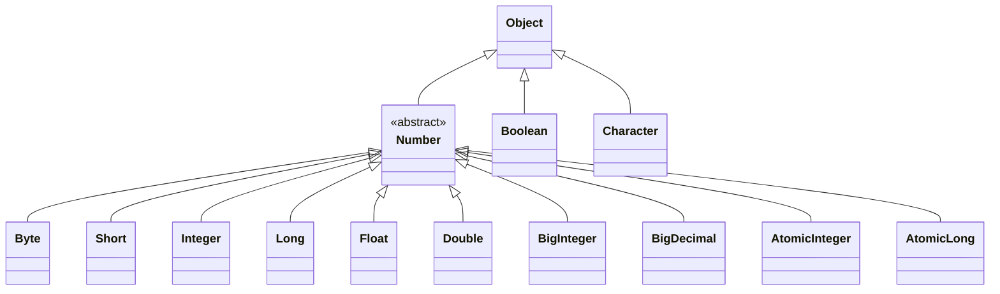

> `Boolean` and `Character` are **not** subclasses of `Number`. All wrapper classes are `final` and **immutable**.

### All primitives with their wrappers

<table>
<tr>
  <th>Primitive</th>
  <th>Wrapper</th>
  <th>Size</th>
  <th>Range</th>
  <th>Default</th>
  <th>Example</th>
</tr>
<tr>
  <td><code>byte</code></td>
  <td><code>Byte</code></td>
  <td>8 bit</td>
  <td><code>-128</code> to <code>127</code></td>
  <td><code>0</code></td>
  <td>

```java
byte b = 100;
byte min = Byte.MIN_VALUE;     // -128
byte max = Byte.MAX_VALUE;     // 127
byte wrap = (byte) 128;        // -128 (wraps around)
Byte boxed = b;                // autoboxing
```

  </td>
</tr>
<tr>
  <td><code>short</code></td>
  <td><code>Short</code></td>
  <td>16 bit</td>
  <td><code>-32,768</code> to <code>32,767</code></td>
  <td><code>0</code></td>
  <td>

```java
short s = 30_000;
short max = Short.MAX_VALUE;   // 32767
short wrap = (short) 40000;    // -25536
Short boxed = s;
```

  </td>
</tr>
<tr>
  <td><code>int</code></td>
  <td><code>Integer</code></td>
  <td>32 bit</td>
  <td><code>-2,147,483,648</code> to <code>2,147,483,647</code><br>(−2³¹ to 2³¹−1)</td>
  <td><code>0</code></td>
  <td>

```java
int i = 2_147_483_647;
int overflow = i + 1;          // -2147483648
int bin = 0b1010;              // 10
int hex = 0xFF;                // 255
int oct = 017;                 // 15
Integer boxed = i;
int n = Integer.parseInt("123");
```

  </td>
</tr>
<tr>
  <td><code>long</code></td>
  <td><code>Long</code></td>
  <td>64 bit</td>
  <td><code>-9,223,372,036,854,775,808</code> to <code>9,223,372,036,854,775,807</code><br>(−2⁶³ to 2⁶³−1)</td>
  <td><code>0L</code></td>
  <td>

```java
long big = 9_000_000_000L;     // L suffix required
long max = Long.MAX_VALUE;
// Math.addExact(max, 1L);     // throws ArithmeticException
Long boxed = big;
```

  </td>
</tr>
<tr>
  <td><code>float</code></td>
  <td><code>Float</code></td>
  <td>32 bit (IEEE 754)</td>
  <td>about <code>±1.4E-45</code> to <code>±3.4028235E38</code><br>(6 to 7 decimal digits)</td>
  <td><code>0.0f</code></td>
  <td>

```java
float f = 3.14f;               // f suffix required
float max = Float.MAX_VALUE;   // 3.4028235E38
float sum = 0.1f + 0.2f;       // 0.3 (approx.)
Float boxed = f;
```

  </td>
</tr>
<tr>
  <td><code>double</code></td>
  <td><code>Double</code></td>
  <td>64 bit (IEEE 754)</td>
  <td>about <code>±4.9E-324</code> to <code>±1.7976931348623157E308</code><br>(15 to 16 decimal digits)</td>
  <td><code>0.0d</code></td>
  <td>

```java
double d = 3.14159;            // default type of decimals
double sum = 0.1 + 0.2;        // 0.30000000000000004
boolean nan = Double.isNaN(0.0 / 0.0);   // true
double inf = 1.0 / 0;          // Infinity
Double boxed = d;
```

  </td>
</tr>
<tr>
  <td><code>char</code></td>
  <td><code>Character</code></td>
  <td>16 bit unsigned</td>
  <td><code>'\u0000'</code> (0) to <code>'\uffff'</code> (65,535)</td>
  <td><code>'\u0000'</code></td>
  <td>

```java
char c = 'A';
char u = '\u0041';             // 'A'
int code = c;                  // 65
char next = (char) (c + 1);    // 'B'
Character ch = 'a';            // autoboxing
boolean digit = Character.isDigit('7');   // true
```

  </td>
</tr>
<tr>
  <td><code>boolean</code></td>
  <td><code>Boolean</code></td>
  <td>1 bit of information (JVM decides the real size)</td>
  <td><code>true</code> or <code>false</code></td>
  <td><code>false</code></td>
  <td>

```java
boolean ok = true;
Boolean boxed = ok;
boolean p = Boolean.parseBoolean("TRUE");  // true
// boolean b = 1;   // ❌ no int-to-boolean conversion
```

  </td>
</tr>
</table>

> **Remember the order of size:** `byte` (1 byte) → `short` (2) → `int` (4) → `long` (8); `float` (4) → `double` (8); `char` (2).

### Wrapper class helpers

<table>
<tr>
  <th>Wrapper</th>
  <th>Constants</th>
  <th>Parse / convert</th>
  <th>Example</th>
</tr>
<tr>
  <td><code>Byte</code></td>
  <td><code>MIN_VALUE</code>, <code>MAX_VALUE</code>, <code>SIZE</code>, <code>BYTES</code></td>
  <td><code>parseByte</code>, <code>valueOf</code></td>
  <td>

```java
Byte.parseByte("12");           // 12
Byte.toUnsignedInt((byte) -1);  // 255
```

  </td>
</tr>
<tr>
  <td><code>Short</code></td>
  <td><code>MIN_VALUE</code>, <code>MAX_VALUE</code></td>
  <td><code>parseShort</code>, <code>valueOf</code></td>
  <td>

```java
Short.parseShort("300");        // 300
```

  </td>
</tr>
<tr>
  <td><code>Integer</code></td>
  <td><code>MIN_VALUE</code>, <code>MAX_VALUE</code></td>
  <td><code>parseInt</code>, <code>valueOf</code>, <code>toBinaryString</code>, <code>toHexString</code>, <code>compare</code>, <code>sum</code>, <code>max</code></td>
  <td>

```java
Integer.parseInt("42");         // 42
Integer.toBinaryString(10);     // "1010"
Integer.toHexString(255);       // "ff"
Integer.compare(3, 5);          // -1
Integer.MAX_VALUE;              // 2147483647
```

  </td>
</tr>
<tr>
  <td><code>Long</code></td>
  <td><code>MIN_VALUE</code>, <code>MAX_VALUE</code></td>
  <td><code>parseLong</code>, <code>valueOf</code></td>
  <td>

```java
Long.parseLong("9000000000");   // 9000000000
```

  </td>
</tr>
<tr>
  <td><code>Float</code></td>
  <td><code>MIN_VALUE</code>, <code>MAX_VALUE</code>, <code>NaN</code>, <code>POSITIVE_INFINITY</code></td>
  <td><code>parseFloat</code>, <code>isNaN</code></td>
  <td>

```java
Float.parseFloat("3.5");        // 3.5
Float.isNaN(0f / 0);            // true
```

  </td>
</tr>
<tr>
  <td><code>Double</code></td>
  <td><code>MIN_VALUE</code>, <code>MAX_VALUE</code>, <code>NaN</code>, <code>POSITIVE_INFINITY</code></td>
  <td><code>parseDouble</code>, <code>compare</code>, <code>isNaN</code>, <code>isInfinite</code></td>
  <td>

```java
Double.parseDouble("2.5");      // 2.5
Double.compare(0.1 + 0.2, 0.3); // 1 (not equal)
```

  </td>
</tr>
<tr>
  <td><code>Character</code></td>
  <td><code>MIN_VALUE</code>, <code>MAX_VALUE</code></td>
  <td><code>isDigit</code>, <code>isLetter</code>, <code>isUpperCase</code>, <code>toUpperCase</code>, <code>getNumericValue</code></td>
  <td>

```java
Character.isLetter('a');        // true
Character.getNumericValue('7'); // 7
Character.toUpperCase('a');     // 'A'
```

  </td>
</tr>
<tr>
  <td><code>Boolean</code></td>
  <td><code>TRUE</code>, <code>FALSE</code></td>
  <td><code>parseBoolean</code>, <code>valueOf</code>, <code>logicalAnd</code></td>
  <td>

```java
Boolean.parseBoolean("true");   // true
Boolean.valueOf("yes");         // false (only "true" ignoring case is true)
```

  </td>
</tr>
</table>

`Number` (abstract class) gives every numeric wrapper these conversion methods: `byteValue()`, `shortValue()`, `intValue()`, `longValue()`, `floatValue()`, `doubleValue()`.

```java
Double d = 9.99;
int i = d.intValue();          // 9 (decimal part is cut off)
long l = d.longValue();        // 9
```

### Integer cache: the `==` trap

Wrapper `valueOf()` (and autoboxing) **reuses cached objects** for small values. So `==` works for small numbers and fails for big ones. **Always compare wrappers with `equals()`.**

| Wrapper | Cached values |
|---|---|
| `Byte`, `Short`, `Integer`, `Long` | `-128` to `127` |
| `Character` | `0` to `127` |
| `Boolean` | `TRUE` and `FALSE` |
| `Float`, `Double` | Not cached |

```java
Integer a = 127, b = 127;
System.out.println(a == b);          // true  (cached object)

Integer c = 128, d = 128;
System.out.println(c == d);          // false (two different objects)
System.out.println(c.equals(d));     // true  ✅ always use equals()

Long x = 127L;
System.out.println(x.equals(127));   // false (127 boxes to Integer, not Long)
```

**Example: proving it with `identityHashCode`**

<table>
<tr><th>Integer cache</th><th>Result</th></tr>
<tr>
  <td>

```java
// Integer Cache
Integer i = 120, j = 120;
// Reason: Java caches Integer objects from -128 to 127 (Integer cache).
// Both i and j point to the same object.
System.out.println("objects in memory ➩ " + System.identityHashCode(i)
    + ": == → compares reference :" + (i == j));      // true
System.out.println("objects in memory ➩ " + System.identityHashCode(j)
    + ": equals() → compares value :" + i.equals(j)); // true

// 129 is outside cache range (-128 to 127).
Integer k = 129, l = 129;
System.out.println("objects in memory ➩ " + System.identityHashCode(k)
    + ": == → compares reference :" + (k == l));      // false
System.out.println("objects in memory ➩ " + System.identityHashCode(l)
    + ": equals() → compares value :" + k.equals(l)); // true
```

  </td>
  <td>

```text
objects in memory ➩ 705927765: == → compares reference :true
objects in memory ➩ 705927765: equals() → compares value :true
objects in memory ➩ 366712642: == → compares reference :false
objects in memory ➩ 1829164700: equals() → compares value :true
```

  </td>
</tr>
</table>

> The same `identityHashCode` (`705927765`) for `i` and `j` shows they are **one object**. For `129` the two numbers differ, so there are **two objects**. The exact numbers change on every run.

### Number literals, overflow and precision

<table>
<tr><th>Topic</th><th>Simple meaning</th><th>Example</th></tr>
<tr>
  <td>Literal forms</td>
  <td>Decimal, binary <code>0b</code>, octal <code>0</code>, hex <code>0x</code>, underscores for readability</td>
  <td>

```java
int dec = 1_000_000;
int bin = 0b1010;      // 10
int oct = 010;         // 8
int hex = 0xFF;        // 255
```

  </td>
</tr>
<tr>
  <td>Integer overflow</td>
  <td>Result wraps around silently</td>
  <td>

```java
int max = Integer.MAX_VALUE;
System.out.println(max + 1);               // -2147483648
// Math.addExact(max, 1);                  // ArithmeticException
```

  </td>
</tr>
<tr>
  <td>Integer division</td>
  <td>Decimals are dropped</td>
  <td>

```java
System.out.println(7 / 2);       // 3
System.out.println(7 / 2.0);     // 3.5
System.out.println(7 % 2);       // 1
// 7 / 0 -> ArithmeticException
// 7.0 / 0 -> Infinity
```

  </td>
</tr>
<tr>
  <td>Type promotion</td>
  <td><code>byte</code>, <code>short</code>, <code>char</code> become <code>int</code> in arithmetic</td>
  <td>

```java
byte a = 10, b = 20;
// byte c = a + b;         // ❌ int cannot fit in byte
byte c = (byte) (a + b);   // ✅
```

  </td>
</tr>
<tr>
  <td>Floating precision</td>
  <td><code>float</code>/<code>double</code> cannot store most decimals exactly</td>
  <td>

```java
System.out.println(0.1 + 0.2 == 0.3);                  // false
System.out.println(Math.abs(0.1 + 0.2 - 0.3) < 1e-9); // true (compare with a tolerance)
```

  </td>
</tr>
<tr>
  <td>Money / exact decimals</td>
  <td>Use <code>BigDecimal</code> built from a <code>String</code></td>
  <td>

```java
BigDecimal x = new BigDecimal("0.1").add(new BigDecimal("0.2"));
System.out.println(x);     // 0.3
```

  </td>
</tr>
</table>

### Other number types (short description and examples)

<table>
<tr>
  <th>Type</th>
  <th>Package</th>
  <th>Short description</th>
  <th>Example</th>
</tr>
<tr>
  <td><code>BigInteger</code></td>
  <td><code>java.math</code></td>
  <td>Whole numbers of <b>any size</b> (no overflow). Immutable. Slower than <code>long</code>.</td>
  <td>

```java
BigInteger a = new BigInteger("99999999999999999999");
BigInteger b = a.multiply(BigInteger.TEN);
System.out.println(b);   // 999999999999999999990
```

  </td>
</tr>
<tr>
  <td><code>BigDecimal</code></td>
  <td><code>java.math</code></td>
  <td>Exact decimal numbers with chosen scale and rounding. Use for money. Immutable.</td>
  <td>

```java
BigDecimal p = new BigDecimal("10.25");
BigDecimal t = p.multiply(new BigDecimal("0.18"))
                .setScale(2, RoundingMode.HALF_UP);
System.out.println(t);   // 1.85
```

  </td>
</tr>
<tr>
  <td><code>AtomicInteger</code></td>
  <td><code>java.util.concurrent.atomic</code></td>
  <td>Thread-safe <code>int</code> counter without <code>synchronized</code>.</td>
  <td>

```java
AtomicInteger counter = new AtomicInteger();
counter.incrementAndGet();   // 1
counter.addAndGet(5);        // 6
```

  </td>
</tr>
<tr>
  <td><code>AtomicLong</code></td>
  <td><code>java.util.concurrent.atomic</code></td>
  <td>Thread-safe <code>long</code> counter.</td>
  <td>

```java
AtomicLong id = new AtomicLong(100);
long next = id.getAndIncrement();   // 100, then 101
```

  </td>
</tr>
<tr>
  <td><code>LongAdder</code></td>
  <td><code>java.util.concurrent.atomic</code></td>
  <td>Faster than <code>AtomicLong</code> when many threads only add and read at the end.</td>
  <td>

```java
LongAdder hits = new LongAdder();
hits.increment();
long total = hits.sum();
```

  </td>
</tr>
<tr>
  <td><code>Number</code></td>
  <td><code>java.lang</code></td>
  <td>Abstract parent of the numeric wrappers; lets a method accept any number.</td>
  <td>

```java
static double twice(Number n) { return n.doubleValue() * 2; }
twice(5);      // 10.0
twice(2.5f);   // 5.0
```

  </td>
</tr>
<tr>
  <td><code>DecimalFormat</code></td>
  <td><code>java.text</code></td>
  <td>Format a number as text (grouping, decimals).</td>
  <td>

```java
String s = new DecimalFormat("#,##0.00").format(1234567.891);
System.out.println(s);   // 1,234,567.89
```

  </td>
</tr>
<tr>
  <td><code>Math</code> exact methods</td>
  <td><code>java.lang</code></td>
  <td>Throw <code>ArithmeticException</code> on overflow instead of wrapping.</td>
  <td>

```java
Math.addExact(1, 2);                 // 3
Math.multiplyExact(100000, 100000);  // throws ArithmeticException
Math.toIntExact(5L);                 // 5
```

  </td>
</tr>
</table>

</details>

## 3. Boxing, Widening and Casting

<details open><summary>Type casting and type conversion (summary)</summary>

> **Type casting:**
>
> - Primitive casting **`(primitive ↔ primitive)`**
>   - **Widening** (`int → double`): automatic. Converting a `smaller data type → larger data type`. No data loss.
>   - **Narrowing** (`double → int`): manual (explicit cast required), as it converts a `larger data type → smaller data type`. Possible data loss.
>
>   ```java
>   byte → short → int → long → float → double
>                ↑
>               char
>   ```
>
> - Reference type casting **`(Object → Object) | (reference ↔ reference)`**
>   - **Upcasting** (`Child → Parent`): automatic and safe.
>   - **Downcasting** (`Parent → Child`): explicit cast, may fail at runtime.
>
> **Type conversion:**
>
> - **Boxing:** automatically converting a `primitive type → wrapper object`.
> - **Unboxing:** converting a `wrapper object → primitive type`.

| Kind | Between | Direction | Written how? | Risk | Example |
|---|---|---|---|---|---|
| **Widening** | primitive ↔ primitive | small → large | Automatic (implicit) | None for the size of the value <br/>(see precision note below) | `int i = 10;`<br/>`double d = i;` |
| **Narrowing** | primitive ↔ primitive | large → small | Manual (explicit cast) | Data loss | `double d = 9.7;`<br/>`int i = (int) d;` |
| **Upcasting** | reference ↔ reference | Child → Parent | Automatic | None | `Parent p = new Child();` |
| **Downcasting** | reference ↔ reference | Parent → Child | Explicit cast | `ClassCastException` | `Child c = (Child) p;` |
| **Boxing** | primitive → wrapper | `int` → `Integer` | Automatic (compiler) | None | `Integer boxed = 10;` |
| **Unboxing** | wrapper → primitive | `Integer` → `int` | Automatic (compiler) | `NullPointerException` if `null` | `int n = boxed;` |

> **Casting vs conversion, in simple words:** *casting* is you telling the compiler to treat a value as another type (written with `(Type)`). *Conversion* is the value (or object) actually changing form, like boxing, which the compiler does for you.

<table>
<tr><th>Case</th><th>Example</th><th>Result</th></tr>
<tr>
  <td>Primitive widening</td>
  <td>

```java
int i = 10;
double d = i;          // automatic
```

  </td>
  <td><code>10.0</code></td>
</tr>
<tr>
  <td>Primitive narrowing</td>
  <td>

```java
double d = 9.78;
int i = (int) d;       // explicit cast
```

  </td>
  <td><code>9</code> (decimal part lost)</td>
</tr>
<tr>
  <td>Reference upcasting</td>
  <td>

```java
Child child = new Child();
Parent p = child;      // automatic and safe
```

  </td>
  <td>Same object, seen as <code>Parent</code></td>
</tr>
<tr>
  <td>Reference downcasting</td>
  <td>

```java
Parent p = new Child();
Child c = (Child) p;   // explicit cast
```

  </td>
  <td>Works, because the object really is a <code>Child</code></td>
</tr>
<tr>
  <td>Boxing</td>
  <td>

```java
int n = 5;
Integer boxed = n;     // primitive -> wrapper object
```

  </td>
  <td>Compiler calls <code>Integer.valueOf(5)</code></td>
</tr>
<tr>
  <td>Unboxing</td>
  <td>

```java
Integer boxed = 5;
int n = boxed;         // wrapper object -> primitive
```

  </td>
  <td>Compiler calls <code>boxed.intValue()</code></td>
</tr>
</table>

</details>

<details><summary>Widening, Narrowing Primitive Conversion, Autoboxing and Unboxing <code>primitives to Wrappers</code></summary>

---

> Widening (Implicit), Narrowing (Explicit) Primitive Conversion

A widening conversion occurs when you convert from a type with smaller (or narrower) to type with larger (or wider) range. Because of this, there is no chance for data loss and the conversion is considered "safe."

A narrowing conversion occurs when you convert from a type with larger (or wider) to type with smaller (or narrower) range. Since we are shrinking the range, there is a chance of data loss so this conversion is considered "unsafe"

Widening Implicit conversion from `int to float`, there is no loss of data.<br/>
Narrowing explicit conversion from `float to int`, there is loss of data

```
byte to short, int, long, float, or double
```

> ⚠ **Precision note:** widening never loses the *size* (magnitude) of a number, but `int → float`, `long → float` and `long → double` can lose **precision** for very large values (a `float` keeps only about 7 digits).
>
> ```java
> int big = 123_456_789;
> float f = big;               // widening, allowed implicitly
> System.out.println((int) f); // 123456792  <- last digits changed
> ```

> Autoboxing and Unboxing

Autoboxing is the automatic conversion that the Java compiler makes between the primitive types and their corresponding object wrapper classes. For example, converting an int to an Integer, a double to a Double, and so on. If the conversion goes the other way, this is called unboxing.

| Primitive Type | boolean | byte | char | float | int | long | short | double |
|---|---|---|---|---|---|---|---|---|
| Wrapper Class | Boolean | Byte | Character | Float | Integer | Long | Short | Double |

---

</details>

<details><summary>Widening and narrowing primitive conversion (explicit and implicit)</summary>

Think of **pouring water between containers**:

- **Widening:** small cup → big bucket. Always fits. Java does it **automatically** (implicit).
- **Narrowing:** big bucket → small cup. Might overflow, so Java makes you write a **cast** (explicit) to say "I accept the risk".

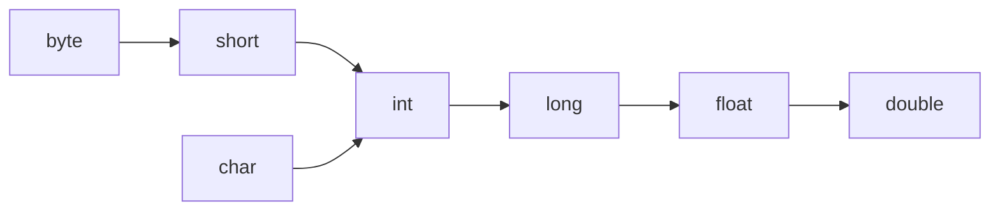

*Widening direction (implicit, automatic):* `byte → short → int → long → float → double`, and `char → int`.

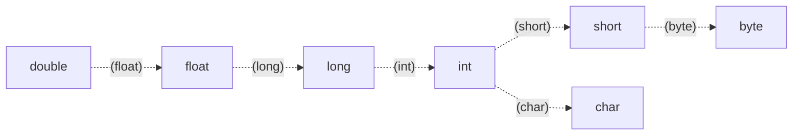

*Narrowing direction (explicit cast required), data may be lost.*

| From | Widening to (implicit) |
|---|---|
| `byte` | `short`, `int`, `long`, `float`, `double` |
| `short` | `int`, `long`, `float`, `double` |
| `char` | `int`, `long`, `float`, `double` |
| `int` | `long`, `float`, `double` |
| `long` | `float`, `double` |
| `float` | `double` |

| | Widening | Narrowing |
|---|---|---|
| Direction | Smaller → larger range | Larger → smaller range |
| Cast needed? | No (implicit) | **Yes** (explicit) |
| Data loss? | No loss of range (precision only for `int/long → float/double`) | **Possible** (range and precision) |
| Compile error without cast? | No | Yes: `possible lossy conversion` |

### Examples

<table>
<tr><th>Case</th><th>Example</th><th>Result / note</th></tr>
<tr>
  <td>Widening <code>int → float</code> (implicit)</td>
  <td>

```java
int i = 10;
float f = i;
```

  </td>
  <td><code>10.0</code>, no loss of data</td>
</tr>
<tr>
  <td>Narrowing <code>float → int</code> (explicit)</td>
  <td>

```java
float f = 10.08f;
int i = (int) f;   // decimal data loss
```

  </td>
  <td><code>10</code> (decimal part is truncated, not rounded)</td>
</tr>
<tr>
  <td>Truncation, not rounding</td>
  <td>

```java
int a = (int) 3.99;    // 3
int b = (int) -3.99;   // -3
long r = Math.round(3.99);  // 4 (use this to round)
```

  </td>
  <td>Cuts towards zero</td>
</tr>
<tr>
  <td>Narrowing overflow (wraps)</td>
  <td>

```java
byte b1 = (byte) 130;    // -126
byte b2 = (byte) 200;    // -56
short s = (short) 70000; // 4464
```

  </td>
  <td>Only the lowest bits are kept</td>
</tr>
<tr>
  <td>Out-of-range float → int</td>
  <td>

```java
int x = (int) 1e20;             // 2147483647 (Integer.MAX_VALUE)
int y = (int) Double.NaN;       // 0
```

  </td>
  <td>Saturates / NaN becomes 0</td>
</tr>
<tr>
  <td><code>byte → char</code> (widening then narrowing)</td>
  <td>

```java
byte b = 65;
char c = (char) b;     // 'A'
```

  </td>
  <td>First <code>byte</code> is widened to <code>int</code>, then the <code>int</code> is narrowed to <code>char</code></td>
</tr>
<tr>
  <td><code>char ↔ int</code></td>
  <td>

```java
char c = 'A';
int code = c;                 // 65 (widening)
char next = (char) (c + 1);   // 'B' (narrowing)
```

  </td>
  <td>Characters are 16-bit unsigned numbers</td>
</tr>
<tr>
  <td>Arithmetic promotion</td>
  <td>

```java
byte a = 10, b = 20;
// byte c = a + b;        // ❌ a + b is an int
byte c = (byte) (a + b);  // ✅
```

  </td>
  <td><code>byte</code>, <code>short</code>, <code>char</code> become <code>int</code> in expressions</td>
</tr>
<tr>
  <td>Compound assignment</td>
  <td>

```java
byte b = 10;
b += 5;          // ✅ compiles: hidden cast
// b = b + 5;    // ❌ lossy conversion
```

  </td>
  <td><code>+=</code> includes an automatic narrowing cast</td>
</tr>
<tr>
  <td>Constant fits the type</td>
  <td>

```java
byte b = 100;          // ✅ constant 100 fits in a byte
// byte c = 200;       // ❌ does not fit
final int k = 10;
byte d = k;            // ✅ compile-time constant
```

  </td>
  <td>Constants that fit are allowed without a cast</td>
</tr>
</table>

> A narrowing primitive conversion may lose information about the overall magnitude of a numeric value and may also lose precision and range.

</details>

<details><summary>Autoboxing and unboxing (primitive ↔ wrapper)</summary>

**Autoboxing** = the compiler **wraps** a primitive into its wrapper object automatically (`int` → `Integer`).
**Unboxing** = the compiler **unwraps** a wrapper object into a primitive automatically (`Integer` → `int`).

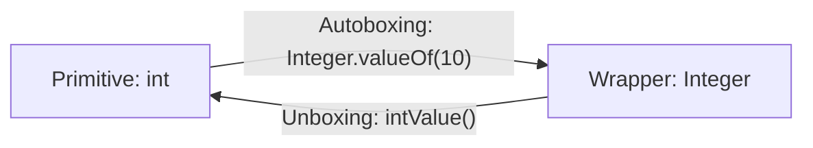

```text
BOXING    : From type boolean to type Boolean
UN_BOXING : From type Boolean to type boolean
```

**Why it exists:** collections and generics store only objects (`List<Integer>`), but code is easier to write with plain numbers.

Converting an object of a wrapper type (`Integer`) to its corresponding primitive (`int`) value is called unboxing. The Java compiler applies unboxing when an object of a wrapper class is:

- Passed as a parameter to a method that expects a value of the corresponding primitive type.
- Assigned to a variable of the corresponding primitive type.

<table>
<tr><th>Where</th><th>Example</th><th>What the compiler does</th></tr>
<tr>
  <td>Simplest autoboxing</td>
  <td>

```java
Character ch = 'a';
```

  </td>
  <td><code>Character ch = Character.valueOf('a');</code></td>
</tr>
<tr>
  <td>Assign primitive to wrapper</td>
  <td>

```java
Integer boxed = 10;
Double  d = 2.5;
Boolean flag = true;
```

  </td>
  <td>Boxing via <code>valueOf()</code></td>
</tr>
<tr>
  <td>Assign wrapper to primitive</td>
  <td>

```java
Integer boxed = 10;
int n = boxed;
```

  </td>
  <td>Unboxing via <code>intValue()</code></td>
</tr>
<tr>
  <td>Pass to a method</td>
  <td>

```java
static void show(int x) { }
Integer boxed = 7;
show(boxed);               // unboxing
```

  </td>
  <td>Wrapper unboxed to match the parameter</td>
</tr>
<tr>
  <td>Collections</td>
  <td>

```java
List<Integer> list = new ArrayList<>();
list.add(5);               // boxing
int first = list.get(0);   // unboxing
```

  </td>
  <td>Generics need objects</td>
</tr>
<tr>
  <td>Arithmetic / comparison</td>
  <td>

```java
Integer a = 10, b = 20;
int sum = a + b;           // both unboxed
boolean lt = a < b;        // unboxed
```

  </td>
  <td><code>+</code>, <code>&lt;</code> and so on unbox their operands</td>
</tr>
</table>

### Gotchas (interview favourites)

<table>
<tr><th>Gotcha</th><th>Example</th><th>Why</th></tr>
<tr>
  <td>Unboxing <code>null</code></td>
  <td>

```java
Integer x = null;
int y = x;      // NullPointerException
```

  </td>
  <td>Unboxing calls <code>x.intValue()</code> on <code>null</code></td>
</tr>
<tr>
  <td>No widening plus boxing together</td>
  <td>

```java
// Long l = 5;     // ❌ int cannot become Long
Long l = 5L;       // ✅
long p = 5;        // ✅ widening only
// Double d = 1;   // ❌
```

  </td>
  <td>Boxing keeps the same type: <code>int</code> boxes to <code>Integer</code> only</td>
</tr>
<tr>
  <td><code>==</code> on wrappers</td>
  <td>

```java
Integer a = 127, b = 127;
Integer c = 128, d = 128;
a == b;          // true  (cache)
c == d;          // false
c.equals(d);     // true
```

  </td>
  <td>Compares references; cache covers <code>-128</code> to <code>127</code></td>
</tr>
<tr>
  <td>Wrong <code>equals</code> type</td>
  <td>

```java
Long l = 10L;
l.equals(10);    // false (10 boxes to Integer)
l.equals(10L);   // true
```

  </td>
  <td><code>equals</code> checks the wrapper class first</td>
</tr>
<tr>
  <td>Overload resolution order</td>
  <td>

```java
static void m(long x)    { System.out.println("long"); }
static void m(Integer x) { System.out.println("Integer"); }
m(5);   // prints: long
```

  </td>
  <td>Order: ① widening ② boxing ③ varargs</td>
</tr>
<tr>
  <td>Performance in loops</td>
  <td>

```java
Long sum = 0L;
for (long i = 0; i < 1_000_000; i++) sum += i;   // creates many Long objects
long fast = 0;                                   // use the primitive instead
```

  </td>
  <td>Each <code>+=</code> unboxes, adds, and boxes again</td>
</tr>
<tr>
  <td>Removing from a list</td>
  <td>

```java
List<Integer> list = new ArrayList<>(List.of(10, 20, 30));
list.remove(1);                    // removes INDEX 1 -> [10, 30]
list.remove(Integer.valueOf(10));  // removes VALUE 10 -> [30]
```

  </td>
  <td><code>remove(int)</code> beats <code>remove(Object)</code></td>
</tr>
</table>

</details>

<details><summary>Upcasting and downcasting (reference type casting)</summary>


Casting also works for **objects** in an inheritance tree.

- **Upcasting:** treat a **child** object as its **parent** type. Always safe, so it is automatic (implicit).
- **Downcasting:** treat a **parent-typed** reference as the **child** type again. It may fail at runtime, so you must write a cast (explicit).

```text
Parent p = new Child();     // upcasting   (implicit)
Child  c = (Child) p;       // downcasting (explicit)
```

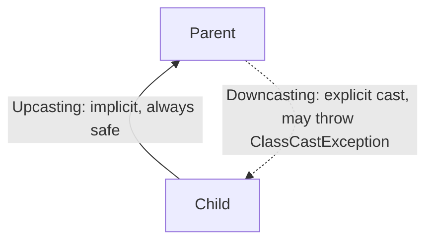

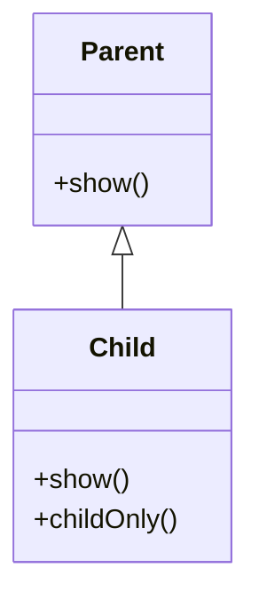

| | Upcasting | Downcasting |
|---|---|---|
| Direction | Child → Parent (up the tree) | Parent → Child (down the tree) |
| Cast written? | No (implicit) | **Yes** `(Child) p` |
| Safe? | Always | Only if the object really **is** a `Child` |
| Failure | Never | `ClassCastException` at runtime |
| What you can call | Only the **Parent's** members (child's overrides still run) | Child's own members too |
| Check first | – | `instanceof` |

```java
class Parent {
    String name = "Parent field";
    void show() { System.out.println("Parent show"); }
}
class Child extends Parent {
    String name = "Child field";
    @Override void show() { System.out.println("Child show"); }
    void childOnly() { System.out.println("Only in Child"); }
}

public class CastDemo {
    public static void main(String[] args) {
        Parent p = new Child();      // ✅ upcasting
        p.show();                    // Child show   (method is chosen at RUNTIME by the real object)
        // p.childOnly();            // ❌ compile error: Parent type has no childOnly()
        System.out.println(p.name);  // Parent field (fields are chosen by the reference TYPE, not overridden)

        Child c = (Child) p;         // ✅ downcasting, the object really is a Child
        c.childOnly();               // Only in Child

        Parent real = new Parent();
        // Child bad = (Child) real; // ❌ ClassCastException: Parent cannot be cast to Child

        // Safe downcast
        if (real instanceof Child ch) {   // pattern matching (Java 16+)
            ch.childOnly();
        } else {
            System.out.println("Not a Child");   // printed
        }
    }
}
```

<table>
<tr><th>Case</th><th>Example</th><th>Note</th></tr>
<tr>
  <td>Upcast to <code>Object</code></td>
  <td>

```java
Object o = "Hello";        // String -> Object
Object n = 42;             // boxing, then upcast
```

  </td>
  <td>Everything is an <code>Object</code></td>
</tr>
<tr>
  <td>Downcast from <code>Object</code></td>
  <td>

```java
Object o = "Hello";
String s = (String) o;     // ✅
// Integer i = (Integer) o;  // ❌ ClassCastException
```

  </td>
  <td>Cast must match the real type</td>
</tr>
<tr>
  <td>Interface upcast</td>
  <td>

```java
List<String> list = new ArrayList<>();   // ArrayList upcast to List
```

  </td>
  <td>"Program to an interface"</td>
</tr>
<tr>
  <td>Safe downcast (old style)</td>
  <td>

```java
if (p instanceof Child) {
    Child c = (Child) p;
}
```

  </td>
  <td>Check, then cast</td>
</tr>
<tr>
  <td>Static vs dynamic type</td>
  <td>

```java
Parent p = new Child();
// static (compile-time) type : Parent
// dynamic (runtime) type     : Child
```

  </td>
  <td>Compiler checks the static type; the JVM runs the dynamic type</td>
</tr>
<tr>
  <td>Primitive casting vs reference casting</td>
  <td>

```java
int i = (int) 3.9;         // changes the VALUE
Child c = (Child) p;       // never changes the object, only how it is viewed
```

  </td>
  <td>Reference casts do not convert the object</td>
</tr>
</table>

> **Interview tip:** upcasting gives **flexibility** (one `Parent` variable can hold any child); downcasting is how you get back child-specific features. Needing many downcasts is a sign to rethink the design (use polymorphism or interfaces instead).

</details>

## 4. Special type: Enum

<details><summary>Enum types (set of predefined constants)</summary>

An **enum type** is a special data type that enables for a variable to be a set of predefined constants. The variable must be equal to one of the values that have been predefined for it.

*Think of a fixed menu: days of the week, directions, order status. You pick one item, and nothing outside the menu is allowed.*

All enums implicitly extend [`java.lang.Enum`](https://docs.oracle.com/javase/tutorial/java/javaOO/enum.html).

- Enum type's fields are in UpperCase letters, as they are constants.
- The enum declaration defines a class (called an enum type). The enum class body can include methods and other fields.
- You cannot invoke an enum constructor yourself. The constructor must be private (or package-private); it is implicitly private.
- The compiler automatically adds some special methods when it creates an enum, like: `EnumClass.class { getEnumConstants(), getFields(), isEnum(), ... }`, plus the static `values()` and `valueOf(String)`.

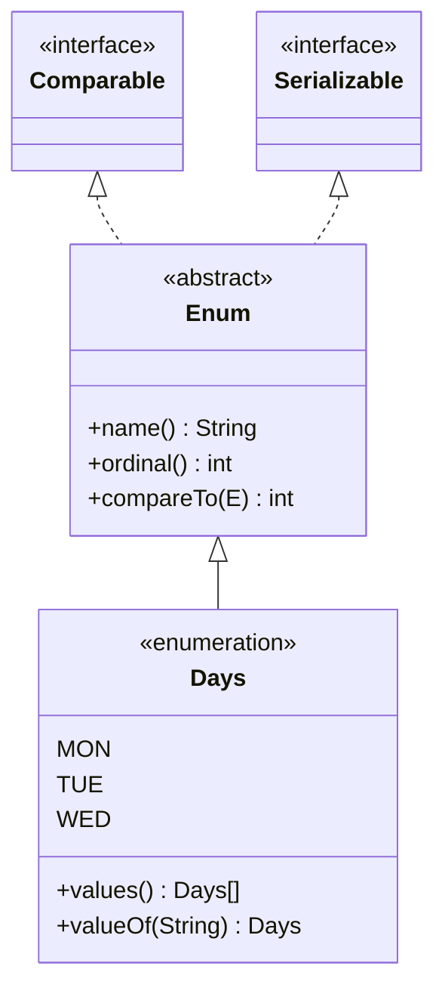

### Enum styles example

```java
public class EnumTest {
	enum constats {
		FIREFOX, CHROME;
	}
	enum ValuesFormOverriding {
		FIREFOX {
			@Override public String toString() {	return "Firefox";	}
		},
		CHROME {
			@Override public String toString() {	return "Chrome";	}
		}
	}
	enum ValuesThroughConstuctor {
		FIREFOX("Firefox"),
		CHROME("CH") {
			@Override public String toString() {	return "Chrome";	}
		};
		
		private String value;
		ValuesThroughConstuctor(final String value) {	this.value = value;	}

		public String getValue() {	return value;	}
	}
	
	enum Language{
		// Non equal parameters, So using Variable arguments String...
		English("english", "eng", "en", "en_GB", "en_US"),
		German("german", "de", "ge"),
		Russian("russian"),
		
		// DriverPack
		FF53 ("39", "40", "41", "42", "43", "44", "45"),
		FF47 ("34", "35", "36", "37", "38"),
		FF44 ("24", "31", "32", "33");
			
		private final List<String> values;
		
		Language(String ...values) {	this.values = Arrays.asList(values);	}
		
		public List<String> getValues() {	return values;	}
		
		public static List<String> getSimilarKeys( String value ) {
			Language language = ALIAS_MAP.get(value.toUpperCase());
			return language.getValues();
		}
		
		public static Language find(String name) {
			if (name == null) throw new NullPointerException("alias null");
			for (Language lang : Language.values()) {
				if (lang.getValues().contains(name)) {
					return lang;
				}
			}
			return null;
		}
		
		static private Map<String,Language> ALIAS_MAP = new HashMap<String,Language>();
		static {
			for (Language language:Language.values()) {
				// ignoring the case by normalizing to UpperCase
				ALIAS_MAP.put(language.name().toUpperCase(),language);
				for (String alias:language.values)
					ALIAS_MAP.put(alias.toUpperCase(),language);
			}
		}
		
		static public boolean has(String value) {
			return ALIAS_MAP.containsKey(value.toUpperCase());
		}
		
		static public Language fromString(String value) {
			if (value == null) throw new NullPointerException("alias null");
			
			Language language = ALIAS_MAP.get(value);
			if (language == null) throw new IllegalArgumentException("Not an alias: "+value);
			
			return language;
		}
	}
	
	enum Days {
		MON(1,"Monday"),	TUE(2,"Tuesday"),	WED(3,"Wednesday"),
		THU(4,"Thursday"),	FRI(5,"Friday"),	SAT(6,"Saturday"),
		SUN(7,"Sunday");

		private int id;
		private String day;

		Days(int id, String day) {
			this.id = id;	this.day = day;
		}
		
		public int getId() {	return id;	}
		public String getDay() {	return day;	}
	}
	public static void main(String[] args) {
		System.out.println("KEY's < ");
		System.out.println("F : " + constats.FIREFOX);
		System.out.println("C : " + constats.CHROME);
		
		System.out.println("Each toString @Override < ");
		System.out.println("F : " + ValuesFormOverriding.FIREFOX);
		System.out.println("C : " + ValuesFormOverriding.CHROME);
		
		System.out.println("Constructor instead of multipe toString @Override < ");
		System.out.println("F : " + ValuesThroughConstuctor.FIREFOX);
		System.out.println("C : " + ValuesThroughConstuctor.CHROME);
		
		System.out.println("Multi constructor Values < ");
		System.out.println("ENG : "+Language.find("en_GB"));
		System.out.println("ENG Similar : "+Language.getSimilarKeys("en_GB"));
		
		System.out.println("ENG Values : "+Language.English.getValues());
		System.out.println("DriverPack : "+Language.find("37"));
		System.out.println("DriverPack Similar : "+Language.getSimilarKeys("37"));
		
		System.out.println("Fixed constructor values > ");
		System.out.println("ID : "+Days.FRI.getId());
		System.out.println("Name : "+Days.FRI.getDay());
		System.out.println("Enum Day Fields : "+Days.class.getFields().length);
		Field[] constants = Days.class.getFields();
		for (Field field : constants) {
			System.out.println("DAY : "+field.getName());
		}
		
	}
}
```

*Expected output (worked out by hand from the code):*

```text
KEY's < 
F : FIREFOX
C : CHROME
Each toString @Override < 
F : Firefox
C : Chrome
Constructor instead of multipe toString @Override < 
F : FIREFOX
C : Chrome
Multi constructor Values < 
ENG : English
ENG Similar : [english, eng, en, en_GB, en_US]
ENG Values : [english, eng, en, en_GB, en_US]
DriverPack : FF47
DriverPack Similar : [34, 35, 36, 37, 38]
Fixed constructor values > 
ID : 5
Name : Friday
Enum Day Fields : 7
DAY : MON
DAY : TUE
DAY : WED
DAY : THU
DAY : FRI
DAY : SAT
DAY : SUN
```

> The original had the typo `"Thrusday"`; it is `"Thursday"` above.

| Style in the example | Simple meaning |
|---|---|
| `constats` | Plain constants; `toString()` prints the constant name |
| `ValuesFormOverriding` | Each constant has its own body that overrides `toString()` (constant-specific class body) |
| `ValuesThroughConstuctor` | Constants pass a value to a constructor; one constant also overrides `toString()` |
| `Language` | Constructor takes **varargs** (`String...`) so constants can hold different numbers of aliases; a static map gives fast, case-insensitive lookup |
| `Days` | Fixed constructor values (`id` and `day`) with getters |

> **Gotcha:** an enum constructor cannot read a `static` field of its own enum (constants are created first). That is why `ALIAS_MAP` is filled in a `static { ... }` block **after** the constants exist.

### Built-in enum methods

| Method | Simple meaning | Example → result |
|---|---|---|
| `values()` | Array of all constants in order | `Days.values().length` → `7` |
| `valueOf(String)` | Constant by exact name (throws `IllegalArgumentException` if missing) | `Days.valueOf("FRI")` → `FRI` |
| `name()` | Constant name as declared | `Days.FRI.name()` → `"FRI"` |
| `ordinal()` | Position (starts at 0) | `Days.FRI.ordinal()` → `4` |
| `toString()` | Name by default; can be overridden | `Days.FRI.toString()` → `"FRI"` |
| `compareTo(other)` | Order by ordinal | `Days.MON.compareTo(Days.FRI)` → `-4` |
| `equals` / `==` | Same constant (use `==`) | `Days.MON == Days.MON` → `true` |
| `getDeclaringClass()` | The enum class | `Days.MON.getDeclaringClass()` |
| `Class.getEnumConstants()` | Constants through reflection | `Days.class.getEnumConstants()` |
| `Class.isEnum()` | Is the class an enum? | `Days.class.isEnum()` → `true` |

### More enum features

<table>
<tr><th>Feature</th><th>Simple meaning</th><th>Example</th></tr>
<tr>
  <td>Use in <code>switch</code></td>
  <td>Enums work naturally in <code>switch</code></td>
  <td>

```java
Days d = Days.SAT;
String type = switch (d) {
    case SAT, SUN -> "Weekend";
    default       -> "Weekday";
};   // Weekend
```

  </td>
</tr>
<tr>
  <td>Implements an interface</td>
  <td>An enum can implement interfaces (but cannot extend a class)</td>
  <td>

```java
interface Printable { String print(); }
enum Color implements Printable {
    RED, GREEN;
    public String print() { return "Color " + name(); }
}
```

  </td>
</tr>
<tr>
  <td>Abstract method per constant</td>
  <td>Each constant supplies its own behaviour</td>
  <td>

```java
enum Op {
    ADD { int apply(int a, int b) { return a + b; } },
    MUL { int apply(int a, int b) { return a * b; } };
    abstract int apply(int a, int b);
}
Op.MUL.apply(3, 4);   // 12
```

  </td>
</tr>
<tr>
  <td><code>EnumMap</code></td>
  <td>Fast, ordered map with enum keys</td>
  <td>

```java
Map<Days, String> plan = new EnumMap<>(Days.class);
plan.put(Days.MON, "Gym");
```

  </td>
</tr>
<tr>
  <td><code>EnumSet</code></td>
  <td>Compact set of enum constants</td>
  <td>

```java
EnumSet<Days> weekend = EnumSet.of(Days.SAT, Days.SUN);
EnumSet<Days> weekdays = EnumSet.complementOf(weekend);
```

  </td>
</tr>
<tr>
  <td>Singleton</td>
  <td>A one-constant enum is the safest singleton (thread-safe, serialization-safe)</td>
  <td>

```java
enum AppConfig {
    INSTANCE;
    String env() { return "prod"; }
}
AppConfig.INSTANCE.env();
```

  </td>
</tr>
<tr>
  <td>Lookup by field</td>
  <td>Find a constant from a stored value</td>
  <td>

```java
static Days fromId(int id) {
    for (Days d : Days.values()) if (d.getId() == id) return d;
    throw new IllegalArgumentException("No day " + id);
}
```

  </td>
</tr>
</table>

### Enum rules at a glance

| Rule | Detail |
|---|---|
| Implicitly `final` | Cannot be extended (unless constants have bodies, then it is effectively sealed) |
| Cannot use `new` | Constants are created by the JVM once |
| Constructor | Implicitly `private` |
| Extends | Always `java.lang.Enum`, so it cannot extend another class |
| Implements | Any number of interfaces |
| Naming | Constants in `UPPER_CASE` |
| Compare | Use `==` (safe and null-safe on the left side) |
| Persist | Store `name()`, **not** `ordinal()` (adding a constant would shift the numbers) |
| Serialization | By name, so constants stay unique |

</details>

## 5. Interview questions and answers

<details><summary>Concept-wise interview questions and answers</summary>

<details><summary>What are the 8 primitive types and their sizes?</summary>

`byte` (8 bit), `short` (16), `int` (32), `long` (64), `float` (32), `double` (64), `char` (16, unsigned), `boolean` (1 bit of information; the JVM decides the real size).

</details>

<details><summary>Primitive vs wrapper class?</summary>

A primitive holds a raw value, cannot be `null`, has no methods and is fast. A wrapper is an immutable object around a primitive; it can be `null`, has helper methods, and is required for generics and collections.

</details>

<details><summary>What are autoboxing and unboxing?</summary>

Autoboxing is the automatic conversion of a primitive to its wrapper object (`int` → `Integer`). Unboxing is the reverse (`Integer` → `int`). Unboxing a `null` wrapper throws `NullPointerException`.

</details>

<details><summary>Why does `Integer a = 127, b = 127; a == b` give true but 128 gives false?</summary>

`Integer.valueOf()` (used by autoboxing) caches objects from -128 to 127, so both variables point to the same object. Outside that range, new objects are created and `==` compares different references. Use `equals()`.

</details>

<details><summary>What is widening and narrowing?</summary>

Widening converts a smaller range type to a larger one (`int` → `long`), is automatic and safe. Narrowing converts a larger one to a smaller one (`double` → `int`), needs an explicit cast and may lose data.

</details>

<details><summary>Why does `byte c = a + b;` not compile for two bytes?</summary>

In arithmetic, `byte`, `short` and `char` operands are promoted to `int`, so `a + b` is an `int`, which needs an explicit cast to fit into a `byte`. `+=` works because it includes a hidden cast.

</details>

<details><summary>What is the output of `(byte) 130`?</summary>

`-126`. Only the lowest 8 bits are kept (130 = 0b10000010), and as a signed byte that bit pattern is -126.

</details>

<details><summary>What is the difference between upcasting and downcasting?</summary>

Upcasting (`Parent p = new Child();`) is implicit and always safe. Downcasting (`Child c = (Child) p;`) is explicit and throws `ClassCastException` if the object is not really a `Child`. Check with `instanceof` first.

</details>

<details><summary>If `Parent p = new Child();`, which method runs and which field is read?</summary>

Overridden **methods** are chosen at runtime by the real object (`Child`'s version runs). **Fields** are chosen by the reference type (`Parent`'s field is read), because fields are not overridden.

</details>

<details><summary>Why is String immutable?</summary>

For the String pool (sharing), thread safety, security (class names, paths, credentials can't be changed after validation), and stable `hashCode()` for use as map keys.

</details>

<details><summary>String vs StringBuffer vs StringBuilder?</summary>

`String` is immutable. `StringBuffer` is mutable and thread-safe (synchronized). `StringBuilder` is mutable, not thread-safe, and the fastest; use it for single-threaded text building.

</details>

<details><summary>What is the String pool and what does `intern()` do?</summary>

The String pool is a heap area that stores unique string literals. `intern()` returns the pooled instance for the same content, adding it if it is missing.

</details>

<details><summary>`"abc" == "abc"` vs `new String("abc") == "abc"`?</summary>

The first is `true` (both literals share one pooled object). The second is `false` (`new` creates a separate heap object), although `equals()` is `true` for both.

</details>

<details><summary>Why use BigDecimal for money?</summary>

`double` stores binary approximations (`0.1 + 0.2 = 0.30000000000000004`). `BigDecimal` stores exact decimal values with controlled scale and rounding. Create it from a `String`, not from a `double`.

</details>

<details><summary>What is an enum, and how is it different from constants?</summary>

An enum is a type with a fixed set of named constants. Unlike `static final int` constants it is type-safe, can have fields, constructors, methods and interfaces, works in `switch`, and prints a readable name.

</details>

<details><summary>Can an enum extend a class or implement an interface?</summary>

It cannot extend a class (it already extends `java.lang.Enum`), but it can implement any number of interfaces.

</details>

<details><summary>Can you create an enum with `new`? Can the constructor be public?</summary>

No to both. Constants are created by the JVM once and the constructor is implicitly private.

</details>

<details><summary>`ordinal()` vs `name()`, which should be stored?</summary>

Store `name()`. `ordinal()` is the position, which changes if a constant is added or reordered.

</details>

<details><summary>Why is an enum the best singleton?</summary>

The JVM guarantees one instance per constant, it is thread-safe, and it is safe against reflection and serialization attacks.

</details>

</details>
</details>

#### References
 - [Numbers and Strings](https://docs.oracle.com/javase/tutorial/java/data/index.html)