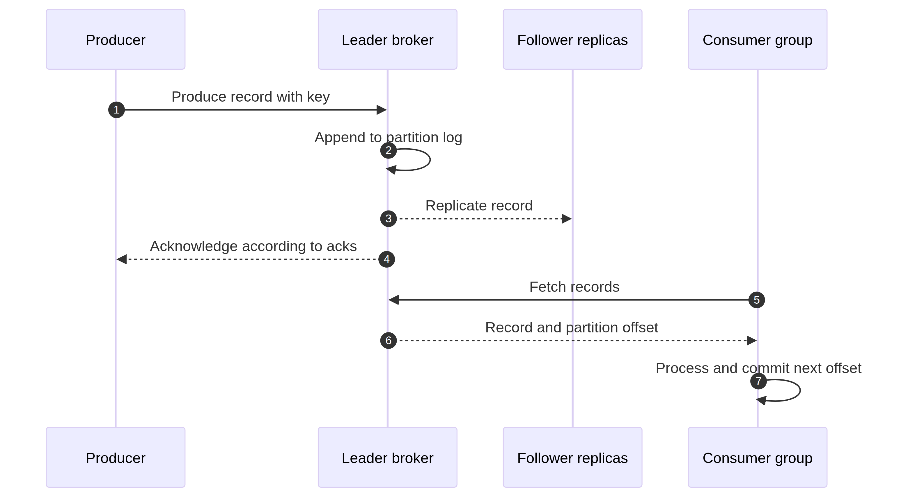

# Kafka Architecture

Kafka is easiest to understand as a distributed, append-only log. Producers write records to named topics. Kafka divides each topic into partitions, stores those partitions on brokers, and lets consumer groups read the log at their own pace. The design is powerful because a record can be replayed, but it also means you must make deliberate choices about keys, retention, replication, acknowledgements, and failure recovery.



## The core building blocks

A **broker** is a Kafka server. A **topic** is a logical stream such as `orders`. A topic is split into **partitions**, which are independent ordered logs. A record's **offset** is its position inside one partition. A **producer** writes records, and a **consumer** fetches records. A **consumer group** is a set of consumers that share partition work.

A topic with three partitions can be processed in parallel by up to three active consumers in one group. A second group receives its own view of the retained records. This is why one `orders` event can drive fulfillment, analytics, and notifications without the producer knowing every downstream service.

## What happens when a record is written

The producer chooses a partition. An explicit partition can be supplied, or a key can be used so related records normally map to the same partition. The partition leader appends the record to its local log and followers copy it. The producer's `acks` setting controls when Kafka acknowledges the write. `acks=all` asks the leader to wait for the in-sync replicas required by the topic and broker configuration.

A consumer does not receive a record pushed into its process. It polls Kafka, receives records from its assigned partitions, performs work, and commits a position. Reading does not delete the record. Retention by time or size, or log compaction for keyed state, controls when Kafka can remove older data.

## Replication and failure boundaries

Each partition has a leader replica and zero or more follower replicas. The replication factor is the number of configured copies. The in-sync replica set contains replicas that are sufficiently caught up according to Kafka's replication rules. If a leader fails, Kafka can elect an eligible replica.

Replication improves availability, but it is not a backup. A bad producer can write incorrect data to every replica, and an aggressive retention policy can remove every copy. Use replication together with tested recovery, appropriate retention, access controls, monitoring, and—when required—an independent backup or source system.

A common production policy is replication factor three, `acks=all`, and a `min.insync.replicas` value that prevents a write from succeeding when too few replicas are healthy. The correct numbers depend on failure tolerance, latency, storage, and cost.

## KRaft and cluster metadata

Modern Kafka deployments use KRaft, Kafka's own metadata quorum, rather than requiring ZooKeeper. Older tutorials may show `--zookeeper` commands and separate ZooKeeper processes. For current installations, use the version-matched Kafka quickstart and `--bootstrap-server` CLI commands. Do not mix commands from different Kafka generations without checking their configuration format.

KRaft does not remove the need for operational planning. Size brokers for network, disk, partition count, replication traffic, controller quorum health, and recovery time. Keep controller and broker responsibilities clear in the deployment model used by your Kafka release.

## A small local exercise

With Kafka running locally, create a topic with three partitions:

```bash
bin/kafka-topics.sh --bootstrap-server localhost:9092 \
  --create --topic orders --partitions 3 --replication-factor 1

bin/kafka-topics.sh --bootstrap-server localhost:9092 \
  --describe --topic orders
```

Replication factor one is fine for a laptop exercise, but it provides no replica redundancy. In production, create topics through reviewed configuration or infrastructure code rather than relying on broker auto-creation.

## Design decisions worth writing down

Before creating a topic, answer these questions in plain language:

1. Which business entity should remain ordered, and what key represents it?
2. How many partitions are needed for expected throughput and consumer parallelism?
3. How long must the event be replayable, and is compaction also required?
4. What is the acceptable behavior when a consumer fails after its side effect but before its offset commit?
5. Which clients and operators may publish, consume, alter, or describe the topic?
6. What metric and alert show that the system is falling behind?

A good Kafka architecture is not “many partitions and replication factor three.” It is a set of explicit guarantees matched to the business workflow.

<details><summary>What is the difference between a topic and a partition?</summary>

A topic is the named stream that applications use. A partition is one ordered log inside that topic. Kafka distributes partitions for storage and parallel processing. Ordering is guaranteed within one partition, not across the complete topic.

</details>

<details><summary>Why does Kafka use a pull model for consumers?</summary>

Consumers poll at a pace they can handle. This allows a slow consumer to apply back-pressure, batch records, and control when work is complete. The consumer can also replay from an earlier offset while the broker retains the data.

</details>

<details><summary>Does replication guarantee zero data loss?</summary>

No. Replication provides copies and supports failover. Data-loss risk also depends on producer acknowledgements, in-sync replicas, unclean leader election policy, retention, operator actions, and the failure scenario. State the exact failure boundary instead of promising zero loss.

</details>

## References

[Apache Kafka documentation](https://kafka.apache.org/documentation/) [Kafka design](https://kafka.apache.org/documentation/#design) [Kafka quickstart](https://kafka.apache.org/quickstart) [ZooKeeper to KRaft migration overview](https://kafka.apache.org/44/getting-started/zk2kraft/)
