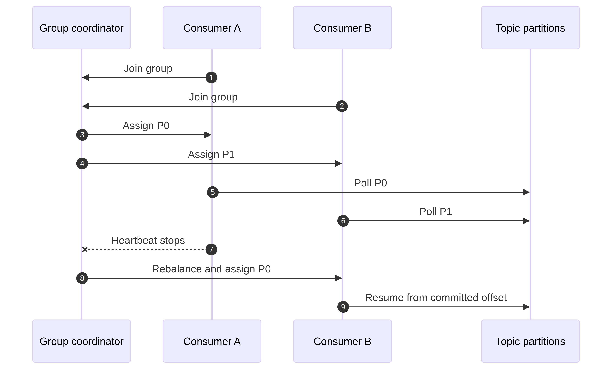

# Kafka Consumer Groups

A consumer group turns a set of consumers into one logical worker. Kafka assigns each subscribed partition to one active member of that group, so the members share work. A different group receives its own view of the retained topic and can process the same events for a different purpose.



## Same group versus different groups

Suppose `orders` has three partitions. Three consumers in group `fulfillment` can process the partitions in parallel. If a fourth consumer joins, it has no partition for this topic until the assignment changes or the group subscribes to more partitions. A second group named `analytics` receives all three partitions independently.

This is how Kafka supports both work sharing and fan-out. Fan-out is achieved with different group IDs; consumers in the same group do not each receive every record.

## Joining and assignment

A consumer subscribes to topics and joins the group coordinator. Kafka computes an assignment using the configured partition-assignment strategy. When a member joins, leaves, stops heartbeating, changes its subscription, or when partitions change, the group may rebalance.

During a rebalance, ownership can move from one member to another. A graceful shutdown should close the consumer so it leaves cleanly. A deployment should finish or safely abandon in-flight records before partitions are revoked. Cooperative or incremental assignment can reduce disruption, but it does not remove the need for correct cleanup.

## Polling and liveness

The consumer poll loop is responsible for fetching records and participating in group liveness. If application work blocks the loop longer than the configured maximum poll interval, Kafka can consider the member unresponsive and start a rebalance. Keep batches bounded, tune `max.poll.records`, and move long work to a controlled executor only when per-partition completion and commit ordering are preserved.

Do not solve every lag alert by increasing `max.poll.interval.ms`. A long timeout can hide a stuck consumer and delay failure detection. Measure processing time, downstream latency, retry time, and rebalance frequency together.

## Offset commits in a group

A committed offset belongs to the group and partition. On restart, a new member resumes from the group's checkpoint according to the client and reset policy. Commit only after the work represented by that checkpoint has succeeded. If a side effect happens before a crash but the commit does not, the next consumer may process the record again; design the side effect to be idempotent.

For concurrent processing, do not commit offset 100 if offset 99 in the same partition is still unfinished. Advancing past a gap can cause Kafka to skip the unfinished record after a restart. Track completion per partition and commit only the contiguous completed prefix.

## Group operations

Inspect a running group and its lag:

```bash
bin/kafka-consumer-groups.sh --bootstrap-server localhost:9092 \
  --group fulfillment --describe

bin/kafka-consumer-groups.sh --bootstrap-server localhost:9092 \
  --list
```

Use a stable group ID for a service. Changing the ID intentionally creates a new logical reader and can cause the service to start from the reset policy rather than its previous checkpoint.

## Troubleshooting checklist

When lag grows, identify the topic, partition, group member, and whether all partitions or only one are affected. Check for hot keys, downstream database/API latency, repeated failures, dead-letter volume, rebalances, CPU/GC pressure, network saturation, and insufficient partitions. Adding consumers is useful only when unassigned partitions exist and downstream capacity is available.

When a group appears stuck, inspect poll-loop latency, session timeouts, coordinator errors, authentication failures, assignment churn, and whether the process is committing. A healthy broker does not prove that the consumer application is making progress.

<details><summary>Why does changing the group ID replay messages?</summary>

The group ID identifies the consumer's checkpoint namespace. A new ID has no committed offsets, so the consumer uses `auto.offset.reset` and reads from the configured starting point. This is useful for a new projection, but dangerous if the handler performs non-idempotent business actions.

</details>

<details><summary>What should happen during partition revocation?</summary>

Stop accepting new work for the revoked partition, finish or safely cancel in-flight work, and commit only the completed contiguous prefix. Release partition-local state and let the new owner resume from the committed position. The exact callback API depends on the client library, but the ownership rule is the same.

</details>

<details><summary>Why can adding consumers fail to reduce lag?</summary>

There may be fewer partitions than consumers, one partition may be hot, the bottleneck may be a database or remote API, or frequent rebalances may be interrupting work. Check the partition-level and downstream metrics before scaling the group.

</details>

## References

[Kafka consumer groups](https://kafka.apache.org/documentation/#intro_consumers) [Kafka consumer configuration](https://kafka.apache.org/documentation/#consumerconfigs) [Kafka operations guide](https://kafka.apache.org/documentation/#operations)
