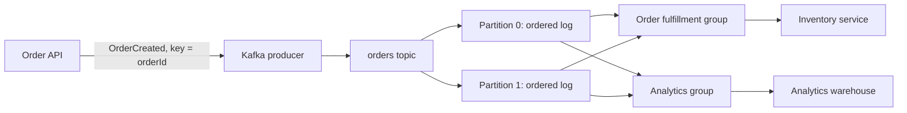

# Apache Kafka: Event Streaming in Practice

Kafka is an open-source, distributed event-streaming platform. It lets systems publish events, keep them for a configured period, and let different applications read and process them at their own pace. Teams use it for real-time data pipelines, event-driven services, activity feeds, telemetry, and integration between systems. It is useful when events need to be durable and replayable—not simply because a system has microservices. That pattern appears in payment and fraud signals, e-commerce orders, logistics updates, and platform monitoring.

Kafka is designed to handle high-volume streams by partitioning logs across brokers. Real capacity still depends on record size, key distribution, replication, storage and network resources, and how quickly consumers can process the data. Partitioning and replication support scalability and fault tolerance when the cluster is sized and configured for the workload; they are not automatic guarantees.

A useful example is an online order. The Order API records `OrderCreated`; payment, inventory, email, and analytics services can each react independently. The Order API does not have to know how many downstream services exist. Kafka stores the event between the producer and its consumers, so a temporarily slow consumer can catch up later while the event remains within retention.

## Follow the Kafka learning path

Start with the [Kafka architecture page](#/content/tree/messaging/kafka/architecture) for the cluster model, then explore [producers and consumers](#/content/tree/messaging/kafka/producers-consumers), [partitions and offsets](#/content/tree/messaging/kafka/partitions-offsets), [consumer groups](#/content/tree/messaging/kafka/consumer-groups), [delivery semantics](#/content/tree/messaging/kafka/delivery-semantics), and [transactions](#/content/tree/messaging/kafka/transactions). The consolidated [Kafka Interview Questions](#/content/tree/messaging/kafka/interview) page gathers the existing questions and additional scenario-based answers in one place.

## How an event moves through Kafka



The producer and consumer applications are separate clients. A **broker** is a Kafka server that stores and serves partition data. A **topic** names a stream, such as `orders`. A topic is divided into **partitions** so its log can be distributed across brokers and read in parallel. Each record has a position called an **offset**, scoped to one partition. The official [Kafka introduction](https://kafka.apache.org/44/getting-started/introduction/#what-is-event-streaming) describes an event as a key, value, timestamp, and optional headers.

The partition is important for both scaling and ordering. With the standard keyed partitioning behavior, records with the same key—such as the same `orderId`—are routed to the same partition. Kafka preserves their order within that partition. It does not provide one total order across every partition in a topic. Choose a key that keeps related events together, and watch for a popular key that could overload one partition.

## Consumer groups make independent work possible

Consumers that share a **group ID** divide the topic's partitions among themselves. A partition is assigned to at most one active member of that group at a time. If one group has three partitions and two consumers, one consumer will normally own two partitions and the other one. Adding a fourth consumer does not create a fourth partition; that consumer will have no partition to process until assignments change.

A different group gets its own view of the stream. For example, `order-fulfillment` and `analytics` can both read every retained `OrderCreated` record independently. Within a group, the members share the work; across groups, each group consumes independently. The committed offset is a checkpoint of a group's progress, not proof that an external database transaction or email has completed exactly once.

## Retention, replay, and replication

Reading a record does not normally delete it. Topic retention—by time or size—controls how long records remain available. A compacted topic instead keeps the latest value for each key over time, which is useful for changelog/state topics. Retention and compaction are different policies; neither should be treated as a substitute for a backup.

Kafka replicates each partition across brokers. One replica is the leader for client reads and writes; the other replicas follow the leader. The replication factor counts copies of a partition. Replication improves availability, but durability still depends on the producer acknowledgement policy, the in-sync replicas, broker configuration, and the failure scenario. Avoid promising that Kafka can never lose data. The [official design documentation](https://kafka.apache.org/documentation/#design) and [delivery-semantics documentation](https://kafka.apache.org/documentation/#semantics) explain the trade-offs behind acknowledgements, retries, and idempotence.

## Kafka and the application around it

Kafka is not a complete application by itself. Producers need to agree on event names, keys, schemas, and compatibility rules. Consumers need retry and poison-record policies, idempotent side effects, and monitoring. Production systems also configure authentication, authorization, and encrypted listeners rather than exposing an unauthenticated plaintext listener to an untrusted network.

Kafka provides several complementary APIs. **Kafka Connect** moves data between Kafka and external systems using connectors. **Kafka Streams** builds stream-processing applications that consume, transform, join, aggregate, and write streams. Ordinary producer and consumer clients cover direct application reads and writes.

Modern Kafka can run its metadata quorum in **KRaft** mode. ZooKeeper belongs to older deployment architectures; it is not a prerequisite for every current Kafka cluster. The supplied wiki examples include ZooKeeper-era commands, so treat those commands as historical examples and use the [current quickstart](https://kafka.apache.org/quickstart) for the release you install. The official [KRaft overview](https://kafka.apache.org/44/getting-started/zk2kraft/) explains the distinction.

## A small local topic exercise

With a local broker available at `localhost:9092`, create and inspect a topic:

```bash
bin/kafka-topics.sh --bootstrap-server localhost:9092 \
  --create --topic orders --partitions 3 --replication-factor 1

bin/kafka-topics.sh --bootstrap-server localhost:9092 \
  --describe --topic orders
```

A single broker can host this replication-factor-1 topic for a local exercise. It provides no replica redundancy, so it is not a production availability setting. Current Kafka CLI examples use `--bootstrap-server`; do not copy the older `--zookeeper` topic command from the archived wiki into a KRaft deployment.

## Spring Boot producer and listener example

The supplied Spring Boot wiki shows `KafkaTemplate` and `@KafkaListener`. The small example below keeps that approachable pattern and uses the order ID as the record key so events for one order stay together under the default keyed partitioning behavior.

```yaml
spring:
  kafka:
    bootstrap-servers: localhost:9092
    producer:
      key-serializer: org.apache.kafka.common.serialization.StringSerializer
      value-serializer: org.apache.kafka.common.serialization.StringSerializer
    consumer:
      group-id: order-fulfillment
      key-deserializer: org.apache.kafka.common.serialization.StringDeserializer
      value-deserializer: org.apache.kafka.common.serialization.StringDeserializer
```

```java
@Service
public class OrderEventPublisher {
    private final KafkaTemplate<String, String> kafkaTemplate;

    public OrderEventPublisher(KafkaTemplate<String, String> kafkaTemplate) {
        this.kafkaTemplate = kafkaTemplate;
    }

    public void publish(String orderId, String eventJson) {
        // Use orderId as the key to keep an order's events on one partition.
        kafkaTemplate.send("orders", orderId, eventJson);
    }
}

@Service
public class OrderEventListener {
    @KafkaListener(topics = "orders", groupId = "order-fulfillment")
    public void handle(String eventJson) {
        // Validate, apply an idempotent business change, and monitor failures.
        System.out.println("Order event received: " + eventJson);
    }
}
```

This is a teaching sketch, not a complete production configuration. Real services should define event schemas and compatibility, observe send failures, configure retry and dead-letter handling, secure the connection, and make downstream side effects safe to repeat.

## Further learning

- [Apache Kafka: Event streaming introduction](https://kafka.apache.org/44/getting-started/introduction/#what-is-event-streaming) and the [current design documentation](https://kafka.apache.org/documentation/#design) are the primary references for Kafka behavior.
- [The supplied Kafka wiki quickstart](https://github.com/Yash-777/SpringBoot_MicroService/wiki/kafka) and [Spring Boot Kafka notes](https://github.com/Yash-777/SpringBoot_MicroService/wiki/Apache-Kafka) provide the original local commands and `KafkaTemplate` / `@KafkaListener` example. Some commands are from Kafka 3.3.1 and ZooKeeper mode; check the version caveat above before reusing them.
- [Kafka deep dive: offsets, lag, commits, rebalancing, consumer groups, and replication](https://www.youtube.com/watch?v=iImW2xHMIRA) pairs well with the consolidated interview page. The [Spring Boot Kafka course](https://www.youtube.com/watch?v=tU_37niRh4U&t=653s) includes an architecture chapter and producer/consumer walkthrough.
- The [ServiceNow Kafka/ZooKeeper discovery page](https://www.servicenow.com/docs/r/zurich/it-operations-management/discovery-and-service-mapping-patterns/kafka-zookeeper-discovery.html) is an external operations reference. An [academic Kafka architecture figure](https://www.researchgate.net/figure/Apache-Kafka-architecture-with-mandatory-and-optional-services_fig3_360518587) was supplied as context; this page uses an original Mermaid diagram rather than copying that figure.
