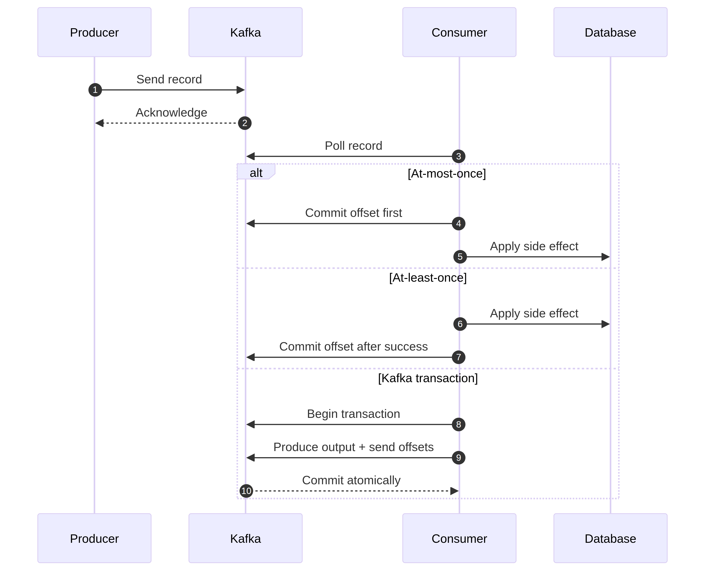

# Kafka Delivery Semantics

Delivery semantics describe what can happen when a producer, broker, consumer, or downstream service fails. The useful question is not “is Kafka exactly once?” It is “exactly which operations are covered by the guarantee, and what happens in each crash window?”

## At-most-once

At-most-once processing commits or advances the consumer position before the business effect. If the process crashes after the commit but before the effect, the record may never be processed again. This avoids duplicates at the cost of possible loss.

This can be appropriate for disposable metrics or notifications where missing an occasional record is acceptable. It is unsafe for a payment, inventory reservation, or other effect that must not silently disappear.

## At-least-once

At-least-once processing performs the effect first and commits afterward. If the process crashes between those actions, Kafka delivers the record again. The effect must therefore be idempotent or deduplicated.

A database update can use a business idempotency key and a unique constraint. An HTTP call can send an idempotency key if the receiving API supports it. A service can store an inbox record before applying a business change. The correct technique depends on the sink.

## Kafka producer idempotence

Producer retries can otherwise create duplicate records when a response is lost even though the broker accepted the first request. Idempotent producer mode lets Kafka recognize retries from the same producer session and avoid duplicate appends within its documented scope. Configure acknowledgements and retries consistently, and still give each business command an application-level identity when the business operation must be deduplicated across restarts or services.

## Transactions and exactly-once processing

Kafka transactions can group producer writes and consumed-offset commits so downstream Kafka consumers see either the committed result or no result. This is useful for Kafka-to-Kafka processing and Kafka Streams topologies. It does not automatically make an arbitrary database write, email, payment gateway, or external HTTP call exactly once.

For an external database, use a database transaction with an inbox/outbox design, a connector with a documented delivery model, or another integration pattern that matches the boundary. State this boundary explicitly in design reviews.

## Producer acknowledgement trade-offs

`acks=0` minimizes waiting but gives the producer no broker acknowledgement. `acks=1` waits for the leader's local append. `acks=all` waits according to the in-sync replica policy. Higher durability settings can increase latency and fail writes when the cluster cannot meet the required replica condition. The right setting is a business trade-off, not a universal maximum.

Replication factor, `min.insync.replicas`, producer idempotence, retries, delivery timeout, and error handling should be reviewed together. A single setting cannot compensate for incorrect retention or an unsafe consumer side effect.

## A practical decision table

| Requirement | Common approach | Main risk to explain |
| --- | --- | --- |
| Disposable telemetry | At-most-once or lossy batching | Some records may be missed |
| Business event with repeat-safe handler | At-least-once and manual commit after success | Duplicate delivery |
| Kafka-to-Kafka transformation | Idempotent producer or Kafka transaction | Transaction scope and timeout |
| Database-backed command | Inbox/idempotency key plus database transaction | Kafka offset and DB commit are separate without integration |
| Payment or irreversible side effect | Provider idempotency key plus durable command state | Provider and local state must be reconciled |

Does exactly-once mean the business action happens once?

Not by itself. Kafka's exactly-once features cover a defined Kafka transaction boundary. An external side effect is protected only if the external system participates in a compatible transaction or provides idempotency and reconciliation. Always name the systems covered by the guarantee.

Why can at-least-once be the safer default?

It favors not losing a record when a process fails. The cost is possible duplicate processing, which can be controlled with idempotent handlers, unique keys, and deduplication. For important business events, a visible duplicate that is safely ignored is often better than a silent missing effect.

What does a producer retry tell us?

A retry usually means the producer did not receive a usable response; it does not prove that the broker rejected the original request. This uncertainty is why idempotence and an application-level command ID matter.

## References

[Kafka message delivery semantics](https://kafka.apache.org/documentation/#semantics) [Kafka producer configuration](https://kafka.apache.org/documentation/#producerconfigs) [Kafka transactions](https://kafka.apache.org/documentation/#transactions) [Exactly-once semantics in Kafka Streams](https://developer.confluent.io/blog/guide-to-kafka-streams-exactly-once-transactions/)
