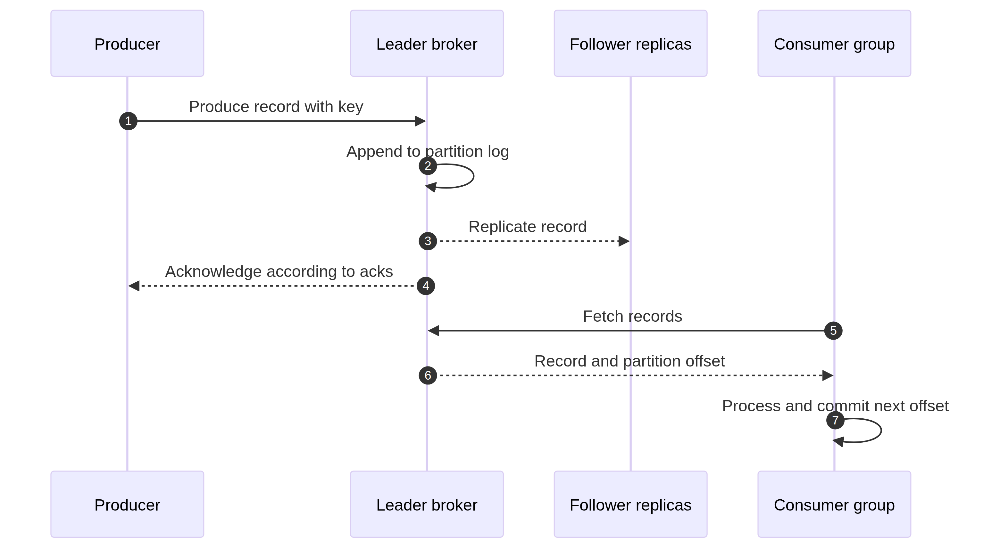

# Kafka Partitions and Offsets

A partition is Kafka's basic unit of ordering, storage, replication, and consumer parallelism. An offset is the position of a record inside that one partition. These two ideas explain most Kafka behavior that feels surprising at first.

## One topic, several ordered logs

A topic named `orders` may have partitions `0`, `1`, and `2`. Each partition has its own offset sequence. Offset `42` in partition `0` is unrelated to offset `42` in partition `2`; there is no global topic offset.



Kafka preserves the order in which records are appended to one partition. If events for an order must remain ordered, use `orderId` as the record key so those events normally map to the same partition. This gives per-order ordering, not a total order for every order in the topic.

## Partition count and scalability

Within one consumer group, one active consumer owns a partition at a time. A topic with six partitions can therefore use up to six active consumers for that subscription. A seventh consumer may be useful after a rebalance or when it subscribes to another topic, but it cannot create more parallel work for those six partitions.

More partitions are not free. They increase metadata, file handles, replication traffic, leader-election work, recovery time, and operational complexity. Choose a count from expected throughput, record size, consumer parallelism, retention, and growth rather than copying a round number.

Increasing a topic's partition count later can change how keys map to partitions for new records. If an application depends on strict per-key ordering, treat a partition-count change as a compatibility event and test it first.

## What an offset represents

A consumer group commits a position so a new member can resume after a restart or rebalance. In application discussions, describe the committed value as the next position the group should read; verify the exact client API convention before writing recovery code.

Committing an offset does not confirm that an email was delivered, a database transaction committed, or an external API accepted a request. It is a Kafka progress checkpoint. Coordinate it with the side effect through idempotency, an inbox/outbox pattern, or a Kafka transaction where the transaction boundary actually includes the work.

## Starting, resetting, and replaying

`auto.offset.reset=earliest` is used when a group has no committed offset and the retained log is available. `latest` starts at the end in that situation. Neither setting overrides an existing committed offset.

To inspect a group's position:

```bash
bin/kafka-consumer-groups.sh --bootstrap-server localhost:9092 \
  --group order-fulfillment --describe
```

To move a group back to a chosen position, stop the consumers first and use a reviewed offsets file. A reset is an operational change, not a harmless debugging command; it can replay business effects or skip data if the range is wrong.

## Retention and compaction

Normal retention removes old log segments by time or size. Log compaction keeps the latest known value for a key over time and is useful for changelog or state topics. Compaction is asynchronous, and a compacted topic can contain older records until cleaning runs. Retention and compaction are different policies and neither replaces a backup.

Choose retention from replay, recovery, privacy, storage, and compliance requirements. If an event is needed to rebuild a projection after an outage, retain it long enough or maintain another durable source.

## Measuring lag

Consumer lag is the distance between a group's committed or processed position and the end of the partition log. It can be expressed in records or time. A growing lag can mean a hot partition, slow downstream dependency, repeated retries, rebalances, insufficient consumers, CPU/GC pressure, network saturation, or disk contention.

Investigate the affected partition and member before adding consumers. More consumers help only when there are unassigned partitions and the downstream system can handle the extra concurrency.

<details><summary>Can Kafka guarantee ordering across a topic?</summary>

No. Kafka guarantees ordering within a partition. Use a stable key to keep related events together, and describe the business ordering boundary precisely. A topic-wide total order would prevent the parallelism that partitions provide.

</details>

<details><summary>Can two consumers in one group read the same partition at the same time?</summary>

Normally one active group member owns a partition at a time. During a rebalance, ownership changes. A process may still have in-flight work while ownership is being revoked, so consumers must handle revocation and commit only completed, contiguous work safely.

</details>

<details><summary>Why is a committed offset not an exactly-once guarantee?</summary>

The offset and an external side effect are separate unless they share a transaction supported by the system. A crash between the side effect and the offset commit can produce a duplicate; a commit before the side effect can produce a missing effect.

</details>

## References

[Kafka design](https://kafka.apache.org/documentation/#design) [Kafka consumer groups](https://kafka.apache.org/documentation/#intro_consumers) [Kafka topic configuration](https://kafka.apache.org/documentation/#topicconfigs) [Kafka operations guide](https://kafka.apache.org/documentation/#operations)
