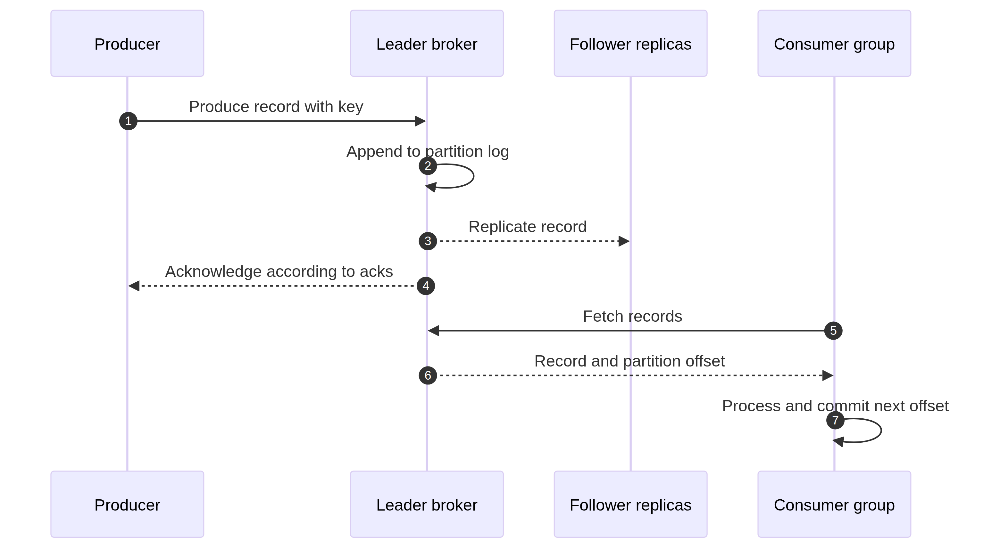

# Kafka Producers and Consumers

A producer publishes records; a consumer polls and processes them. The code is small, but the surrounding decisions determine whether a service is reliable. Start with a clear event contract, choose a key that matches the ordering requirement, and make downstream effects safe when a record is delivered again.



## Producer flow

A producer serializes a key and value, chooses a partition, batches records, sends them to the broker leader, and receives an acknowledgement or error. A key is optional. Use one when events for the same customer, order, account, or device must remain together.

```java
Properties properties = new Properties();
properties.put(ProducerConfig.BOOTSTRAP_SERVERS_CONFIG, "localhost:9092");
properties.put(ProducerConfig.KEY_SERIALIZER_CLASS_CONFIG, StringSerializer.class.getName());
properties.put(ProducerConfig.VALUE_SERIALIZER_CLASS_CONFIG, StringSerializer.class.getName());
properties.put(ProducerConfig.ACKS_CONFIG, "all");
properties.put(ProducerConfig.ENABLE_IDEMPOTENCE_CONFIG, "true");

try (KafkaProducer<String, String> producer = new KafkaProducer<>(properties)) {
    ProducerRecord<String, String> event =
        new ProducerRecord<>("orders", "order-42", "{\"type\":\"OrderCreated\"}");
    producer.send(event, (metadata, error) -> {
        if (error != null) {
            error.printStackTrace();
            return;
        }
        System.out.printf("partition=%d offset=%d%n", metadata.partition(), metadata.offset());
    });
    producer.flush();
}
```

`send` is asynchronous by default. The callback reports success or failure, but production code should expose failures through metrics and a clear retry or error policy. Calling `get()` on every send gives simple synchronous behavior but can reduce throughput; batching and bounded in-flight work are usually better.

## Consumer flow

A consumer joins a group, receives partition assignments, polls records, processes them, and commits offsets. The consumer's `group.id` determines which consumers share work. A different group receives its own copy of the retained stream.

```java
Properties properties = new Properties();
properties.put(ConsumerConfig.BOOTSTRAP_SERVERS_CONFIG, "localhost:9092");
properties.put(ConsumerConfig.GROUP_ID_CONFIG, "order-fulfillment");
properties.put(ConsumerConfig.KEY_DESERIALIZER_CLASS_CONFIG, StringDeserializer.class.getName());
properties.put(ConsumerConfig.VALUE_DESERIALIZER_CLASS_CONFIG, StringDeserializer.class.getName());
properties.put(ConsumerConfig.ENABLE_AUTO_COMMIT_CONFIG, "false");
properties.put(ConsumerConfig.AUTO_OFFSET_RESET_CONFIG, "earliest");

try (KafkaConsumer<String, String> consumer = new KafkaConsumer<>(properties)) {
    consumer.subscribe(List.of("orders"));
    while (true) {
        ConsumerRecords<String, String> records = consumer.poll(Duration.ofMillis(500));
        for (ConsumerRecord<String, String> record : records) {
            applyIdempotentOrderChange(record.key(), record.value());
        }
        consumer.commitSync();
    }
}
```

The example commits after the batch is processed. If the process crashes after the database change but before the commit, the record can be delivered again. That is expected at-least-once behavior, so `applyIdempotentOrderChange` must tolerate the duplicate.

## Keys, ordering, and hot partitions

A stable key normally sends related records to the same partition. This gives per-key ordering, not global topic ordering. A very popular key can create a hot partition while other partitions sit mostly idle. If one customer produces most of the traffic, decide whether that customer truly needs strict ordering or whether the event model can distribute work more evenly.

Do not change a key casually after consumers and downstream systems depend on ordering. Increasing the partition count can also change key-to-partition mapping for future records. Plan partition capacity before production and test with realistic key distributions.

## Retries and poison records

Retry transient failures with bounded attempts and backoff. A malformed event or permanently invalid business state should not spin in an endless retry loop. Route it to a dead-letter topic with the original key, value, headers, exception, source topic, partition, and offset so an operator can diagnose and replay it.

If order is more important than availability, stop the partition when a record fails and repair it before continuing. If availability is more important, continue after moving the bad record aside. That is a business decision, not merely a Kafka setting.

## Producer and consumer configuration habits

Use the client configuration reference for the exact Kafka version. In general, review producer acknowledgements, idempotence, retries, delivery timeout, compression, batch size, and linger together. Review consumer group ID, offset reset policy, poll interval, session timeout, maximum poll records, commit mode, and serializer compatibility together. Configure TLS, SASL, ACLs, and credential rotation outside local exercises.

Avoid copying a tuning profile from a different workload. A high-throughput telemetry stream and a low-volume payment command do not have the same latency, replay, or durability priorities.

<details><summary>What happens if a producer send fails?</summary>

The callback or returned future reports the failure. The application must decide whether to retry, route the event to an error workflow, or fail the request. Retrying blindly can duplicate a record unless producer idempotence and the application's request identity are handled together.

</details>

<details><summary>Why is manual commit not automatically exactly once?</summary>

Manual commit reduces the chance of skipping work, but it does not atomically commit an external database change and a Kafka offset. A crash between those two actions can produce a duplicate or a missing effect. Use idempotency, an outbox/inbox design, or Kafka transactions where their boundary matches the workflow.

</details>

<details><summary>Why should long work not block the consumer poll loop?</summary>

Kafka uses polling and group-liveness settings to determine whether a consumer is responsive. Long processing can cause a rebalance or exceed the maximum poll interval. Use bounded batches, pause/resume carefully, or move work to a controlled executor while preserving per-partition completion order.

</details>

## References

[Kafka producer configuration](https://kafka.apache.org/documentation/#producerconfigs) [Kafka consumer configuration](https://kafka.apache.org/documentation/#consumerconfigs) [Kafka consumer design](https://kafka.apache.org/documentation/#intro_consumers)
