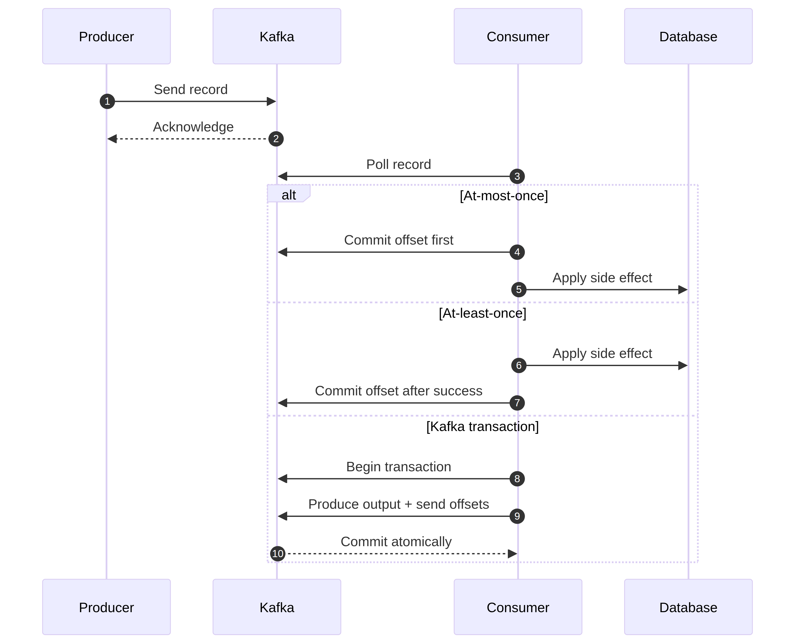

# Kafka Transactions

Kafka transactions let a producer group several Kafka writes and consumed-offset commits into one atomic Kafka operation. They are most useful when a service consumes from Kafka and produces to Kafka, or when Kafka Streams coordinates input offsets with output records. Transactions improve consistency, but they do not turn every external side effect into a distributed transaction.



## The consume-transform-produce pattern

A transactional processor reads an input record, creates one or more output records, sends them in a transaction, and sends the input offsets to the transaction. If the transaction commits, a downstream consumer configured with `isolation.level=read_committed` can see the output and the input group can move forward together. If it aborts, the output is discarded and the input can be retried.

```java
Properties properties = new Properties();
properties.put(ProducerConfig.BOOTSTRAP_SERVERS_CONFIG, "localhost:9092");
properties.put(ProducerConfig.KEY_SERIALIZER_CLASS_CONFIG, StringSerializer.class.getName());
properties.put(ProducerConfig.VALUE_SERIALIZER_CLASS_CONFIG, StringSerializer.class.getName());
properties.put(ProducerConfig.ENABLE_IDEMPOTENCE_CONFIG, "true");
properties.put(ProducerConfig.TRANSACTIONAL_ID_CONFIG, "order-enricher-instance-1");

try (KafkaProducer<String, String> producer = new KafkaProducer<>(properties)) {
    producer.initTransactions();
    producer.beginTransaction();
    try {
        producer.send(new ProducerRecord<>("orders-enriched", "order-42", "{...}"));
        // In a real consume-transform-produce loop, send the consumed offsets here.
        producer.commitTransaction();
    } catch (RuntimeException failure) {
        producer.abortTransaction();
        throw failure;
    }
}
```

A transactional ID must identify the logical producer instance in a way that prevents two active instances from sharing the same identity. Generate it from a stable application identity plus an instance or task identity. Reusing one ID across unrelated active instances can cause fencing.

## Read committed versus read uncommitted

Consumers using `read_committed` hide aborted transactional records and see only committed data. Consumers using `read_uncommitted` can see records from transactions that later abort. Choose the isolation level deliberately; otherwise one application may calculate results from records that another application considers invisible.

Transactions add coordination, timeouts, and operational requirements. Keep transactions bounded. A transaction that stays open while waiting for a slow remote service can hit the transaction timeout and cause retries or aborts.

## What Kafka transactions do not cover

A transaction does not automatically include a relational database commit, email provider, payment gateway, cache, or arbitrary HTTP call. If code updates a database and then commits a Kafka transaction, a crash between those actions can still leave the systems inconsistent.

For database-to-Kafka publishing, the transactional outbox pattern stores the business change and an outbox event in one database transaction. A relay then publishes the outbox event to Kafka and records delivery state. For Kafka-to-database consumption, an inbox or idempotency table can make repeated delivery safe. For irreversible external APIs, use provider idempotency keys and reconciliation.

## Operational safeguards

Monitor transaction abort rate, transaction duration, producer errors, fencing events, consumer lag, and output topic visibility. Set a transaction timeout that matches the expected processing time but does not hide stuck work. Use stable topic and schema contracts, and test broker restarts, producer restarts, consumer rebalances, timeout failures, and duplicate recovery.

Do not enable transactions simply because the word “exactly once” sounds attractive. First identify which records and offsets must be atomic, then decide whether the added latency and complexity are worth that guarantee.

<details><summary>What does `sendOffsetsToTransaction` solve?</summary>

It associates consumed offsets with the producer transaction. When the transaction commits, the output records and the consumer's progress become visible together to Kafka. When it aborts, the output is not committed and the input can be retried. This is useful for Kafka-to-Kafka processing, not for arbitrary external systems.

</details>

<details><summary>Why does a transactional ID need to be unique?</summary>

Kafka uses the transactional ID to identify a logical producer and fence an older instance when a replacement takes ownership. If unrelated active producers share an ID, one may fence the other and fail its transaction. If every restart gets a completely unrelated identity, fencing cannot protect against duplicate ownership in the same way.

</details>

<details><summary>Why can a transaction still produce duplicate external effects?</summary>

Kafka can atomically commit its own records and offsets, but an external database or HTTP service is outside that transaction. A crash after the external effect and before the Kafka commit can cause the input to be retried. Use an idempotency key, inbox/outbox, provider-supported transaction, or reconciliation process.

</details>

<details><summary>When is an outbox better than a Kafka transaction?</summary>

Use an outbox when the source of truth is a database and the business update and event publication must not diverge. The database transaction stores both the state change and an event record; a relay publishes it later. A Kafka transaction is more natural when both the input and output of the workflow are Kafka records.

</details>

## References

[Kafka transactions](https://kafka.apache.org/documentation/#transactions) [Kafka message delivery semantics](https://kafka.apache.org/documentation/#semantics) [Kafka producer configuration](https://kafka.apache.org/documentation/#producerconfigs) [Exactly-once semantics in Kafka Streams](https://developer.confluent.io/blog/guide-to-kafka-streams-exactly-once-transactions/)
