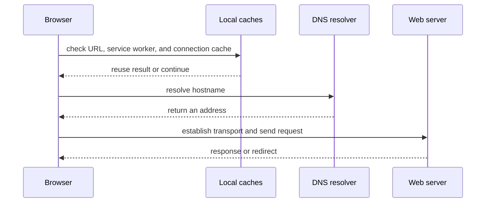
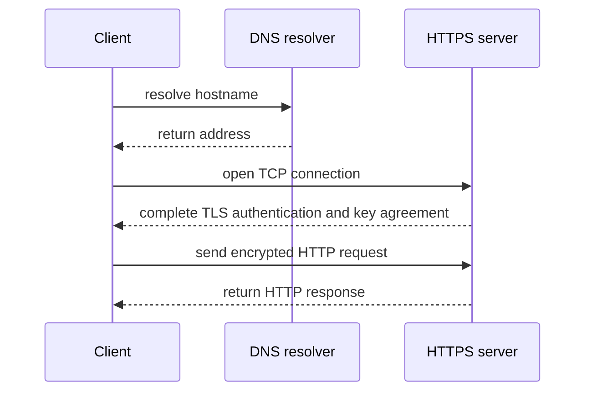

# Networking: follow one request from a name to a response

A network request is not one action. A browser parses a URL, identifies a hostname, asks local name-resolution layers for an address, establishes a transport connection, negotiates encryption when HTTPS is used, sends an application request, and then interprets a response. Redirects can repeat part of that journey with a new URL.

## Follow the lessons in order

1. **DNS & Registrars** explains domain ownership, URL and URI anatomy, hostname lookup, records, local caches, TTL, and practical Windows/macOS/Linux commands.
2. **TLS/SSL** explains certificate chains, browser trust, public CAs, local development certificates, and why blindly bypassing warnings is unsafe.
3. **Types of Protocols** compares HTTP/HTTPS, SMTP, FTP/SFTP, TCP, and UDP. “UUD” is not a commonly standardized Internet transport protocol; the transport topic below covers UDP, which is likely the intended term.
4. **Socket Connections** shows how application code opens TCP or UDP sockets and how a TCP connection is identified.
5. **Proxy Server** compares forward proxies with reverse proxies and explains where load balancers, gateways, and CDNs fit.
6. **Browser Request Walkthroughs** reproduces the two redirect traces in the request and follows each `Location` response to the final `200 OK`.

Every lesson keeps a short explanation beside runnable examples or copyable local terminal commands. A terminal command runs on your computer; a browser-based diagnostic runs from the CodeTrove page and can use a different resolver or network path.

## The essential order for HTTPS

For a fresh HTTPS connection, the browser must obtain or reuse an IP address before it can open a socket to the server. It then completes TCP setup (unless a different transport is used), performs TLS authentication and key agreement, and only after the secure channel is ready sends the HTTP request. Existing DNS answers, sockets, or TLS sessions may be reused, so not every page view repeats every handshake.

## Learn with diagrams and Markdown

[Markdown.org's tools directory](https://markdown.org/tools/) includes a browser-based Markdown editor, Mermaid diagrams, converters, formatters, and Markdown-to-image/PDF tools. The editor page is available inside CodeTrove at [Build → Tools → Markdown Editor](/build/tools/markdown-editor); if an external embed is blocked, use the official [Markdown tools directory](https://markdown.org/tools/) in the same page's built-in link.

Use the diagrams in these lessons as a quick visual map, then read each step: a diagram simplifies the flow and does not show every operating-system-specific cache, retry rule, proxy, or protocol variation.

## Start here

Open **Networking** in the Learn navigation and expand **DNS & Registrars**, **TLS/SSL**, **Types of Protocols**, **Socket Connections**, **Proxy Server**, or **Browser Request Walkthroughs**. Each topic has its own Markdown page, so its deep link can be shared and bookmarked.

Further reading: [Markdown.org tools](https://markdown.org/tools/); [RFC 1034: Domain Names—Concepts and Facilities](https://www.rfc-editor.org/rfc/rfc1034); [MDN: Redirections in HTTP](https://developer.mozilla.org/en-US/docs/Web/HTTP/Guides/Redirections).
