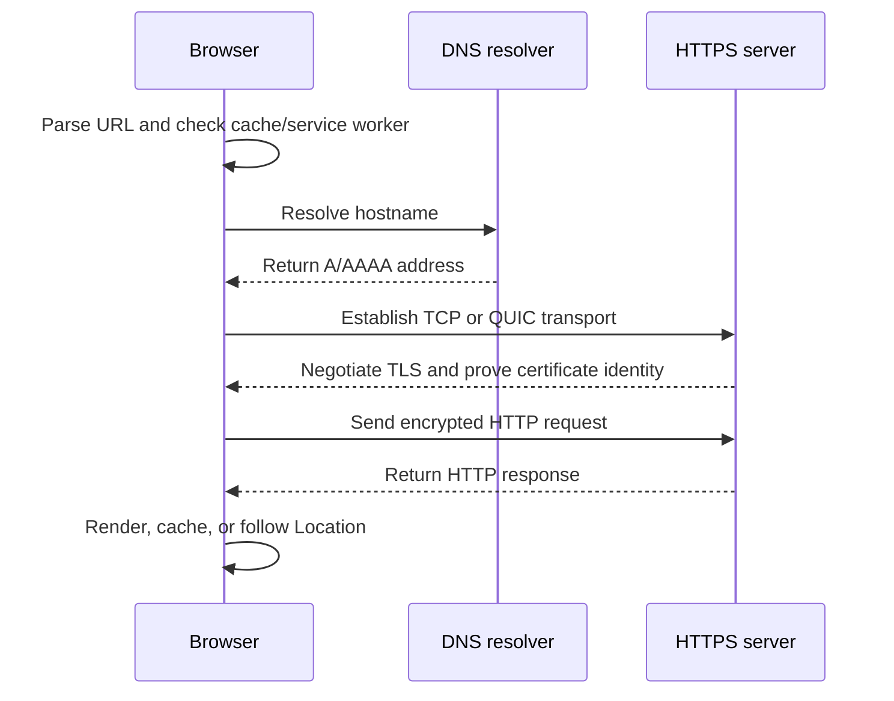
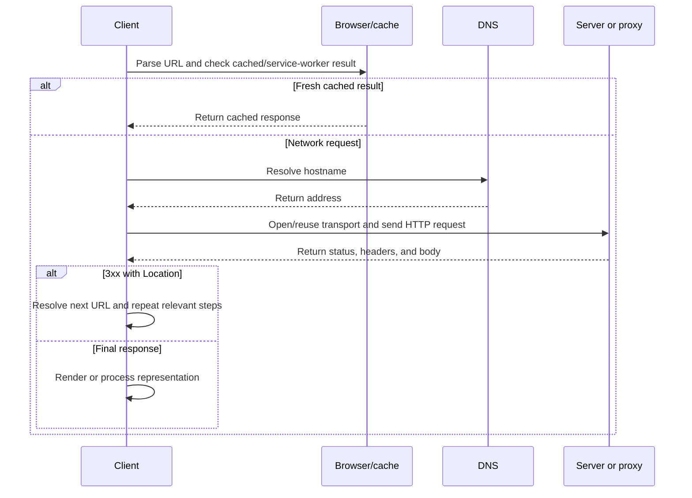

# HTTP vs HTTPS, URL, and HTTP Status Codes

HTTP is an application-layer request–response protocol. A client sends a request and a server, proxy, gateway, cache, or CDN returns a response. HTTPS uses the same HTTP semantics inside a TLS-protected connection.

> **Reading path:** URL → HTTP versus HTTPS → request lifecycle → HTTP/1.0 and HTTP/1.1 → redirect hop tables → expandable status codes → debugging examples.

## 1. URL: the address of a resource

A URL identifies the scheme, destination host, optional port, path, query, and client-side fragment.

```text
https://api.example.com:8443/users/42?view=summary#contact
\____/ \_____________/ \__/ \________/ \__________/ \______/
 scheme      host      port    path        query     fragment
```

| URL part | Example | What it means |
|---|---|---|
| Scheme | `https` | Protocol used to access the resource. |
| Host | `api.example.com` | Hostname resolved by DNS to one or more addresses. |
| Port | `8443` | Service port; HTTP commonly uses 80 and HTTPS 443. |
| Path | `/users/42` | Server-side route or resource identifier. |
| Query | `?view=summary` | Optional key/value input separated with `&`. |
| Fragment | `#contact` | Client-side location; not sent in the HTTP request. |

<details><summary>URL examples: absolute, relative, query, fragment, encoding, and browser state</summary>

An absolute URL can be used without surrounding context:

```text
https://developer.mozilla.org/en-US/docs/Web/HTTP
```

A relative URL is resolved against the current document:

```text
/images/logo.png
../api/users
```

A query value should be encoded independently:

```js
const url = new URL('https://api.example.com/search');
url.searchParams.set('q', 'HTTP status codes');
url.searchParams.set('page', '2');
console.log(url.toString());
```

A fragment such as `#redirects` is used by the browser after the response arrives and is not included in the request target. Cookies, `localStorage`, and `sessionStorage` have origin/domain scope rules; browser storage is not automatically sent as an HTTP header.

</details>

## 2. HTTP versus HTTPS

| Property | HTTP | HTTPS |
|---|---|---|
| Scheme and port | `http://`, usually 80 | `https://`, usually 443 |
| Transport protection | Bytes can be observed or changed in transit. | TLS provides encryption and integrity protection between TLS endpoints. |
| Certificate | Not required. | Client validates hostname, validity, chain, and trust policy. |
| Production use | Legacy, local, or deliberately public non-sensitive traffic. | Normal production websites and APIs. |



<details><summary>What HTTPS protects and what it does not</summary>

HTTPS protects confidentiality and integrity in transit and helps authenticate the requested hostname. It does not fix authorization bugs, XSS, CSRF, injection, leaked credentials, unsafe application logic, or a compromised server.

</details>

## 3. HTTP request and response

```http
POST /users HTTP/1.1
Host: api.example.com
Accept: application/json
Content-Type: application/json
Authorization: Bearer <token>

{"name":"Ada","email":"ada@example.com"}
```

```http
HTTP/1.1 201 Created
Content-Type: application/json
Location: /users/42

{"id":42,"name":"Ada"}
```

| Method | Typical purpose | Important note |
|---|---|---|
| `GET` | Read a representation. | Usually safe and idempotent. |
| `HEAD` | Read headers without a response body. | May be handled differently from `GET`. |
| `POST` | Submit data or trigger processing. | Retries may repeat the operation. |
| `PUT` | Create or replace a known target. | Intended to be idempotent. |
| `PATCH` | Apply a partial modification. | Idempotency depends on design. |
| `DELETE` | Remove a resource. | Intended to be idempotent. |
| `OPTIONS` | Discover options and CORS behavior. | Common preflight method. |
| `TRACE` | Diagnostic loop-back. | Usually disabled in production. |
| `CONNECT` | Establish a proxy tunnel. | Common for HTTPS tunneling. |

<details><summary>Marshalling, unmarshalling, and Java response example</summary>

Marshalling converts an object to JSON/XML; unmarshalling converts the representation back to an object. Serialization is often language-specific, while marshalling is broader in HTTP, REST, and RPC.

```java
@GetMapping("/users/{id}")
public ResponseEntity<User> getUser(@PathVariable Long id) {
    return userRepository.findById(id)
        .map(ResponseEntity::ok)                         // 200 OK
        .orElseGet(() -> ResponseEntity.notFound().build()); // 404 Not Found
}
```

</details>

## 4. HTTP/1.0 and HTTP/1.1

<details><summary>HTTP/1.0 — simple request/response and connection close</summary>

```http
GET /index.html HTTP/1.0
Host: example.com

```

| Feature | HTTP/1.0 |
|---|---|
| Request line | Method, target, and `HTTP/1.0`. |
| `Host` | Commonly sent, but not required by the original specification. |
| Connection reuse | Usually closes after each response unless extensions request keep-alive. |
| Framing | Does not have the HTTP/1.1 chunked-transfer model. |
| Effect | A page with many resources may need many TCP handshakes. |

</details>

<details><summary>HTTP/1.1 — persistent connections and Host routing</summary>

```http
GET /index.html HTTP/1.1
Host: example.com
Connection: keep-alive
Accept: text/html

```

| Feature | HTTP/1.1 |
|---|---|
| Request line | Method, target, and `HTTP/1.1`. |
| `Host` | Required so one IP can serve multiple hostnames. |
| Connection reuse | Persistent by default; `Connection: close` requests closure. |
| Framing | Supports chunked transfer coding. |
| Caching | Adds clearer validators and directives such as `ETag`, `If-None-Match`, and `Cache-Control`. |
| Conditional response | Can return `304 Not Modified` for a reusable cached representation. |
| Pipelining | Defined but difficult to deploy reliably because responses remain ordered. |

HTTP/2 and HTTP/3 improve multiplexing further, while HTTP methods, URLs, and status semantics remain familiar.

</details>

## 5. Request lifecycle and flow table



| Phase | What happens | What to inspect |
|---|---|---|
| 1. Parse URL | Separate scheme, host, port, path, query, fragment. | Fragment is not sent to server. |
| 2. Check local results | Check browser cache, service worker, hosts file, resolver cache. | Freshness and cache state. |
| 3. Resolve hostname | Ask recursive DNS for A/AAAA/CNAME data. | TTL, NXDOMAIN versus timeout. |
| 4. Establish transport | Reuse or create TCP; HTTP/3 may use QUIC. | Handshake, proxy, firewall, timing. |
| 5. Negotiate TLS | Authenticate endpoint and establish session keys for HTTPS. | SAN, issuer, validity, trust chain. |
| 6. Send request | Send method, path/query, headers, optional body. | URL, method, headers, remote address. |
| 7. Read response | Interpret status, headers, and body. | Status, `Location`, cache headers, trace ID. |
| 8. Redirect or render | Follow a safe redirect or process final representation. | Count, method preservation, final response. |

## 6. Redirect walkthroughs with the required hop table

The following are teaching traces. Live results can change with cache, browser, CDN, region, and server configuration.

<details><summary>GitHub Desktop — 301 → 301 → 200</summary>

```text
GET https://windows.github.com/
<- 301 Moved Permanently (from disk cache)
   Location: https://desktop.github.com/

GET https://desktop.github.com/
<- 301 Moved Permanently (from disk cache)
   Location: https://github.com/apps/desktop

GET https://github.com/apps/desktop
<- 200 OK
```

| Hop | Client sends | Server/cache answers | What the client does next |
|---:|---|---|---|
| 1 | `GET https://windows.github.com/` | `301 Moved Permanently`, `Location: https://desktop.github.com/`; disk cache in the teaching trace. | Request `https://desktop.github.com/`. |
| 2 | `GET https://desktop.github.com/` | `301 Moved Permanently`, `Location: https://github.com/apps/desktop`; disk cache in the teaching trace. | Request the new GitHub URL. |
| 3 | `GET https://github.com/apps/desktop` | `200 OK`. | Stop redirecting and render. |

A redirect is an HTTP response, not DNS finding another IP for the same URL. A new host may require new DNS, transport, and TLS work.

</details>

<details><summary>Java.com — 307 → 301 → 302 → 200</summary>

```text
GET http://java.com/
<- 307 Temporary Redirect
   Location: https://java.com/
   non-authoritative-reason: HttpsUpgrades

GET https://java.com/
<- 301 Moved Permanently
   Location: https://www.java.com/

GET https://www.java.com/
<- 302 Found
   Location: https://www.java.com/en/
   server: cloudflare

GET https://www.java.com/en/
<- 200 OK
   server: cloudflare
```

| Hop | Client sends | Server/cache answers | What the client does next |
|---:|---|---|---|
| 1 | `GET http://java.com/` | `307 Temporary Redirect`, `Location: https://java.com/`; `HttpsUpgrades` is browser-specific metadata. | Repeat over HTTPS. |
| 2 | `GET https://java.com/` | `301 Moved Permanently`, `Location: https://www.java.com/`. | Follow the permanent host change. |
| 3 | `GET https://www.java.com/` | `302 Found`, `Location: https://www.java.com/en/`, `server: cloudflare`. | Request the language path. |
| 4 | `GET https://www.java.com/en/` | `200 OK`, `server: cloudflare`. | Render the final response. |

</details>

<details><summary>AWS infrastructure — 301 → target URL</summary>

```text
GET https://infrastructure.aws/
<- 301 Moved Permanently
   Location: https://aws.amazon.com/about-aws/global-infrastructure/regions_az/
```

| Hop | Client sends | Server/cache answers | What the client does next |
|---:|---|---|---|
| 1 | `GET https://infrastructure.aws/` | `301 Moved Permanently` with the AWS `Location`. | Request the target; it may have later redirects. |

</details>

<details><summary>Medium — redirect and gateway-timeout examples</summary>

| Example URL | Observed status in the teaching material | Interpretation |
|---|---:|---|
| `https://medium.com/browse/top` | `301` | Redirects toward `https://medium.com/`. |
| `https://medium.com/` | Final body in the trace | The body can still be a temporary error or maintenance page. |
| `https://mails2abhinand.medium.com/exploiting-functional-parallelism-with-kafka-2c252160c24c` | `504` | A gateway/proxy did not receive a timely upstream response. |

</details>

<details><summary>Additional URL examples from the status-code walkthrough</summary>

| Example URL | Related teaching example |
|---|---|
| `https://yash-777.github.io/` | A historical `404 Not Found` example; live GitHub Pages responses can change. |
| `https://www.paysafe.com/careers/` | A `404 Not Found` page example with human-facing “page cannot be found” text. |
| `https://pool.sks-keyservers.net/` | Used beside a `421 Misdirected Request` example. |
| `http://www.grepcode.com/file/repository.grepcode.com/java/root/jdk/openjdk/8-b132/java/util/concurrent/Callable.java` | Mentioned beside a `503 Service Unavailable` example; live status is not guaranteed. |

</details>

## 7. Status-code classes

| Class | Range | Meaning |
|---|---:|---|
| `1xx` | 100–199 | Informational; processing continues. |
| `2xx` | 200–299 | Succeeded or accepted. |
| `3xx` | 300–399 | Redirect or cache-related action. |
| `4xx` | 400–499 | Request/client-side condition cannot be fulfilled. |
| `5xx` | 500–599 | Server or upstream failure. |

A code is not the entire diagnosis. Inspect method, URL, headers, response body, `Location`, cache, intermediary, trace ID, and logs.

## 7A. Every status code — expandable reference

The summary tables are followed by one expandable section for every code covered here. Framework, vendor, and provider-specific values are labelled as such.

<details>
<summary>1xx — informational: expand every code</summary>

<details><summary><code>100 Continue</code></summary>

The client may continue sending the request body after the server receives headers.

</details>

<details><summary><code>101 Switching Protocols</code></summary>

The server agrees to switch protocols after Upgrade.

</details>

<details><summary><code>102 Processing</code></summary>

A deprecated WebDAV interim response.

</details>

<details><summary><code>103 Early Hints</code></summary>

Early Link headers can enable preload or preconnect.

</details>

<details><summary><code>104 Upload Resumption Supported</code></summary>

A temporary registered extension; support is not universal.

</details>

</details>

<details>
<summary>2xx — successful: expand every code</summary>

<details><summary><code>200 OK</code></summary>

The request succeeded.

</details>

<details><summary><code>201 Created</code></summary>

A new resource was created.

</details>

<details><summary><code>202 Accepted</code></summary>

The request was accepted for asynchronous processing.

</details>

<details><summary><code>203 Non-Authoritative Information</code></summary>

The response came from a transforming or third-party copy.

</details>

<details><summary><code>204 No Content</code></summary>

The operation succeeded without a response representation.

</details>

<details><summary><code>205 Reset Content</code></summary>

The client should reset its view.

</details>

<details><summary><code>206 Partial Content</code></summary>

A requested byte range was returned.

</details>

<details><summary><code>207 Multi-Status</code></summary>

A WebDAV result describes multiple resources.

</details>

<details><summary><code>208 Already Reported</code></summary>

A WebDAV response avoids repeated members.

</details>

<details><summary><code>218 This Is Fine</code></summary>

Non-standard Apache-style example.

</details>

<details><summary><code>226 IM Used</code></summary>

A GET response used instance manipulations.

</details>

</details>

<details>
<summary>3xx — redirection: expand every code</summary>

<details><summary><code>300 Multiple Choices</code></summary>

More than one representation or target is available.

</details>

<details><summary><code>301 Moved Permanently</code></summary>

The resource moved permanently; inspect Location.

</details>

<details><summary><code>302 Found</code></summary>

The resource is temporarily available at another URI.

</details>

<details><summary><code>303 See Other</code></summary>

Retrieve the target with GET.

</details>

<details><summary><code>304 Not Modified</code></summary>

Reuse the validated cached representation.

</details>

<details><summary><code>305 Use Proxy</code></summary>

Deprecated due to security concerns.

</details>

<details><summary><code>306 Unused</code></summary>

Reserved and no longer used.

</details>

<details><summary><code>307 Temporary Redirect</code></summary>

Preserve the original method and body.

</details>

<details><summary><code>308 Permanent Redirect</code></summary>

Preserve the original method and body.

</details>

</details>

<details>
<summary>4xx — client errors: expand every code</summary>

<details><summary><code>400 Bad Request</code></summary>

The request syntax, JSON, or parameters are invalid.

</details>

<details><summary><code>401 Unauthorized</code></summary>

Acceptable authentication is missing or invalid.

</details>

<details><summary><code>402 Payment Required</code></summary>

Reserved or product-specific payment policy.

</details>

<details><summary><code>403 Forbidden</code></summary>

The server refuses authorization.

</details>

<details><summary><code>404 Not Found</code></summary>

The resource is missing, moved, deleted, or hidden.

</details>

<details><summary><code>405 Method Not Allowed</code></summary>

The method is unsupported for the target.

</details>

<details><summary><code>406 Not Acceptable</code></summary>

No representation meets Accept constraints.

</details>

<details><summary><code>407 Proxy Authentication Required</code></summary>

The client must authenticate with the proxy.

</details>

<details><summary><code>408 Request Timeout</code></summary>

The server did not receive a complete request in time.

</details>

<details><summary><code>409 Conflict</code></summary>

The request conflicts with current resource state.

</details>

<details><summary><code>410 Gone</code></summary>

The resource is intentionally permanently unavailable.

</details>

<details><summary><code>411 Length Required</code></summary>

The server requires Content-Length.

</details>

<details><summary><code>412 Precondition Failed</code></summary>

A request precondition did not pass.

</details>

<details><summary><code>413 Content Too Large</code></summary>

The request exceeds a size limit.

</details>

<details><summary><code>414 URI Too Long</code></summary>

The request target is too long.

</details>

<details><summary><code>415 Unsupported Media Type</code></summary>

The request body format is unsupported.

</details>

<details><summary><code>416 Range Not Satisfiable</code></summary>

The requested range cannot be served.

</details>

<details><summary><code>417 Expectation Failed</code></summary>

The server cannot meet the expectation.

</details>

<details><summary><code>418 Unused / I'm a teapot</code></summary>

A joke or compatibility example; registry marks it unused.

</details>

<details><summary><code>419 Page Expired</code></summary>

A framework-specific session or CSRF example.

</details>

<details><summary><code>420 Method Failure / Enhance Your Calm</code></summary>

A framework or service-specific example.

</details>

<details><summary><code>421 Misdirected Request</code></summary>

The server cannot serve the target authority.

</details>

<details><summary><code>422 Unprocessable Content</code></summary>

Syntax is valid but content cannot be processed.

</details>

<details><summary><code>423 Locked</code></summary>

A WebDAV resource is locked.

</details>

<details><summary><code>424 Failed Dependency</code></summary>

A WebDAV action failed first.

</details>

<details><summary><code>425 Too Early</code></summary>

The server will not risk replaying an early request.

</details>

<details><summary><code>426 Upgrade Required</code></summary>

The client should use another protocol or version.

</details>

<details><summary><code>428 Precondition Required</code></summary>

The server requires a conditional request.

</details>

<details><summary><code>429 Too Many Requests</code></summary>

The client exceeded a rate limit; inspect Retry-After.

</details>

<details><summary><code>431 Request Header Fields Too Large</code></summary>

The request headers are too large.

</details>

<details><summary><code>440 Login Time-out</code></summary>

A Microsoft/IIS-style extension.

</details>

<details><summary><code>449 Retry With</code></summary>

A Microsoft-style extension.

</details>

<details><summary><code>450 Blocked by Windows Parental Controls</code></summary>

A Microsoft-style extension.

</details>

<details><summary><code>451 Unavailable For Legal Reasons</code></summary>

Access is legally restricted.

</details>

<details><summary><code>498 Invalid Token</code></summary>

A vendor-specific token error.

</details>

<details><summary><code>499 Token Required</code></summary>

A vendor-specific token error.

</details>

</details>

<details>
<summary>5xx — server errors: expand every code</summary>

<details><summary><code>500 Internal Server Error</code></summary>

An unexpected application failure occurred.

</details>

<details><summary><code>501 Not Implemented</code></summary>

The server lacks the required functionality.

</details>

<details><summary><code>502 Bad Gateway</code></summary>

A gateway received an invalid upstream response.

</details>

<details><summary><code>503 Service Unavailable</code></summary>

The service is overloaded, restarting, or under maintenance.

</details>

<details><summary><code>504 Gateway Timeout</code></summary>

A gateway did not receive a timely upstream response.

</details>

<details><summary><code>505 HTTP Version Not Supported</code></summary>

The server does not support the request version.

</details>

<details><summary><code>506 Variant Also Negotiates</code></summary>

A content-negotiation configuration error.

</details>

<details><summary><code>507 Insufficient Storage</code></summary>

A WebDAV server cannot store the representation.

</details>

<details><summary><code>508 Loop Detected</code></summary>

WebDAV processing detected an infinite loop.

</details>

<details><summary><code>509 Bandwidth Limit Exceeded</code></summary>

An Apache/cPanel-style extension.

</details>

<details><summary><code>510 Not Extended</code></summary>

An obsoleted extension code.

</details>

<details><summary><code>511 Network Authentication Required</code></summary>

The client needs network authentication.

</details>

<details><summary><code>521 Web Server Is Down</code></summary>

A Cloudflare-style extension.

</details>

<details><summary><code>526 Invalid SSL Certificate</code></summary>

A Cloudflare-style origin certificate extension.

</details>

<details><summary><code>530 Site Is Frozen / Origin DNS Error</code></summary>

A service-provider-specific extension.

</details>

<details><summary><code>598 Network Read Timeout</code></summary>

An informal provider convention.

</details>

</details>


## 8. Error response design

A useful API error response normally contains the HTTP status, stable application code, safe message, validation details when appropriate, and a correlation ID.

```java
public enum ApiStatus {
    SUCCESS("200", "Success"),
    HTTP_METHOD_NOT_SUPPORTED("400", "HTTP method not supported"),
    INTERNAL_SERVER_ERROR("500", "Internal server error"),
    REQUIRED_FIELDS_VALIDATION_ERRORS("1001", "Some required fields are blank");

    private final String code;
    private final String message;

    ApiStatus(String code, String message) {
        this.code = code;
        this.message = message;
    }
}
```

`1001` and `4001`-style values can be application codes, but they are not HTTP status codes. Put them inside an appropriate HTTP response such as `400`, `401`, or `500`.

## 9. Inspect the flow locally

```bash
curl -sS -D - -o /dev/null -L --max-redirs 10 https://windows.github.com/
curl -sS -D - -o /dev/null -L --max-redirs 10 https://java.com/
curl -sS -D - -o /dev/null https://infrastructure.aws/
curl.exe -sS -D - -o NUL -L --max-redirs 10 https://windows.github.com/
curl -sS -w '\nHTTP status: %{http_code}\n' -H 'Accept: application/json' https://api.example.com/users/42
```

`-D -` prints headers, `-o /dev/null` or `-o NUL` discards the body, and `-L` follows redirects. `-I` sends `HEAD`, which can behave differently from `GET`. `curl` does not reproduce browser disk-cache entries, service workers, or browser-specific HTTPS-upgrade labels.

## 10. Expandable questions

<details><summary>Does a redirect perform DNS?</summary>A redirect is an HTTP response. If the Location host is new, the client may perform DNS, transport, and TLS work for that host. A cached redirect can avoid a fresh request.</details>

<details><summary>Why is the Java.com teaching flow 307 → 301 → 302 → 200?</summary>The trace first upgrades HTTP to HTTPS, changes to the `www` host, adds a language path, and then returns the page. Each hop is a separate URL request.</details>

<details><summary>What is the difference between 401 and 403?</summary>`401` means acceptable authentication was not supplied. `403` means the server understood the request but refuses authorization. Some applications return `404` to avoid revealing protected resources.</details>

<details><summary>When should 307 or 308 be used?</summary>Use them when the original method and body must be preserved. Use `303` when the follow-up must be a `GET`.</details>

<details><summary>Are all codes in old lists standard?</summary>No. IANA-registered codes differ from framework, vendor, proxy, CDN, and product extensions such as `218`, `419`, `440`, `449`, `450`, `498`, `499`, `509`, `521`, `526`, `530`, and `598`.</details>

## References

[MDN: What is a URL?](https://developer.mozilla.org/en-US/docs/Learn_web_development/Howto/Web_mechanics/What_is_a_URL) [MDN: HTTP response status codes](https://developer.mozilla.org/en-US/docs/Web/HTTP/Reference/Status) [RFC 9110: HTTP Semantics](https://www.rfc-editor.org/rfc/rfc9110) [IANA: HTTP Status Code Registry](https://www.iana.org/assignments/http-status-codes/http-status-codes.xhtml) [CodeTrove Networking overview](/content/tree/networking) [CodeTrove Browser Request Walkthroughs](/content/tree/networking/browser-request-flow)
