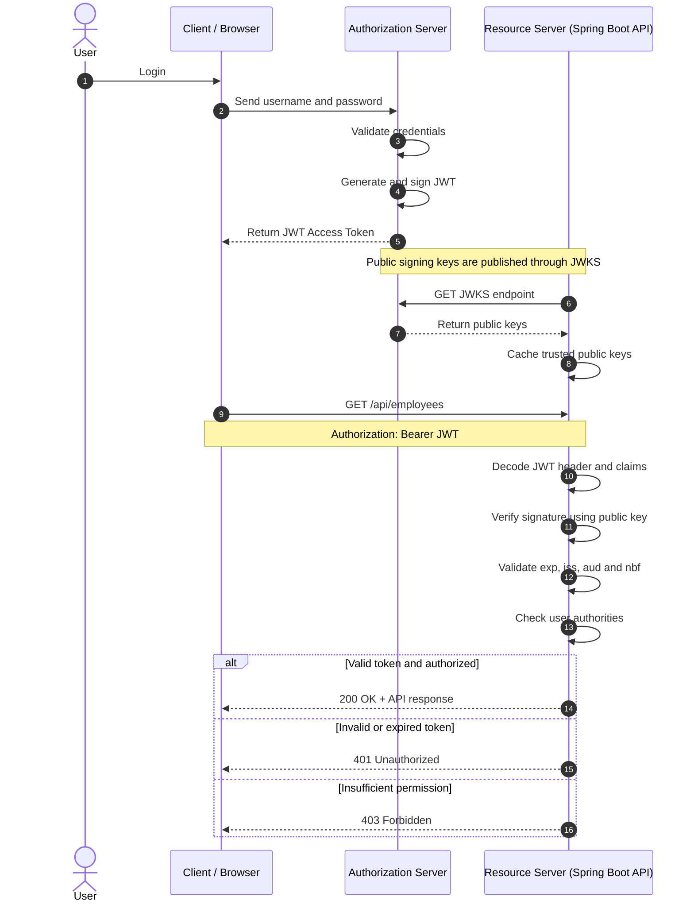
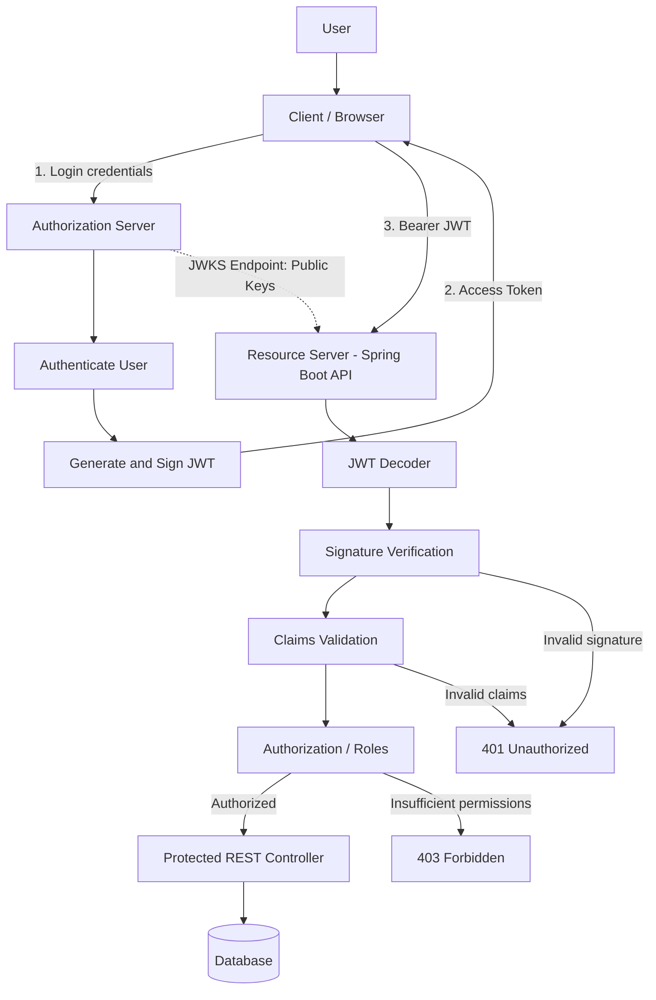

# JSON Web Token (JWT)

## 1. What is JSON Web Token?

JSON Web Token (JWT) is an open standard ([RFC 7519](https://www.rfc-editor.org/rfc/rfc7519)) used to securely transmit information between parties as a JSON-based token.

It is commonly used for authentication, authorization and information exchange.

**Example:**

After successful login, the Authorization Server generates a signed JWT and returns it to the client. The client sends this token when accessing protected APIs.

## 2. Why do we use JWT?

JWT is commonly used for:

- **Authentication:** To represent an authenticated user's identity.
- **Authorization:** To provide claims that help determine whether a user can access a resource.
- **Information Exchange:** To transmit claims between parties with integrity protection when properly signed and verified.

**Example:**

An employee logs in and receives a JWT containing the user's ID and role. The Resource Server validates the token and checks whether the employee is allowed to access the requested resource.

## 3. What is the structure of a JWT?

A signed JWT (JWS compact format) typically contains three parts separated by dots (`.`).

| JWT three parts | Example |
| :-- | :-- |
| `Header.Payload.Signature` | `xxxxx.yyyyy.zzzzz` |

The three parts are:

1. **Header**
2. **Payload**
3. **Signature**

## 4. What is the JWT Header?

The header contains metadata about the token, such as the token type and signing algorithm.

**Example:**

```json
{
  "alg": "RS256",
  "typ": "JWT",
  "kid": "key-123"
}
```

- `alg`: Signing algorithm.
- `typ`: Token type.
- `kid`: Key ID used to identify the signing key.

The header JSON is Base64URL-encoded to form the first part of the JWT.

## 5. What is the JWT Payload?

The payload contains **claims**, which are statements about an entity (typically the user) and additional information.

**Example:**

```json
{
  "sub": "employee123",
  "role": "ADMIN",
  "iss": "https://auth.example.com",
  "aud": "employee-api",
  "iat": 1793520000,
  "exp": 1793523600
}
```

### Types of JWT Claims

- **Registered claims:** Standard claim names defined by the JWT specification.
- **Public claims:** Claims designed to be collision-resistant, for example, using registered names or collision-resistant namespaces.
- **Private claims:** Custom claims agreed upon by the parties.

### Common Registered Claims

| Claim | Description |
| :-- | :-- |
| `iss` | Issuer (who issued the token) |
| `sub` | Subject (who the token is about) |
| `aud` | Audience (intended recipient) |
| `exp` | Expiration time |
| `iat` | Issued-at time |
| `nbf` | Not-before time |
| `jti` | Unique token identifier |

The payload JSON is Base64URL-encoded to form the second part.

**Important:**

A typical signed JWT payload is readable by anyone who obtains the token.

- Base64URL encoding is not encryption.
- Do not store passwords, secrets or sensitive personal data in the payload.
- Signing protects integrity; it does not hide the claims.

## 6. What is the JWT Signature?

The signature helps verify that the token has not been modified and that it was signed using a trusted key.

For example, with HS256:

```text
HMAC-SHA256(
  base64UrlEncode(header) + "." +
  base64UrlEncode(payload),
  secret
)
```

### Common Signing Algorithms

| Algorithm | Description |
| :-- | :-- |
| `HS256` | HMAC using SHA-256 and a shared secret |
| `RS256` | RSA signature using SHA-256 |
| `ES256` | ECDSA signature using SHA-256 |

- **HS256:** The issuer and verifier share a secret key.
- **RS256 / ES256:** The issuer signs using a private key, and the verifier uses the corresponding public key.

**Important:**

A valid signature alone does not guarantee that a token is safe to use. The API must also validate the claims and apply authorization rules.

## 7. Difference Between JWT Encoding and Decoding

### 7.1 JWT Encoding

Encoding converts the JWT header and payload JSON into Base64URL-encoded strings.

For a signed JWT:

1. Create the header JSON.
2. Create the payload JSON.
3. Base64URL-encode the header and payload.
4. Sign the encoded header and payload using the selected algorithm and key.
5. Base64URL-encode the signature.
6. Join all three parts using dots (`.`).

```text
header.payload.signature
```

**Important:** Encoding alone does not create a secure JWT. Signing requires a cryptographic algorithm and key.

### 7.2 JWT Decoding

Decoding converts the Base64URL-encoded header and payload back into readable JSON.

**Example decoded payload:**

```json
{
  "sub": "employee123",
  "role": "ADMIN"
}
```

Anyone who obtains a typical signed JWT can decode its header and payload without a key.

- Decoding does not verify the signature.
- Decoding does not prove that the token is genuine.
- Do not trust claims until the token has been securely verified and validated.

### 7.3 Encoding vs Decoding

| Feature | Encoding | Decoding |
| :-- | :-- | :-- |
| Purpose | Convert data into token representation | Read encoded token data |
| Input | Header and payload JSON | Encoded JWT parts |
| Output | Encoded representation | Readable header and payload |
| Key required? | Signing requires a key | Decoding alone does not require a key |
| Signature verification? | Signing creates a signature | Decoding alone does not verify it |

## 8. Difference Between JWT Verification and Validation

JWT verification and validation are related security checks. Their exact terminology can vary between libraries and documentation.

- **Verification:** Checks whether the JWT's signature is valid using the expected key and permitted algorithm.
- **Validation:** Checks whether the token meets the application's security requirements, including its claims and usage rules.

### 8.1 JWT Verification

Verification checks the authenticity and integrity of the token.

Common checks:

- **Signature verification:** Verify the signature using the expected secret or public key.
- **Algorithm verification:** Allow only explicitly configured algorithms.
- **Trusted signing key:** Ensure the key belongs to a trusted issuer.

### 8.2 JWT Validation

Validation checks whether the token is acceptable for the current application.

Common checks:

- **Expiration (`exp`):** Reject expired tokens.
- **Not Before (`nbf`):** Reject tokens that are not yet valid.
- **Issuer (`iss`):** Match the expected issuer.
- **Audience (`aud`):** Match the intended API or recipient.
- **Subject (`sub`):** Check application-specific subject requirements, if applicable.
- **Authorization:** Check roles or permissions before granting access.

### 8.3 Example

Suppose an employee has a JWT containing:

```json
{
  "sub": "employee123",
  "role": "ADMIN",
  "iss": "https://auth.example.com",
  "aud": "employee-api",
  "exp": 1793523600
}
```

When accessing `GET /api/employees`:

1. Verify the signature using the trusted key.
2. Validate the issuer, audience and expiration.
3. Check whether the employee has permission to access the API.
4. Return the response if all required checks pass.

**Interview Answer:**

Verification checks whether the JWT signature is valid and its integrity can be trusted. Validation checks whether the token's claims and application requirements are satisfied. In practice, JWT libraries often perform these checks together.

## 9. How does JWT Authentication work?

JWT authentication generally involves three main components:

1. **Client:** Browser, mobile application or frontend.
2. **Authorization Server:** Authenticates users and generates signed JWT access tokens.
3. **Resource Server:** Hosts protected APIs and verifies JWT access tokens.

### 9.1 JWT Authentication – UML Sequence Diagram



**Important:** The Resource Server typically does not contact the Authorization Server for every API request. It verifies JWT signatures locally using trusted public keys obtained through JWKS.

### 9.2 JWT Authentication – UML Component Diagram



### 9.3 Real-World Example

Suppose an employee logs in to a company application.

- User: `employee123`
- Role: `ADMIN`
- Authorization Server: `https://auth.example.com`
- Resource Server: `https://api.example.com`
- Protected API: `GET /api/employees`

The Authorization Server issues a JWT.

**Example decoded payload:**

```json
{
  "sub": "employee123",
  "role": "ADMIN",
  "iss": "https://auth.example.com",
  "aud": "employee-api",
  "exp": 1793523600
}
```

The client calls:

```http
GET /api/employees
Host: api.example.com
Authorization: Bearer <access_token>
```

The Resource Server:

1. Reads the JWT from the Authorization header.
2. Verifies the JWT signature using the trusted public key.
3. Validates the expiration, issuer and audience.
4. Checks whether the employee has permission.
5. Processes the API request if all security checks pass.

| Scenario | HTTP Status |
| :-- | :-- |
| Valid token and authorized | `200 OK` |
| Missing or invalid token | `401 Unauthorized` |
| Authenticated but insufficient permission | `403 Forbidden` |

### 9.4 Who does what?

| Component | Responsibility |
| :-- | :-- |
| Authorization Server | Authenticates user and issues signed JWT |
| Client | Sends JWT as Bearer token |
| Resource Server | Verifies JWT signature and validates claims |
| JWKS Endpoint | Publishes public keys for token verification |
| JWT Decoder | Decodes token and verifies its signature through configured validation |
| REST API | Processes authorized requests |

### 9.5 How does Resource Server get the public key?

When the Authorization Server issues an RS256-signed JWT, it signs using its private key.

The Resource Server needs the corresponding public key to verify the signature.

The Authorization Server publishes its public keys through a JWKS endpoint.

Example:

```text
Authorization Server
        |
        | Publishes public keys
        v
https://auth.example.com/.well-known/jwks.json
        |
        v
Resource Server
        |
        | Retrieves and caches public keys
        v
Verifies JWT locally
```

The JWT header can contain a `kid` (Key ID). The Resource Server uses it to select the appropriate public key from the trusted JWKS.

**Key points:**

- Private key: Used by Authorization Server to sign JWT.
- Public key: Used by Resource Server to verify JWT.
- JWKS: JSON Web Key Set containing public keys.
- `kid`: Identifies which signing key was used.
- Key rotation: Resource Server must refresh its trusted keys when signing keys change.

### 9.6 Spring Boot Resource Server Configuration

For a Spring Boot Resource Server, configure the issuer URI:

```yaml
spring:
  security:
    oauth2:
      resourceserver:
        jwt:
          issuer-uri: https://auth.example.com
```

Spring Security can discover the Authorization Server metadata and obtain its signing keys through the configured issuer.

Alternatively, configure the JWKS endpoint directly:

```yaml
spring:
  security:
    oauth2:
      resourceserver:
        jwt:
          jwk-set-uri: https://auth.example.com/.well-known/jwks.json
```

Use the actual JWKS endpoint provided by your Authorization Server.

**Example dependency:**

```xml
<dependency>
    <groupId>org.springframework.boot</groupId>
    <artifactId>spring-boot-starter-oauth2-resource-server</artifactId>
</dependency>
```

Spring Security provides JWT decoding and authentication support through its Resource Server functionality.

### 9.7 Interview Questions

**Q1. Does Resource Server call Authorization Server for every API request?**

No. Typically, the Resource Server retrieves and caches the public signing keys from the JWKS endpoint and verifies JWT signatures locally.

**Q2. Why does Resource Server use a public key?**

The Authorization Server signs the JWT using its private key. The Resource Server uses the corresponding public key to verify the signature.

**Q3. What happens if the signing key changes?**

The Authorization Server publishes the new public key through JWKS. The Resource Server must refresh its cached keys and use the JWT's `kid` to identify the correct key.

**Q4. Can Resource Server verify HS256 tokens?**

Yes. It needs the same shared secret used by the Authorization Server. With RS256, Resource Servers only need the public key and cannot sign tokens using it.

**Q5. Is JWT signature verification enough?**

No. The Resource Server must also validate issuer, audience, expiration and other required claims, followed by authorization checks.

## 10. Is JWT Authentication Stateless?

JWT-based authentication can be stateless when the API validates tokens locally without retrieving session state from a database or centralized session store on every request.

However, JWT does not automatically make an application stateless.

Examples:

- Token revocation may require a denylist or other server-side state.
- Authorization may require database lookups.
- Refresh tokens may be managed using server-side storage.

## 11. Is JWT Encrypted?

A typical signed JWT is not encrypted.

| Type | Purpose |
| :-- | :-- |
| JWS (Signed JWT) | Integrity protection and signature-based authenticity verification |
| JWE (Encrypted JWT) | Confidentiality protection |
| Signed and encrypted JWT | Can provide both protections |

**Remember:**

- Encoding is not encryption.
- Signing is not encryption.
- Encryption hides content from parties without the required decryption key.

## 12. Where should we store JWT on the client?

Token storage depends on the application architecture.

- Avoid storing sensitive session tokens in `localStorage` when possible because JavaScript-accessible storage can be exposed by XSS.
- `HttpOnly`, `Secure`, appropriately configured cookies can reduce token theft through JavaScript.
- Cookie-based authentication requires appropriate CSRF protections.
- Protect tokens in transit using HTTPS.
- Keep access tokens short-lived and design refresh-token handling carefully.

## 13. JWT vs Session-Based Authentication

| Feature | JWT-Based | Session-Based |
| :-- | :-- | :-- |
| Client sends | Token | Session ID |
| Server state | Can be stateless | Usually maintains session state |
| Revocation | Requires additional design | Often easier to invalidate |
| Scalability | Can simplify distributed validation | Requires shared or coordinated session storage |
| Common use | APIs, distributed services | Traditional web applications |

Neither approach is always better. Choose based on security and application requirements.

## 14. JWT Security Checks: Remember This

| Operation | What it does |
| :-- | :-- |
| Encoding | Converts data into Base64URL representation |
| Signing | Creates a cryptographic signature |
| Decoding | Reads the encoded header and payload |
| Verification | Checks signature authenticity and integrity |
| Validation | Checks claims and application security requirements |
| Authorization | Checks whether the user can perform the requested action |

### Learning Order

**Encoding → Signing → Decoding → Verification → Validation → Authorization**

This order helps understand the token lifecycle.

**Note:** This is a learning order, not the exact runtime order. In a real API, verify the signature before trusting the claims, then validate the claims and perform authorization.

## 15. Interview Question: What is JWT?

**Answer:**

JWT is an open standard used to transmit claims between parties.

A typical signed JWT consists of three parts: Header, Payload and Signature.

In my application, after successful login, the Authorization Server generates a signed JWT. The client sends it through the Authorization Bearer header for subsequent API requests.

The Resource Server verifies the signature using trusted signing keys, validates the required claims and checks the user's permissions before providing access to protected resources.

## 16. Useful References

- [JWT Introduction – Auth0](https://jwt.io/introduction)
- [RFC 7519 – JSON Web Token](https://www.rfc-editor.org/rfc/rfc7519)
- [RFC 7515 – JSON Web Signature](https://www.rfc-editor.org/rfc/rfc7515)
- [RFC 7516 – JSON Web Encryption](https://www.rfc-editor.org/rfc/rfc7516)
- [Spring Security – OAuth2 Resource Server JWT](https://docs.spring.io/spring-security/reference/servlet/oauth2/resource-server/jwt.html)
- [OWASP HTML5 Security Cheat Sheet](https://cheatsheetseries.owasp.org/cheatsheets/HTML5_Security_Cheat_Sheet.html)
