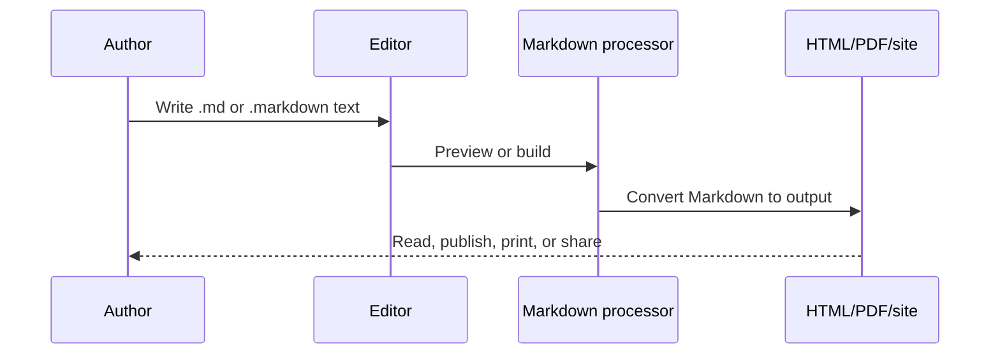
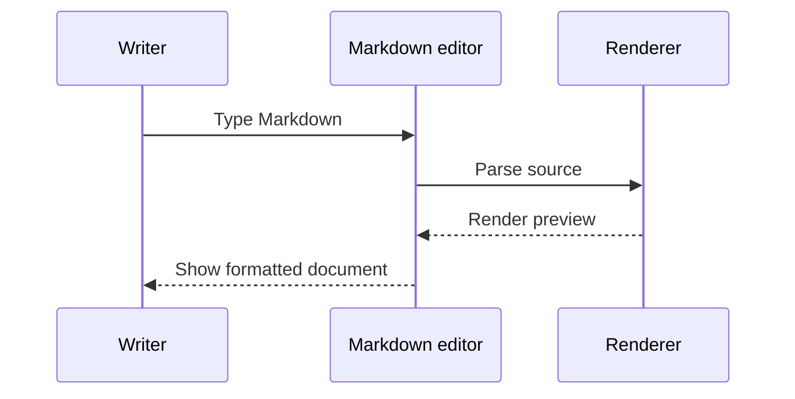
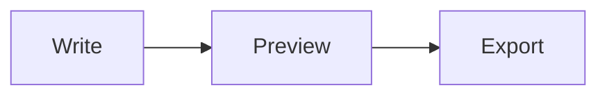

# 📘 Markdown: Readable Documents from Plain Text

Markdown is a lightweight markup language for writing structured documents in plain text. You add small, readable markers to headings, emphasis, links, code, lists, and other elements, then a Markdown processor converts the file into HTML or another output format. A Markdown file normally uses the `.md` or `.markdown` extension.

Markdown was designed to remain useful even before it is rendered. The source should be easy to read in a text editor, easy to review in Git, and easy to move between tools. The original design goal is described by [John Gruber's Markdown syntax reference](https://daringfireball.net/projects/markdown/).

> [!IMPORTANT]
> Markdown is a family of related syntaxes rather than one perfectly identical language. Learn the portable CommonMark core first, then confirm which GitHub Flavored Markdown (GFM), HTML, or processor-specific extensions your target supports.

## What Markdown is good for

Markdown is used for README files, technical documentation, issue descriptions, project notes, websites, books, presentations, email, team messages, and knowledge bases. It is portable because the source is plain text, platform independent because it can be edited anywhere, and future-friendly because the original text remains readable without a special application.

A typical Markdown workflow is:

<table>
  <tr>
    <th>Write Markdown</th>
    <th>Render preview</th>
  </tr>

  <tr> <td>
  
````md

````

</td><td>


</td> </tr>

</table>

A processor parses the source into blocks and inline elements, then renders those elements. In CodeTrove, `react-markdown` renders the document and GitHub-flavored extensions are enabled where supported.

> [!NOTE]
> The Markdown application and processor are two separate components. For the sake of brevity, I've combined them into one element ("Markdown app") in the figure below.


## Create your first file

Create a file named `README.md`, `notes.md`, or `guide.markdown`. Start with a heading and a paragraph:

```markdown
# My project

This document explains how to install and use the project.
```

You can edit Markdown in a normal text editor, an IDE, or a dedicated editor with a live preview. The [Markdown tools directory](https://markdown.org/tools/) lists browser-based tools, editors, and converters. CodeTrove also provides an in-app Markdown editor under **Build → Diagrams / Editors tools**.

<details>
<summary>Where can Markdown be used?</summary>

Markdown can generate a website through a static-site generator such as [Jekyll](https://jekyllrb.com/), a documentation site with [MkDocs](https://www.mkdocs.org/) or [Read the Docs](https://readthedocs.org/), a book with [Leanpub](https://leanpub.com/), a presentation with [Marp](https://marp.app/), or a shared note in tools such as [Obsidian](https://obsidian.md/) and [Joplin](https://joplinapp.org/). The exact syntax and extensions depend on the processor.

</details>

## Portable Markdown basics

The examples in this section are useful in nearly every Markdown implementation. Keep a blank line around block elements when portability matters.

### Headings

Use one to six `#` characters followed by a space. The number of markers indicates the heading level.

```markdown
# Page title
## Major section
### Subsection
#### Detail
```

Use one H1 for the page title, then increase the level in order. Do not skip from H1 to H4 just to change the font size. Some processors also support setext headings:

```markdown
Heading level 1
================

Heading level 2
----------------
```

Always include the space after the `#` markers and place blank lines before and after headings. This avoids differences between Markdown processors.

### Paragraphs and line breaks

A blank line separates paragraphs:

```markdown
This is the first paragraph.

This is the second paragraph.
```

For a deliberate line break inside one paragraph, end the first line with two spaces or use `<br>` when HTML is supported:

```markdown
First line with an explicit HTML break.<br>
Second line in the same paragraph.

First line with an HTML break.<br>
Second line in the same paragraph.
```

Do not indent ordinary paragraphs with spaces or tabs. Indentation changes the meaning in lists and code blocks.

### Bold, italic, and combined emphasis

Use asterisks or underscores around text. Asterisks are usually clearer inside words because underscores have different behavior in some processors.

| Result | Markdown |
| --- | --- |
| *italic* | `*italic*` |
| **bold** | `**bold**` |
| ***bold italic*** | `***bold italic***` |
| ~~removed text~~ | `~~removed text~~` |
| `inline code` | `` `inline code` `` |

```markdown
Use *emphasis* for a gentle stress.
Use **bold** for a key term.
Use ***bold and italic*** when both are needed.
Use ~~deprecated text~~ to show a deliberate removal.
```

### Blockquotes

Prefix a paragraph with `>`:

```markdown
> This is a quotation or an important note.
```

A blockquote can contain multiple paragraphs, lists, headings, and nested quotes. Put `>` on the blank line between paragraphs:

```markdown
> First paragraph in the quote.
>
> Second paragraph in the quote.
>
>> This line is a nested quote.
```

### Ordered and unordered lists

Use `-`, `*`, or `+` for an unordered list. Use numbers followed by a period for an ordered list. For portable output, start an ordered list with `1.` and keep nested content consistently indented.

```markdown
- Install Node.js.
- Clone the repository.
- Run the tests.

1. Read the requirements.
2. Implement the change.
3. Verify the result.
```

Nested lists need indentation:

```markdown
1. Prepare the project.
   - Install dependencies.
   - Create the environment file.
2. Run the application.
   1. Start the API.
   2. Start the frontend.
```

A list item can contain multiple paragraphs. Indent the continuation content so the processor keeps it inside the item.

### Horizontal rules

Use three or more hyphens, asterisks, or underscores on a line by themselves:

```markdown
---
```

Use horizontal rules to separate major parts of a short document, not as a replacement for headings.

### Inline code and code blocks

Use backticks for a command, filename, variable, or short expression:

```markdown
Run `npm install` and edit `src/main.jsx`.
```

For a multi-line code block, indent by four spaces or use a fenced block. Fences are easier to maintain:

```java
public class Hello {
    public static void main(String[] args) {
        System.out.println("Hello, Markdown");
    }
}
```

A language identifier after the opening fence enables syntax highlighting in processors that support it. Common identifiers include `bash`, `css`, `html`, `java`, `javascript`, `json`, `markdown`, `python`, `sql`, `typescript`, and `xml`.

Use four backticks when the sample itself contains a triple-backtick fence:

````markdown
```javascript
console.log('This block is inside a Markdown example');
```
````

A tilde fence is an alternative:

```markdown
~~~python
print("The tilde fence also creates a code block")
~~~
```

### Links

An inline link has link text followed by a destination:

```markdown
[Open the CommonMark specification](https://spec.commonmark.org/current/)
```

You can add a title:

```markdown
[CommonMark](https://spec.commonmark.org/current/ "CommonMark specification")
```

Use an autolink for a plain URL or email address when the processor supports it:

```markdown
<https://example.com>
<developer@example.com>
```

#### Reference-style links

Reference links keep repeated destinations out of the paragraph. Define the destination anywhere in the document, commonly at the end:

```markdown
Read the [CommonMark spec][commonmark] and the [GFM spec][gfm].

[commonmark]: https://spec.commonmark.org/current/ "CommonMark specification"
[gfm]: https://github.github.com/gfm/ "GitHub Flavored Markdown specification"
```

The collapsed form uses the visible label as the identifier:

```markdown
[CommonMark][]

[CommonMark]: https://spec.commonmark.org/current/
```

Use inline links when the destination is short and reference links when a document contains many repeated or long URLs. Keep reference identifiers simple and consistent.

#### Internal links and heading anchors

A link can target a heading anchor generated by the host application:

```markdown
[Jump to code blocks](#inline-code-and-code-blocks)
```

Automatic heading IDs vary by processor. If you need stable IDs, check whether the target supports custom heading attributes before using extension syntax.

### Images

An image uses alternative text followed by a source:

```markdown

```

The alt text is important for screen readers and for cases where the image cannot load. Use a meaningful description rather than `image` or `screenshot` alone. An image can also use a title:

```markdown

```

Store repository-owned images under the project’s public asset directory and verify the built path. Remote images can disappear or change, so use them only when the source is stable and attribution is appropriate.

### Escaping special characters

A backslash before punctuation prevents Markdown from interpreting it as syntax:

```markdown
\*This is displayed with literal asterisks\*.
\[This is not a link\]
\# This is not a heading
```

Use backslash escapes for characters such as `\`, `` ` ``, `*`, `_`, `{}`, `[]`, `<>`, `()`, `#`, `+`, `-`, `.`, `!`, and `|` when they must appear literally. Inside a table, escape a literal pipe as `\|` or use the appropriate HTML entity supported by the processor.

### HTML in Markdown

Many processors allow selected HTML. This is useful for elements Markdown does not express directly, but it reduces portability because another processor may sanitize or ignore it.

```html
<p>This paragraph uses HTML.</p>
<br>
<kbd>Ctrl</kbd> + <kbd>S</kbd>
```

Prefer Markdown for normal content. Use HTML only when the target renderer supports it and the semantic HTML improves the document.

## GitHub Flavored Markdown and useful extensions

GitHub Flavored Markdown extends the portable core. The [GFM specification](https://github.github.com/gfm/) and [GitHub's basic formatting guide](https://docs.github.com/en/get-started/writing-on-github/getting-started-with-writing-and-formatting-on-github/basic-writing-and-formatting-syntax) document the behavior. CodeTrove supports many of these forms through its Markdown renderer, but a different platform may not.

### Tables

Use a header row, a separator row with at least three hyphens per column, and pipe-separated cells:

```markdown
| Syntax | Purpose |
| --- | --- |
| `# Title` | Creates a heading |
| `**word**` | Makes text bold |
| `[text](url)` | Creates a link |
```

Alignment is controlled by colons:

```markdown
| Left | Center | Right |
| :--- | :----: | ---: |
| A | B | C |
```

Tables support inline code, links, emphasis, and images in many processors. They generally do not support full block elements such as headings, nested lists, or fenced code blocks inside a cell. Escape a literal pipe so it does not split the cell:

```markdown
| Expression | Meaning |
| --- | --- |
| `a \| b` | A literal pipe in code |
```

For large or complex comparisons, use separate code blocks instead of forcing code into a table. The GitHub guide explains [organizing information with tables](https://docs.github.com/en/get-started/writing-on-github/working-with-advanced-formatting/organizing-information-with-tables).

### Fenced code and syntax highlighting

Fenced blocks are part of many extended Markdown implementations. Put the language immediately after the opening fence:

````markdown
```json
{
  "name": "CodeTrove",
  "private": true
}
```
````

Syntax highlighting is presentation only; it does not validate or execute the code. Choose the identifier that matches the language and keep the sample correct so readers can copy it safely.

### Task lists

Task lists are useful for READMEs, issues, release checklists, and tutorials:

<table>
  <tr>
    <th>Write Markdown</th>
    <th>Render preview</th>
  </tr>

  <tr> <td>
  
```markdown
- [x] Create the Markdown file
- [x] Add navigation
- [ ] Review the rendered page
```

</td><td>

- [x] Create the Markdown file
- [x] Add navigation
- [ ] Review the rendered page

</td> </tr>
</table>

GitHub renders the brackets as checkboxes. The [GitHub task-list documentation](https://docs.github.com/en/get-started/writing-on-github/getting-started-with-writing-and-formatting-on-github/task-lists) explains how task items behave inside issues and pull requests.

### Strikethrough

Wrap text in two tildes:

```markdown
~~This approach is obsolete.~~ Use the supported approach instead.
```

Strikethrough is useful for showing a correction or completed change, but do not use it to hide important information from screen readers.

### Footnotes

Some processors support named footnotes:

```markdown
Markdown source is plain text.[^plain]

[^plain]: The file can be read without rendering it.
```

Footnote identifiers may be numbers or words without spaces. Footnotes are an extension, so verify support before using them in a portable document. The processor may renumber them in the rendered output.

### Heading IDs and definition lists

Some processors accept custom heading IDs:

```markdown
### Deployment checklist {#deployment-checklist}
```

Other processors generate IDs automatically. A definition-list extension commonly uses this form:

```markdown
Term
: A definition associated with the term.

Another term
: Its definition.
```

These are not universal CommonMark features. Use ordinary headings and paragraphs when the document must work across unknown renderers.

### Highlight, subscript, and superscript

Some processors support these extensions:

<table>
  <tr>
    <th>Write Markdown </th>
    <th>raw HTML</th>
    <th>Render preview</th>
  </tr>

  <tr> <td>
  
```markdown
==Highlighted text==
H~2~O
X^2^
```

</td><td>

HTML alternatives are often clearer when raw HTML is allowed:

```html
<mark>Highlighted text</mark>
H<sub>2</sub>O
X<sup>2</sup>
```

</td><td>

==Highlighted text==
H~2~O
X^2^

</td> </tr>
</table>

Test these forms in the target renderer. A single tilde may mean subscript in one implementation and conflict with strikethrough behavior in another.

### Automatic URLs

Some processors turn a bare URL into a link:

```markdown
https://example.com/docs
```

When a URL must remain plain text, wrap it in code:

```markdown
`https://example.com/docs`
```

This behavior is processor-dependent. Explicit link syntax is clearer in documentation.

## [Collapsible sections with `<details>`](https://docs.github.com/en/get-started/writing-on-github/working-with-advanced-formatting/organizing-information-with-collapsed-sections)

A collapsible section hides its body until the reader opens it. Leave a blank line after `</summary>` so Markdown code blocks and lists are parsed as body content:

<table>
  <tr>
    <th>Write Markdown </th>
    <th>Render preview</th>
  </tr>

  <tr> <td> 

````html
<details>

<summary>Tips for collapsed sections</summary>

### You can add a header

You can add text within a collapsed section.

You can add an image or a code block, too.

```ruby
   puts "Hello World"
```

</details>
````

  </td>
    <td>

<details>

<summary>Tips for collapsed sections</summary>

### You can add a header

You can add text within a collapsed section.

You can add an image or a code block, too.

```ruby
   puts "Hello World"
```

</details>

</td> </tr>

  <tr> <td>
  
Optionally, to make the section display as open by default, add the open attribute to the `<details>` tag:

````html
<details open>
<summary>Visible by default</summary>

This text starts open but can still be collapsed.

</details>
````
  
  </td>
    <td>

<details open>
<summary>Visible by default</summary>

This text starts open but can still be collapsed.

</details>

</td> </tr>
</table>


A concise summary should describe what is hidden. Use collapsibles for optional examples, troubleshooting, interview answers, and long reference tables; do not hide essential instructions that every reader must see. The [GitHub collapsed-sections guide](https://docs.github.com/en/get-started/writing-on-github/working-with-advanced-formatting/organizing-information-with-collapsed-sections) shows the supported pattern.

<details>
<summary>Why is the blank line after summary important?</summary>

The `<summary>` element ends the clickable label. The blank line makes the following Markdown a separate block. Without it, some renderers treat a fenced code block or list as part of the HTML element in an unexpected way.

</details>

## [GitHub alert](https://docs.github.com/en/get-started/writing-on-github/getting-started-with-writing-and-formatting-on-github/basic-writing-and-formatting-syntax#alerts) blocks

Alerts, also sometimes known as callouts or admonitions, are a Markdown extension based on the blockquote syntax that you can use to emphasize critical information. On GitHub, they are displayed with distinctive colors and icons to indicate the significance of the content.

<table>
  <tr>
    <th>Write Markdown </th>
    <th>Render preview</th>
  </tr>

  <tr> <td> <pre>
&gt; [!NOTE]
&gt; A useful detail that readers should know.
</pre> </td>
    <td>

> [!NOTE]
> Useful information that users should know, even when skimming content.

</td> </tr>

<tr> <td> <pre>
&gt; [!TIP]
&gt; A helpful suggestion for a better workflow.
</pre> </td>
    <td>

> [!TIP]
> Helpful advice for doing things better or more easily.

</td> </tr>

<tr> <td> <pre>
&gt; [!IMPORTANT]
&gt; Information required to complete the task correctly.
</pre> </td>
    <td>

> [!IMPORTANT]
> Key information users need to know to achieve their goal.

</td> </tr>

<tr> <td> <pre>
&gt; [!WARNING]
&gt; A risk that needs attention.
</pre> </td>
    <td>

> [!WARNING]
> Urgent info that needs immediate user attention to avoid problems.

</td> </tr>

<tr> <td> <pre>
&gt; [!CAUTION]
&gt; A warning about a negative outcome.
</pre> </td>
    <td>

> [!CAUTION]
> Advises about risks or negative outcomes of certain actions.

</td> </tr>

</table>

The five supported labels are `NOTE`, `TIP`, `IMPORTANT`, `WARNING`, and `CAUTION`. Keep the body short and actionable. Alerts are a GitHub Flavored Markdown extension; a processor that does not support them may display the marker as ordinary text.

## Mermaid diagrams

GitHub and several Markdown tools support Mermaid diagrams in fenced blocks. CodeTrove renders Mermaid diagrams through its supported Markdown diagram flow. A sequence diagram is useful when the document describes interactions:

<table>
  <tr>
    <th>Write Markdown</th>
    <th>Render preview</th>
  </tr>

<tr><td>

````md

````

</td><td>


</td></tr>
  <tr> <td>
  
````md

````

</td><td>


</td> </tr>
<tr> <td>

````md

````

</td><td>


</td> </tr>
</table>

Use diagrams for a process or relationship that is difficult to explain in prose. Keep labels short, check that the diagram remains readable on a narrow screen, and verify that the target platform enables Mermaid. GitHub's [diagram-creation documentation](https://docs.github.com/en/get-started/writing-on-github/working-with-advanced-formatting/creating-diagrams) lists supported diagram types and syntax.

## Tables with HTML and code comparisons

Markdown tables are best for short values. For side-by-side code, a semantic HTML table can be useful when the target renderer allows raw HTML:

```html
<table>
  <tr>
    <th>Before</th>
    <th>After</th>
  </tr>
  <tr>
    <td><pre><code>const answer = 41;</code></pre></td>
    <td><pre><code>const answer = 42;</code></pre></td>
  </tr>
</table>
```

Use `<code>` for inline code and `<pre><code>` for preserved indentation. Avoid whitespace-only lines inside `<pre>` blocks because they can create confusing blank rows or spacing differences. A table is a presentation choice, not a substitute for accessible prose: explain the change outside the table as well.

Keyboard keys can be shown with `<kbd>` when the renderer supports it:

```html
<kbd>Ctrl</kbd> + <kbd>Shift</kbd> + <kbd>P</kbd>
```

Common key labels include `Tab`, `Shift`, `Alt`, `Space`, `Delete`, `Enter`, `Command`, and `Option`. Use the platform-appropriate label and do not rely on the key styling alone to explain an action.

## Emojis, symbols, and documentation annotations

Emoji can make a quick reference easier to scan, but their meaning is context-dependent and not every processor supports emoji shortcodes. Unicode emoji can be copied directly:

| Symbol | Useful meaning |
| :---: | --- |
| ✅ | Correct, complete, or yes |
| ❌ | Incorrect or problem |
| 💡 | Idea or explanation |
| 🔍 | Search or inspect |
| 📌 | Important point |
| 🛑 | Stop or warning |
| ⚠️ | Caution |
| 🔁 | Repeat or retry |
| 🚨 | Alert |
| 🚫 | Not used or blocked |
| ❓ | Question |
| ➕ | Additional item |
| 📚 | Summary or documentation |
| 🧠 | Explanation |
| 📊 | Data or statistics |
| 🧪 | Test or experiment |
| 🧰 | Optional tool |
| 🔑 | Key or authentication |
| 🔐 | Secure/authenticated endpoint |
| 🔓 | Public endpoint |
| 📦 | Package |
| ⚙️ | Configuration or setting |
| 🛠️ | Fix or refactor |

Some processors support shortcodes such as `:tada:` or `:+1:`, while others display them as literal text. For example:

```markdown
✅ Build passed. :tada:
```

Do not use emoji as the only indicator of meaning. Pair an icon with words so the document remains understandable to screen readers, text-only readers, and users who do not see color.

Special characters can make a compact visual vocabulary:

| Symbol | Meaning |
| :---: | --- |
| `➤` | Section pointer |
| `✔` | Yes or done |
| `→` | Next step or flow |
| `➩` | Redirect or alias |
| `① ② ③` | Visual sequence |
| `⌘` / `⌥` | macOS Command / Option |
| `↑` / `↵` | Up / Enter |

Optional annotation markers are useful in technical notes, but define them once. For example, `🔐` can mean authenticated, `🔓` public, `🐬` MySQL-only, `📋` a source file, `🧾` complete API documentation, and `⚙️` configuration.

## 🏷️ Branch naming in Markdown documentation

Markdown reference pages often document the naming convention used by a project. A Jira-oriented branch pattern can be:

```text
prefix/JIRA-123-short-description
```

| 🪪 Jira Ticket Type | 🔧 Git Branch Prefix | 📋 Example Branch | 📝 Notes |
| :-- | :-- | :-- | :-- |
| 🐛 Bug | `fix/` | `fix/PROJ-101-login-error` | Fixing a reported defect |
| ✨ Story / Feature | `feature/` | `feature/PROJ-202-user-dashboard` | New feature or user story |
| 🚑 Hotfix | `hotfix/` | `hotfix/PROJ-303-prod-crash` | Urgent production fix |
| 🔧 Task / Chore | `chore/` | `chore/PROJ-404-upgrade-deps` | Maintenance, dependency updates |
| ♻️ Refactor | `refactor/` | `refactor/PROJ-505-service-layer` | Code restructuring, no behavior change |
| 📖 Documentation | `docs/` | `docs/PROJ-606-api-readme` | Wiki, README, inline docs |
| 🧪 Test | `test/` | `test/PROJ-707-payment-unit` | Adding or updating test coverage |

A good branch name is short, specific, searchable, and consistent with the repository convention. The same idea can be used for issue references and release notes.

## Compatibility and troubleshooting

### CommonMark, GFM, and processor-specific syntax

[CommonMark](https://spec.commonmark.org/current/) provides a clearly specified portable core. [GitHub Flavored Markdown](https://github.github.com/gfm/) adds features such as tables, task lists, strikethrough, and autolinks. Other processors may add footnotes, definition lists, heading IDs, math, diagrams, or custom attributes.

When a document will move between systems, write the core syntax first. Then isolate extensions in an optional section, test the rendered output in the destination, and provide a plain-text explanation for anything essential.

### Whitespace and indentation checklist

Whitespace changes meaning in Markdown. Check these issues when output looks wrong:

- Add a blank line before and after headings, blockquotes, lists, tables, and fenced code.
- Use consistent indentation for nested list content.
- Do not indent ordinary paragraphs.
- Leave an empty line after a `<summary>` tag before Markdown body content.
- Do not place accidental spaces or tabs on blank lines inside `<pre>` blocks.
- Use a closing fence with the same character and at least the opening length.
- Escape literal pipes inside tables.
- Check whether the processor permits raw HTML before using `<details>`, `<kbd>`, or `<table>`.
- Confirm that a language identifier is spelled correctly when syntax highlighting matters.

### Links and images that do not render

Check for a missing closing parenthesis, an unescaped space in a URL, a reference identifier that does not match its definition, or a relative image path that is wrong for the deployed base URL. Prefer descriptive link text and alt text. CodeTrove supports both ordinary inline links and reference-style links, but inline syntax is easiest to debug:

```markdown
[Read the guide](https://www.markdownguide.org/getting-started/)
```

### Tables that collapse into plain text

A table needs a separator row. Pipes must be balanced, and a literal pipe must be escaped. Keep complex HTML or code out of normal table cells unless the target renderer explicitly supports it.

### Code that loses its indentation

Use a fenced code block with a language identifier. If the sample contains the same fence marker, increase the outer fence length. Avoid mixing tabs and spaces in examples where indentation is meaningful.

## A practical Markdown authoring checklist

- [ ] Start with one clear H1 title.
- [ ] Use headings in a logical hierarchy.
- [ ] Keep paragraphs short and put blank lines around block elements.
- [ ] Prefer Markdown syntax for common content and HTML only when necessary.
- [ ] Add language identifiers to code fences.
- [ ] Use descriptive link text, alt text, and stable destinations.
- [ ] Use tables for compact comparisons, not long paragraphs or complex code.
- [ ] Verify collapsible sections and alerts in the destination renderer.
- [ ] Check task lists, emoji, Mermaid, footnotes, and other extensions for processor support.
- [ ] Preview the page at a narrow viewport and with a keyboard.
- [ ] Read the source once without rendering it; readability is one of Markdown's main benefits.

## Quick interview questions and answers

<details>
<summary>Is Markdown a programming language?</summary>

No. Markdown is a lightweight markup language. It describes document structure and presentation hints rather than algorithms and executable behavior. A processor converts it into HTML or another output.

</details>

<details>
<summary>What is the difference between Markdown and HTML?</summary>

Markdown is a concise plain-text authoring syntax. HTML is a structured markup language with explicit elements and attributes. Markdown processors commonly generate HTML, and many processors allow selected HTML inside Markdown. Use Markdown for readable authoring and HTML when you need an element or attribute that the target Markdown syntax does not provide.

</details>

<details>
<summary>What is the difference between CommonMark and GFM?</summary>

CommonMark specifies a portable core and resolves ambiguities in the original syntax. GFM builds on CommonMark and adds GitHub-oriented features such as tables, task-list items, strikethrough, and autolinks. A page that uses GFM extensions may need changes before it renders the same way in another processor.

</details>

<details>
<summary>Why do blank lines matter?</summary>

Blank lines help the parser distinguish paragraphs, headings, lists, blockquotes, tables, and code blocks. A missing blank line can cause content to be included in the previous block, especially around HTML such as `<details>` and `<summary>`.

</details>

<details>
<summary>When should I use a reference-style link?</summary>

Use one when the destination is long, repeated, or easier to manage at the end of the file. Use an inline link when the destination is short and the relationship is clearer beside the text. Both forms should have descriptive link labels.

</details>

<details>
<summary>Are tables and task lists supported everywhere?</summary>

No. They are common extensions, especially in GFM, but they are not part of the smallest portable Markdown core. Confirm the processor's documentation or provide a simpler fallback.

</details>

<details>
<summary>Can Markdown contain JavaScript?</summary>

A Markdown processor may allow HTML, but executable script handling is normally sanitized for security. Do not assume that JavaScript, event attributes, or arbitrary HTML will run. For interactive behavior, use a trusted application or component rather than embedding untrusted script in a document.

</details>

<details>
<summary>How can I make Markdown accessible?</summary>

Use a logical heading hierarchy, descriptive links, useful image alt text, readable table headers, plain-language labels, and text alongside color or emoji. Keep keyboard instructions explicit and avoid hiding essential information inside a collapsed section.

</details>

## External references and tools

The following sources provide the syntax and platform behavior used in this lesson:

- [Markdown Guide: Getting Started](https://www.markdownguide.org/getting-started/)
- [Markdown Guide: Basic Syntax](https://www.markdownguide.org/basic-syntax/)
- [Markdown Guide: Extended Syntax](https://www.markdownguide.org/extended-syntax/)
- [Markdown Guide: Cheat Sheet](https://www.markdownguide.org/cheat-sheet/)
- [CommonMark specification](https://spec.commonmark.org/current/)
- [CommonMark project](https://commonmark.org/)
- [GitHub Flavored Markdown specification](https://github.github.com/gfm/)
- [GitHub basic writing and formatting syntax](https://docs.github.com/en/get-started/writing-on-github/getting-started-with-writing-and-formatting-on-github/basic-writing-and-formatting-syntax)
- [GitHub tables](https://docs.github.com/en/get-started/writing-on-github/working-with-advanced-formatting/organizing-information-with-tables)
- [GitHub diagrams](https://docs.github.com/en/get-started/writing-on-github/working-with-advanced-formatting/creating-diagrams)
- [GitHub task lists](https://docs.github.com/en/get-started/writing-on-github/getting-started-with-writing-and-formatting-on-github/task-lists)
- [Markdown tools directory](https://markdown.org/tools/)
- [Jekyll](https://jekyllrb.com/), [MkDocs](https://www.mkdocs.org/), [Read the Docs](https://readthedocs.org/), [Marp](https://marp.app/), [Obsidian](https://obsidian.md/), and [Joplin](https://joplinapp.org/)

The supplied reference material has been incorporated into this lesson, but its personal wiki URL is intentionally not included.
