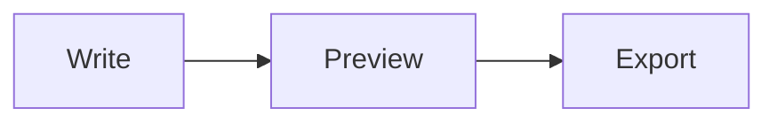
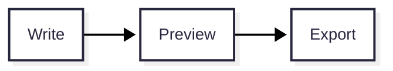
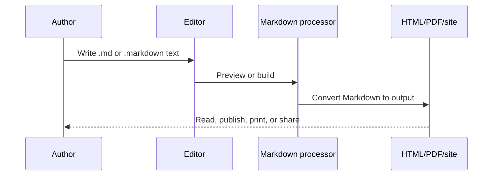
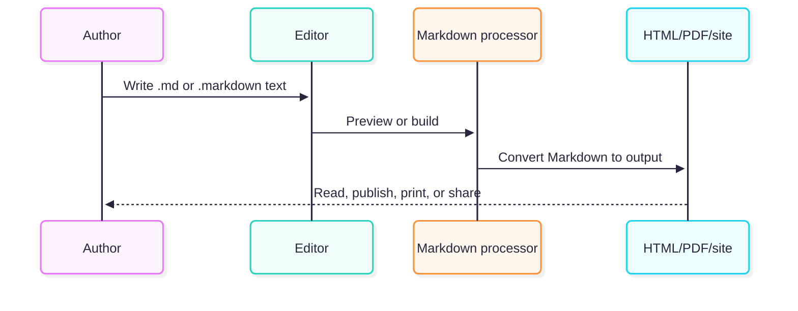
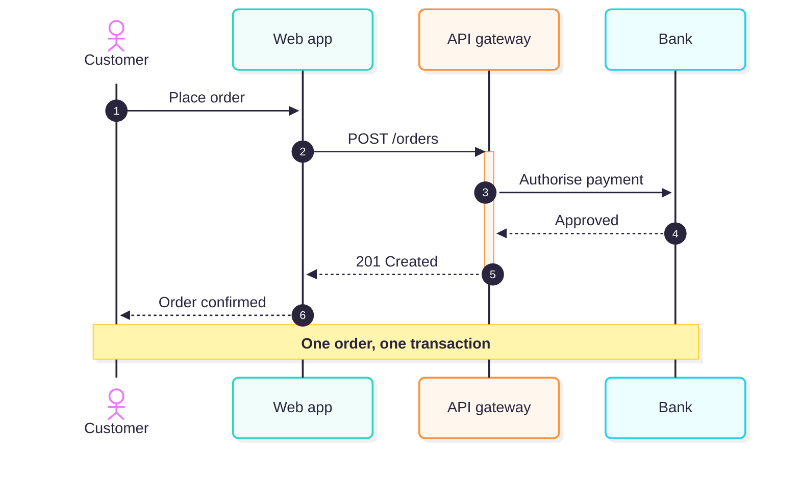
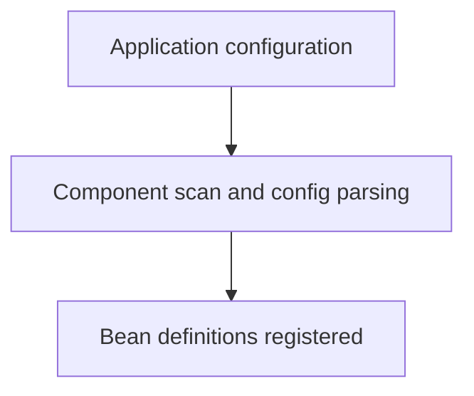

## Mermaid diagrams

Mermaid lets you create diagrams and visualizations using text and code.

It is a JavaScript based diagramming and charting tool that renders Markdown-inspired text definitions to create and modify diagrams dynamically.

<table>
  <tr>
    <th>Write Markdown</th>
    <th>Render preview</th>
  </tr>
<tr> <td>

````md

````

</td><td>


</td> </tr>
<tr> <td>

````md

````

</td><td>


</td> </tr>
  <tr> <td>
  
````md

````

</td><td>


</td> </tr>
  <tr> <td>
  
````md

````

</td><td>



</td> </tr>

</table>

Use diagrams for a process or relationship that is difficult to explain in prose. Keep labels short, check that the diagram remains readable on a narrow screen, and verify that the target platform enables Mermaid. GitHub's [diagram-creation documentation](https://docs.github.com/en/get-started/writing-on-github/working-with-advanced-formatting/creating-diagrams) lists supported diagram types and syntax.

## Keeping flowchart labels on one line

Mermaid wraps flowchart labels that are wider than `wrappingWidth` (default 200px), so a short label like "Application configuration" can split across two lines in a top-down flowchart. You can raise the limit for one diagram or for every diagram:

<table>
  <tr>
    <th>Per-diagram, via frontmatter</th>
    <th>Raise <code>wrappingWidth</code> globally (recommended)</th>
  </tr>

<tr><td>

````md

````

</td><td>

````js
mermaid.initialize({
  startOnLoad: false,
  securityLevel: 'strict',
  //theme: 'default', look: 'classic',
  theme: 'redux-color', look: 'neo',
  htmlLabels: false,
  flowchart: {
    theme: 'default', look: 'classic', layout: 'dagre', curve: 'linear',
    wrappingWidth: 400, // keeps labels like "Application configuration" on one line
  },
});
mermaid
````

</td></tr>

<tr><td>

````mermaid
---
config:
  flowchart:
    wrappingWidth: 400
---
flowchart TD
    A[Application configuration] --> B[Component scan and config parsing]
    B --> C[Bean definitions registered]
````

</td><td>

````mermaid
flowchart TD
    A[Application configuration] --> B[Component scan and config parsing]
    B --> C[Bean definitions registered]
````

</td></tr>

<tr><td>

**Why choose it:** The setting travels with the diagram, so it also works on GitHub and other tools that render Mermaid without CodeTrove's config. It only affects that one diagram, so every diagram that needs it has to repeat the block. It also needs a Mermaid version that supports frontmatter config.

</td><td>

**Why choose it:** You set it once in `MermaidDiagram.jsx` and every diagram benefits, with no extra lines in the Markdown. It applies only inside CodeTrove, so the same file may still wrap labels on other platforms. Hard-refresh after changing it, because the `mermaidInitialized` flag stops `initialize` from running again on hot reload.

</td></tr>
</table>

Use the global setting for CodeTrove's own rendering, and add frontmatter only to diagrams that must look the same on other platforms. If labels still wrap, increase `wrappingWidth`, since a larger font size needs a larger limit.

## External References and Tools

The following resources provide official documentation, syntax references, and tools for learning, creating, and working with Mermaid flowcharts:

- [Mermaid Tools](https://www.mermaid.tools/flowchart/) – An online tool for creating and experimenting with Mermaid flowcharts.
- [Mermaid Flowchart Syntax](https://mermaid.ai/open-source/syntax/flowchart.html) – Documentation covering Mermaid flowchart syntax, diagram elements, shapes, connections, and configuration options.